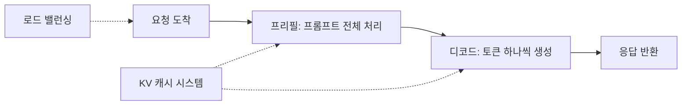

- DeepSeek이 자사 대규모 프로덕션 서비스를 돌린다는 추론 프레임워크 DeepInfer를 Apache 2.0으로 공개했다. 지원 모델은 DeepSeek-V4.1-Flash 하나다.
- 비동기 스케줄링, 배치 불변 추론, 결정적 샘플링, 구조화 출력 등 기능 목록은 화려하지만, KV 캐시 시스템과 로드 밸런싱은 이번 릴리스에서 빠져 있다.
- NVIDIA SM100과 Huawei Ascend 950을 둘 다 지원한다. 다만 몇몇 기능은 NVIDIA 전용이다.

## 스타 16.9k짜리 커밋 4개, 숫자는 어디서 왔나

먼저 의문부터 꺼내자. 모델 하나만 지원하는 추론 프레임워크가 왜 이렇게 시끄러운가. 이유는 세 가지로 보인다.

첫째, 만든 곳이 DeepSeek이다. 스타 16.9k, 포크 1.7k인데 커밋은 4개다. 코드 품질보다 출처가 만든 숫자다. 커밋 히스토리가 얇다는 건 내부 저장소를 스냅샷으로 떠서 올렸다는 뜻일 가능성이 높다. 내부에서 몇 년 굴린 코드의 이력을 통째로 공개하지 않았다는 얘기다. 다만 자료만으로는 확정할 수 없다.

둘째, Ascend 950 NPU 지원이다. HN 댓글에서도 "엔비디아 독점에 균열이 생길 수 있다"는 반응이 나왔다. 실제로 그럴지는 모르겠다. README의 요구사항이 CANN 9.2에 전용 requirements 파일까지 따로 있는 걸 보면 시늉 수준은 아니지만, 외부 팀이 Ascend 장비를 구해서 돌릴 수 있느냐는 별개 문제다. 코드가 두 플랫폼을 지원하는 것과 내 회사 랙에 그 장비가 있는 것은 다른 이야기다.

셋째, 댓글에 인용된 숫자다. 단일 클러스터 하루 155조 토큰, 카드당 시간당 매출 38달러라는 출처는 지후(Zhihu) 글이다. 이 레포 README에는 없다. 나는 검증하지 못했으니 "그렇다더라" 수준으로만 받아야 한다. 정치적 타이밍 음모론 댓글도 있는데, 근거 없는 추측이라 다루지 않는다.

## 추론 엔진이 실제로 하는 일과 README가 밝힌 부품들

README가 밝힌 것만 정리한다. 내부 구현까지는 자료에 없으니 추측하지 않는다. 그 전에 LLM 서빙이 뭘 하는 일인지 한 번 깔고 가자. 그래야 아래 기능 목록이 왜 기능인지 보인다.

요청 하나가 들어오면 엔진은 두 단계를 거친다. 먼저 프롬프트 전체를 한 번에 읽는 프리필(prefill)이고, 그다음 토큰을 하나씩 뽑아내는 디코드(decode)다. 프리필은 계산량이 많고, 디코드는 한 번에 한 토큰이라 같은 일을 수없이 반복한다. 이 둘의 성격이 달라서 프리필과 디코드를 따로 굴리는 분리 구성이 나온다. README의 "VE/Prefill/Decode disaggregation"이 이 얘기다. 이 글에서 프리필은 4장, 디코드는 64장으로 벤치마크를 쟀다는 문장이 나오는 것도 같은 맥락이다.

점선이 이번 릴리스에서 빠진 쪽이다. 이제 부품을 보자.

- 커널: FlashMLA, DeepGEMM, DeepEP, TileKernels, DeepSelect, 그리고 커스텀 TileLang 커널을 쓴다. 전부 GPU에서 실제 연산을 하는 저수준 코드 모음이다. 엔진이 아무리 영리해도 이 층이 느리면 소용없다.
- 병렬화: Attention DP / balanced CP, MoE는 EP + EPLB(전문가 병렬과 로드 밸런싱) 조합이다. MoE는 모델 안에 전문가 서브네트워크가 여러 개 있고 토큰마다 일부만 골라 쓰는 구조다. 전문가를 여러 장의 GPU에 나눠 얹은 게 EP이고, 토큰이 특정 전문가에 몰리면 그 GPU만 바빠진다. EPLB는 그 쏠림을 고르게 펴는 쪽이라고 이해하면 된다. 이 줄만으로 세부 방식까지는 알 수 없다.
- 비동기 스케줄링: CPU의 배치 스케줄링과 디바이스 실행을 겹친다. 기본 활성화다. 비유하자면 주방이 요리하는 동안 홀 직원이 다음 주문표를 미리 정리하는 식이다. 이게 없으면 GPU가 한 배치를 끝낼 때마다 CPU가 다음 배치를 짜느라 GPU가 놀게 된다. README는 이걸 "zero-overhead batch scheduler"라고 부른다.
- DSpark와 신뢰도 기반 검증: 드래프트 토큰으로 디코딩을 가속하고, 신뢰도 추정으로 검증 시점을 스케줄링한다. 디코드가 한 토큰씩이라 느리니, 앞 토큰 몇 개를 미리 추측해 두고 한꺼번에 맞는지 확인하는 투기적 디코딩 계열이다. DEEPINFER_ENABLE_MTP_VARLEN=1로 켜고, DEEPINFER_USE_NEXTN_DECODE가 최대 드래프트 길이(기본 5)를 정한다. DSpark의 정확한 알고리즘은 README에 없어서 설명하지 못한다.
- SWA bounded replay: 디코더 프리필 작업을 줄이려고 제한된 길이의 접미부만 재생한다. V4.1 기본값은 DEEPINFER_YOCO_PREFILL_TRUNCATION_MODE=compact, DEEPINFER_YOCO_PREFILL_KEEP_TOKENS=140이다. README는 남기는 접미부가 SWA 윈도우와 최대 백트래킹 길이를 덮어야 한다고 적었다. 즉 140이라는 값은 아무 숫자가 아니라 모델 구조에서 나온 하한이라는 뜻이다. 그래서 다른 값을 함부로 건드리면 안 된다.
- 구조화 출력: 정규식, JSON 스키마, EBNF 문법으로 생성을 제한한다. SamplingParams에 so_args로 schema_type과 schema를 넘기는 식이다. 에이전트가 JSON을 깨뜨려서 파이프라인이 죽는 경험이 있다면 이 기능이 왜 필요한지 설명은 필요 없다.

개인적으로 제일 실무적인 건 재현성 쪽이다. 배치 불변(batch-invariant) 추론이란 같은 요청이 다른 요청과 어떤 조합으로 묶여 처리되든 결과가 똑같다는 보장이다. 평범한 서빙에서는 부동소수점 연산 순서가 배치 구성에 따라 달라져서, 같은 프롬프트인데 옆에 누가 있었느냐로 출력이 미세하게 달라질 수 있다. DEEPINFER_BATCH_INVARIANT=1이면 배치 구성이 달라도 결과가 같다. 결정적 샘플링은 거기에 DEEPINFER_ENABLE_MTP_VARLEN=0을 더하고 SamplingParams에 고정 seq_seed를 넘기는 방식이다. 둘 다 NVIDIA 전용이다. 장애 재현이나 회귀 테스트에서 "같은 입력인데 왜 출력이 다르죠" 싸움을 끝내줄 수 있다. 성능 비용이 얼마인지는 자료에 없다.

## vLLM 위에서 태어난 물건을 vLLM과 같은 저울에 올릴 수 있나

README에 따르면 DeepInfer는 원래 vLLM 위에 주로 만들어졌고, SGLang과 TensorRT-LLM에서 영감을 받았다. 그러니 "vLLM 포크에서 출발해 DeepSeek 모델에 극단적으로 맞춘 물건"으로 읽는 게 안전하다. 다만 포크라고 명시한 건 아니고, 지금 코드가 vLLM에서 얼마나 멀어졌는지도 내가 확인하지 못했다.

범용성은 vLLM, SGLang이 훨씬 낫다. 모델 하나(V4.1-Flash)만 지원하는 프레임워크와 비교할 수준이 아니다. 새 모델이 나올 때마다 갈아탈 필요 없이 한 엔진으로 여러 모델을 돌리고 싶다면 선택지가 아니다. 반대로 이 모델을 쓴다면 모델 구조에 맞춘 커널과 기능이 이미 들어 있다는 게 장점이다. 범용 엔진이 여러 모델을 다 지원하려고 포기하는 최적화를, 모델을 하나로 못 박으면 할 수 있다는 논리다.

처리량이나 지연시간을 vLLM 등과 직접 비교한 수치는 자료에 없다. README에 벤치마크 항목은 있지만(프리필 4장, 디코드 64장의 SM100 GPU 기준, 각각 하나의 스케일업 도메인 안에서 측정), 그래프는 이미지로만 있고 구체적 숫자는 내가 확인하지 못했다. 그래서 "빠르다"는 말은 여기서 하지 않겠다. 재현용 스크립트(examples/sweep/run_sweep.sh)가 있다고만 적어 둔다.

## 엔진은 받았는데 서비스는 못 띄우는 이유

여기서 삽질하기 딱 좋다. 먼저 빠진 것들이 왜 큰 문제인지부터 풀겠다.

1. 오프라인 추론만 된다. README가 "완전한 추론 서비스에 필요하지만 이번에 포함되지 않은 것"으로 KV 캐시 시스템, VE/Prefill/Decode 분리, 프리필·디코드 DP 레플리카 간 로드 밸런싱을 명시했다. KV 캐시는 이미 처리한 토큰의 어텐션 계산 결과를 저장해 두는 곳이다. 이게 없으면 대화가 길어질 때마다, 혹은 같은 시스템 프롬프트가 붙은 요청마다 앞부분을 처음부터 다시 계산해야 한다. 로드 밸런싱이 없으면 레플리카 여러 개를 세워도 요청이 한쪽으로 쏠려서 장비 수만큼 처리량이 늘지 않는다. 즉 API 서버를 붙여 바로 서비스한다는 기대는 접어야 한다. 이 셋을 직접 만들거나 다른 걸로 대체해야 한다. 참고로 README는 분리 구성에 대해 "필요한 엔진 기능은 대부분 이미 구현돼 있다"고 덧붙였다. 나머지 둘이 더 빈 칸일 가능성이 크다.
2. 하드웨어 장벽이 높다. NVIDIA SM100(Blackwell 계열 표기로 보이지만 자료에는 명시가 없다)과 Ascend 950만 된다. 이전 세대 GPU로는 시도조차 어렵다고 보는 게 맞다.
3. 빌드 환경이 까다롭다. Linux, GCC 13 이상, Python 3.12, CUDA 13(또는 CANN 9.2)이 필요하다. 빈 가상환경에서 build.sh를 돌려야 하고, DEEPINFER_ACCELERATOR 환경변수(NVIDIA면 nvidia, Ascend면 ascend)를 빌드할 때만이 아니라 실행 환경에도 유지해야 한다. 이거 빼먹으면 이상한 에러를 만난다. 체크포인트 deepseek-ai/DeepSeek-V4.1-Flash-1017은 첫 실행 때 Hugging Face 캐시로 내려받고, 로컬 사본을 쓰려면 DEEPINFER_HF_MODEL_DIR을 지정한다. 첫 실행이 느린 게 고장은 아니라는 뜻이다.
4. 환경변수 기능이 많다. 기능 플래그 상호작용(예: 결정적 샘플링은 MTP_VARLEN을 꺼야 함)이 문서 한 줄에 묻혀 있다. 값을 잘못 조합하면 조용히 비결정적이 될 가능성이 있다. 에러 없이 틀리는 설정이 제일 오래 걸리는 디버깅이다. 게다가 투기적 디코딩은 MTP_VARLEN=1이 필요하고 결정적 샘플링은 0이 필요하니, 속도와 재현성 중 하나를 골라야 하는 구조로 읽힌다.
5. 성숙도를 알 수 없다. 커밋 4개라 이슈 대응이나 릴리스 규칙이 어떨지는 아직 모른다.

엔진 본체는 공개됐고 서빙에 필요한 바퀴 몇 개는 빠진 상태다. 연구용이나 구조 학습용으로는 보물이지만, 당장 프로덕션에 올리려면 빠진 부분부터 직접 만들 각오를 해야 한다.

---

*원문: [DeepInfer: High-performance inference framework for DeepSeek models](https://github.com/deepseek-ai/DeepInfer) (via hn)*
