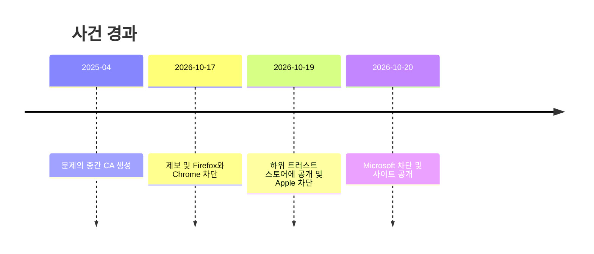
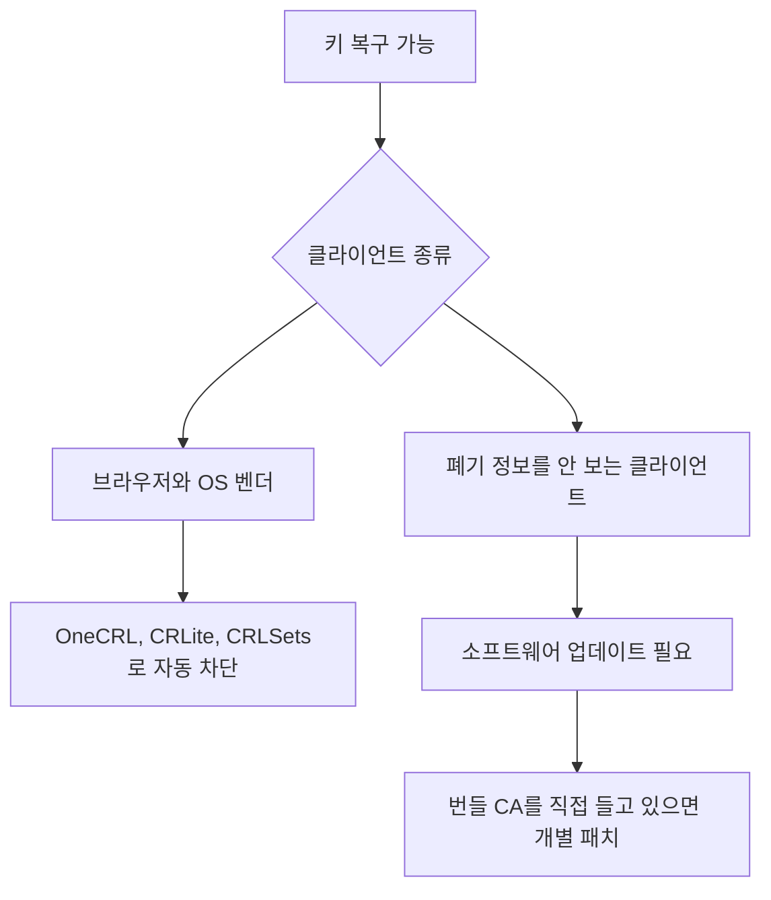

eMudhra 중간 CA 8개의 개인키가 털렸다. 정확히는 털린 게 아니라, 발급한 쪽이 키를 잘못 만들어서 인증서만 보면 누구나 복구할 수 있는 상태였다.

> 키 생성 스크립트 버그라서 인증서 공개키만 있으면 개인키가 나온다. 해킹이 아니라 제조 불량이다.
> 브라우저와 OS는 몇 시간 만에 막았는데, curl, git, pip, 임베디드 CA 번들을 쓰는 쪽은 패치가 올 때까지 뚫려 있다.
> 이 사건의 본질은 CA 한 곳의 실수보다 폐기(revocation) 인프라에 투자한 쪽과 안 한 쪽의 격차다.

## 키가 "털렸다"는 표현부터 틀렸다

공식 설명은 이렇다. CA가 개인키를 잘못 생성했고, 그래서 인증서에서 누구나 키를 복구할 수 있다. 침투도 유출도 아니다.

HN 댓글에는 8개 키가 전부 1바이트짜리 값이고 그중 하나는 말 그대로 "4"라는 주장이 있다. 공식 자료에서 확인한 내용이 아니라 댓글 주장이다. 사실이라면 "compromised"라는 단어가 너무 점잖다.

eMudhra가 Mozilla 버그 트래커에 남긴 설명에 따르면 ECC 발급용 키를 만든 KGC 스크립트에 결함이 있었다. 키를 export 하려고 wrap/unwrap 테스트를 끼운 승인된 예외 절차가 있었고, 코드 결함이 그 지점에서 문제를 만든 것으로 읽힌다. 인용된 부분이 중간에 잘려 있어서 나머지 원인은 모른다.

증명 방식은 깔끔하다. 제보자 Wayne이 8개 키로 각각 "We have a problem here"에 서명해서 root program에 보냈다. 서명이 검증되면 그걸로 끝이다. 논쟁할 여지가 없다.

## 며칠 만에 끝난 대응, 그리고 안 끝난 대응

읽는 법: 키가 약한 상태는 2025년 4월부터 있었고, 발견부터 4대 브라우저와 OS 차단까지는 사흘이다.

속도는 인상적이다. 다만 이건 대응이 잘돼서가 아니라 배포 채널이 이미 있어서 가능했다. Mozilla 댓글에 따르면 Firefox는 OneCRL로 몇 시간 만에, 업데이트 없이 처리했다. Chrome은 CRLSets, Apple과 Microsoft도 비슷한 도구를 쓴다.

CA 쪽도 해당 중간 인증서를 폐기했다. 문제는 폐기 정보를 안 보는 클라이언트다.

## 누가 안전하고 누가 아닌가

읽는 법: 갈림길은 "폐기 정보를 소비하느냐"이고, 안 하는 쪽은 업데이트가 유일한 방어다.

자료에서 가장 중요한 문장이 이거다. 많은 클라이언트가 폐기 정보를 쓰지 않고 업데이트로만 신뢰를 끊을 수 있다. 서버 쪽에서 아무리 폐기해도 의미가 없다.

<svg viewBox="0 0 680 220" xmlns="http://www.w3.org/2000/svg">
  <rect x="20" y="30" width="290" height="150" rx="8" fill="none" stroke="#4ade80" stroke-width="2"/>
  <text x="165" y="60" text-anchor="middle" fill="#888" font-size="16">폐기 채널이 있는 쪽</text>
  <text x="165" y="95" text-anchor="middle" fill="#888" font-size="14">Firefox, Chrome</text>
  <text x="165" y="120" text-anchor="middle" fill="#888" font-size="14">Apple, Microsoft</text>
  <text x="165" y="155" text-anchor="middle" fill="#4ade80" font-size="14">서버 푸시로 수 시간</text>
  <rect x="370" y="30" width="290" height="150" rx="8" fill="none" stroke="#fb923c" stroke-width="2"/>
  <text x="515" y="60" text-anchor="middle" fill="#888" font-size="16">패키지 업데이트에 의존하는 쪽</text>
  <text x="515" y="95" text-anchor="middle" fill="#888" font-size="14">curl, git, pip, 언어 런타임</text>
  <text x="515" y="120" text-anchor="middle" fill="#888" font-size="14">자체 CA 번들을 든 앱</text>
  <text x="515" y="155" text-anchor="middle" fill="#fb923c" font-size="14">배포판 패치를 기다림</text>
  <path d="M310 105 L370 105" stroke="#60a5fa" stroke-width="2"/>
  <text x="340" y="195" text-anchor="middle" fill="#888" font-size="12">격차</text>
</svg>

읽는 법: 왼쪽은 중앙에서 밀어 넣을 수 있고, 오른쪽은 각자 패키지를 올려야 한다. 수치 아닌 개념도.

## 현업에서 진짜 터지는 곳

CT(Certificate Transparency) 로그에 해당 기간 항목이 없었다. 그래서 CT를 강제하는 Firefox, Chrome, Edge, Safari는 이 키로 공격받을 수 없었다고 자료는 말한다. 반대로 CT를 강제하지 않는 클라이언트는 실제 공격 여부를 모른다. 자료도 "모른다"고 쓴다. 나도 모른다.

서버 간 통신, 사내 CLI, 컨테이너 베이스 이미지, 임베디드 기기가 위험 구간이다. 이쪽은 브라우저가 아니라서 CT도 폐기도 안 본다.

댓글에서 나온 지적도 맞다. 소프트웨어마다 자체 CA 번들을 vendoring 해서 들고 있다. 시스템 번들은 한 번에 고치지만, 바이너리에 박힌 CA는 하나씩 재빌드해야 한다. 이건 몇 달 갈 수 있다.

macOS 쪽은 더 웃기다. 자료에 따르면 OS는 막았는데 내장 curl, git, python3, perl, ruby, openssl은 폐기 확인 없이 /etc/ssl/cert.pem을 보고, 그 파일은 갱신되지 않았다. 내장 pip는 자기 사본을 따로 쓴다. 그래서 파일을 직접 편집하라는 우회법이 나왔다.

## 내 환경에서 뭘 확인해야 하나

| 확인 대상 | 자료상 상태 |
|---|---|
| 데비안/우분투 ca-certificates | 패치 버전 있음 |
| Alpine, Arch, Fedora, Gentoo | 패치 버전 있음 |
| FreeBSD ca_root_nss | pending |
| Bun | pending |
| Go, Node.js, Rust rustls-webpki | 패치 버전 있음 |
| Python certifi, pip, uv | 패치 버전 있음 |
| macOS 내장 curl, git, python3 | 수동 우회 필요 |

읽는 법: 대부분 패치가 나왔고, FreeBSD ca_root_nss와 Bun만 pending이다.

가장 빠른 점검은 자료가 제공하는 테스트 호스트에 curl을 날려 보는 거다. 인증서 에러가 나면 안전한 쪽이다. 에러 없이 붙으면 그 클라이언트는 문제의 중간 CA를 아직 신뢰한다.

우회법으로 루트 CA 자체를 distrust 하는 방법도 나와 있다. 대상 루트는 AAA Certificate Services와 emSign ECC Root CA - G3다. 다만 자료는 일반 사용자에게는 권장하지 않는다고 못 박는다. 루트를 통째로 빼면 그 루트 아래 정상 사이트도 같이 죽는다.

## 한줄평

폐기 인프라에 안 쓴 돈은 결국 이런 날 한꺼번에 청구된다.

---

*원문: [eMudhra intermediate CA compromise](https://emudhra.we-have-a-problem.com/) (via hn)*
