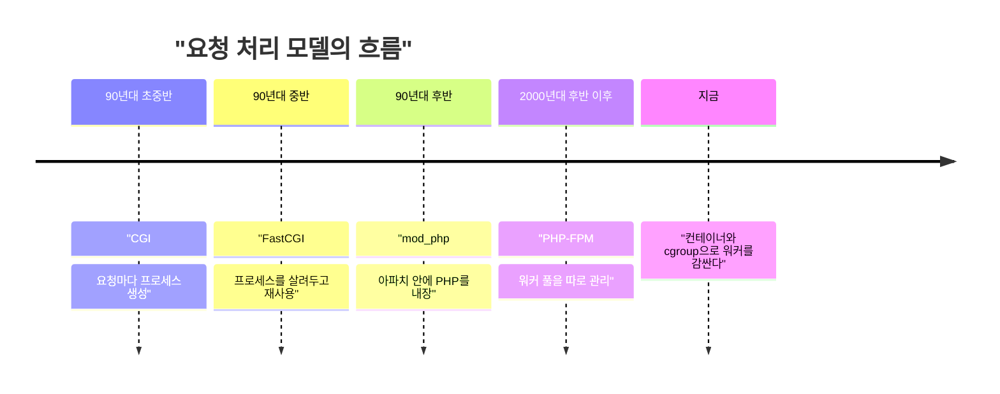

PHP가 인증 없는 RCE 2건을 고쳤고, 둘 다 원인이 "요청 처리하다 남은 찌꺼기 상태"다. 이런 버그가 가능한 이유는 워커가 요청을 끝내고도 안 죽기 때문이고, 옛날엔 그럴 필요가 없었다.

메모리가 구체적으로 어떻게 망가지는지는 이 글에서 다루지 않는다. 그건 같은 사건을 다룬 다른 글(free-php-uaf)에서 봤고, 여기서는 한 발 물러서서 "왜 그런 찌꺼기가 살아남을 수 있는 구조가 됐나"만 본다. 버그의 원인이 아니라 버그가 놓인 자리, 즉 프로세스 모델 얘기다.

> 90년대 초중반 CGI는 요청 하나당 프로세스 하나를 띄우고 끝나면 죽였다. 상태가 남을 자리가 애초에 없었다.
> 느리다는 이유로 mod_php, FastCGI, PHP-FPM처럼 프로세스를 살려두는 쪽으로 갔고, 그 대가로 요청 간 상태 오염이라는 새 문제가 생겼다.
> 이번 CVE 중 하나(오래된 전역 상태)는 "같은 워커가 다음 요청을 받는다"는 구조 때문에 생기는 병이다.

## 웹서버가 코드를 못 돌리던 시절

초기 웹서버는 파일을 읽어서 그대로 돌려주는 물건이었다. 동적인 페이지는 방법이 없었다.

그래서 나온 게 CGI다. 요청이 오면 서버가 외부 프로그램을 실행하고, 요청 정보는 환경변수와 표준입력으로 넘기고, 표준출력으로 나온 걸 응답으로 보낸다. 규약은 이게 전부다.

PHP도 90년대 중반에 이런 CGI 프로그램 모음으로 시작했다. 그때 개발자는 "언어"가 아니라 "프로세스 실행 규약"을 쓰고 있었다.

비유하자면 이렇다. 식당에 주문이 들어올 때마다 요리사를 새로 고용하고, 요리 하나 내보내면 바로 해고하는 구조다. 비효율적으로 들리지만 장점이 하나 확실하다. 요리사가 이전 손님의 주문서를 들고 있을 수가 없다. 조리대도, 머릿속도 매번 비어 있다. CGI가 정확히 이 모델이다. 웹서버는 요청을 받으면 프로그램을 실행하고, 프로그램이 끝나면 운영체제가 그 프로세스의 메모리와 열린 파일을 전부 회수한다. 정리 코드를 잘 짰는지 아닌지는 상관없다. 청소를 운영체제가 대신 해주기 때문이다.

"그럼 규약이 왜 하필 환경변수와 표준입출력이었나"가 궁금할 수 있다. 이유는 단순하다. 어떤 언어로 짠 프로그램이든 환경변수 읽기와 표준출력 쓰기는 할 수 있다. 서버와 프로그램 사이에 언어 종속적인 약속이 필요 없었다. 덕분에 셸 스크립트, C, Perl, PHP가 같은 규약 위에서 돌았다.

## 그때 방식으로 직접 만들어 보기

Python 3 표준 라이브러리만으로 CGI 서버를 만들면 이 정도다. 요청마다 스크립트를 새 프로세스로 띄운다.

```python
# server.py (Python 3.x, 표준 라이브러리만)
import socket, subprocess, sys
srv = socket.socket()
srv.setsockopt(socket.SOL_SOCKET, socket.SO_REUSEADDR, 1)
srv.bind(("127.0.0.1", 8080)); srv.listen(5)
while True:
    conn, _ = srv.accept()
    data = conn.recv(65536).decode("latin-1")
    line = data.split("\r\n", 1)[0]
    method, target, _ = line.split(" ", 2)
    path, _, query = target.partition("?")
    body = data.split("\r\n\r\n", 1)[1] if "\r\n\r\n" in data else ""
    env = {"REQUEST_METHOD": method, "QUERY_STRING": query,
           "SCRIPT_NAME": path, "CONTENT_LENGTH": str(len(body))}
    out = subprocess.run([sys.executable, "hello.py"], input=body.encode(),
                         env=env, capture_output=True).stdout
    conn.sendall(b"HTTP/1.1 200 OK\r\nConnection: close\r\n" + out)
    conn.close()
```

```python
# hello.py (CGI 스크립트)
import os
print("Content-Type: text/plain\r\n\r\nquery=" + os.environ["QUERY_STRING"])
```

`curl "localhost:8080/?a=1"` 하면 `query=a=1`이 나온다. 읽는 법: 서버가 요청을 파싱해서 환경변수에 담고, 스크립트는 그걸 읽어 출력만 한다.

코드에서 봐둘 곳은 `subprocess.run` 한 줄이다. 요청 하나가 들어올 때마다 이 줄이 새 파이썬 프로세스를 만들고, 스크립트가 출력을 끝내면 그 프로세스는 사라진다. 스크립트가 전역 변수에 뭘 담아놨든 다음 요청에는 아무것도 넘어가지 않는다. 루프 안에서 매번 "새 프로세스 → 실행 → 소멸"이 돌 뿐이다. 장난감이라 동시 요청 처리나 보안 처리는 없지만, 요청 간 격리가 어디서 나오는지 보여주기엔 충분하다.

여기서 아픈 지점.

- 요청마다 인터프리터를 새로 띄운다. 설정 읽고 모듈 올리는 비용을 매번 낸다.
- DB 연결도 매번 새로 맺는다. 요청 수가 늘면 서버가 프로세스 생성에 시간을 다 쓴다.
- 대신 요청 간 오염은 없다. 이 장점은 불편함에 가려져서 아무도 신경 안 썼다.

세 번째 항목이 이 글의 핵심이다. 격리는 공짜로 따라오는 성질이었기 때문에 당시엔 장점으로 인식조차 안 됐다. 사람들이 체감한 건 느림뿐이었고, 그래서 느림을 고치는 방향으로만 설계가 진화했다. 고치는 과정에서 뭘 내놓고 있는지는 아무도 계산하지 않았다. 계산할 필요가 없었으니까.

## 느려서 살려두기 시작했다

흐름만 먼저 본다. 개념도(실제 수치 아님)가 아니라 순서만 보여주는 타임라인이다. 이 글의 연도 표기는 대략적인 시기이고, 정확한 출시 연도는 확인하지 않았다.



단계별로 보면 이렇다.

1단계, CGI. 불편은 프로세스 생성 비용이었다. 해법은 FastCGI로, 프로세스를 띄워 놓고 요청을 소켓으로 받는 방식이다. 새로 생긴 문제는 프로세스가 오래 살아서 요청 사이에 뭔가 남을 수 있다는 점이다.

비유로 돌아가면, 요리사를 해고하지 않고 계속 고용해 두는 것이다. 주문마다 면접 보는 시간이 사라지니 빠르다. 대신 요리사가 이전 주문의 도마와 재료를 치우는 일이 이제 요리사 본인 책임이 된다. 운영체제가 해주던 청소가 애플리케이션 코드의 몫으로 넘어온 것이다. "그냥 깔끔하게 치우면 되지 않나"라는 반문이 나오는데, 맞는 말이고 대부분은 치운다. 문제는 정상 경로가 아니라 중간에 무너진 경로다. 주문 도중 재료가 떨어졌을 때(메모리 부족), 요리사가 치우기 절차를 끝까지 밟는가. 이번 CVE 하나가 바로 그 지점이다.

2단계, mod_php. 불편은 서버와 인터프리터 사이의 통신이었다. 해법은 아파치 프로세스 안에 PHP를 넣는 것이다. 빠르고 설정이 쉬워서 공유 호스팅 시대를 먹었다. 새로 생긴 문제는 웹서버와 PHP가 한 몸이라 PHP가 터지면 서버 전체가 영향권이라는 점이다. 이번 권고에서도 mod_php 위험도가 가장 높다고 한 이유가 이것이다.

한 몸이라는 말이 구체적으로 뭔지 풀어두면, 웹서버의 워커 프로세스가 곧 PHP 실행기라는 뜻이다. 그 프로세스가 장악되면 공격자는 웹서버가 가진 권한과 같은 프로세스에 올라와 있는 다른 것들까지 손에 넣는다. 서버와 인터프리터 사이에 프로세스 경계라는 벽이 없다. 빠르고 편했던 이유와 위험한 이유가 같은 곳에서 나온다.

3단계, PHP-FPM. 불편은 웹서버와 PHP의 결합이었다. 해법은 PHP 워커 풀을 별도 프로세스로 빼고, nginx 같은 서버는 앞에서 프록시만 하는 구조다. 풀별로 설정과 권한을 나눌 수 있다. 새로 생긴 문제는 워커가 여전히 여러 요청을 연달아 처리한다는 점이다.

여기서 "FPM이 격리를 개선했다면서 왜 이번 버그를 못 막았나"라는 의문이 생긴다. FPM이 개선한 건 PHP와 웹서버 사이, 그리고 풀과 풀 사이의 경계다. 한 사이트의 워커가 다른 사이트의 워커와 섞이지 않게 해준다. 하지만 한 워커 안에서 요청 1과 요청 2 사이에는 여전히 벽이 없다. 경계를 하나 더 그은 것이지, 요청 단위의 경계를 되살린 게 아니다. 이번 취약점은 후자의 부재에서 나온다.

## 지금: 찌꺼기는 어디서 오나

아래는 구조 비교다. 읽는 법: 위는 요청마다 새로 시작하는 CGI, 아래는 같은 워커가 요청을 이어 받는 FPM이다. 오른쪽 점선 영역이 오염 가능 구간이다.

<svg viewBox="0 0 640 220" xmlns="http://www.w3.org/2000/svg">
<text x="20" y="22" font-size="13" fill="#7a6a58">CGI: 요청마다 새 프로세스</text>
<rect x="20" y="34" width="120" height="36" rx="4" fill="none" stroke="#c9a37a"/>
<text x="38" y="57" font-size="12" fill="#7a6a58">요청 1 시작</text>
<rect x="160" y="34" width="120" height="36" rx="4" fill="none" stroke="#c9a37a"/>
<text x="188" y="57" font-size="12" fill="#7a6a58">종료, 소멸</text>
<rect x="320" y="34" width="120" height="36" rx="4" fill="none" stroke="#c9a37a"/>
<text x="338" y="57" font-size="12" fill="#7a6a58">요청 2 시작</text>
<text x="460" y="57" font-size="12" fill="#6b4f3a">깨끗한 상태에서 출발</text>
<text x="20" y="116" font-size="13" fill="#7a6a58">FPM / mod_php: 워커 재사용</text>
<rect x="20" y="128" width="120" height="36" rx="4" fill="none" stroke="#a8683a"/>
<text x="38" y="151" font-size="12" fill="#7a6a58">요청 1 처리</text>
<rect x="160" y="128" width="120" height="36" rx="4" fill="none" stroke="#a8683a"/>
<text x="178" y="151" font-size="12" fill="#7a6a58">정리 (cleanup)</text>
<rect x="320" y="128" width="120" height="36" rx="4" fill="none" stroke="#a8683a"/>
<text x="338" y="151" font-size="12" fill="#7a6a58">요청 2 처리</text>
<rect x="150" y="174" width="300" height="30" rx="4" fill="none" stroke="#d9b98c" stroke-dasharray="5 4"/>
<text x="168" y="193" font-size="12" fill="#a8683a">정리가 덜 되면 찌꺼기가 요청 2로 넘어감</text>
</svg>

이번 취약점 두 개가 이 구조에 정확히 들어맞는다. 두 건이 같은 부류라는 점이 중요하다. 하나는 "청소가 중간에 끊긴 경우", 다른 하나는 "청소가 끝났는데 뭔가 남은 경우"로, 둘 다 요청의 끝과 다음 요청의 시작 사이 틈에서 생긴다. CGI에서는 그 틈이 프로세스 종료라는 한 번의 확실한 사건이었다. 재사용 모델에서는 그 틈이 애플리케이션이 직접 관리해야 하는 구간이 됐다.

- CVE-2026-109618은 메모리가 부족해 요청 데이터 초기화가 중간에 끊긴 뒤, 정리 단계가 반쯤 만들어진 데이터를 멀쩡한 것으로 취급하는 경우다. 에러 경로의 정리 코드가 문제인 전형이다. 정상 경로는 테스트가 많이 돌아서 튼튼하지만, 메모리 부족처럼 드물게 타는 에러 경로는 검증이 덜 되기 마련이다. 그리고 공격자는 일부러 그 드문 경로를 밟을 수 있다. 요청을 조작해서 메모리를 압박하면 되기 때문이다. 이것도 프로세스가 매번 죽는 모델이었다면 반쯤 만들어진 데이터가 어디로 가지 않고 그대로 사라졌을 것이다.
- CVE-2026-109619는 요청 상태가 메모리 해제 후에도 남고, 같은 워커의 다음 요청이 정상 초기화로 덮어쓰기 전에 그걸 쓰는 경우다. 워커를 재사용하지 않았다면 존재할 수 없는 버그다. 순서를 풀어 쓰면 이렇다. 요청 1이 끝나며 메모리를 해제했는데 상태를 가리키는 값은 그대로 남는다. 같은 워커가 요청 2를 받는다. 요청 2가 자기 상태를 정상적으로 초기화하기 전, 그 짧은 틈에 남아 있던 값이 쓰인다. 프로세스가 죽었다면 남아 있던 값이라는 개념 자체가 없다.

그렇다고 CGI로 돌아가자는 얘기는 아니다. 요청마다 프로세스를 띄우는 비용은 여전히 크고, 그 비용을 피하려고 지금 구조가 나왔다. 세대별로 정리하면 이렇다.

| 시대 | 방식 | 장점 | 한계 |
|---|---|---|---|
| CGI | 요청마다 프로세스 | 상태 격리가 완벽함 | 생성 비용이 큼 |
| FastCGI | 프로세스 재사용 | 빠름 | 요청 간 상태 오염 가능 |
| mod_php | 웹서버에 내장 | 설정이 쉽고 빠름 | 서버와 운명 공동체 |
| PHP-FPM | 별도 워커 풀 | 풀별 격리, 운영 편의 | 워커 재사용 문제는 그대로 |

선택지는 현실적으로 이렇다. 업데이트가 정답이다. 공지에도 메모리 제한 조정이나 기능 끄기는 특정 공격 경로만 줄이는 완화일 뿐이라고 되어 있다. 완화가 근본 대책이 못 되는 이유는 위에서 본 대로 버그가 특정 기능이 아니라 "재사용되는 워커"라는 구조에 걸쳐 있기 때문이다. 기능 하나를 끄면 한 경로가 닫힐 뿐, 같은 틈을 다른 경로로 밟을 가능성은 남는다.

업데이트 전까지는 컨테이너나 cgroup으로 워커를 감싸고, 영향받은 워커만 죽이는 정책을 쓰는 게 그나마 CGI의 "죽으면 깨끗하다"는 성질을 흉내 낸 방어다. 워커를 주기적으로 재시작하거나 이상 징후가 보인 워커를 폐기하면 찌꺼기의 수명이 짧아진다. 다만 이건 피해 범위를 줄이는 방어일 뿐, 이미 장악된 워커 안에서 벌어지는 일을 막지는 못한다.

남는 한계도 있다. 공식 Docker 이미지와 Ubuntu 패키지가 늦어서 패치를 못 쓰는 시간이 생겼다. 8.1 이하는 정규 지원이 끝났고 8.2도 2026년 12월 31일에 끝난다. 코드 고치는 것보다 배포 파이프라인이 먼저 막힌다. 패치가 나왔어도 내 환경에 들어오는 이미지와 패키지가 따라오지 못하면 그동안은 취약한 채로 운영해야 한다. 지원이 끝난 버전을 쓰는 쪽은 사정이 더 나쁘다. 패치를 기다릴 대상조차 없다.

성능 때문에 버린 "요청마다 죽는다"는 성질을, 우리는 지금 컨테이너로 비싸게 다시 사 오고 있다.

---

*원문: [PHP 8.5.12, 8.4.27, 8.3.36, 8.2.35 출시, 치명적 원격 코드 실행 취약점 수정](https://news.hada.io/topic?id=35759) (via geeknews)*
