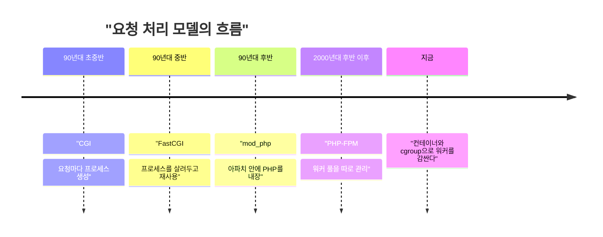

PHP가 인증 없는 RCE 2건을 고쳤고, 둘 다 원인이 "요청 처리하다 남은 찌꺼기 상태"다. 이런 버그가 가능한 이유는 워커가 요청을 끝내고도 안 죽기 때문이고, 옛날엔 그럴 필요가 없었다.

> 90년대 초중반 CGI는 요청 하나당 프로세스 하나를 띄우고 끝나면 죽였다. 상태가 남을 자리가 애초에 없었다.
> 느리다는 이유로 mod_php, FastCGI, PHP-FPM처럼 프로세스를 살려두는 쪽으로 갔고, 그 대가로 요청 간 상태 오염이라는 새 문제가 생겼다.
> 이번 CVE 중 하나(오래된 전역 상태)는 "같은 워커가 다음 요청을 받는다"는 구조 때문에 생기는 병이다.

## 웹서버가 코드를 못 돌리던 시절

초기 웹서버는 파일을 읽어서 그대로 돌려주는 물건이었다. 동적인 페이지는 방법이 없었다.

그래서 나온 게 CGI다. 요청이 오면 서버가 외부 프로그램을 실행하고, 요청 정보는 환경변수와 표준입력으로 넘기고, 표준출력으로 나온 걸 응답으로 보낸다. 규약은 이게 전부다.

PHP도 90년대 중반에 이런 CGI 프로그램 모음으로 시작했다. 그때 개발자는 "언어"가 아니라 "프로세스 실행 규약"을 쓰고 있었다.

## 그때 방식으로 직접 만들어 보기

Python 3 표준 라이브러리만으로 CGI 서버를 만들면 이 정도다. 요청마다 스크립트를 새 프로세스로 띄운다.

```python
# server.py (Python 3.x, 표준 라이브러리만)
import socket, subprocess, sys
srv = socket.socket()
srv.setsockopt(socket.SOL_SOCKET, socket.SO_REUSEADDR, 1)
srv.bind(("127.0.0.1", 8080)); srv.listen(5)
while True:
    conn, _ = srv.accept()
    data = conn.recv(65536).decode("latin-1")
    line = data.split("\r\n", 1)[0]
    method, target, _ = line.split(" ", 2)
    path, _, query = target.partition("?")
    body = data.split("\r\n\r\n", 1)[1] if "\r\n\r\n" in data else ""
    env = {"REQUEST_METHOD": method, "QUERY_STRING": query,
           "SCRIPT_NAME": path, "CONTENT_LENGTH": str(len(body))}
    out = subprocess.run([sys.executable, "hello.py"], input=body.encode(),
                         env=env, capture_output=True).stdout
    conn.sendall(b"HTTP/1.1 200 OK\r\nConnection: close\r\n" + out)
    conn.close()
```

```python
# hello.py (CGI 스크립트)
import os
print("Content-Type: text/plain\r\n\r\nquery=" + os.environ["QUERY_STRING"])
```

`curl "localhost:8080/?a=1"` 하면 `query=a=1`이 나온다. 읽는 법: 서버가 요청을 파싱해서 환경변수에 담고, 스크립트는 그걸 읽어 출력만 한다.

여기서 아픈 지점.

- 요청마다 인터프리터를 새로 띄운다. 설정 읽고 모듈 올리는 비용을 매번 낸다.
- DB 연결도 매번 새로 맺는다. 요청 수가 늘면 서버가 프로세스 생성에 시간을 다 쓴다.
- 대신 요청 간 오염은 없다. 이 장점은 불편함에 가려져서 아무도 신경 안 썼다.

## 느려서 살려두기 시작했다

흐름만 먼저 본다. 개념도(실제 수치 아님)가 아니라 순서만 보여주는 타임라인이다.



단계별로 보면 이렇다.

1단계, CGI. 불편은 프로세스 생성 비용이었다. 해법은 FastCGI로, 프로세스를 띄워 놓고 요청을 소켓으로 받는 방식이다. 새로 생긴 문제는 프로세스가 오래 살아서 요청 사이에 뭔가 남을 수 있다는 점이다.

2단계, mod_php. 불편은 서버와 인터프리터 사이의 통신이었다. 해법은 아파치 프로세스 안에 PHP를 넣는 것이다. 빠르고 설정이 쉬워서 공유 호스팅 시대를 먹었다. 새로 생긴 문제는 웹서버와 PHP가 한 몸이라 PHP가 터지면 서버 전체가 영향권이라는 점이다. 이번 권고에서도 mod_php 위험도가 가장 높다고 한 이유가 이것이다.

3단계, PHP-FPM. 불편은 웹서버와 PHP의 결합이었다. 해법은 PHP 워커 풀을 별도 프로세스로 빼고, nginx 같은 서버는 앞에서 프록시만 하는 구조다. 풀별로 설정과 권한을 나눌 수 있다. 새로 생긴 문제는 워커가 여전히 여러 요청을 연달아 처리한다는 점이다.

## 지금: 찌꺼기는 어디서 오나

아래는 구조 비교다. 읽는 법: 위는 요청마다 새로 시작하는 CGI, 아래는 같은 워커가 요청을 이어 받는 FPM이다. 오른쪽 점선 영역이 오염 가능 구간이다.

<svg viewBox="0 0 640 220" xmlns="http://www.w3.org/2000/svg">
<text x="20" y="22" font-size="13" fill="#7a6a58">CGI: 요청마다 새 프로세스</text>
<rect x="20" y="34" width="120" height="36" rx="4" fill="none" stroke="#c9a37a"/>
<text x="38" y="57" font-size="12" fill="#7a6a58">요청 1 시작</text>
<rect x="160" y="34" width="120" height="36" rx="4" fill="none" stroke="#c9a37a"/>
<text x="188" y="57" font-size="12" fill="#7a6a58">종료, 소멸</text>
<rect x="320" y="34" width="120" height="36" rx="4" fill="none" stroke="#c9a37a"/>
<text x="338" y="57" font-size="12" fill="#7a6a58">요청 2 시작</text>
<text x="460" y="57" font-size="12" fill="#6b4f3a">깨끗한 상태에서 출발</text>
<text x="20" y="116" font-size="13" fill="#7a6a58">FPM / mod_php: 워커 재사용</text>
<rect x="20" y="128" width="120" height="36" rx="4" fill="none" stroke="#a8683a"/>
<text x="38" y="151" font-size="12" fill="#7a6a58">요청 1 처리</text>
<rect x="160" y="128" width="120" height="36" rx="4" fill="none" stroke="#a8683a"/>
<text x="178" y="151" font-size="12" fill="#7a6a58">정리 (cleanup)</text>
<rect x="320" y="128" width="120" height="36" rx="4" fill="none" stroke="#a8683a"/>
<text x="338" y="151" font-size="12" fill="#7a6a58">요청 2 처리</text>
<rect x="150" y="174" width="300" height="30" rx="4" fill="none" stroke="#d9b98c" stroke-dasharray="5 4"/>
<text x="168" y="193" font-size="12" fill="#a8683a">정리가 덜 되면 찌꺼기가 요청 2로 넘어감</text>
</svg>

이번 취약점 두 개가 이 구조에 정확히 들어맞는다.

- CVE-2026-109618은 메모리가 부족해 요청 데이터 초기화가 중간에 끊긴 뒤, 정리 단계가 반쯤 만들어진 데이터를 멀쩡한 것으로 취급하는 경우다. 에러 경로의 정리 코드가 문제인 전형이다.
- CVE-2026-109619는 요청 상태가 메모리 해제 후에도 남고, 같은 워커의 다음 요청이 정상 초기화로 덮어쓰기 전에 그걸 쓰는 경우다. 워커를 재사용하지 않았다면 존재할 수 없는 버그다.

그렇다고 CGI로 돌아가자는 얘기는 아니다. 세대별로 정리하면 이렇다.

| 시대 | 방식 | 장점 | 한계 |
|---|---|---|---|
| CGI | 요청마다 프로세스 | 상태 격리가 완벽함 | 생성 비용이 큼 |
| FastCGI | 프로세스 재사용 | 빠름 | 요청 간 상태 오염 가능 |
| mod_php | 웹서버에 내장 | 설정이 쉽고 빠름 | 서버와 운명 공동체 |
| PHP-FPM | 별도 워커 풀 | 풀별 격리, 운영 편의 | 워커 재사용 문제는 그대로 |

선택지는 현실적으로 이렇다. 업데이트가 정답이다. 공지에도 메모리 제한 조정이나 기능 끄기는 특정 공격 경로만 줄이는 완화일 뿐이라고 되어 있다. 업데이트 전까지는 컨테이너나 cgroup으로 워커를 감싸고, 영향받은 워커만 죽이는 정책을 쓰는 게 그나마 CGI의 "죽으면 깨끗하다"는 성질을 흉내 낸 방어다.

남는 한계도 있다. 공식 Docker 이미지와 Ubuntu 패키지가 늦어서 패치를 못 쓰는 시간이 생겼다. 8.1 이하는 정규 지원이 끝났고 8.2도 2026년 12월 31일에 끝난다. 코드 고치는 것보다 배포 파이프라인이 먼저 막힌다.

## 한줄평

성능 때문에 버린 "요청마다 죽는다"는 성질을, 우리는 지금 컨테이너로 비싸게 다시 사 오고 있다.

---

*원문: [PHP 8.5.12, 8.4.27, 8.3.36, 8.2.35 출시, 치명적 원격 코드 실행 취약점 수정](https://news.hada.io/topic?id=35759) (via geeknews)*
