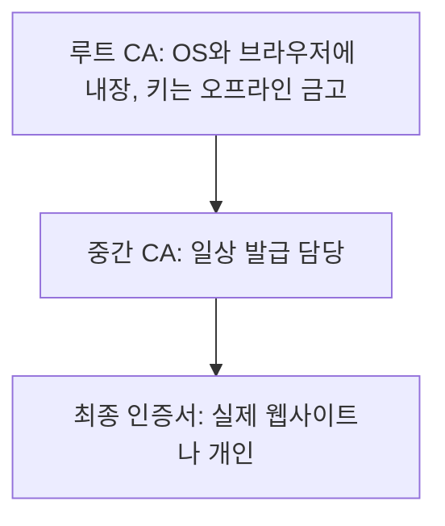
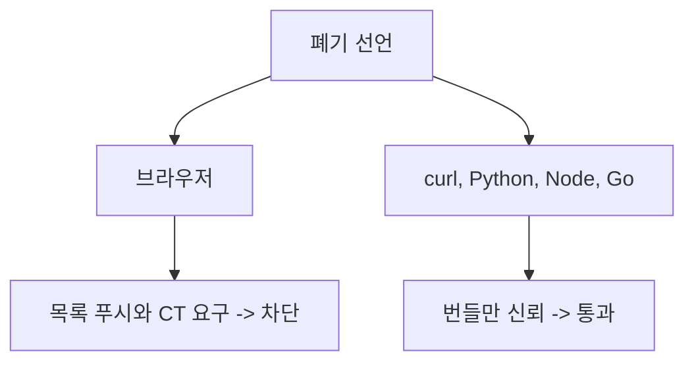

eMudhra 중간 CA 8개가 폐기됐다는데, 정작 curl은 "verify ok"를 뱉었다. 폐기가 안 먹힌 게 아니라 curl이 폐기 여부를 아예 안 물어본 거다.

처음 이 얘기를 들으면 의문이 두 개 생긴다. 하나는 "폐기했으면 끝난 거 아니냐"이고, 다른 하나는 "애초에 중간 CA가 뭔데 그게 털리면 왜 난리냐"다. 이 글은 그 둘을 차례로 푼다. 먼저 중간 CA가 뭔지, 그다음 취소라는 게 기술적으로 어떻게 돌아가는지, 마지막으로 이번 건에서 그 취소 인프라가 어디서 갈렸는지 본다.

> 인증서 폐기는 발급자가 "취소했다"고 선언하는 것으로 끝나지 않는다. 클라이언트가 그 선언을 따로 가져와서 확인해야 효력이 생긴다.
> CRL, OCSP, 브라우저 푸시 목록으로 방식은 바뀌었지만, 확인 책임이 클라이언트에 있다는 구조는 그대로다.
> 브라우저는 폐기 목록을 밀어 넣어 막았고, curl이나 Python 같은 일반 클라이언트는 기본 설정에서 이 확인을 하지 않는다.

## 중간 CA가 뭔데 그게 털리면 난리가 나나

인증서는 혼자 신뢰받지 못한다. 누가 서명했는지를 따라 올라가면 결국 OS나 브라우저에 미리 박혀 있는 최상위 인증서에 닿아야 한다. 이 사슬이 체인이고, 층은 보통 세 개다.



읽는 법: 위에서 아래로 서명 권한이 위임된다. 아래층은 자기 아래에 인증서를 발급할 수 없다.

Gemini와 나눈 대화에서 나온 한국식 비유를 빌리면, KISA는 루트 CA에 가깝고 금융결제원이나 한국정보인증 같은 발급 기관이 중간 CA에 해당한다. 어디까지나 이해용 비유라서, 실제 국내 인증 체계가 이 표와 정확히 일치한다고 확인한 건 아니다. 글로벌 쪽으로 옮기면 eMudhra Root가 루트, eMudhra의 하위 CA들이 중간 CA다.

그럼 루트가 직접 발급하면 되지 왜 중간 층을 끼우느냐. 이유는 위험 격리다. 루트 키가 유출되면 전 세계 OS, 브라우저의 신뢰 저장소를 전부 갈아엎어야 해서 복구가 사실상 불가능에 가깝다. 그래서 루트 키는 네트워크가 끊긴 금고(HSM)에 넣어두고 평소엔 거의 꺼내지 않는다. 매일 쏟아지는 발급 요청은 네트워크에 상시 연결된 중간 CA가 맡는다. 은행으로 치면 본점 금고에 인감 원본을 두고, 창구 직원에게는 위임장 찍힌 업무용 도장을 주는 구조다.

이 구조의 장점은 사고가 나도 루트까지 버릴 필요가 없다는 거다. 중간 CA 하나만 폐기 목록에 올리면 루트의 신뢰는 유지된다. 이번에 8개가 폐기된 것도 그 설계가 의도대로 쓰인 경우다.

반대로 약점도 같은 데서 나온다. 중간 CA는 "다른 인증서에 합법적으로 서명할 권한"을 위임받은 존재라서, 그 개인키를 가진 사람은 어떤 도메인이든 인증서를 만들어 서명할 수 있다. 브라우저 입장에서는 루트에 연결된 유효한 중간 CA가 보증했으니 진짜와 구분할 방법이 없다. 그래서 중간 CA 키 사고는 한 사이트 사고가 아니라 이 CA가 보증할 수 있는 모든 이름의 사고가 된다.

이번 건의 성격도 짚어두자. 해킹이 아니었다. 키 생성 과정의 결함 때문에 공개키만 있으면 개인키를 계산해낼 수 있는 상태였다. Gemini가 인용한 보안 연구자 분석으로는 키가 거대 난수가 아니라 대부분 0이고 마지막 1바이트만 값이 있는 형태였다고 한다. 제보자가 이 키들로 임의의 메시지에 유효한 서명을 만들어 보여줬고, 그걸로 caCompromise 처리가 됐다. 서명이 검증되면 더 따질 게 없는 증명이다. 여기까지가 "왜 폐기해야 했나"고, 이 글의 본론은 "폐기하면 누가 실제로 막히나"다.

## 취소 기능이 없던 시대

인증서는 서명된 종이쪽지다. 유효기간 안이고 서명이 맞으면 통과한다. 검증하는 쪽은 발급자한테 다시 물어볼 필요가 없다.

이게 설계상 장점이기도 했다. 발급자 서버가 죽어 있어도, 검증하는 쪽이 오프라인이어도 검증이 된다. 여권 심사관이 본국에 전화하지 않고 여권 자체의 위조방지 요소만 보고 통과시키는 것과 비슷하다.

문제는 이 종이를 회수할 방법이 없다는 거다. 개인키가 털려도 만료일까지 그 인증서는 멀쩡하게 통과한다. 서명 검증은 오프라인 계산이라, 세상 어디에도 "이거 취소됨"을 적어둘 곳이 없었다. 여권으로 치면 분실 신고를 해도 심사관이 신고 명단을 안 보면 그 여권은 계속 통한다.

그래서 초기엔 이렇게 버텼다. 유효기간을 짧게 잡거나, 문제가 생기면 관리자가 서버 설정을 손으로 고치거나, 그냥 만료를 기다렸다. 지금 눈으로 보면 욕이 나오지만, 당시엔 인증서가 몇 개 없었다.

## 그때 방식 그대로 만져보기

처음 나온 해법이 CRL(인증서 폐기 목록)이다. 발급자가 취소된 일련번호를 한 파일에 모아 서명해서 올려두고, 클라이언트가 그걸 받아서 대조한다. 발급자 서버에 "이 인증서 괜찮아?"를 묻는 게 아니라 "취소 명단 통째로 줘"를 하는 방식이다. 명단 자체가 서명돼 있으니 중간에서 위조할 수도 없다.

```python
# Python 3.x, 표준 라이브러리만 사용
import ssl

ctx = ssl.create_default_context()
print("leaf CRL 확인:", bool(ctx.verify_flags & ssl.VERIFY_CRL_CHECK_LEAF))
print("chain CRL 확인:", bool(ctx.verify_flags & ssl.VERIFY_CRL_CHECK_CHAIN))
# 기본값은 둘 다 False. 폐기 확인은 켜야 돈다.

# 켜려면 CRL 파일을 직접 구해서 직접 먹여야 한다
ctx.verify_flags |= ssl.VERIFY_CRL_CHECK_CHAIN
ctx.load_verify_locations("revoked.crl.pem")  # 직접 받아온 PEM CRL

# 개념 코드: CRL이 하는 일의 본질은 결국 집합 조회다
revoked_serials = {0x1A2B, 0x3C4D}   # 발급자가 서명해서 공개한 목록
def is_ok(serial):
    return serial not in revoked_serials

print(is_ok(0x1A2B))  # False
print(is_ok(0x9999))  # True
```

코드 윗부분이 "이 라이브러리는 폐기를 기본으로 안 본다"는 증거고, 아랫부분이 CRL의 본질이다. 일련번호가 집합에 있으면 거절, 없으면 통과. 이게 전부다.

여기서 아픈 지점은 이거다.

- 기본값이 꺼져 있다. 폐기를 믿으려면 클라이언트가 먼저 켜야 한다.
- 켜면 CRL을 누가 어디서 받아오는지 직접 챙겨야 한다. 체인 전체를 켠 뒤 CRL이 없으면 검증이 실패한다. 그러니 안전을 위해 켠 옵션이 서비스 장애의 원인이 될 수 있다.
- 목록은 파일 하나라서 발급량이 늘수록 커지고, 받은 시점 이후의 취소는 모른다. 오늘 아침에 받은 명단에는 오후에 취소된 인증서가 없다.

"기본값이 꺼져 있다"는 부분은 뒤에서 계속 돌아온다. 이번 사건에서 curl이 통과시킨 이유가 정확히 이거다.

## 불편이 쌓여서 이렇게 됐다


읽는 법: 왼쪽에서 오른쪽으로 갈수록 "클라이언트가 직접 물어보는 부담"을 누군가 대신 지는 쪽으로 옮겨간다.

각 단계는 앞 단계의 불편을 고친 결과다. 하나씩 "무슨 불편이 있었고, 뭘로 풀었고, 뭐가 새로 터졌는지"로 보면 흐름이 잡힌다.

1단계는 CRL이다. 불편은 "취소를 못 한다"였고, 해법은 서명된 목록 배포였다. 새로 생긴 문제는 목록이 커지고 갱신이 느리다는 점이다.

2단계는 OCSP다. 불편은 "목록이 너무 크다"였고, 해법은 인증서 하나만 묻는 실시간 조회였다. 명단 전체 대신 "이 일련번호 하나 괜찮아?"만 묻고 서명된 답을 받는다. 새로 생긴 문제는 두 가지다. 접속할 때마다 CA에 물어보니 느리고, 내가 어느 사이트에 가는지 CA가 알게 된다. 응답 서버가 죽으면 "그냥 통과시킬까, 막을까"를 정해야 하는데, 대부분 통과시키는 쪽(soft-fail)으로 굴러갔다. 막으면 CA 서버 장애 하나로 인터넷이 멈추기 때문이다. 그런데 공격자 입장에서는 그 응답 경로를 막기만 하면 폐기 확인이 무력화된다. 확인은 하는데 실패해도 통과시키니 사실상 안 하는 거나 같다.

3단계는 stapling이다. 불편은 "클라이언트가 CA에 직접 간다"였고, 해법은 서버가 OCSP 응답을 미리 받아 핸드셰이크에 붙여주는 방식이었다. 클라이언트가 CA를 찾아갈 필요가 없으니 느려지지도 않고 방문 기록도 새지 않는다. 새로 생긴 문제는 서버가 안 붙여주면 그만이라는 점이다. 공격자가 쥔 서버는 당연히 안 붙인다. 폐기를 가장 확인하고 싶은 상대가 하필 확인 수단을 쥐고 있다.

4단계는 브라우저 푸시 목록이다. 불편은 "조회가 믿을 수 없다"였고, 해법은 브라우저 벤더가 중요한 폐기 목록을 업데이트에 실어 밀어 넣는 방식이었다. 클라이언트가 묻는 게 아니라 벤더가 알려주는 쪽으로 방향이 뒤집힌 거다. 이번 건에서 Chrome은 CRLSet, Firefox는 OneCRL로 몇 시간 만에 막았다. 새로 생긴 문제는 이게 브라우저 전용이라는 점이다.

5단계는 CRLite와 짧은 수명이다. 목록을 압축해서 브라우저에 통째로 넣거나, 인증서 수명 자체를 줄여 폐기 필요성을 낮추는 쪽이다. 통째로 들고 있으면 네트워크에 물어볼 일이 없어지고, 수명이 짧으면 폐기를 기다리느니 그냥 만료되는 게 빠르다. 둘 다 효과가 있지만 수혜자는 역시 브라우저와 자동 갱신을 쓰는 서버다.

| 시대 | 방식 | 장점 | 한계 |
|---|---|---|---|
| 초기 | 만료 대기 | 구현 없음 | 회수 불가 |
| CRL | 서명된 목록 | 오프라인 대조 가능 | 크고 느림 |
| OCSP | 실시간 조회 | 항목 단위 확인 | 지연, 프라이버시, soft-fail |
| stapling | 서버가 응답 첨부 | 조회 부담 이동 | 서버가 안 붙이면 끝 |
| 푸시 목록 | 벤더가 배포 | 빠르고 강제적 | 브라우저 한정 |

## 이 사건에서 폐기 인프라가 승부처였던 이유

이 흐름을 이번 건에 겹쳐보면 결과가 설명된다. 폐기 선언 자체는 CA가 했고, 8개 중간 인증서는 폐기됐다. 그런데 그 선언이 클라이언트에 도착하는 경로는 위 단계 중 어디까지 구축돼 있느냐에 따라 달랐다.

4단계 이후를 가진 브라우저와 OS 벤더는 OneCRL, CRLite, CRLSet 같은 긴급 원격 업데이트로 8개 인증서를 신뢰 차단 목록에 올렸다. 소프트웨어 업데이트를 기다릴 필요 없이 몇 시간이면 됐다. 반면 1~2단계 어딘가에 멈춰 있는 클라이언트, 그러니까 기본값으로 폐기를 안 보는 클라이언트는 신뢰 자체를 업데이트로만 끊을 수 있다. Gemini 답변도 같은 지적이다. 자동 CRL/OCSP 확인을 하지 않는 리눅스 서버나 레거시 클라이언트 라이브러리는 ca-certificates와 OS 보안 업데이트를 적용해야 한다.



읽는 법: 같은 폐기 선언이 도착하는 길이 브라우저와 그 외 클라이언트에서 갈라진다.

## 지금은 이렇다

<svg viewBox="0 0 680 220" xmlns="http://www.w3.org/2000/svg">
<rect x="20" y="30" width="290" height="160" rx="8" fill="none" stroke="#6b4f3a" stroke-width="2"/>
<rect x="370" y="30" width="290" height="160" rx="8" fill="none" stroke="#a8683a" stroke-width="2"/>
<text x="165" y="58" font-size="16" text-anchor="middle" fill="#6b4f3a">브라우저</text>
<text x="515" y="58" font-size="16" text-anchor="middle" fill="#a8683a">그 외 클라이언트</text>
<text x="165" y="95" font-size="13" text-anchor="middle" fill="#7a6a58">벤더가 폐기 목록을 푸시</text>
<text x="165" y="120" font-size="13" text-anchor="middle" fill="#7a6a58">CT를 요구</text>
<text x="165" y="145" font-size="13" text-anchor="middle" fill="#7a6a58">업데이트가 자동</text>
<text x="515" y="95" font-size="13" text-anchor="middle" fill="#7a6a58">디스크의 CA 번들만 신뢰</text>
<text x="515" y="120" font-size="13" text-anchor="middle" fill="#7a6a58">기본값은 폐기 확인 없음</text>
<text x="515" y="145" font-size="13" text-anchor="middle" fill="#7a6a58">번들 갱신은 사람 몫</text>
<text x="340" y="212" font-size="11" text-anchor="middle" fill="#c9a37a">개념도(실제 수치 아님)</text>
</svg>

읽는 법: 왼쪽 상자는 밀어주는 쪽, 오른쪽 상자는 알아서 확인해야 하는 쪽이다.

"번들"이 뭔지 한 번 짚자. curl이나 Python, Node 같은 클라이언트는 신뢰할 루트와 중간 CA 목록을 디스크의 파일 하나로 들고 있다. 이 파일에 이름이 있으면 신뢰하고, 없으면 안 한다. 폐기 목록을 따로 안 보니, 파일에서 그 CA를 빼는 것 말고는 신뢰를 끊을 방법이 없다. 그 파일을 갱신하는 건 배포판 패키지이거나 앱 개발자이거나 결국 사람이다.

이번 사건의 교훈은 키가 약했다는 데서 끝나지 않는다. 글쓴이가 로컬 서버에서 api.stripe.com용 인증서를 만들어 테스트하자, 기본 설정의 curl, Python, Node가 전부 통과시켰다. 폐기는 이미 끝난 상태였는데도 그랬다. 인증서를 위조한 게 아니라 폐기된 CA의 키로 정상 서명을 한 것이니, 번들만 보는 클라이언트 눈에는 흠잡을 데가 없다.

그럼 CT 같은 다른 안전장치는 없었냐는 의문이 들 수 있다. 사건 자료는 해당 기간 CT 로그에 항목이 없었고, CT를 강제하는 브라우저들은 이 키로 공격받을 수 없었다고 말한다. 반대로 CT를 강제하지 않는 클라이언트에서 실제 공격이 있었는지는 자료도 모른다고 쓴다. 나도 모른다. 위험한 쪽은 서버 간 통신, 사내 CLI, 컨테이너 베이스 이미지, 임베디드 기기처럼 브라우저가 아니라서 폐기도 CT도 안 보는 구간이다.

선택지는 세 가지다. 첫째, 번들을 업데이트한다. 가장 확실하지만 컨테이너 이미지를 다시 굽고 OS 패키지를 올려야 한다. 둘째, 클라이언트에서 폐기 확인을 직접 켠다. 위 코드처럼 가능은 한데 CRL을 어디서 받을지 책임져야 하고, 실수하면 서비스가 멈춘다. 셋째, 신뢰할 CA를 줄인다. 댓글에 나온 "100개는 너무 많았다"는 말이 이 얘기다. 믿는 CA가 많을수록 그중 하나가 깨질 확률도 같이 올라간다.

업데이트가 불가능한 기기는 답이 없다. 번들이 박힌 라우터나 임베디드 장비는 만료일인 2039년까지 이 CA를 믿는다.

취소는 발급자가 하는데 확인은 내가 해야 하는 구조라, 확인 안 하는 클라이언트한테 폐기는 없던 일이다.

---

*원문: [Eight Bits of Trust: eMudhra's CA keys cracked in milliseconds](https://scotthelme.co.uk/eight-bits-of-trust-emudhras-ca-keys-cracked-in-milliseconds/) (via hn)*
