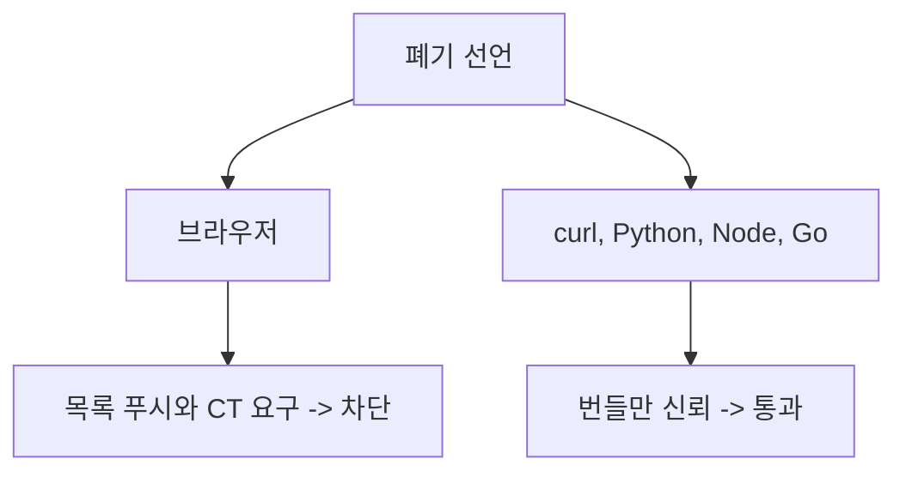

eMudhra 중간 CA 8개가 폐기됐다는데, 정작 curl은 "verify ok"를 뱉었다. 폐기가 안 먹힌 게 아니라 curl이 폐기 여부를 아예 안 물어본 거다.

> 인증서 폐기는 발급자가 "취소했다"고 선언하는 것으로 끝나지 않는다. 클라이언트가 그 선언을 따로 가져와서 확인해야 효력이 생긴다.
> CRL, OCSP, 브라우저 푸시 목록으로 방식은 바뀌었지만, 확인 책임이 클라이언트에 있다는 구조는 그대로다.
> 브라우저는 폐기 목록을 밀어 넣어 막았고, curl이나 Python 같은 일반 클라이언트는 기본 설정에서 이 확인을 하지 않는다.

## 취소 기능이 없던 시대

인증서는 서명된 종이쪽지다. 유효기간 안이고 서명이 맞으면 통과한다. 검증하는 쪽은 발급자한테 다시 물어볼 필요가 없다.

문제는 이 종이를 회수할 방법이 없다는 거다. 개인키가 털려도 만료일까지 그 인증서는 멀쩡하게 통과한다. 서명 검증은 오프라인 계산이라, 세상 어디에도 "이거 취소됨"을 적어둘 곳이 없었다.

그래서 초기엔 이렇게 버텼다. 유효기간을 짧게 잡거나, 문제가 생기면 관리자가 서버 설정을 손으로 고치거나, 그냥 만료를 기다렸다. 지금 눈으로 보면 욕이 나오지만, 당시엔 인증서가 몇 개 없었다.

## 그때 방식 그대로 만져보기

처음 나온 해법이 CRL(인증서 폐기 목록)이다. 발급자가 취소된 일련번호를 한 파일에 모아 서명해서 올려두고, 클라이언트가 그걸 받아서 대조한다.

```python
# Python 3.x, 표준 라이브러리만 사용
import ssl

ctx = ssl.create_default_context()
print("leaf CRL 확인:", bool(ctx.verify_flags & ssl.VERIFY_CRL_CHECK_LEAF))
print("chain CRL 확인:", bool(ctx.verify_flags & ssl.VERIFY_CRL_CHECK_CHAIN))
# 기본값은 둘 다 False. 폐기 확인은 켜야 돈다.

# 켜려면 CRL 파일을 직접 구해서 직접 먹여야 한다
ctx.verify_flags |= ssl.VERIFY_CRL_CHECK_CHAIN
ctx.load_verify_locations("revoked.crl.pem")  # 직접 받아온 PEM CRL

# 개념 코드: CRL이 하는 일의 본질은 결국 집합 조회다
revoked_serials = {0x1A2B, 0x3C4D}   # 발급자가 서명해서 공개한 목록
def is_ok(serial):
    return serial not in revoked_serials

print(is_ok(0x1A2B))  # False
print(is_ok(0x9999))  # True
```

여기서 아픈 지점은 이거다.

- 기본값이 꺼져 있다. 폐기를 믿으려면 클라이언트가 먼저 켜야 한다.
- 켜면 CRL을 누가 어디서 받아오는지 직접 챙겨야 한다. 체인 전체를 켠 뒤 CRL이 없으면 검증이 실패한다.
- 목록은 파일 하나라서 발급량이 늘수록 커지고, 받은 시점 이후의 취소는 모른다.

## 불편이 쌓여서 이렇게 됐다


읽는 법: 왼쪽에서 오른쪽으로 갈수록 "클라이언트가 직접 물어보는 부담"을 누군가 대신 지는 쪽으로 옮겨간다.

1단계는 CRL이다. 불편은 "취소를 못 한다"였고, 해법은 서명된 목록 배포였다. 새로 생긴 문제는 목록이 커지고 갱신이 느리다는 점이다.

2단계는 OCSP다. 불편은 "목록이 너무 크다"였고, 해법은 인증서 하나만 묻는 실시간 조회였다. 새로 생긴 문제는 두 가지다. 접속할 때마다 CA에 물어보니 느리고, 내가 어느 사이트에 가는지 CA가 알게 된다. 응답 서버가 죽으면 "그냥 통과시킬까, 막을까"를 정해야 하는데, 대부분 통과시키는 쪽(soft-fail)으로 굴러갔다. 공격자는 그 응답을 막기만 하면 된다.

3단계는 stapling이다. 불편은 "클라이언트가 CA에 직접 간다"였고, 해법은 서버가 OCSP 응답을 미리 받아 핸드셰이크에 붙여주는 방식이었다. 새로 생긴 문제는 서버가 안 붙여주면 그만이라는 점이다. 공격자가 쥔 서버는 당연히 안 붙인다.

4단계는 브라우저 푸시 목록이다. 불편은 "조회가 믿을 수 없다"였고, 해법은 브라우저 벤더가 중요한 폐기 목록을 업데이트에 실어 밀어 넣는 방식이었다. 이번 건에서 Chrome은 CRLSet, Firefox는 OneCRL로 몇 시간 만에 막았다. 새로 생긴 문제는 이게 브라우저 전용이라는 점이다.

5단계는 CRLite와 짧은 수명이다. 목록을 압축해서 브라우저에 통째로 넣거나, 인증서 수명 자체를 줄여 폐기 필요성을 낮추는 쪽이다. 둘 다 효과가 있지만 수혜자는 역시 브라우저와 자동 갱신을 쓰는 서버다.

| 시대 | 방식 | 장점 | 한계 |
|---|---|---|---|
| 초기 | 만료 대기 | 구현 없음 | 회수 불가 |
| CRL | 서명된 목록 | 오프라인 대조 가능 | 크고 느림 |
| OCSP | 실시간 조회 | 항목 단위 확인 | 지연, 프라이버시, soft-fail |
| stapling | 서버가 응답 첨부 | 조회 부담 이동 | 서버가 안 붙이면 끝 |
| 푸시 목록 | 벤더가 배포 | 빠르고 강제적 | 브라우저 한정 |

## 지금은 이렇다



읽는 법: 같은 폐기 선언이 도착하는 길이 브라우저와 그 외 클라이언트에서 갈라진다.

<svg viewBox="0 0 680 220" xmlns="http://www.w3.org/2000/svg">
<rect x="20" y="30" width="290" height="160" rx="8" fill="none" stroke="#6b4f3a" stroke-width="2"/>
<rect x="370" y="30" width="290" height="160" rx="8" fill="none" stroke="#a8683a" stroke-width="2"/>
<text x="165" y="58" font-size="16" text-anchor="middle" fill="#6b4f3a">브라우저</text>
<text x="515" y="58" font-size="16" text-anchor="middle" fill="#a8683a">그 외 클라이언트</text>
<text x="165" y="95" font-size="13" text-anchor="middle" fill="#7a6a58">벤더가 폐기 목록을 푸시</text>
<text x="165" y="120" font-size="13" text-anchor="middle" fill="#7a6a58">CT를 요구</text>
<text x="165" y="145" font-size="13" text-anchor="middle" fill="#7a6a58">업데이트가 자동</text>
<text x="515" y="95" font-size="13" text-anchor="middle" fill="#7a6a58">디스크의 CA 번들만 신뢰</text>
<text x="515" y="120" font-size="13" text-anchor="middle" fill="#7a6a58">기본값은 폐기 확인 없음</text>
<text x="515" y="145" font-size="13" text-anchor="middle" fill="#7a6a58">번들 갱신은 사람 몫</text>
<text x="340" y="212" font-size="11" text-anchor="middle" fill="#c9a37a">개념도(실제 수치 아님)</text>
</svg>

읽는 법: 왼쪽 상자는 밀어주는 쪽, 오른쪽 상자는 알아서 확인해야 하는 쪽이다.

이번 사건의 교훈은 키가 약했다는 데서 끝나지 않는다. 글쓴이가 로컬 서버에서 api.stripe.com용 인증서를 만들어 테스트하자, 기본 설정의 curl, Python, Node가 전부 통과시켰다. 폐기는 이미 끝난 상태였는데도 그랬다.

선택지는 세 가지다. 첫째, 번들을 업데이트한다. 가장 확실하지만 컨테이너 이미지를 다시 굽고 OS 패키지를 올려야 한다. 둘째, 클라이언트에서 폐기 확인을 직접 켠다. 위 코드처럼 가능은 한데 CRL을 어디서 받을지 책임져야 하고, 실수하면 서비스가 멈춘다. 셋째, 신뢰할 CA를 줄인다. 댓글에 나온 "100개는 너무 많았다"는 말이 이 얘기다.

업데이트가 불가능한 기기는 답이 없다. 번들이 박힌 라우터나 임베디드 장비는 만료일인 2039년까지 이 CA를 믿는다.

취소는 발급자가 하는데 확인은 내가 해야 하는 구조라, 확인 안 하는 클라이언트한테 폐기는 없던 일이다.

---

*원문: [Eight Bits of Trust: eMudhra's CA keys cracked in milliseconds](https://scotthelme.co.uk/eight-bits-of-trust-emudhras-ca-keys-cracked-in-milliseconds/) (via hn)*
