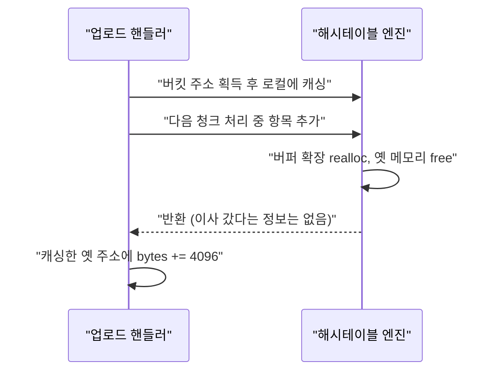
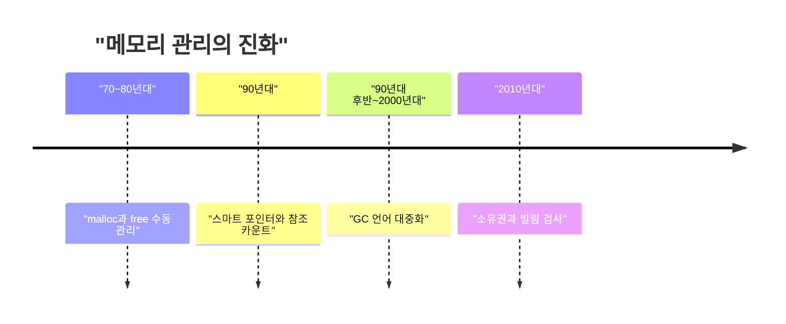

PHP 코어에서 pre-auth RCE 두 건이 터졌는데 원인은 거창한 게 아니다. 이미 이사 간 메모리의 옛 주소를 계속 들고 있었다는 것, 그게 전부다.

> - use-after-free(UAF)는 "반납한 메모리를 아직 내 것인 줄 알고 계속 쓰는" 버그고, 수동 메모리 관리 언어에서 수십 년째 반복된다.
> - 이번 건은 업로드 진행률 핸들러가 해시테이블 내부 버킷 주소를 로컬 변수에 캐싱해 두었는데, 그 사이 테이블이 realloc 되면서 주소가 무효가 된 케이스다.
> - 사람의 주의력에 맡기던 방식은 참조 카운트, GC, 소유권 시스템(Rust)으로 단계적으로 기계에 넘어갔다.

## 메모리를 사람이 직접 치우던 시대

C에서는 메모리를 `malloc`으로 받고 `free`로 돌려준다. 언제 돌려줄지는 전부 프로그래머 몫이다. 컴파일러는 도와주지 않는다.

문제는 포인터가 복사된다는 거다. 같은 주소를 세 군데서 들고 있는데 한 군데가 free하면 나머지 둘은 무효 주소가 된다. 이걸 dangling pointer라고 부른다.

여기서 흔히 하는 오해가 있다. `free(ptr)`는 메모리를 지우지 않는다. 그 블록을 "이제 다른 용도로 써도 된다"고 힙 관리자에게 돌려줬다고 표시만 한다. 데이터는 그대로 남아 있고, `ptr` 변수도 NULL로 바뀌지 않는다. 그래서 옛 주소로 읽어도 어쩌다 멀쩡해 보인다.

진짜 위험한 순간은 그다음이다. 프로세스가 다른 용도로 메모리를 할당하면 힙 관리자는 방금 반납된 그 자리에 문자열이든 다른 해시테이블 노드든 객체 메타데이터든 아무거나 넣는다. 그 상태에서 옛 포인터로 쓰기를 하면 남의 집 가구를 내 것인 줄 알고 옮기는 꼴이다.

그 시절 사람들은 이걸 규율로 버텼다. "이 구조체의 소유자는 누구다"를 주석과 코드리뷰와 팀 컨벤션으로 관리했다. 사람이 안 틀리면 되는 방식이다.

## 그 방식으로 직접 만들어 보기

PHP가 한 짓을 아주 단순하게 줄이면 이렇게 된다. 테이블 안의 항목 주소를 따로 들고 있다가, 테이블이 커지면서 메모리가 이사 간다.

```c
// C99, gcc/clang. 표준 라이브러리만 사용
#include <stdio.h>
#include <stdlib.h>

typedef struct { const char *name; long bytes; } Entry;
typedef struct { Entry *items; int len, cap; } Table;

static void add(Table *t, const char *name) {
    if (t->len == t->cap) {                 // 꽉 차면 확장
        t->cap *= 2;
        t->items = realloc(t->items, t->cap * sizeof(Entry));
    }
    t->items[t->len++] = (Entry){ name, 0 };
}

int main(void) {
    Table t = { malloc(2 * sizeof(Entry)), 0, 2 };
    add(&t, "post_bytes");
    add(&t, "file_bytes");

    Entry *progress = &t.items[0];          // 버킷 주소를 직접 보관
    add(&t, "extra");                       // realloc: 메모리가 이사 갈 수 있음

    progress->bytes += 4096;                // 옛 주소에 쓰기: 미정의 동작
    printf("%ld\n", t.items[0].bytes);      // 0일 수도, 크래시일 수도 있음
    free(t.items);
    return 0;
}
```

여기서 아픈 지점:

- 컴파일 경고도 없고 어쩌다 정상 동작한다. 테스트가 통과하니까 버그가 몇 년씩 산다.
- 해제된 자리를 다른 데이터가 재사용한다. 그 주소에 쓰는 순간 남의 데이터를 망가뜨리는 거고, 공격자가 그 자리에 뭘 채울지 조절할 수 있으면 RCE까지 간다.
- `-fsanitize=address` 같은 도구를 붙여야 잡힌다. 안 붙이면 운영에서 처음 터진다.

읽는 법: 아래 그림은 실제 PHP 메모리 레이아웃이 아니라 위 샘플을 도식화한 것이다.

개념도(실제 수치 아님)

<svg viewBox="0 0 680 220" xmlns="http://www.w3.org/2000/svg" font-family="monospace" font-size="14">
<text x="20" y="28" fill="#7a6a58">realloc 전</text>
<rect x="20" y="40" width="160" height="40" fill="none" stroke="#6b4f3a" stroke-width="2"/>
<text x="36" y="65" fill="#7a6a58">items[0] post_bytes</text>
<rect x="180" y="40" width="160" height="40" fill="none" stroke="#6b4f3a" stroke-width="2"/>
<text x="196" y="65" fill="#7a6a58">items[1] file_bytes</text>
<text x="20" y="125" fill="#7a6a58">realloc 후</text>
<rect x="20" y="137" width="160" height="40" fill="#d9b98c" stroke="#c9a37a" stroke-dasharray="5 4"/>
<text x="36" y="162" fill="#7a6a58">해제된 옛 자리</text>
<rect x="400" y="137" width="260" height="40" fill="none" stroke="#a8683a" stroke-width="2"/>
<text x="416" y="162" fill="#7a6a58">새 자리 items[0..2]</text>
<path d="M100 100 L100 135" stroke="#a8683a" stroke-width="2"/>
<text x="110" y="118" fill="#a8683a">progress 포인터는 여기를 가리킴</text>
</svg>

왼쪽 점선 칸이 이미 반납된 메모리고, 포인터는 여전히 거기를 가리킨다.

## 왜 "당연히 같이 갱신해야 하는 걸" 못 했나

테이블이 realloc 됐으면 캐싱해 둔 포인터도 새 위치로 고치거나 다시 찾아야 한다. 당연한 얘기다. 그런데 안 했다. 게으른 게 아니라 구조적으로 알 방법이 없었다.

업로드 진행률 핸들러는 성능을 아끼려고 매 청크마다 키 이름으로 해시테이블을 검색하지 않고, 처음 한 번 찾은 버킷 주소를 쥐고 있었다. 그런데 파일 청크를 파싱하는 중간에 호출되는 다른 코드(세션에 폼 데이터를 기록하는 경로 등)가 같은 테이블에 항목을 추가한다. 그러면서 테이블 버퍼가 꽉 차 `realloc`이 일어난다.



읽는 법: 핸들러 입장에서는 호출이 정상적으로 돌아왔을 뿐이고, 그 사이 주소가 바뀌었다는 신호는 어디에도 없다.

C의 해시테이블 구조체에는 "나 이사 간다, 내 안쪽을 가리키던 외부 포인터는 전부 갱신해라" 같은 통지 장치가 없다. 호출한 쪽과 realloc 한 쪽이 서로 다른 레이어에 있으니 상태 공유가 끊긴다. 이게 UAF가 코드리뷰에서 잘 안 잡히는 이유다. 각 함수는 따로 보면 맞고, 조합했을 때만 틀린다.

일반적인 수정 방법은 둘 중 하나다.

- 매번 다시 찾기: 바이트 수를 올릴 때마다 `zend_hash_find()` 같은 조회로 현재 유효한 주소를 얻는다. 조회 비용을 낸다.
- 인덱스나 키로 들고 있기: 절대 주소 대신 인덱스 번호나 키 이름을 쥐고 있다가 `items[index]`로 접근한다. 베이스 주소가 바뀌어도 항상 유효하다.

둘 다 "수명을 보장할 수 없는 원시 포인터를 따로 쥐지 않는다"는 같은 원칙이다. 이번 패치가 정확히 어느 쪽인지는 내가 커밋을 직접 확인하지 못했다.

## 이게 왜 쓰기만으로 RCE가 되나

처음에는 의문이 든다. 쓰레기 값에 4096을 더하는 게 전부인데 어떻게 코드 실행까지 가나.

free된 자리를 다른 객체가 재사용하면 그 객체의 필드에 4096이 더해진다. 공격자는 multipart 요청을 정교하게 짜서 방금 해제된 자리에 자기가 원하는 구조체가 들어가도록 유도한다. 이걸 힙 그루밍이라고 부른다.

- 원하는 값 조작: 업로드 청크 수를 조절하면 4096이 몇 번 더해질지 정해지므로, 그 위치의 값을 공격자가 원하는 만큼 정확히 올릴 수 있다.
- 함수 포인터 변조: 재할당된 자리가 어떤 객체의 메서드 실행 주소라면, 그 값을 올려서 미리 힙에 심어 둔 코드 주소로 맞춘다.
- 실행 트리거: PHP가 그 객체의 메서드를 정상적으로 호출하는 순간 변조된 주소로 점프한다.

개념도(실제 수치 아님)

```text
[해제 전]       0x1000: [ 진행률 이름 | bytes ]      <- progress가 가리킴
[재사용 후]     0x1000: [ 다른 객체 타입 | 함수 주소 ]  <- 같은 자리
[bytes += 4096] 0x1000: [ 다른 객체 타입 | 함수 주소+4096 ]  <- 원하는 곳으로 틀어짐
```

읽는 법: 필드 위치가 우연히 겹쳐서 진행률 카운터가 남의 함수 주소를 건드리는 장면이다. 실제 익스플로잇의 정확한 레이아웃은 이 글에서 확인하지 못했다.

정리하면 임의 쓰기가 아니라 "4096씩 더하기"라는 제한된 도구인데도, 힙 배치를 통제할 수 있으면 충분히 치명적이다.

## 그래서 어떻게 진화했나



읽는 법: 왼쪽에서 오른쪽으로 갈수록 "사람이 챙기는 일"이 기계로 넘어간다.

1단계. 불편: free 타이밍을 사람이 맞춰야 해서 누수와 이중 해제가 끝이 없었다. 해법: 참조 카운트다. 쓰는 쪽이 카운트를 올리고, 0이 되면 해제한다. 새 문제: 순환 참조는 영원히 0이 안 된다. 카운트 올리고 내리는 걸 빼먹으면 똑같이 터진다.

2단계. 불편: 그 규율조차 사람이 깜빡한다. 해법: GC 언어(Java, 이후 대부분의 스크립트 언어)다. 쓰이는 동안은 절대 해제하지 않는다. 새 문제: GC 멈춤과 메모리 사용량이 예측하기 어렵고, 시스템 프로그래밍에는 부담스럽다.

3단계. 불편: 성능은 C급으로 필요한데 UAF는 싫다. 해법: Rust의 소유권과 빌림 검사다. 컴파일러가 "이 참조가 살아있는 동안 원본을 못 건드린다"를 컴파일 타임에 강제한다. 새 문제: 학습 곡선이 가파르고 기존 C 코드를 다 갈아엎을 수는 없다.

위 C 샘플과 같은 실수를 Rust로 쓰면 컴파일 자체가 안 된다. 이번 버그가 정확히 이 모양이다. 테이블에 새 항목을 넣는 동작이 이미 빌려 간 참조를 무효로 만들 수 있다는 걸 컴파일러가 안다.

```rust
let mut v = vec![1, 2];
let first = &v[0];   // v를 빌려 옴
v.push(3);           // 컴파일 에러: 빌린 동안 변경 불가
println!("{}", first);
```

| 시대 | 방식 | 장점 | 한계 |
|---|---|---|---|
| C 수동 관리 | malloc / free | 빠르고 통제 가능 | 사람 실수가 곧 취약점 |
| 참조 카운트 | 카운터로 수명 추적 | 해제 시점이 명확 | 순환 참조, 카운트 누락 |
| GC | 런타임이 수거 | 안전하고 편함 | 멈춤, 메모리 오버헤드 |
| 소유권 | 컴파일러가 검증 | 안전하고 빠름 | 학습 비용, 기존 코드 이전 |

## 지금은 어떤가

PHP는 코어가 C로 되어 있다. 스크립트를 쓰는 사람은 GC를 믿고 메모리를 신경 안 써도 되지만, 그 밑의 엔진은 여전히 수동 관리 영역이다. 이번 건이 그 증거다.

자료에 따르면 `session.upload_progress.enabled`가 기본값 1이라서, 평범한 multipart POST만으로 해당 코드 경로가 활성화된다. 인증도 필요 없다. 설정을 꺼두면 공격 경로가 막히고 일반 업로드는 그대로 된다고 한다. 지원 중인 브랜치는 8.5.12, 8.4.27, 8.3.36, 8.2.35 이상으로 올리면 된다고 적혀 있다. 8.1 이하 EOL 버전은 공식 패치가 없으니 설정을 끄거나 배포판 백포트를 써야 한다.

선택지를 정리하면 이렇다.

- 당장: 업로드 진행률 기능을 안 쓰면 끈다. 쓰는 사람이 거의 없는 기능이 기본 ON이었다는 게 이 사고의 절반이다.
- 이번 주: 지원 브랜치로 패치 버전을 올린다. EOL 버전이면 업그레이드 계획부터 잡는다.
- 장기: 새 코드는 메모리 안전 언어로 짠다. 기존 C 코어는 샌드박스와 프로세스 감시로 피해 반경을 줄인다.

PHP 워커가 갑자기 `/bin/sh`나 `curl`을 자식 프로세스로 띄우면 그게 신호다. 자료가 권장하듯 그 패턴은 모니터링에 걸어두는 게 좋다.

"조심해서 쓰면 된다"는 말로 메모리 버그를 막은 적은 한 번도 없다.

---

*원문: [eness/php2shell-CVE-2026-109618-CVE-2026-109619-PoC](https://github.com/eness/php2shell-CVE-2026-109618-CVE-2026-109619-PoC) (via github)*
