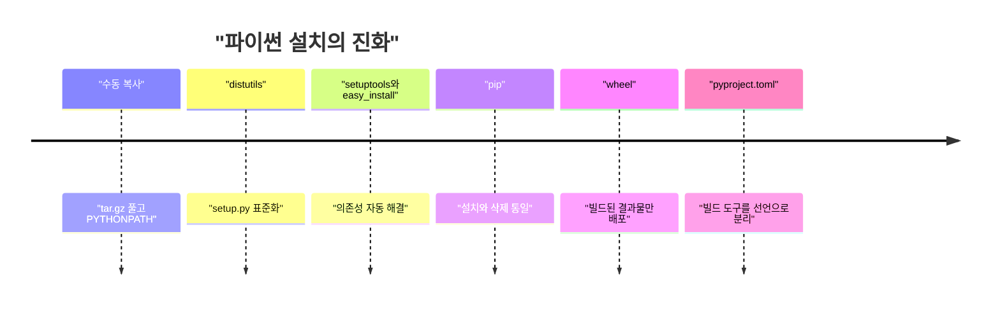
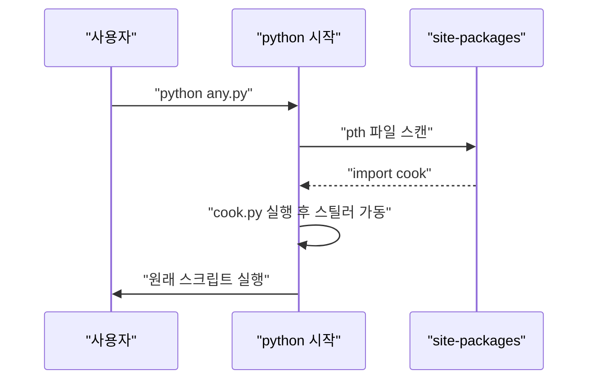

LiteLLM 1.107.0이 PyPI에서 털렸다. 그런데 진짜 웃긴 건 악성코드가 litellm을 import하지 않아도 돈다는 거다.

보통 "악성 패키지"라고 하면 그 패키지를 import하는 순간 터진다고 생각한다. 그러면 안 쓰는 패키지는 깔려 있어도 무해하다는 결론이 나온다. 이번 건은 그 가정이 안 맞는다. 설치만 끝나면, 그 머신에서 파이썬이 한 번이라도 켜질 때마다 돈다. litellm과 아무 상관 없는 스크립트여도, pip 자신이어도 마찬가지다. 왜 그런 일이 가능한지 이해하려면 사고 자체보다 파이썬 패키징이 어떻게 여기까지 왔는지를 한 번 훑어야 한다.

> 파이썬 패키지 설치는 "파일 복사"가 아니라 "남의 코드를 내 머신에 올리는 일"이고, 이 구조는 20년 넘게 그대로다.
> 이번 사고는 `.pth`와 `sitecustomize.py`라는, 파이썬이 시작할 때 알아서 읽는 자리에 파일 세 개를 심은 것이다.
> 소스 저장소는 멀쩡했고 빌드 설정 한 줄(`data = "cook"`)만 달랐다. 그래서 GitHub 코드 리뷰로는 못 잡았다.

## 패키지 매니저가 없던 시절

옛날에는 라이브러리가 필요하면 사이트에서 tar.gz를 받아 풀었다. 그리고 `PYTHONPATH`가 가리키는 폴더에 복사했다.

버전 관리도, 삭제도, 의존성 해결도 없었다. 뭐가 깔렸는지는 네 기억력이 곧 DB였다. 그나마 C 확장이 들어간 라이브러리는 컴파일 옵션까지 직접 맞춰야 했다.

"그럼 그때는 안전했나?" 하고 물을 수 있다. 반은 맞고 반은 틀리다. 복사만 했으니 설치 단계에서 코드가 도는 일은 없었다. 대신 네가 직접 받은 tar.gz를 믿는 수밖에 없었고, 검증할 수단도 없었다. 비유하자면 이웃집에서 빌려 온 공구를 아무 표시 없이 내 공구함에 섞어 넣는 거다. 위험이 적었던 게 아니라 규모가 작아서 눈에 안 띄었던 쪽에 가깝다. 문제는 이 방식으로는 라이브러리가 몇 개만 넘어가도 사람이 감당을 못 한다는 거였고, 그 불편이 이후 모든 도구를 만들었다.

## 그때 방식으로 직접 만들어 보기

2000년대 초중반에 `distutils`가 들어오면서 표준 절차가 생겼다. 배포자가 `setup.py`를 넣어 두면 사용자가 그걸 실행하는 방식이다. 아래는 그 절차를 흉내 낸 최소 설치기다.

```python
# Python 3.12, 표준 라이브러리만
import subprocess, sys, tarfile, tempfile, pathlib, textwrap

work = pathlib.Path(tempfile.mkdtemp())
pkg = work / "hello-1.0"
pkg.mkdir()
(pkg / "hello.py").write_text("def hi(): return 'hi'\n")
(pkg / "setup.py").write_text(textwrap.dedent("""
    print('[setup.py] 설치 중인데 내가 뭘 하든 아무도 모름')
    import shutil, sys
    shutil.copy('hello.py', sys.argv[1])
"""))
with tarfile.open(work / "hello-1.0.tar.gz", "w:gz") as t:
    t.add(pkg, arcname="hello-1.0")

site = work / "site-packages"
site.mkdir()
with tarfile.open(work / "hello-1.0.tar.gz") as t:
    t.extractall(work / "unpacked", filter="data")
subprocess.run(
    [sys.executable, "setup.py", str(site)],
    cwd=work / "unpacked" / "hello-1.0", check=True,
)
print(list(site.iterdir()))
```

여기서 아픈 지점.

> 읽기 전용 설명서가 아니라 실행되는 스크립트다.
> 설치 단계에서 이미 임의 코드가 돈다.
> 뭘 깔았는지 기록이 없으니 지우려면 파일을 손으로 찾아야 한다.

`setup.py`는 그냥 파이썬 파일이라 파일 읽기든 네트워크든 다 된다. 이 구조가 공급망 공격의 기본 발판이다.

"설치 스크립트가 코드면 당연한 거 아닌가, 그게 왜 위험한가" 싶을 수 있다. 위험한 이유는 실행되는 시점과 권한에 있다. 설치 스크립트는 네가 패키지를 쓰기 전에, 그것도 `pip install`을 친 사용자의 권한으로 돈다. 즉 네가 내용을 읽어 볼 기회가 생기기 전에 이미 실행이 끝난다. 식당 비유로 하면, 메뉴판을 받은 게 아니라 주방 직원이 네 집 열쇠를 들고 들어와 요리하는 구조다. 요리가 맛있는지는 중요하지 않고, 열쇠를 줬다는 사실이 문제다.

위 최소 설치기가 하는 일도 사실 이게 전부다. tar.gz를 풀고, 그 안의 `setup.py`를 `subprocess`로 실행하고, 결과로 파일이 복사됐는지 본다. 예제에서는 출력 한 줄을 찍고 파일을 복사했지만, 같은 자리에 다른 코드를 넣으면 같은 방식으로 돈다. 이게 20년 전 방식이라고 해서 지금과 다른 이야기가 아니다.

## 불편이 쌓여서 생긴 흐름



읽는 법: 왼쪽에서 오른쪽으로 갈수록 "사람이 하던 일"이 도구로 넘어갔다. 이 흐름은 계획된 설계가 아니라, 직전 단계의 불편을 다음 도구가 메운 순서다. 각 단계가 이전 문제를 하나 풀고 새 문제를 하나 남겼다는 점만 보면 된다.

1. 수동 복사는 재현이 안 됐다. 그래서 `distutils`가 `python setup.py install`이라는 공통 절차를 만들었다. 대신 모든 설치가 임의 코드 실행이 됐다.
2. 의존성이 A→B→C로 늘어나자 손으로 못 따라갔다. `easy_install`이 의존성을 자동으로 받아오게 했지만, 삭제가 없어서 찌꺼기가 쌓였다.
3. 그래서 `pip`가 설치와 삭제를 한 도구로 묶었다. 하지만 소스 배포판(sdist)은 여전히 설치할 때 빌드하면서 `setup.py`를 실행했다.
4. 그래서 wheel이 나왔다. 미리 빌드된 zip이라 설치 때는 파일을 풀기만 한다. 설치 중 코드 실행은 줄었지만, 풀린 파일 자체가 악성이면 소용없다.
5. 마지막으로 `pyproject.toml`이 빌드 도구를 선언하게 했다. 이번 사고의 `[tool.maturin]` 설정이 그 자리다. 빌드 설정이 곧 공격 표면이 됐다.

여기서 흔한 의문이 하나 있다. wheel이 설치 중 코드 실행을 없앴다면 그걸로 끝난 거 아닌가. 아니다. wheel이 막은 건 "설치하는 순간 `setup.py`가 도는 것"이지, "설치된 파일이 나중에 도는 것"이 아니다. wheel은 zip을 `site-packages`에 푸는 것뿐이라서, 설치 단계 자체는 얌전해졌다. 그런데 파이썬에는 시작할 때 `site-packages` 안의 특정 파일을 알아서 읽는 장치가 따로 있다. 설치 때 안 돌던 코드가, 그 자리에 놓이기만 하면 다음 파이썬 실행 때 돈다. 문을 잠그는 위치가 현관에서 거실로 옮겨 갔을 뿐이다.

또 하나. 그럼 소스에서 직접 빌드하지 않고 wheel만 받으면 안전하지 않냐고 물을 수 있다. 이번 사고에서 악성 파일은 wheel 안에 이미 들어 있었다. 빌드 설정에 한 줄이 추가되었고, 그 결과 `cook/` 폴더가 wheel 안의 `litellm-1.107.0.data/purelib/`로 들어갔고, pip가 그걸 `site-packages`에 풀었다. 즉 wheel이라서 막힌 게 아니라 wheel이라서 아주 매끄럽게 설치됐다.

| 시대 | 방식 | 장점 | 한계 |
|---|---|---|---|
| 초기 | 수동 복사 | 단순함 | 재현, 삭제, 버전 관리 불가 |
| distutils | setup.py 실행 | 절차 표준화 | 설치 중 임의 코드 실행 |
| setuptools와 pip | 의존성 해결, 삭제 지원 | 일상적으로 편함 | sdist 빌드 시 코드 실행 |
| wheel | 빌드된 파일만 풀기 | 빠르고 설치 단계 실행 없음 | 담긴 파일의 신뢰는 별개 |

표에서 한계 칸만 위에서 아래로 읽으면 같은 문제가 모양만 바꿔 따라온다는 게 보인다. 초기에는 "관리 불가", distutils에서는 "설치 중 실행", wheel에서는 "내용물의 신뢰"다. 편의가 늘 때마다 사람이 직접 보던 지점이 도구 뒤로 숨었고, 그 숨은 지점이 공격자가 노리는 자리가 됐다.

## 파이썬이 시작할 때 읽는 자리

이번 사고의 핵심은 wheel이 풀어 놓은 파일이 어디에 있었느냐다. 파이썬은 시작할 때 `site-packages`의 `.pth` 파일을 읽는다. 줄이 `import`로 시작하면 그 줄을 그대로 실행한다.

`.pth`는 원래 "이 폴더도 import 경로에 넣어 줘"라고 알려 주는 용도의 설정 파일이다. 한 줄에 경로 하나를 적는 단순한 형식인데, 그중 `import`로 시작하는 줄은 경로가 아니라 코드로 취급해서 실행하는 규칙이 붙어 있다. 정상적인 용도도 있어서 이걸 막기가 애매하다. 비유하면 아파트 관리실이 입주민 명단(경로)을 정리하는 서류철인데, 맨 앞에 "import"라고 쓴 쪽지는 명단이 아니라 지시서로 읽고 실행해 주는 셈이다. 누구든 서류철에 쪽지를 끼워 넣을 수 있으면 관리실을 시켜 일을 시킬 수 있다.

그리고 이 자리가 하나 더 있다. 파이썬은 시작할 때 `sitecustomize`라는 이름의 모듈도 import한다. `site-packages`에 `sitecustomize.py`가 있으면 그것도 파이썬 프로세스마다 돈다. 이번 사고는 `.pth`와 `sitecustomize.py` 두 자리를 같이 썼다.

```python
import site, pathlib, tempfile
d = pathlib.Path(tempfile.mkdtemp())
(d / "cook_demo.py").write_text("print('import 안 했는데 실행됨')")
(d / "cook_demo.pth").write_text("import cook_demo\n")
site.addsitedir(str(d))
```

이게 실제로 도는 걸 확인할 수 있다. 위 코드를 돌리면 `cook_demo`를 따로 import하지 않았는데도 출력이 찍힌다. 여기서는 `site.addsitedir`로 해당 폴더를 직접 읽게 했지만, 실제 `site-packages`에서는 파이썬이 켜질 때 같은 일을 알아서 한다. 차이는 누가 호출하느냐뿐이다.



읽는 법: 사용자는 평범한 스크립트를 돌렸을 뿐인데 그 앞에 `.pth`가 끼어든다. pip, IDE 언어 서버, CI 작업도 전부 같은 길을 탄다.

순서대로 풀면 이렇다. 먼저 `litellm==1.107.0`을 설치하면 `cook.pth`, `cook.py`, `sitecustomize.py` 세 파일이 `site-packages`에 놓인다. `cook.pth`에는 `import cook` 한 줄이 들어 있었고, 파이썬이 켜질 때 이 줄이 실행되어 `cook.py`, 즉 크리덴셜 스틸러가 돈다. 원문에 따르면 스틸러는 SSH 키, 클라우드 자격증명, CI/CD 시크릿, AI 도구 토큰, 브라우저 저장 비밀번호 같은 걸 모아 암호화해서 외부 서버로 보낸다. 같은 시점에 `sitecustomize.py`는 백그라운드 데몬을 띄운다. 이 데몬은 한 시간마다 GitHub의 파일에서 서버 주소를 읽고, 스틸러를 다시 돌리고, 그 서버가 내려주는 코드를 실행한다. 즉 정보를 한 번 가져가는 것에 그치지 않고 이후에 아무 코드나 실행할 수 있는 뒷문이다.

"파이썬 프로세스마다 돈다"는 말이 얼마나 넓은지 감이 안 올 수 있다. 네 앱만이 아니다. pip를 실행해도, 에디터의 언어 서버가 파이썬을 띄워도 같은 길을 탄다. 그래서 litellm을 안 쓰는 날에도, 그 머신이 파이썬을 쓰는 한 감염 상태가 유지된다. 한편 스틸러는 표식 파일로 호스트당 한 번만 수집하고, 데몬은 잠금 파일로 호스트당 하나만 뜨게 했다. 눈에 띄지 않게 중복을 줄인 설계다. 다만 데몬이 가진 스틸러 복사본에는 표식이 없어서 시간마다 다시 돈다.

## 지금은 어떤가


<svg viewBox="0 0 680 220" xmlns="http://www.w3.org/2000/svg">
<rect x="20" y="30" width="290" height="160" rx="8" fill="none" stroke="#c9a37a" stroke-width="2"/>
<text x="165" y="58" text-anchor="middle" font-size="15" fill="#6b4f3a">GitHub 소스</text>
<text x="165" y="100" text-anchor="middle" font-size="13" fill="#7a6a58">pyproject.toml 정상</text>
<text x="165" y="125" text-anchor="middle" font-size="13" fill="#7a6a58">cook/ 폴더 없음</text>
<text x="165" y="150" text-anchor="middle" font-size="13" fill="#7a6a58">커밋 기록도 깨끗함</text>
<rect x="370" y="30" width="290" height="160" rx="8" fill="none" stroke="#a8683a" stroke-width="2"/>
<text x="515" y="58" text-anchor="middle" font-size="15" fill="#a8683a">PyPI wheel</text>
<text x="515" y="100" text-anchor="middle" font-size="13" fill="#7a6a58">data = "cook" 한 줄 추가</text>
<text x="515" y="125" text-anchor="middle" font-size="13" fill="#7a6a58">cook.pth, cook.py</text>
<text x="515" y="150" text-anchor="middle" font-size="13" fill="#7a6a58">sitecustomize.py</text>
<path d="M312 110 L368 110" stroke="#d9b98c" stroke-width="3" fill="none"/>
<text x="340" y="100" text-anchor="middle" font-size="12" fill="#7a6a58">빌드</text>
</svg>


읽는 법: 개념도(실제 수치 아님). 왼쪽 소스와 오른쪽 결과물이 다르면 소스를 아무리 봐도 소용없다는 걸 보여준다.

"GitHub 코드 리뷰를 꼼꼼히 하면 걸러지지 않나"라는 의문이 제일 먼저 든다. 원문 기준으로는 안 걸린다. 1.107.0의 sdist에서 달라진 건 `pyproject.toml`의 maturin 섹션에 붙은 `data = "cook"` 한 줄뿐이고, `cook/` 폴더는 sdist에도 없다. GitHub 저장소 쪽에는 이 줄도 폴더도 공개 커밋에 없다. 리뷰어가 볼 수 있는 곳이 전부 깨끗한 셈이다. 악성 파일 세 개는 빌드된 wheel에서만 나타난다. 지도(소스)는 멀쩡한데 실제 건물(wheel)만 바뀐 상황이다.

그럼 공격자는 어떻게 그걸 정식 경로로 올렸을까. 원문이 인용한 LiteLLM의 사고 보고서에 따르면 공격자는 개발자 세 명의 GitHub CLI 자격증명을 쥐고 있었다. LiteLLM은 사내에서 인터넷에 노출된 배포의 로그에서 빼낸 것으로 보고 있다. 조직 소유자의 토큰으로 브랜치 보호를 우회하고, 비공개 릴리스 워크플로를 `Berri-AI/litellm`이라는 비슷한 이름의 저장소로 돌렸다. 승인 단계는 다른 개발자의 자격증명으로 통과했다. 그다음은 정식 파이프라인이 알아서 빌드하고 서명하고 올렸다. 공격자가 한 일은 파이프라인에 넣는 입력을 바꾼 것이고, 파이프라인은 시킨 대로 정직하게 일했다.

그럼 개인 개발자는 뭘 할 수 있나. 완벽한 답은 없고 선택지가 있을 뿐이다. 버전을 고정하고 해시까지 검증하는 lockfile(`pip install --require-hashes`)을 쓰면 새 릴리스를 자동으로 받지 않아서 이런 사고의 노출 시간이 줄어든다. 신뢰할 수 있는 퍼블리셔 같은 발행 방식은 토큰 탈취 위험을 줄여 주지만, 이번처럼 파이프라인 안에서 벌어진 일은 못 막는다. 샌드박스에서 설치하고 실행하면 피해 범위가 줄지만 번거롭다. 결국 `pip install`은 지금도 "남의 코드를 내 권한으로 돌린다"는 뜻이고, 그 권한 안에 SSH 키와 클라우드 자격증명이 있는 한 이런 사고는 또 나온다.

피해 범위를 가늠하는 단서는 원문에 있다. PyPI는 UTC 기준 2026-10-21 13:23에 1.107.0을 내렸고, 업로드는 그날 11:39에서 11:40 사이였다. 공격자의 GitHub 계정은 13:40쯤 404를 돌려주기 시작해서, 데몬이 서버 주소를 못 찾아 사실상 아무것도 못 하는 상태가 됐다. 다만 그 전에 데몬이 돌았던 호스트는 2차 코드를 받았을 수 있고, SafeDep도 서버 주소를 복구하지 못했다고 쓴다. 그 2차 코드가 무엇이었는지는 확인하지 못했다. 1.106.2, 1.107.0rc1, 1.107.0rc2는 깨끗하다고 한다.

---

*원문: [Compromised LiteLLM 1.107.0 on PyPI Installs a Credential Stealer and Backdoor](https://safedep.io/litellm-pypi-compromise-credential-stealer-backdoor/) (via hn)*
