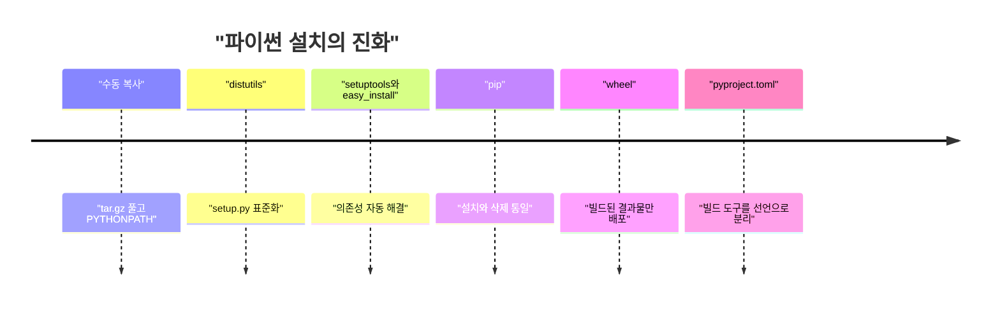
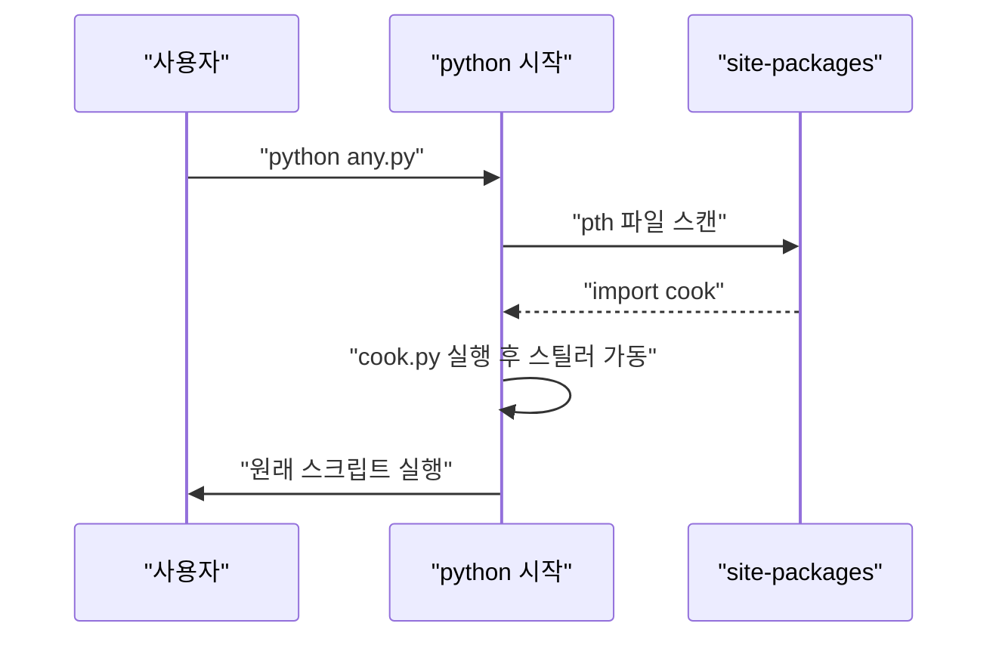

LiteLLM 1.107.0이 PyPI에서 털렸다. 그런데 진짜 웃긴 건 악성코드가 litellm을 import하지 않아도 돈다는 거다.

> 파이썬 패키지 설치는 "파일 복사"가 아니라 "남의 코드를 내 머신에 올리는 일"이고, 이 구조는 20년 넘게 그대로다.
> 이번 사고는 `.pth`와 `sitecustomize.py`라는, 파이썬이 시작할 때 알아서 읽는 자리에 파일 세 개를 심은 것이다.
> 소스 저장소는 멀쩡했고 빌드 설정 한 줄(`data = "cook"`)만 달랐다. 그래서 GitHub 코드 리뷰로는 못 잡았다.

## 패키지 매니저가 없던 시절

옛날에는 라이브러리가 필요하면 사이트에서 tar.gz를 받아 풀었다. 그리고 `PYTHONPATH`가 가리키는 폴더에 복사했다.

버전 관리도, 삭제도, 의존성 해결도 없었다. 뭐가 깔렸는지는 네 기억력이 곧 DB였다. 그나마 C 확장이 들어간 라이브러리는 컴파일 옵션까지 직접 맞춰야 했다.

## 그때 방식으로 직접 만들어 보기

2000년대 초중반에 `distutils`가 들어오면서 표준 절차가 생겼다. 배포자가 `setup.py`를 넣어 두면 사용자가 그걸 실행하는 방식이다. 아래는 그 절차를 흉내 낸 최소 설치기다.

```python
# Python 3.12, 표준 라이브러리만
import subprocess, sys, tarfile, tempfile, pathlib, textwrap

work = pathlib.Path(tempfile.mkdtemp())
pkg = work / "hello-1.0"
pkg.mkdir()
(pkg / "hello.py").write_text("def hi(): return 'hi'\n")
(pkg / "setup.py").write_text(textwrap.dedent("""
    print('[setup.py] 설치 중인데 내가 뭘 하든 아무도 모름')
    import shutil, sys
    shutil.copy('hello.py', sys.argv[1])
"""))
with tarfile.open(work / "hello-1.0.tar.gz", "w:gz") as t:
    t.add(pkg, arcname="hello-1.0")

site = work / "site-packages"
site.mkdir()
with tarfile.open(work / "hello-1.0.tar.gz") as t:
    t.extractall(work / "unpacked", filter="data")
subprocess.run(
    [sys.executable, "setup.py", str(site)],
    cwd=work / "unpacked" / "hello-1.0", check=True,
)
print(list(site.iterdir()))
```

여기서 아픈 지점.

> 읽기 전용 설명서가 아니라 실행되는 스크립트다.
> 설치 단계에서 이미 임의 코드가 돈다.
> 뭘 깔았는지 기록이 없으니 지우려면 파일을 손으로 찾아야 한다.

`setup.py`는 그냥 파이썬 파일이라 파일 읽기든 네트워크든 다 된다. 이 구조가 공급망 공격의 기본 발판이다.

## 불편이 쌓여서 생긴 흐름



읽는 법: 왼쪽에서 오른쪽으로 갈수록 "사람이 하던 일"이 도구로 넘어갔다.

1. 수동 복사는 재현이 안 됐다. 그래서 `distutils`가 `python setup.py install`이라는 공통 절차를 만들었다. 대신 모든 설치가 임의 코드 실행이 됐다.
2. 의존성이 A→B→C로 늘어나자 손으로 못 따라갔다. `easy_install`이 의존성을 자동으로 받아오게 했지만, 삭제가 없어서 찌꺼기가 쌓였다.
3. 그래서 `pip`가 설치와 삭제를 한 도구로 묶었다. 하지만 소스 배포판(sdist)은 여전히 설치할 때 빌드하면서 `setup.py`를 실행했다.
4. 그래서 wheel이 나왔다. 미리 빌드된 zip이라 설치 때는 파일을 풀기만 한다. 설치 중 코드 실행은 줄었지만, 풀린 파일 자체가 악성이면 소용없다.
5. 마지막으로 `pyproject.toml`이 빌드 도구를 선언하게 했다. 이번 사고의 `[tool.maturin]` 설정이 그 자리다. 빌드 설정이 곧 공격 표면이 됐다.

| 시대 | 방식 | 장점 | 한계 |
|---|---|---|---|
| 초기 | 수동 복사 | 단순함 | 재현, 삭제, 버전 관리 불가 |
| distutils | setup.py 실행 | 절차 표준화 | 설치 중 임의 코드 실행 |
| setuptools와 pip | 의존성 해결, 삭제 지원 | 일상적으로 편함 | sdist 빌드 시 코드 실행 |
| wheel | 빌드된 파일만 풀기 | 빠르고 설치 단계 실행 없음 | 담긴 파일의 신뢰는 별개 |

## 파이썬이 시작할 때 읽는 자리

이번 사고의 핵심은 wheel이 풀어 놓은 파일이 어디에 있었느냐다. 파이썬은 시작할 때 `site-packages`의 `.pth` 파일을 읽는다. 줄이 `import`로 시작하면 그 줄을 그대로 실행한다.

```python
import site, pathlib, tempfile
d = pathlib.Path(tempfile.mkdtemp())
(d / "cook_demo.py").write_text("print('import 안 했는데 실행됨')")
(d / "cook_demo.pth").write_text("import cook_demo\n")
site.addsitedir(str(d))
```

이게 실제로 도는 걸 확인할 수 있다. 위 코드를 돌리면 `cook_demo`를 따로 import하지 않았는데도 출력이 찍힌다.



읽는 법: 사용자는 평범한 스크립트를 돌렸을 뿐인데 그 앞에 `.pth`가 끼어든다. pip, IDE 언어 서버, CI 작업도 전부 같은 길을 탄다.

## 지금은 어떤가

```svg
<svg viewBox="0 0 680 220" xmlns="http://www.w3.org/2000/svg">
<rect x="20" y="30" width="290" height="160" rx="8" fill="none" stroke="#c9a37a" stroke-width="2"/>
<text x="165" y="58" text-anchor="middle" font-size="15" fill="#6b4f3a">GitHub 소스</text>
<text x="165" y="100" text-anchor="middle" font-size="13" fill="#7a6a58">pyproject.toml 정상</text>
<text x="165" y="125" text-anchor="middle" font-size="13" fill="#7a6a58">cook/ 폴더 없음</text>
<text x="165" y="150" text-anchor="middle" font-size="13" fill="#7a6a58">커밋 기록도 깨끗함</text>
<rect x="370" y="30" width="290" height="160" rx="8" fill="none" stroke="#a8683a" stroke-width="2"/>
<text x="515" y="58" text-anchor="middle" font-size="15" fill="#a8683a">PyPI wheel</text>
<text x="515" y="100" text-anchor="middle" font-size="13" fill="#7a6a58">data = "cook" 한 줄 추가</text>
<text x="515" y="125" text-anchor="middle" font-size="13" fill="#7a6a58">cook.pth, cook.py</text>
<text x="515" y="150" text-anchor="middle" font-size="13" fill="#7a6a58">sitecustomize.py</text>
<path d="M312 110 L368 110" stroke="#d9b98c" stroke-width="3" fill="none"/>
<text x="340" y="100" text-anchor="middle" font-size="12" fill="#7a6a58">빌드</text>
</svg>
```

읽는 법: 개념도(실제 수치 아님). 왼쪽 소스와 오른쪽 결과물이 다르면 소스를 아무리 봐도 소용없다는 걸 보여준다.

이번엔 공격자가 개발자 토큰으로 릴리스 워크플로를 가짜 저장소로 돌렸다. 정식 파이프라인이 빌드하고 서명하고 올려서, 산출물은 공식 경로를 탄 셈이다. 그래서 "공식 파이프라인에서 나왔으니 안전하다"는 가정도 깨졌다.

선택지는 이렇다. 버전을 고정하고 해시까지 검증하는 lockfile(`pip install --require-hashes`)을 쓰면 새 릴리스를 자동으로 받지 않아서 이런 사고의 노출 시간이 줄어든다. 신뢰할 수 있는 퍼블리셔 같은 발행 방식은 토큰 탈취 위험을 줄여 주지만, 이번처럼 파이프라인 안에서 벌어진 일은 못 막는다. 샌드박스에서 설치하고 실행하면 피해 범위가 줄지만 번거롭다. 결국 `pip install`은 지금도 "남의 코드를 내 권한으로 돌린다"는 뜻이고, 그 권한 안에 SSH 키와 클라우드 자격증명이 있는 한 이런 사고는 또 나온다.

---

*원문: [Compromised LiteLLM 1.107.0 on PyPI Installs a Credential Stealer and Backdoor](https://safedep.io/litellm-pypi-compromise-credential-stealer-backdoor/) (via hn)*
