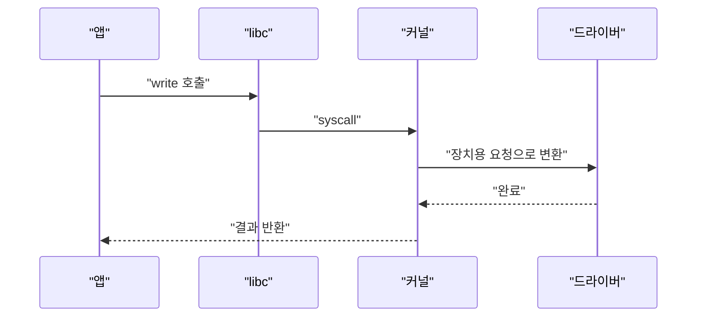
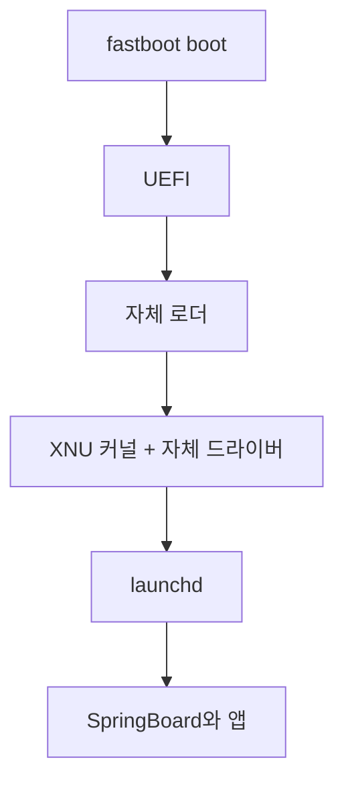

iOS 16.5 커널(XNU)을 안드로이드 폰에서 부팅했다는 프로젝트가 올라왔다. 다들 "왜 하냐"부터 묻는데, 진짜 신기한 건 "된다"는 쪽이다. 앱과 커널 사이의 약속이 하드웨어보다 오래 살아남아서 되는 거다.

> 커널의 진짜 일은 앱이 하드웨어를 몰라도 되게 만드는 것이다. 앱은 syscall이라는 약속만 보고, 하드웨어는 드라이버가 가린다.
> 이 프로젝트는 그 약속을 믿고 커널 아래(로더, 드라이버, 부팅)만 새로 만들어서 iOS 유저 공간을 그대로 올린 것이다.
> 단, README 기준으로 셀룰러, 블루투스, 앱스토어 로그인은 안 되고, 세션도 정해진 시간 뒤 끝나는 연구용이다. 쓰는 폰이 아니다.

## 커널이 없던 시절

처음엔 OS가 없었다. 프로그램이 곧 시스템 전체였고, 화면에 글자를 찍으려면 그 기계의 출력 장치 레지스터 주소에 직접 값을 써야 했다. 주소는 기계 설명서에 적혀 있었고, 프로그래머는 그걸 외웠다.

문제는 기계가 바뀌면 프로그램이 통째로 죽는다는 거다. 주소가 다르고 상태 확인 방식이 다르니 코드를 거의 다시 짠다. 같은 회사 제품이어도 모델이 바뀌면 똑같았다.

"그럼 라이브러리로 묶어서 재사용하면 되잖아?" 실제로 그렇게 했다. 하지만 라이브러리도 결국 앱과 같은 권한으로 돌았다. 프로그램 하나가 잘못된 주소에 값을 쓰면 그 기계 전체가 멈췄다.

이게 왜 위험하냐면, 하드웨어를 만지는 코드와 내 코드 사이에 벽이 없어서다. 버그가 나면 내 변수만 망가지는 게 아니라 장비 상태가 같이 망가진다. 프로그램이 둘 이상 돌기 시작하면 서로의 장비 설정을 덮어쓰는 일도 생긴다.

## 그때 방식으로 직접 만들어 보기

진짜 하드웨어를 만질 순 없으니 가짜 보드 두 개로 흉내 낸다. 앱이 보드 A의 레지스터 주소를 코드에 박아둔 상황이다. Python 3, 표준 라이브러리만 쓴다.

```python
# Python 3.x : 하드웨어 직접 만지기 흉내
class Board:
    def __init__(self, tx, status):
        self.tx, self.status = tx, status
    def poke(self, addr, val):          # 레지스터에 쓰기
        if addr == self.tx:
            print(chr(val), end="")
    def peek(self, addr):               # 레지스터 읽기
        return 1 if addr == self.status else 0

def app_hello(board):
    # 보드 A의 주소를 코드에 박아둔 앱
    for ch in "hello\n":
        for _ in range(1000):
            if board.peek(0x1004):      # 송신 준비됐나?
                break
        else:
            raise RuntimeError("UART가 안 깨어남")
        board.poke(0x1000, ord(ch))

app_hello(Board(0x1000, 0x1004))        # 보드 A: 정상 출력
try:
    app_hello(Board(0x4000, 0x4008))    # 보드 B: 주소가 다름
except RuntimeError as e:
    print("B 보드 실패:", e)
```

보드 A에서는 hello가 찍히고, 보드 B에서는 에러가 난다. 앱 코드는 한 글자도 안 틀렸는데 죽는다. 주소가 다를 뿐이다.

여기서 아픈 지점.

- 앱이 하드웨어 배치를 알고 있다. 보드가 바뀌면 앱을 고쳐야 한다.
- 에러도 조용하다. 틀린 주소에 쓰면 아무 일도 안 일어나거나, 엉뚱한 장치가 반응한다.
- 이 앱이 죽으면 장비를 아는 코드도 같이 죽는다. 막아 줄 벽이 없다.

이 상황을 그림으로 보면 이렇다. 개념도(실제 수치 아님)이고, 왼쪽은 예전 구조, 오른쪽은 지금 구조다. 오른쪽에서는 앱과 하드웨어 사이에 낀 층이 변화를 흡수한다.

<svg viewBox="0 0 680 300" xmlns="http://www.w3.org/2000/svg" font-family="sans-serif" font-size="14">
<text x="110" y="24" fill="#7a6a58" font-weight="bold">커널 이전</text>
<text x="450" y="24" fill="#7a6a58" font-weight="bold">커널 이후</text>
<rect x="40" y="50" width="220" height="60" rx="6" fill="#d9b98c" stroke="#6b4f3a"/>
<text x="70" y="85" fill="#6b4f3a">앱 (주소를 직접 안다)</text>
<line x1="150" y1="110" x2="150" y2="190" stroke="#a8683a" stroke-width="2"/>
<polygon points="144,186 156,186 150,198" fill="#a8683a"/>
<rect x="40" y="200" width="220" height="60" rx="6" fill="#c9a37a" stroke="#6b4f3a"/>
<text x="90" y="235" fill="#6b4f3a">하드웨어 (보드마다 다름)</text>
<rect x="400" y="40" width="220" height="44" rx="6" fill="#d9b98c" stroke="#6b4f3a"/>
<text x="440" y="67" fill="#6b4f3a">앱 (하드웨어를 모름)</text>
<rect x="400" y="100" width="220" height="44" rx="6" fill="#a8683a" stroke="#6b4f3a"/>
<text x="450" y="127" fill="#ffffff">syscall 경계</text>
<rect x="400" y="160" width="220" height="44" rx="6" fill="#c9a37a" stroke="#6b4f3a"/>
<text x="460" y="187" fill="#6b4f3a">커널 + 드라이버</text>
<rect x="400" y="220" width="220" height="44" rx="6" fill="#d9b98c" stroke="#6b4f3a"/>
<text x="440" y="247" fill="#6b4f3a">하드웨어 (보드마다 다름)</text>
<text x="300" y="150" fill="#7a6a58">-&gt;</text>
</svg>

## 그래서 어떻게 진화했나

진화 흐름은 아래처럼 한 줄로 요약된다. 읽는 법은 왼쪽에서 오른쪽으로, 각 칸이 앞 칸의 불편에서 나왔다는 것이다.


**1단계: 공용 라이브러리 / 모니터.** 불편은 기계가 바뀔 때마다 앱을 새로 짜는 것이었다. 해법은 장치 접근 코드를 한 곳에 모아 앱이 그걸 호출하게 하는 것이다. 새 문제는 라이브러리가 앱과 같은 권한이라 앱 버그가 여전히 장비를 망가뜨린다는 점이다.

**2단계: 커널과 보호 모드.** 불편은 프로그램 여러 개가 한 기계를 나눠 쓰는데 서로 못 믿는다는 것이었다. 해법은 CPU가 특권 모드를 지원하게 하고, 장치 접근은 커널만 하게 막는 것이다. 앱은 "이거 해줘"라고 요청만 하고, 그 요청 통로가 syscall이다.

호출 순서는 이렇다. 앱은 직접 장치에 가지 않고, 경계를 넘을 때마다 커널이 검사한다.



Python으로 보면 이 한 줄이 그 약속이다. `os.write(1, b"hello\n")` 에는 보드 주소가 없다. 1번 파일 디스크립터에 쓰라는 요청만 있고, 그게 UART인지 터미널인지는 커널 아래의 일이다.

새 문제는 커널이 하드웨어마다 드라이버를 들고 있어야 한다는 점이다. 장치가 늘면 커널 코드가 부풀고, 드라이버 하나가 커널을 죽일 수도 있다.

**3단계: 드라이버 모델.** 불편은 장치가 계속 늘어난다는 것이었다. 해법은 드라이버를 정해진 인터페이스에 맞춰 끼워 넣는 구조로 만든 것이다. 새 문제는 "이 보드엔 어떤 장치가 어느 주소에 있나"를 커널이 어떻게 아느냐였다.

**4단계: 부트로더와 디바이스 트리.** 예전 ARM 계열은 보드마다 커널에 주소를 하드코딩하는 경우가 많았다. 그러면 보드 하나당 커널을 하나 따로 빌드해야 한다. 그래서 하드웨어 구성을 데이터 파일로 따로 적어 부팅 때 커널에 넘기는 방식이 퍼졌다. 이게 디바이스 트리이고, 리눅스 ARM 쪽은 2010년대 초에 이쪽으로 크게 넘어갔다.

```
uart@4000 {
    compatible = "vendor,uart";
    reg = <0x4000 0x100>;
};
```

위처럼 "UART가 0x4000에 있다"를 코드가 아니라 데이터로 적는다. 앞의 보드 B 문제가 코드 수정이 아니라 파일 한 장 교체로 바뀐 거다. 새 문제는 이 파일을 만들고 맞는 드라이버를 짝지어 주는 일이 사람 손이 많이 간다는 점이다.

**5단계: 에뮬레이션과 가상화.** 하드웨어가 데이터로 표현되면 "진짜 기계 말고 가짜 기계를 줘도 된다"는 생각이 따라온다. QEMU의 `virt` 같은 가상 보드가 그런 예다. 장치가 문서화된 규격대로만 있으면 커널은 진짜인지 가짜인지 신경 쓰지 않는다.

각 세대를 표로 비교하면 이렇다.

| 시대 | 방식 | 장점 | 한계 |
|---|---|---|---|
| 커널 이전 | 앱이 레지스터 직접 접근 | 단순하고 빠름 | 기계마다 재작성, 보호 없음 |
| 커널과 syscall | 앱은 요청만, 커널이 장치 접근 | 이식성, 격리 | 커널에 드라이버가 몰림 |
| 드라이버 모델 | 정해진 인터페이스로 장치 추가 | 장치 확장이 쉬움 | 보드 정보 하드코딩 문제 |
| 디바이스 트리 | 하드웨어 구성을 데이터로 전달 | 커널 하나로 여러 보드 | 파일 작성과 드라이버 매칭은 수작업 |
| 가상화 | 가짜 보드를 규격대로 제공 | 개발과 테스트가 쉬움 | 실제 장치 특성은 별도 |

## 지금은 어떤가

이제 오늘 자료로 돌아온다. HackiOS는 README 설명대로라면 Apple의 오픈소스 XNU 커널(xnu-8796.121.2, iOS 16.5용)을 안드로이드 폰(POCO X5 Pro 5G)과 QEMU에서 부팅하고, 그 위에 iOS 유저 공간(launchd, backboardd, SpringBoard, 앱)을 수정 없이 올린다고 한다. 내가 직접 돌려본 건 아니라서 동작 여부는 README 주장으로만 적는다.

"그럼 iOS 전체를 포팅한 거냐?" 아니다. 유저 공간은 Apple IPSW에서 가져온 그대로고, 갈아끼운 건 커널 아래쪽이다. README에는 자체 EFI 로더, Apple의 닫힌 드라이버를 대체하는 자체 드라이버, UEFI 포팅, 리눅스 Wi-Fi 드라이버를 호환 레이어로 올린 것, GPU는 Mesa/freedreno 경유로 쓴다고 적혀 있다.

흐름을 단순하게 그리면 이렇다. 읽는 법은 위에서 아래로, 앞 단계가 다음 단계를 띄워 준다는 것이다.



위 4단계에서 만든 구조가 그대로 적용된 거다. 앱과 UI는 syscall 약속을 믿고 돌고, 커널 아래의 하드웨어 차이는 드라이버와 로더가 메운다. 이 프로젝트가 한 일의 대부분은 "iOS가 기대하는 하드웨어 모양을 이 폰 위에서 흉내 내 주기"다.

한계도 분명하다. 셀룰러와 블루투스는 안 되고, Secure Enclave가 없어서 앱스토어 로그인이나 FairPlay 쪽도 막혀 있다. 폰에 설치하는 ROM이 아니라 램에서 돌다가 세션이 끝나면 안드로이드로 돌아오는 연구용 벤치라고 README가 직접 선을 긋는다.

"왜 안드로이드 폰에 iOS를 올리냐, 반대로 애플 하드웨어에 자유 OS를 올리는 게 낫지 않냐"는 댓글도 있다. 맞는 말이긴 한데, 이 둘은 같은 기술의 반대 방향일 뿐이다. 커널 아래를 맞춰 주면 위가 돌아간다는 원리는 어느 쪽이든 똑같고, 어느 쪽이 쓸모 있냐는 별개의 문제다.

선택지를 놓고 보면 이렇다. 진짜 안드로이드나 리눅스를 쓰면 드라이버가 이미 있어서 편하다. 가상화(QEMU)는 안전하고 재현이 쉽지만 실제 기기 특성은 못 본다. 이번 같은 방식은 가장 어렵고 가장 불안정하지만, 커널 경계가 얼마나 단단한지를 직접 시험해 보는 방법이다.

결국 폰이 뭐든 앱은 "주소가 어딘지"를 모른다. 그래서 이런 장난이 가능하고, 장난이 가능하다는 사실 자체가 40년 넘게 지켜진 경계가 튼튼하다는 증거다.

---

*원문: [Run full iOS 16.5 firmware on Android Devices](https://github.com/oosexgang/hackios-xnu-kernel) (via hn)*
