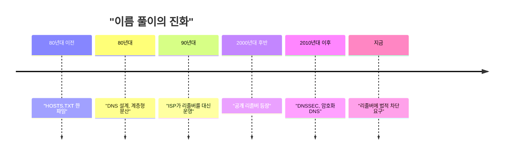
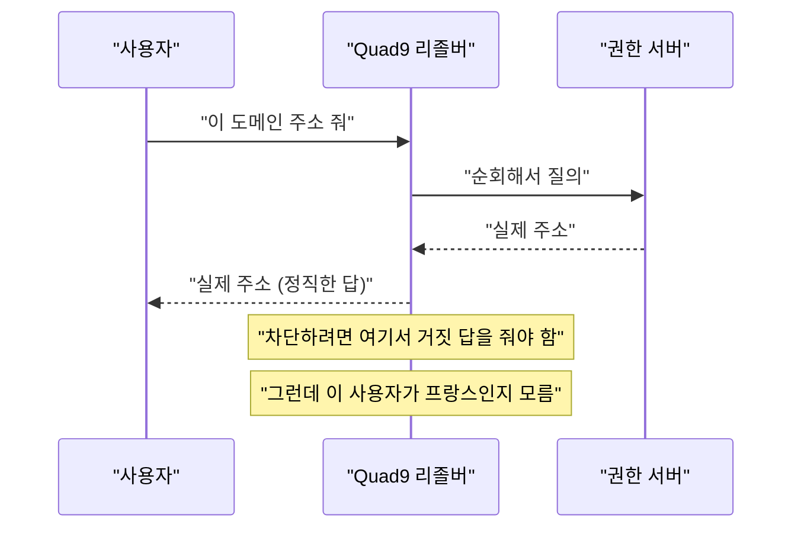

Quad9가 11월 24일부터 프랑스에서 서비스를 접는다. 법원이 "특정 도메인 몇 개의 조회를 막으라"고 했는데, 그걸 못 하겠다고 나라째 나가는 거다.

> - DNS는 이름을 숫자 주소로 바꿔주는 전화번호부고, 리졸버는 그 번호부를 대신 뒤져주는 심부름꾼이다.
> - 심부름꾼이 "그런 번호 없는데?"라고 거짓말을 해야 차단이 되는데, 그 순간 번호부 시스템의 신뢰가 깨진다.
> - 법원은 "프랑스 사용자만 막아라"고 했지만, 익명으로 쓰는 공개 리졸버는 누가 프랑스 사람인지 모른다.

## 이름이 없던 시대

처음 인터넷의 전신(ARPANET) 시절에는 컴퓨터가 몇백 대 수준이었다. 그때는 이름과 주소의 대응표를 파일 하나로 관리했다. 그 파일이 HOSTS.TXT다. 한 기관이 관리하고, 다른 호스트들이 주기적으로 받아가는 식이었다.

지금도 네 맥북에 /etc/hosts가 남아 있다. 모양이 그때와 같다. 한 줄에 주소 하나, 이름 하나다.

```
127.0.0.1   localhost
93.184.216.34   example.com
```

호스트가 몇백 대일 때는 이게 문제없다. 그런데 호스트가 늘면 문제가 연달아 터진다. 파일이 커지고, 새 컴퓨터를 등록하려면 중앙 관리자에게 부탁해야 하고, 내가 받은 파일은 이미 낡은 상태다. 중앙 서버는 모두의 다운로드를 받아내느라 허덕인다.

"그럼 그냥 서버를 늘리면 되지 않냐"는 의문이 들 거다. 파일이 하나인 한 서버를 늘려도 관리자는 한 명이다. 병목이 서버 대수가 아니라 "한 곳이 모든 이름의 정답을 쥐고 있다"는 구조에 있었다.

## 그때 방식으로 직접 만들어 보기

요즘 우리는 gethostbyname 같은 함수 한 줄로 이름을 푼다. 그 밑에서 실제로 오가는 건 UDP 패킷 하나다. 라이브러리 없이 표준 라이브러리만으로 직접 질문을 던져 보자.

```python
# Python 3.8+, 표준 라이브러리만 사용
import socket, struct, random

def build_query(name):
    header = struct.pack(">HHHHHH", random.randint(0, 65535), 0x0100, 1, 0, 0, 0)
    qname = b"".join(bytes([len(p)]) + p.encode() for p in name.split(".")) + b"\x00"
    return header + qname + struct.pack(">HH", 1, 1)  # 타입 A, 클래스 IN

def parse_a(data):
    an = struct.unpack(">H", data[6:8])[0]
    i = 12
    while data[i] != 0: i += data[i] + 1
    i += 5  # 끝 0바이트 + 타입/클래스 4바이트
    ips = []
    for _ in range(an):
        if data[i] & 0xC0 == 0xC0: i += 2  # 압축 포인터
        else:
            while data[i] != 0: i += data[i] + 1
            i += 1
        rtype, _, _, rdlen = struct.unpack(">HHIH", data[i:i + 10])
        i += 10
        if rtype == 1: ips.append(".".join(map(str, data[i:i + rdlen])))
        i += rdlen
    return ips

s = socket.socket(socket.AF_INET, socket.SOCK_DGRAM)
s.settimeout(3)
s.sendto(build_query("example.com"), ("9.9.9.9", 53))
print(parse_a(s.recvfrom(512)[0]))
```

여기서 아픈 지점이 있다.

- 질문도 답도 평문 UDP다. 중간에 있는 누구든 읽을 수 있고, 답을 바꿔치기해도 내가 알아볼 방법이 없다.
- 내가 물어본 서버가 정직한지 확인하는 장치가 이 코드에는 없다. 온 답을 그냥 믿는다.
- 누구에게 물을지는 내가 정한다. 코드에 박은 9.9.9.9는 Quad9의 주소지만, 이걸 ISP 서버로 바꾸는 데 필요한 건 숫자 하나뿐이다. 이 점이 이번 사건의 핵심으로 이어진다.

## 그래서 어떻게 진화했나

흐름부터 보자. 읽는 법은 왼쪽에서 오른쪽으로 시간 순서다.



**1단계: 파일 하나 -> 계층형 분산 DNS.** 불편은 앞에서 말한 대로 중앙 병목이었다. 해법은 이름을 점 단위로 쪼개서 관리 책임도 쪼개는 것이었다. 루트가 com의 위치를 알고, com 관리자가 example.com의 위치를 알고, example.com 주인이 자기 이름의 정답을 안다. 새로 생긴 문제는 질문 한 번에 서버 서너 곳을 돌아야 한다는 것이다. 느리고, 모든 앱이 이 복잡한 순회를 직접 하기는 곤란했다.

**2단계: 순회를 대신해 주는 재귀 리졸버.** 앱은 "example.com 주소 줘" 한 번만 묻는다. 리졸버가 루트부터 차례로 따라 내려가 답을 가져오고, 결과를 캐시해 둔다. 비유하면 114 안내원이다. 너는 전화번호부를 뒤질 필요 없이 안내원에게 이름만 말하면 된다.

그림으로 보면 이렇다. 개념도(실제 수치 아님)이고, 위에서 아래로 질문이 내려간다.

<svg viewBox="0 0 660 300" xmlns="http://www.w3.org/2000/svg" font-family="monospace" font-size="14">
<rect x="20" y="20" width="150" height="50" rx="6" fill="transparent" stroke="#6b4f3a" stroke-width="2"/>
<text x="95" y="50" text-anchor="middle" fill="#7a6a58">내 앱 (스텁)</text>
<rect x="255" y="20" width="170" height="50" rx="6" fill="#d9b98c" stroke="#a8683a" stroke-width="2"/>
<text x="340" y="50" text-anchor="middle" fill="#6b4f3a">재귀 리졸버</text>
<rect x="490" y="10" width="150" height="38" rx="6" fill="transparent" stroke="#c9a37a" stroke-width="2"/>
<text x="565" y="35" text-anchor="middle" fill="#7a6a58">루트</text>
<rect x="490" y="95" width="150" height="38" rx="6" fill="transparent" stroke="#c9a37a" stroke-width="2"/>
<text x="565" y="120" text-anchor="middle" fill="#7a6a58">com 서버</text>
<rect x="490" y="180" width="150" height="38" rx="6" fill="transparent" stroke="#c9a37a" stroke-width="2"/>
<text x="565" y="205" text-anchor="middle" fill="#7a6a58">권한 서버</text>
<line x1="170" y1="45" x2="255" y2="45" stroke="#a8683a" stroke-width="2"/>
<line x1="425" y1="40" x2="490" y2="30" stroke="#c9a37a" stroke-width="2"/>
<line x1="425" y1="55" x2="490" y2="112" stroke="#c9a37a" stroke-width="2"/>
<line x1="425" y1="65" x2="490" y2="195" stroke="#c9a37a" stroke-width="2"/>
<text x="340" y="110" text-anchor="middle" fill="#a8683a">여기서 "거짓 답"을 하면 차단</text>
<text x="340" y="132" text-anchor="middle" fill="#7a6a58">서버는 법원의 눈에 보이는 유일한 지점</text>
<text x="95" y="110" text-anchor="middle" fill="#7a6a58">익명, 가입 없음</text>
<text x="330" y="270" text-anchor="middle" fill="#7a6a58">진짜 콘텐츠는 권한 서버 너머에 있다</text>
</svg>

위 그림에서 재귀 리졸버가 가운데에 앉아 있다는 점을 기억해라. 법원이 건드릴 수 있는 곳이 여기다. 콘텐츠를 올린 서버는 해외에 있고 잡기 어렵지만, 리졸버는 눈에 보이는 회사다.

**3단계: ISP 리졸버 -> 공개 리졸버.** ISP가 주는 리졸버는 느리거나, 존재하지 않는 도메인에 광고 페이지를 끼워 넣거나, 검열 목록을 적용하기도 했다. 그래서 2000년대 후반부터 8.8.8.8 같은 공개 리졸버를 직접 지정하는 사람이 늘었다. Quad9는 여기에 "악성 도메인은 막되 개인정보는 안 쌓는다"는 노선을 붙인 비영리 서비스다. 새로 생긴 문제는, 사용자가 누구인지 모르는 채로 나라마다 다른 법을 맞춰야 한다는 점이다.

**4단계: 거짓말을 막는 장치.** 평문 UDP는 답을 바꿔치기해도 알 수 없었다. 그래서 DNSSEC가 나왔다. 권한 서버가 답에 서명을 붙이고, 리졸버나 클라이언트가 서명을 검증하는 방식이다. 이후 DoH, DoT처럼 질문 자체를 암호화하는 방식도 퍼졌다.

여기서 흔한 의문이 나온다. "DNSSEC가 있으면 차단도 못 하는 거 아니냐." 반은 맞다. 리졸버가 서명된 도메인에 거짓 답을 주면 검증하는 쪽에서는 변조처럼 보인다. 그래서 Quad9가 말하는 "거짓말하지 않는다"는 원칙이 기술적 의미를 갖는다.

| 시대 | 방식 | 장점 | 한계 |
|---|---|---|---|
| 초기 | HOSTS.TXT | 단순함 | 중앙 병목, 항상 낡음 |
| DNS 초기 | 계층형 분산 | 확장, 위임 | 순회가 번거롭고 평문 |
| ISP 리졸버 | 대리 조회와 캐시 | 빠름, 편함 | ISP가 답을 마음대로 건드림 |
| 공개 리졸버 | 누구나 선택 | 중립성, 보안 필터 | 법적 표적이 됨 |
| DNSSEC와 암호화 | 서명 검증, 질문 암호화 | 변조 탐지 | 도입률 편차, 차단과 충돌 |

## 지금은 어떤가

이번 사건을 요약하면 이렇다. 프랑스 법원이 beIN의 요청으로 Quad9에 특정 도메인 차단을 명했고, 벌금은 하루 580,000유로에서 1,000유로로 줄었다. 그래도 Quad9는 프랑스 서비스를 접기로 했다. 돈 문제가 아니라 원칙 문제라는 게 그쪽 입장이다.

호출 순서로 보면 왜 곤란한지 보인다. 아래 다이어그램은 위에서 아래로 시간 순서다.



차단하려면 두 가지가 필요하다. 이 요청자가 프랑스에 있는지 알아야 하고, 그 사람에게만 거짓 답을 줘야 한다. 그런데 Quad9는 가입도 신원 확인도 없고, 사용자 기록도 남기지 않는다. 신원 없이 이름만 풀어주는 구조가 개인정보 보호의 핵심이라서, 그 장점이 곧 "누가 프랑스인지 모른다"는 한계가 된다.

"그럼 전 세계에 일괄 차단하면 되지 않냐"고 묻는 사람이 있을 거다. 기술적으로는 쉽다. 하지만 프랑스 법원 판결이 전 세계 사용자에게 적용되는 셈이라서 Quad9는 선례가 위험하다며 거부했다. 어떤 나라든 같은 방식으로 자기 법을 다른 나라에 들이밀 수 있게 된다는 논리다.

그럼 IP 지역 판별(geoIP)로 프랑스만 막으면 되지 않냐는 의문도 있다. Quad9가 독일에서 이미 해봤다. 원고 측이 VPN으로 독일 밖에서 접속해 우회에 성공했고, 법원은 차단 미이행으로 판단해 벌금을 물렸다. 최종적으로 이겼지만 몇 년이 걸렸고 비용도 컸다고 한다. 그래서 이번엔 시도하지 않고 서비스를 접는 쪽을 택했다.

댓글에서 CTO가 직접 한 말이 흥미롭다. 11월 24일 이후 프랑스 사용자를 서비스에서 막는 데는 geoIP를 쓸 가능성이 높다고 했다. 정밀도가 완벽하지 않은 도구라도 "서비스를 통째로 끄는" 용도라면 오차가 큰 문제가 아니기 때문이다. 반면 "특정 도메인만 골라 막는" 용도에는 오차가 곧 법적 위험이다.

지금 선택지를 비교하면 이렇다.

- 리졸버를 ISP로 돌려놓는다. 프랑스 ISP는 이미 차단 명령을 따르고 있다. 가장 편하지만 가장 덜 중립적이다.
- 다른 공개 리졸버를 쓴다. Google과 Cloudflare는 프랑스에서 이미 차단 명령을 받아 이행한 것으로 알려져 있다. Cisco의 OpenDNS는 아예 프랑스에서 철수했다는 얘기가 댓글에 나온다.
- 직접 재귀 리졸버를 돌린다. Unbound 같은 걸 집에서 돌리면 남의 규칙을 안 받지만, 질의가 ISP에게 그대로 보이고 캐시 이점도 작다.

남은 한계는 분명하다. DNS 차단은 이름만 지울 뿐이라 IP를 직접 치거나 hosts 파일에 적으면 그대로 접속된다. 그래서 차단을 요구하는 쪽도 막는 쪽도 다음 수를 계속 찾는다. 전화번호부 회사를 압박해서 통화를 못 하게 하겠다는 발상은 번호부를 한 장 복사하는 순간 끝나는데, 이번에도 가장 먼저 비용을 치르는 건 번호부를 만든 쪽이다.

---

*원문: [Quad9 (DNS Resolver) to Exit France](https://quad9.net/news/blog/au-revoir-france/) (via hn)*
