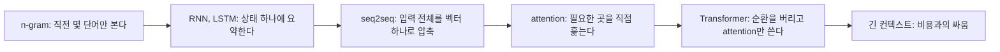

Kimi가 K3.1 Pro를 내놓으면서 컨텍스트 윈도우 100만 토큰을 자랑스럽게 적어놨다. 다들 숫자만 보는데, 이 숫자가 왜 자랑거리인지는 "기억"이 원래 얼마나 비싼 물건이었는지 알아야 보인다.

> - 언어 모델의 기억력은 "직전 몇 단어만 본다"에서 시작해서, 요약 하나에 몰아넣기를 거쳐, 필요한 곳을 직접 훑는 attention으로 왔다.
> - 컨텍스트 100만 토큰은 모델이 똑똑해졌다는 뜻이기 전에, 그 기억을 감당할 메모리와 연산을 돌릴 수 있게 됐다는 뜻이다.
> - Highspeed 같은 별도 버전이 나오는 이유도, 긴 기억은 공짜가 아니라서 속도와 맞바꿔야 하기 때문이다.

## 기억이 없던 시대

옛날 언어 모델은 문맥을 거의 못 봤다. 다음 단어를 맞히려면 앞 내용을 알아야 하는데, 전체를 다 기억하는 건 계산도 저장도 감당이 안 됐다. 그래서 타협했다. 직전 한두 단어만 보고 다음 단어를 찍는 방식이다. n-gram이라고 부른다.

원리는 단순하다. 큰 텍스트를 쭉 읽으면서 "A B 다음에는 C가 몇 번 나왔다"를 센다. 새 문장을 만들 때는 마지막 두 단어를 보고, 세어둔 후보 중에서 골라 붙인다. 통계 기반 자동완성이다.

"그럼 단어를 열 개, 스무 개씩 보면 되지 않냐"는 의문이 바로 든다. 안 된다. 단어 조합 수가 폭발해서, 스무 단어짜리 조합은 학습 데이터에 한 번도 안 나온 게 대부분이다. 본 적 없는 조합은 확률을 줄 수 없다. 기억을 늘리려는 순간 표가 텅텅 비는 구조였다.

## 그때 방식으로 직접 만들어 보기

Python 3.11, 표준 라이브러리만 쓴 trigram 생성기다. 앞 두 단어를 키로 잡고 다음 단어 후보를 모아둔다.

```python
import random
from collections import defaultdict

text = ("the cat sat on the mat and the cat ate the fish "
        "then the dog sat on the mat and the dog ate the bone").split()

N = 2  # 직전 2단어만 본다
table = defaultdict(list)
for i in range(len(text) - N):
    table[tuple(text[i:i + N])].append(text[i + N])

def generate(length=12):
    out = list(random.choice(list(table)))
    for _ in range(length):
        nxt = table.get(tuple(out[-N:]))
        if not nxt:
            break
        out.append(random.choice(nxt))
    return " ".join(out)

print(generate())
```

돌려보면 문법은 그럴싸한데 내용이 샌다. "the cat sat on the mat and the dog ate the fish"처럼 고양이 얘기를 하다가 개가 생선을 먹는다. 앞에서 뭘 말했는지 모르니까 그렇다.

여기서 아픈 지점은 이렇다.

- 기억 길이가 코드에 박혀 있다. N을 키우면 표가 희소해지고, 줄이면 맥락이 사라진다.
- 단어를 "그대로" 키로 쓰기 때문에 비슷한 단어끼리 배운 걸 공유하지 못한다. cat을 배워도 dog에는 도움이 안 된다.
- 멀리 떨어진 단어 사이의 관계(문장 앞의 주어와 문장 끝의 동사)는 구조적으로 못 본다.

## 그래서 어떻게 진화했나

불편이 쌓이면서 해법이 순서대로 나왔다. 큰 흐름부터 본다.

읽는 법: 왼쪽에서 오른쪽으로 갈수록 최근 방식이고, 각 칸 아래 화살표가 "그 방식이 낳은 다음 문제"다.



**1단계: n-gram에서 RNN으로.** 불편은 기억 길이를 못 늘린다는 거였다. 해법은 단어를 숫자 벡터로 바꾸고, 문장을 읽으면서 "지금까지 읽은 내용의 요약"을 상태 하나에 계속 덮어쓰는 순환 신경망(RNN)이다. 표를 외우는 대신 요약본을 들고 다니는 셈이다. 새로 생긴 문제는 이 요약본이 너무 쉽게 닳는다는 것이다. 문장이 길어지면 앞부분이 희미해진다. 1997년에 나온 LSTM이 이걸 상당히 완화했지만 구조적으로는 여전히 "작은 가방 하나에 다 넣기"였다.

**2단계: 번역기에서 터진 병목.** 입력 문장을 읽어서 벡터 하나로 압축하고, 그 벡터에서 번역문을 뽑아내는 seq2seq가 2010년대 중반에 나왔다. 불편은 명확했다. 문장이 길수록 벡터 하나에 다 담기지 않아서 번역 품질이 떨어졌다. 비유하자면 책 한 권을 포스트잇 한 장에 요약해서 넘기고 그걸 보고 번역하라는 꼴이다.

**3단계: attention.** 해법은 요약본만 보지 말고, 출력할 때마다 입력의 각 위치를 다시 훑어서 "지금 필요한 부분"에 가중치를 주자는 것이다. 도서관 사서가 질문을 받을 때마다 서가를 직접 둘러보는 방식과 비슷하다. 핵심 계산은 이 정도다.

```python
import math

def attention(q, keys, values):
    scores = [sum(a * b for a, b in zip(q, k)) for k in keys]
    exps = [math.exp(s) for s in scores]
    weights = [e / sum(exps) for e in exps]
    return [sum(w * v[i] for w, v in zip(weights, values))
            for i in range(len(values[0]))]
```

질문(q)과 각 위치의 열쇠(keys)를 곱해서 점수를 내고, 점수를 확률처럼 바꿔서 값(values)을 섞는다. 실제 구현은 여기에 스케일링과 행렬 연산이 붙지만 뼈대는 같다. 새로 생긴 문제는 모든 위치를 다 훑으니 비용이 입력 길이의 제곱으로 늘어난다는 점이다.

**4단계: Transformer.** attention이 잘 되니 굳이 순환 구조가 필요 없다는 결론이 나왔다. 2017년 "Attention Is All You Need"가 그 선언이다. 순환이 없으니 문장 전체를 병렬로 계산할 수 있어서 GPU에 딱 맞았고, 그래서 모델을 키우는 경쟁이 가능해졌다. 대신 제곱 비용은 그대로 남았다.

세대별로 정리하면 이렇다.

| 시대 | 방식 | 장점 | 한계 |
|---|---|---|---|
| 초기 | n-gram | 구현이 단순하고 빠름 | 기억이 몇 단어뿐, 표가 희소해짐 |
| 중기 | RNN, LSTM | 임의 길이 입력을 읽을 수 있음 | 요약이 닳음, 순차 계산이라 병렬화 어려움 |
| 전환기 | seq2seq + attention | 필요한 위치를 직접 참조 | 아직 순환 구조에 얹혀 있어 느림 |
| 현재 | Transformer | 병렬 학습, 긴 문맥 참조 | 문맥이 길수록 메모리와 연산이 급증 |

읽는 법: 위에서 아래로 시대가 내려오고, 한계 칸이 다음 줄의 장점 칸을 만들어냈다.

기억 방식 차이를 그림으로 보면 더 쉽다. 개념도(실제 수치 아님)이고, 막대가 길수록 한 번에 직접 참조할 수 있는 범위가 넓다는 뜻이다.

<svg viewBox="0 0 640 220" xmlns="http://www.w3.org/2000/svg">
<text x="20" y="40" font-size="14" fill="#7a6a58">n-gram</text>
<rect x="150" y="26" width="40" height="18" fill="#d9b98c"/>
<text x="200" y="40" font-size="12" fill="#7a6a58">직전 2단어</text>
<text x="20" y="90" font-size="14" fill="#7a6a58">RNN, LSTM</text>
<rect x="150" y="76" width="40" height="18" fill="#c9a37a"/>
<rect x="190" y="76" width="200" height="18" fill="#c9a37a" opacity="0.25"/>
<text x="400" y="90" font-size="12" fill="#7a6a58">요약 하나에 눌러 담음</text>
<text x="20" y="140" font-size="14" fill="#7a6a58">Transformer</text>
<rect x="150" y="126" width="440" height="18" fill="#a8683a"/>
<text x="150" y="165" font-size="12" fill="#7a6a58">컨텍스트 안의 모든 위치를 직접 참조</text>
<text x="20" y="205" font-size="12" fill="#6b4f3a">연한 막대는 흐려진 기억, 진한 막대는 직접 접근 가능한 범위</text>
</svg>

## 지금은 어떤가

이제 Kimi K3.1 Pro로 돌아간다. 이 모델은 컨텍스트 윈도우가 100만 토큰이라고 한다. 위 흐름으로 보면 "직전 두 단어"에서 출발한 기억이 코드베이스 한 덩어리, 문서 수백 개를 통째로 올릴 수 있는 수준까지 온 것이다. 자료에 나온 재무 문서 교차 검증이나 장기 코딩 작업 같은 걸 하려면 이런 기억이 전제가 된다.

그럼 왜 다들 100만으로 안 가고 몇 만 토큰에서 멈췄냐는 의문이 남는다. 두 가지 벽이 있었다. 하나는 앞서 말한 연산 비용이다. 다른 하나는 이미 읽은 토큰마다 attention에 쓰는 중간값(KV 캐시)을 메모리에 들고 있어야 한다는 점이다. 문맥이 길어지면 GPU 메모리가 먼저 바닥난다. 이 벽을 넘으려고 어텐션 계산을 효율화하고 캐시를 줄이는 별도 최적화가 계속 붙는다. 다만 Kimi가 이번 모델에서 구체적으로 어떤 구조를 쓰는지는 이 자료에 안 나와 있다. 가중치가 공개된다는 11월 4일 이후에 확인해야 할 부분이다.

Highspeed 버전이 별도로 존재하는 것도 같은 맥락이다. 긴 기억과 큰 모델은 응답 속도를 깎아먹으니, 속도가 2~3배 빠른 걸 따로 파는 건 비용 구조를 그대로 가격표에 드러낸 것이다. 댓글에 구독 한도가 47분 만에 찼다는 불평이 있는 것도 우연이 아니다. 긴 컨텍스트에 에이전트까지 돌리면 토큰이 순식간에 나간다. 벤치마크 점수는 전부 제조사가 발표한 수치이니 그대로 믿지 말고 직접 돌려보는 게 맞다.

선택지는 대략 이렇게 갈린다.

- 컨텍스트를 길게 쓰는 방식: 문서를 통째로 넣으면 구현이 쉽지만 비용과 지연이 커진다. 중간 내용을 놓치는 일도 여전히 있다.
- 필요한 조각만 찾아서 넣는 RAG 방식: 싸고 빠르지만 검색이 틀리면 답도 틀린다.
- 둘을 섞는 방식: 현실에서 제일 많이 쓰는 타협이다.

기억이 100만 토큰이 됐어도 결국 "무엇을 넣고 무엇을 뺄지" 고르는 일은 사람 몫으로 남았고, 그 비용 계산은 옛날 trigram 표를 짜던 때와 본질적으로 똑같다.

---

*원문: [Kimi K3.1 Pro and K3.1 Pro Highspeed](https://www.kimi.ai/blog/kimi-k3-1-pro) (via hn)*
