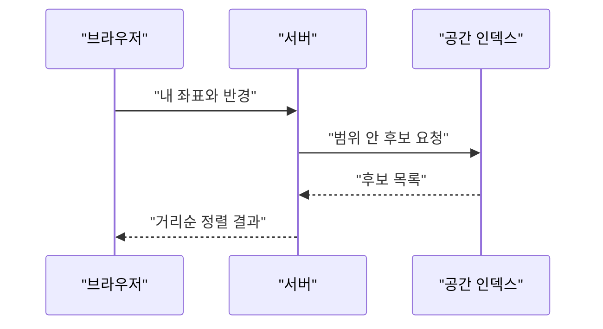

걸어서 30분 안에 있는 위키피디아 항목만 보여주는 사이트가 HN에 올라왔다. 댓글 중에 위키 기본 기능인 Special:Nearby를 감싼 래퍼 같다는 말이 있는데, 내가 직접 확인한 건 아니다. 어쨌든 이 사이트 하나 만드는 데 필요한 진짜 기술은 "내 좌표 근처에 있는 것들을 빨리 찾는 법"이다.

> 좌표 두 개의 거리는 공식 하나로 구하지만, 수백만 개 중에서 가까운 것만 고르는 건 전혀 다른 문제다.
> 위도 인덱스 하나, 경도 인덱스 하나로는 "근처"를 못 찾는다. 2차원을 1차원 줄에 어떻게 펴 넣느냐가 역사의 절반이다.
> 댓글에 나온 불만(시골은 텅 비고 도시는 넘친다, 단위가 야드다)은 대부분 인덱스가 아니라 데이터와 설계 문제다.

## 근처라는 개념이 컴퓨터에 없던 시대

사람은 "근처"를 그냥 안다. 컴퓨터한테는 그런 개념이 없다. 레코드마다 숫자 두 개(위도, 경도)가 적혀 있을 뿐이고, 어느 게 가까운지는 계산해 보기 전엔 모른다.

지도 앱이나 위치 서비스가 흔해지기 전에는 "가까운 걸 찾는다"는 요구 자체가 드물었다. 주소나 지역 이름으로 찾는 게 보통이었다. "서울 종로구"로 필터링하면 끝이었으니까. 이건 사실 "근처"를 행정구역이라는 정해진 칸으로 바꿔 놓은 방식이다.

문제는 칸 경계다. 종로구 끝에 서 있으면 길 건너 중구에 있는 가게가 훨씬 가깝다. 그런데 칸 기준으로 검색하면 그 가게는 안 나온다. 사람들은 그냥 "그 정도는 감안해서 봐라" 하고 버텼다.

좌표가 들어오고 나서도 처음엔 단순무식했다. 전부 꺼내서 하나씩 거리를 재고, 가까운 것만 남긴다. 데이터가 수천 개일 때는 이게 정답이다. 가장 단순하고 틀릴 구석이 없으니까.

## 그때 방식으로 직접 만들어 보기

아래는 Python 3.11, 표준 라이브러리만 쓴 전수 검사 버전이다. 지구를 구로 보고 두 점 사이 거리를 구하는 haversine 공식을 쓴다. 좌표는 대충 잡은 예시 값이라 정밀하지 않다.

```python
import math

PLACES = [
    ("경복궁", 37.5796, 126.9770),
    ("광화문", 37.5759, 126.9769),
    ("서울시청", 37.5663, 126.9779),
    ("남산서울타워", 37.5512, 126.9882),
]

def haversine(lat1, lon1, lat2, lon2):
    r = 6371000  # 지구 반지름(m), 근사값
    p1, p2 = math.radians(lat1), math.radians(lat2)
    dp = p2 - p1
    dl = math.radians(lon2 - lon1)
    a = math.sin(dp / 2) ** 2 + math.cos(p1) * math.cos(p2) * math.sin(dl / 2) ** 2
    return 2 * r * math.asin(math.sqrt(a))

def nearby(lat, lon, radius_m=2500):
    hits = []
    for name, plat, plon in PLACES:
        d = haversine(lat, lon, plat, plon)
        if d <= radius_m:
            hits.append((round(d), name))
    return sorted(hits)

print(nearby(37.5700, 126.9770))
```

걸어서 30분이 대략 2~3km라서 반경은 2500m로 잡았다. 돌려 보면 가까운 순서대로 이름이 나온다.

여기서 아픈 지점은 이렇다.

- 매 요청마다 모든 항목을 돈다. 항목이 4개면 상관없지만 수백만 개면 요청 하나가 그 전부를 삼각함수로 계산한다.
- 사용자가 늘면 느려지는 정도가 곱으로 늘어난다. 항목 수와 요청 수가 둘 다 커진다.
- DB에 넣어도 소용없다. 거리 계산은 DB가 인덱스로 건너뛸 수 없는 함수라서, 결국 전체 행을 읽는다.

## 그래서 어떻게 진화했나

한 번에 이어서 보면 이렇게 흘렀다. 읽는 법: 왼쪽에서 오른쪽으로 갈수록 나중 방식이고, 각 칸은 앞 단계의 불편을 푼 결과다.


### 1단계. 사각형으로 먼저 거른다

불편은 속도였다. 해법은 "원을 바로 재지 말고, 원을 감싸는 정사각형 안에 있는 것만 후보로 삼자"였다. 사각형 판정은 숫자 비교 네 번이면 끝나서 싸다.

```sql
SELECT * FROM places
WHERE lat BETWEEN 37.55 AND 37.59
  AND lon BETWEEN 126.95 AND 127.01;
```

여기서 새 문제가 생긴다. 위도 컬럼과 경도 컬럼에 각각 일반 인덱스를 걸어도 DB는 둘을 깔끔하게 합치지 못한다. 위도 범위로 줄이면 "지구를 가로지르는 띠" 전체가 후보로 남는다. 서울 위도와 같은 띠에는 베이징도 뉴욕 일부도 있다. 일반 인덱스는 한 줄로 정렬된 값에만 강한데, 위치는 줄이 아니라 평면이다.

경도 쪽에는 함정도 하나 있다. 경도 1도의 길이는 위도에 따라 줄어든다. 적도에서는 약 111km쯤이지만 고위도로 갈수록 짧아진다. 그래서 "반경 2.5km"를 도 단위로 바꿀 때 위도와 경도를 다르게 환산해야 한다.

### 2단계. 평면을 격자로 쪼갠다

불편은 2차원을 1차원 인덱스에 못 넣는다는 점이었다. 해법은 평면을 일정한 칸으로 나누고, 칸 번호를 키로 쓰는 것이다. 내 칸과 이웃 8칸만 열어 보면 된다.

```python
from collections import defaultdict
CELL = 0.02  # 약 2km 안팎의 칸

def cell(lat, lon):
    return (int(lat // CELL), int(lon // CELL))

grid = defaultdict(list)
for p in PLACES:
    grid[cell(p[1], p[2])].append(p)
```

이걸 문자열 하나로 압축한 게 geohash 같은 방식이다. 앞글자가 같으면 같은 구역이라서, 일반 B-tree 인덱스에서 접두사 검색만으로 "근처"를 찾는다. 2차원 문제를 기존 도구가 이미 잘하는 1차원 문제로 바꿔치기한 셈이다.

새 문제는 세 가지다. 칸 경계에서 이웃 칸까지 봐야 하고, 칸 크기가 고정이라 밀도 차이를 못 따라간다. 도시 한복판 한 칸에는 수만 개가 몰리고 시골 한 칸은 비어 있다. 댓글에서 "내가 사는 곳은 몇 시간을 걸어야 위키 항목이 나온다"와 "도시는 결과가 넘친다"는 불만이 같이 나온 이유가 이 밀도 차이와 닿아 있다.

### 3단계. 밀도에 맞춰 알아서 쪼개는 트리

불편은 고정 칸이 너무 뻣뻣하다는 점이었다. 해법은 데이터가 몰린 곳은 잘게, 빈 곳은 크게 나누는 트리다. quadtree는 칸이 차면 4등분하는 방식이다. R-tree는 근처 점들을 사각형 상자로 묶고, 그 상자들을 다시 더 큰 상자로 묶는다. R-tree는 80년대 중반에 나온 오래된 아이디어다.

검색은 위에서부터 내려온다. 내 검색 범위와 겹치지 않는 상자는 통째로 건너뛴다. 책 목차에서 "관련 없는 부 전체를 안 펴 보는 것"과 같다.

PostgreSQL에서는 이런 구조를 GiST 인덱스 형태로 쓰고, 확장인 PostGIS가 지리 데이터용 타입과 함수를 얹는다. 새로 생긴 문제는 쓰기 쪽이다. 상자가 겹치면 검색이 느려지고, 데이터가 계속 바뀌면 트리를 관리하는 비용이 커진다.

### 4단계. 검색엔진과 전용 셀 체계

불편은 "근처이면서 키워드도 맞고 점수도 높은 것"처럼 조건이 섞이는 검색이었다. 그래서 Elasticsearch 같은 검색엔진이 거리 조건을 기본 필터로 흡수했다. 한편 Google의 S2나 Uber의 H3는 지구 표면 전체를 계층적 셀로 나누고, 셀 ID 하나로 위치를 표현한다. 이러면 이웃 찾기와 집계가 숫자 연산 몇 번으로 끝난다.

여기서 독자가 품을 의문이 하나 있을 거다. "그냥 다 R-tree 쓰면 되지, 왜 셀 체계가 또 나왔냐." 셀 ID는 그냥 숫자나 문자열이라서 어느 DB, 어느 캐시, 어느 분산 저장소에든 넣을 수 있다. 트리는 그걸 지원하는 시스템에서만 쓸 수 있다. 서비스 규모가 커질수록 이 차이가 효과를 낸다.

아래는 세대별 비교다. 읽는 법: 윗줄일수록 오래된 방식이고, 장점과 한계는 서로 맞물려 다음 줄을 낳았다.

| 시대 | 방식 | 장점 | 한계 |
|---|---|---|---|
| 초기 | 전수 검사 + 거리 공식 | 단순하고 틀릴 일이 없다 | 데이터가 늘면 선형으로 느려진다 |
| 그다음 | 사각형 범위 + 일반 인덱스 | 기존 DB로 바로 가능 | 한 축만 줄여서 후보가 많이 남는다 |
| 이후 | 격자, geohash | 접두사 검색으로 간단히 처리 | 경계 문제, 고정 크기 |
| 현재 | R-tree, 검색엔진, S2, H3 | 밀도에 적응하거나 분산에 유리 | 구성과 선택이 복잡하다 |

구조 차이를 그림으로도 그려 둔다. 개념도(실제 수치 아님)다. 읽는 법: 왼쪽은 모든 점을 다 훑는 방식, 오른쪽은 내 칸과 이웃 칸만 여는 방식이다.

<svg viewBox="0 0 680 260" xmlns="http://www.w3.org/2000/svg">
<text x="150" y="24" fill="#7a6a58" font-size="14" text-anchor="middle">전수 검사</text>
<text x="510" y="24" fill="#7a6a58" font-size="14" text-anchor="middle">격자로 거른 뒤</text>
<rect x="30" y="40" width="240" height="180" fill="none" stroke="#6b4f3a" stroke-width="2"/>
<circle cx="70" cy="80" r="6" fill="#a8683a"/>
<circle cx="120" cy="150" r="6" fill="#a8683a"/>
<circle cx="170" cy="70" r="6" fill="#a8683a"/>
<circle cx="210" cy="180" r="6" fill="#a8683a"/>
<circle cx="90" cy="195" r="6" fill="#a8683a"/>
<circle cx="230" cy="110" r="6" fill="#a8683a"/>
<circle cx="150" cy="120" r="9" fill="#6b4f3a"/>
<text x="150" y="245" fill="#7a6a58" font-size="12" text-anchor="middle">점 전부와 거리를 잰다</text>
<rect x="390" y="40" width="240" height="180" fill="none" stroke="#6b4f3a" stroke-width="2"/>
<line x1="470" y1="40" x2="470" y2="220" stroke="#c9a37a"/>
<line x1="550" y1="40" x2="550" y2="220" stroke="#c9a37a"/>
<line x1="390" y1="100" x2="630" y2="100" stroke="#c9a37a"/>
<line x1="390" y1="160" x2="630" y2="160" stroke="#c9a37a"/>
<rect x="470" y="100" width="80" height="60" fill="#d9b98c" fill-opacity="0.5" stroke="#a8683a" stroke-width="2"/>
<circle cx="430" cy="70" r="6" fill="#c9a37a"/>
<circle cx="590" cy="190" r="6" fill="#c9a37a"/>
<circle cx="500" cy="130" r="6" fill="#a8683a"/>
<circle cx="530" cy="140" r="6" fill="#a8683a"/>
<circle cx="510" cy="120" r="9" fill="#6b4f3a"/>
<text x="510" y="245" fill="#7a6a58" font-size="12" text-anchor="middle">내 칸과 이웃 칸만 열어 본다</text>
</svg>

## 지금은 어떤가

오늘 자료인 Local Wikipedia는 위에서 말한 흐름의 맨 끝에 서 있다. 위키피디아 문서에 좌표를 붙여 두면, "내 좌표 근처 문서"는 서버가 미리 만든 공간 인덱스로 찾는다. 내부 구현의 세부는 내가 확인하지 못했다. 다만 거리 조건을 질의로 받아 후보를 빠르게 좁히는 구조라는 건 틀림없다.

호출 흐름은 이런 모양이다. 읽는 법: 위에서 아래로 시간 순서고, 브라우저는 좌표만 보내고 거리 계산과 정렬은 서버 쪽에서 끝난다.



댓글들의 불만을 이 틀로 보면 성격이 갈린다. 반경을 바꾸고 싶다는 말은 설계 선택이다. 위키 쪽 API는 반경에 상한을 두는 걸로 아는데, 정확한 수치는 확신이 없어서 적지 않는다. 상한을 두는 이유는 단순하다. 반경이 커질수록 후보가 폭증하고, 그건 곧 서버 비용이다.

시골에서 결과가 없고 도시에서 주택단지와 도로만 나온다는 불만은 인덱스 탓이 아니다. 그건 데이터에 좌표가 달린 문서가 뭐가 있느냐의 문제다. 인덱스는 있는 걸 빨리 찾아 줄 뿐이고, 없는 걸 만들어 주진 못한다.

"걸어서 30분"이라는 말도 함정이 있다. 우리가 구현한 건 직선거리다. 강이나 철도 건너편은 직선으로는 가깝지만 실제로는 한참 돌아야 한다. 진짜 도보 시간을 구하려면 길 네트워크 위에서 경로를 계산해야 하고, 그건 공간 인덱스와는 다른 층의 문제다. 야드가 모욕이라는 댓글은 단위 표시의 문제라서 계산과는 아무 상관이 없다.

지금 고르는 방법을 비교하면 이렇다.

- 데이터가 수만 개 이하: 전수 검사에 사각형 필터만 붙여도 충분하다. 인덱스는 복잡도를 사는 일이다.
- 이미 PostgreSQL을 쓴다: PostGIS와 GiST 인덱스가 가장 무난하다. 거리 정렬과 반경 필터를 SQL 하나로 쓴다.
- 키워드, 점수, 거리를 섞어야 한다: 검색엔진의 거리 필터를 쓴다.
- 대규모 분산 환경이나 집계가 중요하다: S2나 H3 같은 셀 ID 방식이 편하다.

결국 "근처"는 질문 하나로 보이지만, 안쪽에서는 40년 넘게 평면을 어떻게 줄 세우느냐는 싸움이 이어져 왔다. 이 사이트가 시시해 보여도 뒤에서 도는 건 그 싸움의 결과물이다.

---

*원문: [Local Wikipedia: Wikipedia, but only for things a half hour walk from you](https://edjefferson.com/localwiki/) (via hn)*
