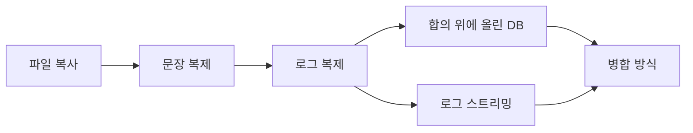
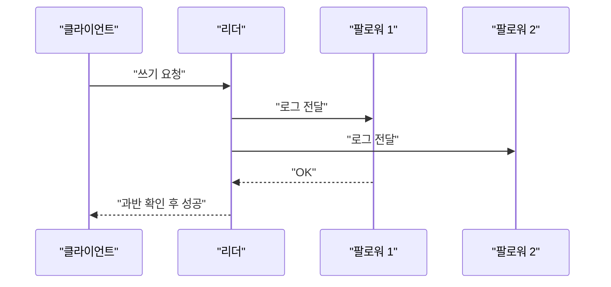

SQLite는 파일 하나다. 그런데 12년째 사람들이 그걸 여러 대에 복제하겠다고 달려들고 있고, 방식은 서로 완전히 다르다.

> - 복제의 뿌리는 "데이터 파일을 복사하는 것"이 아니라 "변경 기록(로그)을 옮기는 것"이다.
> - 문장 복제 -> 로그 복제 -> 합의 -> 로그 스트리밍 -> 병합으로 이어진 갈래는 결국 "누가 쓸 수 있고, 얼마나 잃어도 되나"의 답이 다른 것이다.
> - 분산 SQLite 프로젝트들이 싸우는 건 기술이 아니라 질문이 다르기 때문이다.

## 복제라는 게 없던 시대

DB 복제가 없던 시절에 DB는 그냥 한 대의 서버 안에 있는 파일이었다. 그 서버가 죽으면 데이터도 같이 죽었다. 사람들이 버티던 방법은 단순하다. 밤에 cron으로 파일을 복사해서 다른 디스크나 다른 서버에 던져 놓는 것이다.

이게 왜 위험한지 먼저 말해 둔다. DB 파일은 "쓰는 도중"에 읽으면 반쯤 바뀐 상태로 복사될 수 있다. 앞쪽 페이지는 옛날 값이고 뒤쪽 페이지는 새 값인 파일이 만들어진다. 백업은 성공했다고 뜨는데 복구하려고 열어 보면 깨져 있다.

그럼 쓰기를 잠깐 멈추고 복사하면 되지 않냐고 물을 수 있다. 된다. 그래서 실제로 많이 그렇게 했다. 다만 그러면 백업하는 동안 서비스가 멈추고, 그 사이에 쌓인 변경은 다음 백업 때까지 서버가 죽으면 그냥 사라진다. 하루 한 번 백업이면 최대 하루치를 잃을 각오를 하고 사는 거다.

SQLite는 여기에 한 가지 더 사정이 있었다. 예전 기본 방식은 롤백 저널이라서, 쓰기 전에 원본 페이지를 저널 파일에 먼저 복사해 두고 본 파일을 고친다. 도중에 죽으면 저널로 되돌린다. 안전하긴 한데 이 저널은 "되돌리기용"이지 "다른 곳에 전달하기용"이 아니다. 복제에 쓸 만한 변경 기록이 따로 없었다는 뜻이다.

아래 표는 그 뒤로 등장하는 방식들을 한눈에 보려고 만든 거다. 지금은 첫 줄만 읽으면 된다.

| 시대 | 방식 | 장점 | 한계 |
|---|---|---|---|
| 초기 | 파일 복사 (cron, rsync) | 만들기 쉽다 | 복사 중 깨질 수 있고, 마지막 백업 이후는 날아간다 |
| 이후 | 쓰기 문장을 복제본에서 재실행 | 전송량이 작다 | 실행할 때마다 결과가 달라지는 문장이 문제다 |
| 이후 | 변경 기록(로그)을 그대로 전달 | 복제본이 원본과 똑같아진다 | 주 서버가 죽으면 누가 대신하는지 정해야 한다 |
| 2014 전후 | 합의 프로토콜 위에 DB를 얹음 | 서버가 죽어도 데이터가 안 사라진다 | 소수파 쪽은 쓰기를 거부한다 |
| 2021 전후 | WAL을 오브젝트 스토리지로 스트리밍 | 클러스터 없이 싸게 복구한다 | 쓰는 쪽은 한 대뿐이다 |
| 2022 전후 | 충돌을 병합하는 방식 | 여러 곳에서 동시에 쓴다 | 최종적으로만 일치한다 |

읽는 법: 위에서 아래로 갈수록 "무엇을 잃어도 되는가"의 기준이 달라진다.

## 그 방식 그대로 직접 만들어 보면

가장 순진한 복제는 이거다. 주 DB에 실행한 SQL 문장을 그대로 적어 두었다가 복제본에서 똑같이 실행한다. 파일을 복사하는 것보다 훨씬 똑똑해 보이고, 실제로 초기 DB 복제들이 이런 문장 기반 방식을 썼다.

```python
# Python 3, 표준 라이브러리(sqlite3)만 사용
import sqlite3

primary = sqlite3.connect(":memory:")
replica = sqlite3.connect(":memory:")
log = []  # 실행한 쓰기 문장을 그대로 쌓는다

for db in (primary, replica):
    db.execute("CREATE TABLE t (id INTEGER PRIMARY KEY, v INTEGER)")

def write(sql):
    primary.execute(sql)
    log.append(sql)

def replicate():
    while log:
        replica.execute(log.pop(0))

write("INSERT INTO t (v) VALUES (random())")
write("INSERT INTO t (v) VALUES (42)")
replicate()

print("primary:", primary.execute("SELECT * FROM t").fetchall())
print("replica:", replica.execute("SELECT * FROM t").fetchall())
```

돌려 보면 두 번째 행은 같고 첫 번째 행의 값은 다르게 나온다. random()이 복제본에서 다시 실행되면서 새 숫자를 뽑았기 때문이다.

여기서 아픈 지점은 이렇다.

- 문장은 "무엇을 할지"를 적은 거지 "무엇이 바뀌었는지"를 적은 게 아니다. random()이나 현재 시각 같은 함수가 끼면 서버마다 결과가 갈린다.
- 복제본이 한 번 어긋나면 그 뒤로 같은 문장을 아무리 실행해도 계속 어긋난 채로 간다. 어긋났다는 사실조차 모를 수 있다.
- 주 서버가 죽었을 때 로그가 어디까지 넘어갔는지는 별개 문제다. 이 코드에서는 메모리에 있는 log 리스트가 날아가면 끝이다.

## 그래서 어떻게 진화했나

흐름을 먼저 그림으로 본다.



읽는 법: 화살표는 "앞 단계의 불편 때문에 다음 단계가 나왔다"는 뜻이다. 가운데에서 갈래가 둘로 갈라진다.

첫 번째 단계는 파일 복사에서 문장 복제로 넘어간 것이다. 불편은 복사 중에 깨지고 마지막 백업 이후가 날아간다는 점이었다. 해법은 변경을 문장 단위로 계속 흘려보내는 것이고, 그러면 지연이 초 단위로 줄어든다. 새로 생긴 문제는 방금 코드에서 본 비결정성이다.

두 번째 단계는 문장 대신 "결과로 바뀐 데이터"를 전달하는 것이다. 어떤 행이 어떤 값으로 바뀌었는지를 적으면 random()을 다시 굴릴 일이 없다. SQLite에서는 WAL(Write-Ahead Log) 모드가 이 역할을 한다. 바뀐 페이지를 본 파일이 아니라 로그 파일에 먼저 덧붙이는 방식이고, 2010년 무렵 3.7대에서 들어왔다고 기억한다.

이 변화가 복제에는 결정적이었다. 원래 목적은 읽기와 쓰기가 서로 막지 않게 하려는 것이었지만, 결과적으로 "순서대로 쌓이는 변경 기록"이 공짜로 생겼다. 그 기록을 복사해서 다른 곳에서 재생하면 똑같은 DB가 된다. 새로 생긴 문제는 이제 주 서버가 죽으면 누가 주 서버가 되느냐였다.

세 번째 단계가 합의 프로토콜이다. 복제본 중 하나를 사람이 수동으로 승격시키면 느리고, 자동으로 승격시키면 두 대가 서로 자기가 주 서버라고 우기는 상황이 생긴다. 이걸 스플릿 브레인이라고 부르고, 데이터가 갈라지면 합치는 건 거의 불가능하다.

해법은 "과반이 인정한 쓰기만 유효하다"는 규칙이다. 90년대 후반 Paxos 논문에서 시작해 2014년 Raft 논문이 이해하기 쉬운 버전으로 퍼졌다. 이 시기에 Philip O'Toole이 SQLite 앞에 Raft 로그를 붙여서 rqlite를 만들었다. 새로 생긴 문제는 네트워크가 갈리면 소수파 쪽이 쓰기를 거부한다는 점이다. 이건 버그가 아니라 의도다. 데이터가 갈라지느니 서비스가 잠깐 막히는 쪽을 택한 거다.



읽는 법: 리더는 과반이 OK를 줄 때까지 성공이라고 답하지 않는다. F2가 느려도 응답은 나간다.

네 번째 단계는 그 합의 자체가 과하다는 반론이다. 대부분의 앱은 서버 한 대에서 돌고, 필요한 건 "죽으면 복구"이지 "죽어도 안 멈춤"이 아니다. 2021년 Litestream이 이 지점을 찔렀다. WAL을 감시하다가 S3 같은 오브젝트 스토리지로 계속 흘려보내고, 서버가 죽으면 거기서 복원한다.

그럼 왜 다들 이걸 안 쓰고 Raft를 쓰냐고 물을 수 있다. 복원하는 동안은 서비스가 멈추기 때문이다. 글쓴이 말대로 질문이 다르다. Litestream은 "기계가 죽으면 어떻게 되나"에 답하고, rqlite는 "기계가 죽었는데 복원을 기다릴 수 없으면"에 답한다.

다섯 번째 단계는 쓰는 곳 자체를 여러 곳으로 늘리는 것이다. 오프라인 앱이나 로컬 우선 앱은 리더에 닿지 못해도 쓸 수 있어야 한다. cr-sqlite 같은 CRDT 방식은 각자 쓰고 나중에 규칙대로 병합한다. 새로 생긴 문제는 "동시에 같은 행을 고치면 누가 이기나"를 설계자가 정해야 한다는 거다.

## 지금은 어떤가

기사가 말하듯 지금은 세 갈래가 공존한다. 합의는 강한 일관성, 스트리밍은 싸고 단순한 복구, 병합은 여러 곳에서 쓰기를 맡는다. 어느 쪽이 더 낫다는 건 없고 질문이 다를 뿐이다.


<svg viewBox="0 0 680 230" xmlns="http://www.w3.org/2000/svg" font-family="sans-serif" font-size="14">
<rect x="10" y="20" width="200" height="170" rx="10" fill="none" stroke="#6b4f3a" stroke-width="2"/>
<rect x="240" y="20" width="200" height="170" rx="10" fill="none" stroke="#a8683a" stroke-width="2"/>
<rect x="470" y="20" width="200" height="170" rx="10" fill="none" stroke="#c9a37a" stroke-width="2"/>
<text x="110" y="52" text-anchor="middle" fill="#6b4f3a" font-weight="bold">합의</text>
<text x="340" y="52" text-anchor="middle" fill="#a8683a" font-weight="bold">스트리밍</text>
<text x="570" y="52" text-anchor="middle" fill="#7a6a58" font-weight="bold">병합</text>
<text x="110" y="95" text-anchor="middle" fill="#7a6a58">쓰는 곳: 리더 하나</text>
<text x="110" y="125" text-anchor="middle" fill="#7a6a58">과반 확인 후 성공</text>
<text x="110" y="155" text-anchor="middle" fill="#7a6a58">대표: rqlite, dqlite</text>
<text x="340" y="95" text-anchor="middle" fill="#7a6a58">쓰는 곳: 한 대</text>
<text x="340" y="125" text-anchor="middle" fill="#7a6a58">WAL을 S3로 전송</text>
<text x="340" y="155" text-anchor="middle" fill="#7a6a58">대표: Litestream</text>
<text x="570" y="95" text-anchor="middle" fill="#7a6a58">쓰는 곳: 여러 곳</text>
<text x="570" y="125" text-anchor="middle" fill="#7a6a58">나중에 병합</text>
<text x="570" y="155" text-anchor="middle" fill="#7a6a58">대표: cr-sqlite</text>
<text x="340" y="218" text-anchor="middle" fill="#7a6a58">개념도(실제 수치 아님)</text>
</svg>


읽는 법: 세 칸은 "누가 쓰고, 어떻게 일치시키나"로 나눈 갈래다. 오른쪽으로 갈수록 쓰기 자유도는 올라가고 일치 강도는 내려간다.

돈은 결국 플랫폼으로 갔다. Cloudflare D1이나 Turso처럼 "직접 돌리는 것"이 아니라 "사서 쓰는 것"이 됐다. 다만 상위 댓글 중에 D1을 실제로 써 본 사람은 안정적이지 않았다고 했고, D1 개발자가 쓴 글을 인용해서 D1은 Durable Object 위에 얹은 SQLite 래퍼일 뿐이라고 했다. 이건 댓글 인용이라 내가 확인한 건 아니다.

선택지는 대충 이렇게 정리된다. 서버 한 대에 복구만 되면 되면 Litestream 계열이 싸다. 죽어도 안 멈춰야 하는데 직접 돌릴 거면 rqlite나 dqlite다. 복제 걱정 자체가 귀찮으면 관리형을 사되 안이 어떻게 생겼는지는 못 본다는 걸 각오해야 한다. 그리고 댓글처럼 SQL 기능이 부족해서 원격 SQLite를 고민하는 단계라면 그냥 Postgres 서버를 쓰는 게 더 빠를 때도 있다.

멀티 문장 트랜잭션을 쓰는지도 따져야 한다. 엔진마다 BEGIN/COMMIT 지원 범위가 다르다고 댓글에 나왔고, 이건 도입 전에 반드시 확인해야 하는 부분이다.

12년 동안 이 바닥에서 바뀐 건 방식이 아니라 가격표다. 파일 하나를 안전하게 두 곳에 두는 문제는 여전히 같고, 그 답을 누가 얼마에 파느냐만 달라졌다.

---

*원문: [Twelve years of distributed SQLite](https://philipotoole.com/twelve-years-of-distributed-sqlite/) (via hn)*
