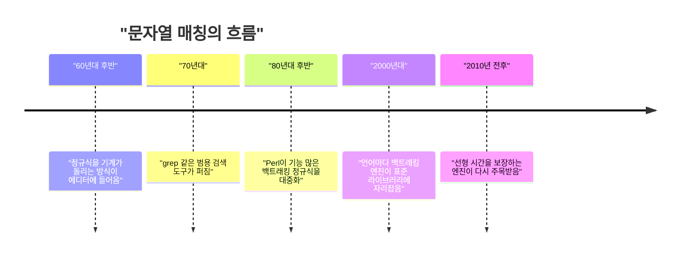

로그에서 에러 코드 하나 뽑자고 정규식 엔진을 새로 만든다고 하면 예전엔 미친 사람 취급이었다. 근데 요즘은 그게 몇 시간짜리 작업이라고 주장하는 글이 돌고, 그 글의 뿌리를 파면 결국 "문자열 매칭을 어떻게 하냐"가 나온다.

> 정규식은 원래 패턴을 손으로 짜던 문자열 검색 코드를 한 줄로 줄여주는 문법이다. 그 밑의 엔진은 크게 두 갈래(백트래킹, 오토마타 시뮬레이션)로 갈렸고 성능 성격이 완전히 다르다.
> 엔진을 직접 만드는 건 원래 "절대 출시 못 하는 사람"의 취미였는데, 만드는 비용이 확 내려가면서 내 워크로드에 맞춘 엔진이 현실적인 선택지가 됐다.
> 대신 빨리 만드는 것과 믿고 쓸 만한 것 사이의 간격은 그대로고, 그 간격을 메우는 건 테스트와 벤치마크다.

## 정규식이 없던 시대

정규식이 없으면 "ERROR 뒤에 code= 가 오고 그 뒤에 숫자가 붙은 줄을 찾아라" 같은 요구를 전부 손으로 짜야 했다. 문자열 찾기, 공백 건너뛰기, 숫자 읽기를 직접 이어 붙이는 식이다.

이게 왜 괴롭냐면 패턴이 바뀔 때마다 코드 구조 자체가 바뀌기 때문이다. 공백이 선택적이 되거나 대소문자를 무시해야 하면 루프와 분기를 다시 짠다. 패턴이 곧 코드라서, 패턴을 데이터로 다룰 수가 없다.

"그냥 요구사항마다 함수 하나씩 짜면 되지 않냐"는 의문이 들 텐데, 실제로 그렇게 버텼다. 문제는 함수가 수십 개 쌓이면 그걸 검색 도구에 사용자가 입력으로 넘길 방법이 없다는 거다. grep 같은 도구는 패턴을 실행 중에 받아야 하는데, 손으로 짠 코드는 컴파일 시점에 굳어 있다.

## 그때 방식으로 직접 만들어 보기

Python 3, 표준 라이브러리만 쓴다. "ERROR 공백* code= 숫자+" 패턴을 손으로 푼 버전이다.

```python
def find_error_code(line):
    i = line.find("ERROR")
    while i != -1:
        j = i + len("ERROR")
        while j < len(line) and line[j] == " ":
            j += 1
        if line.startswith("code=", j):
            start = k = j + 5
            while k < len(line) and line[k].isdigit():
                k += 1
            if k > start:
                return line[start:k]
        i = line.find("ERROR", i + 1)
    return None

print(find_error_code("t=1 ERROR   code=503 upstream"))  # 503
print(find_error_code("ERROR code= none"))               # None
```

여기서 아픈 지점.

- 패턴이 코드 구조에 박혀 있어서 요구가 조금만 바뀌어도 함수를 새로 짜야 한다.
- "ERROR가 여러 번 나오면 어디서 다시 시작하냐" 같은 경계 처리를 전부 사람이 책임진다. 위 코드의 마지막 줄 하나가 그거다.
- 패턴을 실행 중에 바꿀 수 없으니 범용 도구가 못 된다.

## 그래서 어떻게 진화했나

흐름부터 보자. 연도는 뭉뚱그렸다.



읽는 법: 왼쪽에서 오른쪽으로 갈수록 기능은 늘었고, 중간에 속도 보장이 한 번 뒤로 밀렸다가 다시 올라왔다.

**1단계: 패턴을 데이터로 만든다.** 불편은 패턴이 코드에 박혀 있다는 거였다. 해법은 패턴을 문자열로 받아서 내부 표현으로 바꿔 돌리는 엔진이다. 60년대 후반에 이미 이 아이디어가 에디터에 들어갔고, 패턴을 NFA라는 상태 기계로 바꿔서 입력을 한 글자씩 흘려보내는 방식이 쓰였다.

비유하자면 지하철 노선도다. 지금 있을 수 있는 역 집합을 들고 있다가, 글자 하나가 들어올 때마다 "이 글자로 갈 수 있는 다음 역들"로 집합을 갈아끼운다. 끝에 도착역이 집합에 있으면 매칭이다.

```python
trans = {(0, "a"): {0}, (0, "b"): {1}}   # 패턴: a*b
def run(s):
    cur = {0}
    for ch in s:
        cur = {n for st in cur for n in trans.get((st, ch), ())}
    return 1 in cur
print(run("aaab"), run("aaa"))  # True False
```

새로 생긴 문제는 기능이다. 이 방식은 "앞에서 잡은 걸 뒤에서 다시 참조"하는 기능을 넣기 어렵다.

**2단계: 기능을 늘리려고 백트래킹을 쓴다.** 불편은 위 방식이 단순하다는 거였다. 80년대 후반 Perl 같은 도구가 선택지가 많은 쪽을 길게 파고들다가 막히면 되돌아가는 백트래킹 방식을 대중화했다. 되돌아가기만 하면 되니 역참조 같은 기능을 붙이기 쉽다.

새로 생긴 문제는 최악의 경우다. 되돌아가는 경로가 겹치면 시간이 폭발한다.

```python
import re
re.match(r"(a+)+$", "a" * 25 + "b")  # 글자가 하나 늘 때마다 대략 두 배로 느려진다
```

이게 왜 위험하냐면, 정규식이 사용자 입력을 받는 서버 코드에 들어가면 공격자가 일부러 이런 문자열을 보내서 CPU를 묶을 수 있기 때문이다. 정규식 하나가 서비스 장애 버튼이 되는 거다.

**3단계: 다시 시뮬레이션 쪽으로 돌아온다.** 불편은 "정규식 하나에 서버가 죽는다"였다. 해법은 입력 길이에 비례하는 시간만 쓰도록 보장하는 엔진이다. 2010년 전후에 이런 엔진이 다시 주목받았고, 지금은 Rust의 regex 크레이트 같은 곳이 이 계열이다.

새로 생긴 문제는 포기해야 하는 기능이 있다는 거다. 역참조 같은 건 보통 지원하지 않는다. 그래서 "빠르고 안전한 쪽"과 "기능 많은 쪽"을 골라야 한다.

두 계열의 차이를 그림으로 보자. 개념도(실제 수치 아님)다.

<svg viewBox="0 0 640 220" xmlns="http://www.w3.org/2000/svg">
<rect x="20" y="20" width="280" height="180" rx="8" fill="transparent" stroke="#6b4f3a" stroke-width="2"/>
<rect x="340" y="20" width="280" height="180" rx="8" fill="transparent" stroke="#a8683a" stroke-width="2"/>
<text x="160" y="50" text-anchor="middle" font-size="16" fill="#7a6a58">백트래킹</text>
<text x="480" y="50" text-anchor="middle" font-size="16" fill="#7a6a58">상태 집합 시뮬레이션</text>
<circle cx="70" cy="110" r="14" fill="#d9b98c"/>
<circle cx="130" cy="80" r="14" fill="#c9a37a"/>
<circle cx="130" cy="140" r="14" fill="#c9a37a"/>
<circle cx="190" cy="60" r="14" fill="#d9b98c"/>
<circle cx="190" cy="110" r="14" fill="#d9b98c"/>
<circle cx="190" cy="160" r="14" fill="#d9b98c"/>
<text x="160" y="190" text-anchor="middle" font-size="13" fill="#7a6a58">한 길씩 가보고 막히면 되돌아감</text>
<rect x="370" y="90" width="60" height="40" rx="6" fill="#c9a37a"/>
<rect x="450" y="90" width="60" height="40" rx="6" fill="#c9a37a"/>
<rect x="530" y="90" width="60" height="40" rx="6" fill="#c9a37a"/>
<text x="480" y="190" text-anchor="middle" font-size="13" fill="#7a6a58">글자마다 가능한 상태를 한꺼번에 갱신</text>
</svg>

읽는 법: 왼쪽은 갈림길마다 한 길씩 시도하는 구조라 길이 겹치면 시간이 폭발하고, 오른쪽은 글자 하나당 한 번 갱신하는 구조라 입력 길이에 비례한다.

| 시대 | 방식 | 장점 | 한계 |
|---|---|---|---|
| 정규식 이전 | 손으로 짠 매칭 함수 | 단순하고 빠를 수 있음 | 패턴 변경 때마다 재작성 |
| 초기 범용 도구 | 상태 기계 시뮬레이션 | 입력 길이에 비례하는 시간 | 기능이 단순함 |
| 80년대 후반 이후 | 백트래킹 | 기능 풍부, 구현 쉬움 | 최악의 경우 시간 폭발 |
| 2010년 전후 이후 | 선형 시간 보장 엔진 | 안전하고 예측 가능 | 역참조 등 일부 기능 포기 |

## 지금은 어떤가

오늘의 자료는 이 계보의 맨 끝에 있다. 글쓴이는 정규식이나 컴파일러를 잘 모르는 상태에서, 자기 워크로드에 맞게 조정되는 정규식 엔진과 그걸 쓰는 ripgrep 포크를 몇 시간 만에 만들었다고 한다. 예전 같으면 1년 이상 걸렸을 거라는 게 본인 평가다.

핵심 주장은 "사람들이 옛날 비용 모델을 머리에 넣고 산다"는 거다. 10년 전엔 컴파일러가 느리다고 새 컴파일러를 짜는 사람은 대체로 출시를 못 하는 타입이었는데, 지금은 그게 합리적인 선택일 수 있다는 얘기다. 앞서 본 선택지 표가 "고르는 것"에서 "내 입맛에 맞게 만드는 것"까지 넓어진 셈이다.

근데 이 주장은 반만 믿는 게 맞다. 댓글에 나온 지적이 정확한데, AI로 속도를 올리면 테스트한 케이스에만 과적합된 지저분한 코드가 붙을 수 있고, 그건 다른 입력에선 안 빠르고 나중에 고치기도 어렵다. 정규식은 특히 이게 심한 영역이다. 겉보기엔 맞는데 최악의 입력에서만 터지는 버그가 위에서 본 백트래킹 폭발 같은 모양이기 때문이다.

그래서 현실적인 선택지는 이렇게 갈린다.

- 범용 라이브러리를 그대로 쓴다. 대부분은 이게 맞고, 선형 시간 보장 엔진을 고르면 서버 쪽 사고는 막는다.
- 내 워크로드 하나에 맞춘 엔진을 만든다. 병목이 측정으로 확인된 경우에만 값어치가 있고, 이때 테스트 코퍼스와 벤치마크가 없으면 만든 게 아니라 쌓은 거다.
- 텍스트 인덱스를 쓴다. 글쓴이도 인정하듯 검색이 진짜 병목이면 엔진 튜닝보다 인덱스가 맞는 답이다.

자료에 나온 pgrust가 의심받으면서도 실제 Postgres 버그를 찾아낸 건, 만드는 속도가 아니라 검증하는 깊이가 품질을 가른다는 증거다. 엔진을 몇 시간에 짜는 시대가 와도 "이게 맞다"를 증명하는 시간은 줄지 않았고, 앞으로 값이 오르는 건 그쪽이다.

---

*원문: [We should be more ambitious with the software we build](https://danluu.com/ambitious/) (via hn)*
