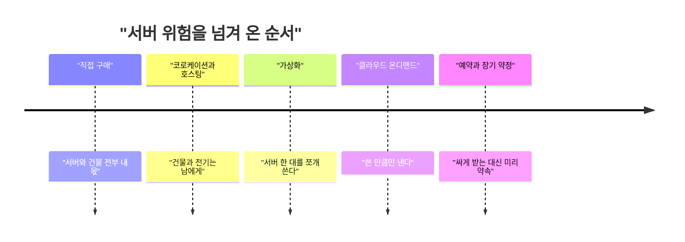
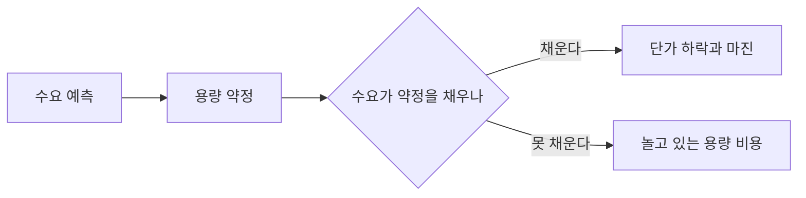

S-1 본문은 수집이 안 돼서 못 읽었다. 댓글만 봤는데, 다들 같은 데서 싸운다. 수요가 진짜냐, 그리고 미리 약정한 컴퓨팅을 그 수요로 채울 수 있냐다.

> - 이 싸움은 AI가 새로 만든 게 아니다. 서버를 사다 놓고 손님이 오길 기다리던 시절의 용량 계획 문제가 그대로 커진 것이다.
> - 용량을 작게 잡으면 터지는 순간 손님을 놓치고, 크게 잡으면 노는 서버 값을 내가 문다. 어느 쪽을 골라도 손해라는 게 핵심이다.
> - 클라우드는 이 문제를 없애지 않았다. 위험을 쪼개 팔았고, 대형 약정은 그걸 다시 한 덩어리로 뭉친 것이다.

참고로 이 글에 나오는 금액과 주장은 전부 댓글 작성자들의 말이다. 내가 검증한 숫자가 아니니 사실로 읽지 마라.

## 서버가 곧 자산이던 시절

클라우드 이전에 서비스를 하려면 서버를 직접 샀다. 주문하고 받고 랙에 꽂고 네트워크를 연결하는 데 몇 주가 걸렸다. 그 사이에 트래픽이 늘면 그냥 기다려야 했다.

그래서 사람들은 "피크 기준으로 산다"는 규칙으로 버텼다. 1년에 한 번 오는 가장 바쁜 날을 예상하고, 거기에 여유분을 얹어서 샀다. 뷔페 예약과 같다. 하객이 몇 명 올지 모르니 최대 인원으로 잡는데, 안 오면 음식은 버려지고 값은 내야 한다.

왜 그냥 평균에 맞추지 않았냐는 의문이 나온다. 서버는 부족할 때 천천히 느려지는 게 아니라 어느 선을 넘으면 한꺼번에 무너지기 때문이다. 요청이 쌓이면 대기열이 길어지고, 타임아웃이 나고, 재시도가 또 요청을 늘린다. 한 번 터지면 복구하는 동안 손님은 다른 곳으로 간다. 그래서 평균이 아니라 피크에 맞췄고, 평소 가동률이 낮은 건 감수했다.

더 아픈 건 이 결정을 돌이킬 수 없다는 점이다. 서버는 이미 돈을 냈고, 수요가 예상보다 적다고 반품하지 못한다. 회계로 보면 비용이 먼저 나가고 매출이 나중에 들어오는 구조다. 예측이 틀리면 그 차이를 회사가 떠안는다.

## 그때 방식으로 직접 계산해 보기

용량을 고정해 놓고 한 달 치 수요를 흘려 보내는 시뮬레이션이다. 낮에는 바쁘고 밤에는 한가하고, 어느 날 한 번 갑자기 튄다. 표준 라이브러리만 쓴 Python 3.11 코드다.

```python
import random

random.seed(7)

def demand_curve(hours=24 * 30):
    for h in range(hours):
        base = 100 + (60 if 9 <= h % 24 <= 22 else 0)
        spike = 400 if h == 400 else 0
        yield base + random.randint(-10, 10) + spike

def run(capacity):
    served = dropped = idle = 0
    for d in demand_curve():
        s = min(d, capacity)
        served += s
        dropped += d - s
        idle += capacity - s
    return served, dropped, idle

for cap in (180, 300, 600):
    s, d, i = run(cap)
    print(f"cap={cap} dropped={d} idle_ratio={i / (cap * 720):.0%}")
```

돌려 보면 방향은 뻔하다. 180은 평소엔 충분한데 튀는 시간에 수요를 크게 놓친다. 600은 한 건도 안 놓치지만 대부분의 시간 동안 서버가 논다. 300은 그 사이 어딘가에서 어정쩡하다.

여기서 아픈 지점은 이렇다.

- 튀는 시간은 한 달에 한 시간인데, 그 한 시간을 막으려고 한 달 내내 비싼 용량을 들고 있어야 한다.
- 어떤 용량을 골라도 틀린 답이다. 맞는 답이 있는 문제가 아니라 어느 쪽 손해를 감수할지 고르는 문제다.
- `spike`가 언제 올지, 올해 수요가 작년의 두 배일지 열 배일지는 코드 밖의 정보다. 모델이 정교해도 입력이 틀리면 소용없다.

## 불편이 쌓이면서 이렇게 바뀌었다

흐름은 "내가 들고 있던 위험을 누구에게 넘길 수 있나"로 읽으면 쉽다. 단계마다 한 겹씩 넘겨 왔다.



위 타임라인은 왼쪽에서 오른쪽으로 갈수록 내가 직접 들고 있는 걸 남에게 넘기는 순서다. 연도는 일부러 안 적었다. 단계가 겹치는 시기가 길었다.

첫 번째 단계는 건물과 전기 문제다. 서버실을 직접 짓고 냉각과 전력을 관리하는 건 본업이 아니었다. 그래서 남의 데이터센터에 내 서버를 놓는 코로케이션과 호스팅이 나왔다. 하지만 서버는 여전히 내가 샀고, 용량 계획 문제는 그대로였다.

두 번째는 가상화다. 서버 한 대를 여러 개의 가상 서버로 쪼개 쓰니 "서버 한 대에 서비스 하나"라는 낭비가 줄었다. 대신 한 대 위에 여러 개가 앉으면서 서로 자원을 뺏는 문제가 새로 생겼다. 그래도 용량을 쪼개 다룰 수 있게 된 게 중요하다. 이게 다음 단계의 재료가 됐다.

세 번째가 클라우드의 온디맨드다. 2000년대 중반쯤부터 가상 서버를 시간 단위로 빌려 쓰는 모델이 퍼졌다. 피크 때만 서버를 늘리고 한가하면 반납하면 되니, 앞에서 말한 "한 시간 때문에 한 달 내내 들고 있는" 문제가 풀리는 것처럼 보였다. 스타트업이 서버 구매 없이 시작할 수 있게 된 것도 이 덕분이다.

그런데 이 모델에는 숨은 조건이 하나 있다. 내가 필요할 때 상대방에게 남는 서버가 있어야 한다. 클라우드 회사가 그 위험을 대신 들고 있는 셈이다. 위험이 사라진 게 아니라 규모의 경제로 평균을 내서 싸게 들고 있는 것이다.

네 번째가 예약과 약정이다. 온디맨드는 편한 대신 비싸서, 꾸준히 쓰는 쪽은 "1년이나 3년 쓸 테니 깎아 달라"고 했다. 업체는 미리 수요를 확정받으니 용량을 안심하고 깔 수 있고, 고객은 단가를 낮춘다. 대신 고객은 다시 예측을 해야 한다. 쓰든 안 쓰든 약속한 돈은 낸다. 직접 구매 시절의 위험이 계약서 형태로 돌아온 것이다.

| 시대 | 방식 | 장점 | 한계 |
|---|---|---|---|
| 직접 구매 | 서버를 사서 직접 운영 | 단가 통제, 완전한 소유 | 피크 기준 구매, 조달에 몇 주 |
| 코로케이션 | 남의 센터에 내 서버 | 전기와 건물 부담 감소 | 서버 구매 위험은 그대로 |
| 클라우드 온디맨드 | 시간 단위로 빌림 | 수요 변동에 유연 | 단가가 높고 재고가 상대 몫 |
| 예약과 장기 약정 | 기간과 양을 약속 | 단가 하락, 용량 확보 | 예측이 틀리면 쓸모없는 비용 |

표는 위에서 아래로 갈수록 소유 대신 계약으로 용량을 잡는다는 뜻이다. 마지막 줄의 한계가 오늘 이야기의 핵심이다.

## 그래서 지금, Anthropic S-1 댓글이 말하는 것

AI 시대에 이 문제는 훨씬 극단적이다. GPU는 주문하면 바로 받는 물건이 아니고, 데이터센터는 짓는 데 오래 걸린다. 그래서 수요가 오기 전에 몇 년 치 용량을 먼저 확보해야 한다. 직접 구매 시절의 "미리 사 놓고 기다린다"가 단위만 훨씬 커져서 돌아왔다.

댓글에는 여러 클라우드와 칩 업체에 수천억 달러 규모의 약정이 걸려 있다는 이야기가 나온다. 한 댓글은 수요가 계속되면 매출이 몇 배로 커져서 문제없지만, 아니면 크게 아프다고 요약한다. 그리고 그게 유일한 선택이라고 본다. 용량이 모자라면 최고 모델을 갖고도 가용성에서 밀린다는 논리다. 앞에서 본 시뮬레이션의 180짜리 선택이 곧 그 위험이다.

반대편 의심도 같은 구조다. 한 댓글은 컴퓨팅을 공급하는 쪽에 전환사채나 주식을 준 것이 컴퓨팅 비용으로 잡히지 않는다고 주장한다. 무료 사용자에게 준 비용이 매출총이익률에 안 들어간다는 얘기도 있다. 이건 댓글의 추측이고, 나는 원문을 못 봤으니 맞다 틀리다 말하지 않는다. 다만 분류 방식에 따라 마진이 달라 보인다는 건 회계의 일반적인 특성이다.

수요 쪽에는 두 가지 시각이 있다. 하나는 코딩 도구가 가장 큰 수요처인데 도입 속도가 지금처럼 이어질지 모르겠다는 것이다. 다른 하나는 오픈 웨이트 모델을 자체 서버에 올려 쓰는 기업이 늘면 매출이 줄 수 있다는 것이다. 후자는 클라우드 역사에서 익숙한 패턴이다. 빌려 쓰던 쪽이 일정 규모를 넘으면 직접 서버를 사는 쪽으로 돌아간다.



흐름도는 약정이 한 번 걸리면 갈림길이 하나뿐이라는 걸 보여준다. 채우면 이득이고, 못 채우면 노는 서버 값이 고스란히 비용이다.

선택지를 비교하면 이렇다. 아래 도형은 개념도(실제 수치 아님)이고, 약정이 클수록 단가는 내려가지만 예측이 틀렸을 때의 손실 폭이 커진다는 것만 보면 된다.

<svg viewBox="0 0 640 220" xmlns="http://www.w3.org/2000/svg" style="background:transparent">
<text x="320" y="24" text-anchor="middle" font-size="14" fill="#7a6a58">"개념도 - 약정 규모에 따른 단가와 손실 폭"</text>
<line x1="60" y1="190" x2="600" y2="190" stroke="#7a6a58" stroke-width="1"/>
<line x1="60" y1="40" x2="60" y2="190" stroke="#7a6a58" stroke-width="1"/>
<line x1="80" y1="60" x2="580" y2="170" stroke="#a8683a" stroke-width="3"/>
<line x1="80" y1="170" x2="580" y2="60" stroke="#6b4f3a" stroke-width="3" stroke-dasharray="8 5"/>
<circle cx="150" cy="76" r="6" fill="#d9b98c"/>
<circle cx="500" cy="153" r="6" fill="#c9a37a"/>
<text x="330" y="210" text-anchor="middle" font-size="12" fill="#7a6a58">"약정 규모 (작음 -> 큼)"</text>
<text x="590" y="52" text-anchor="end" font-size="12" fill="#6b4f3a">"예측 실패 시 손실 폭"</text>
<text x="590" y="186" text-anchor="end" font-size="12" fill="#a8683a">"단가"</text>
<text x="150" y="64" text-anchor="middle" font-size="12" fill="#7a6a58">"온디맨드"</text>
<text x="500" y="142" text-anchor="middle" font-size="12" fill="#7a6a58">"대형 장기 약정"</text>
</svg>

실선은 약정이 커질수록 내려가는 단가이고, 점선은 같은 방향으로 올라가는 손실 폭이다. 두 선은 같이 움직인다. 싸게 받으려면 위험도 같이 받아야 한다.

그래서 지금 선택지는 대체로 세 갈래다. 온디맨드로 비싸게 유연하게 가거나, 중간 규모 약정으로 나눠 걸거나, 대형 약정으로 단가와 확보를 동시에 잡는 것이다. 어느 쪽이 맞는지는 수요가 어디까지 오르는지에 달려 있고, 그건 S-1을 읽어도 알 수 없다. 서버 시대의 용량 계획과 같은 결론이다. 맞는 용량은 사후에야 알 수 있다.

---

*원문: [Anthropic S-1](https://www.sec.gov/Archives/edgar/data/2130357/000162828026067168/anthropicpbc-sx1.htm) (via hn)*
