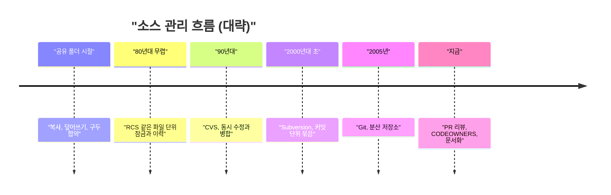
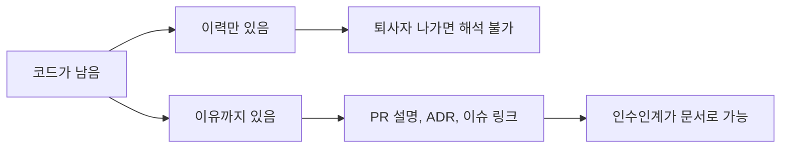

마이크로소프트가 직원 6만 명한테 자발적 퇴사 제안을 돌렸다. 회사는 정리해고가 아니라고 하는데, 나가는 사람 머릿속에 있는 "이 코드가 왜 이렇게 생겼는지"는 퇴직금 계산서에 안 나온다.

> 사람이 나가면 코드는 남지만 코드의 이유는 같이 나간다.
> 버전 관리는 원래 동시 수정 충돌을 막으려고 만든 건데, 부작용으로 조직의 기억 장치가 됐다.
> 그래도 커밋 로그는 "무엇"만 기억하고 "왜"는 사람이 따로 적어야 한다.

## 기록이 없던 시대

버전 관리가 없던 시절에도 소프트웨어는 만들었다. 다만 소스가 팀 공유 폴더에 파일로 그냥 놓여 있었다.

수정하려면 파일을 내 자리로 복사하고, 고치고, 다시 덮어썼다. 두 사람이 같은 파일을 동시에 복사했으면 나중에 덮어쓴 사람 코드만 남는다. 먼저 쓴 사람의 수정은 말 없이 사라진다.

그래서 사람들이 만든 규칙이 사회적 프로토콜이다. "main.c 지금 누구 만지냐"고 사무실에 소리 지르거나, 폴더에 "main_수정중_김대리.c" 같은 이름을 붙이거나, 화이트보드에 파일 소유자를 적었다. 이게 웃기게 들려도 규모가 작을 때는 실제로 돌아갔다.

문제는 이 방식의 지식이 전부 사람한테 있다는 거다. 어느 버전이 출시본인지, 이 함수를 왜 이렇게 꼬아 놨는지, 지난달에 뭘 고쳤는지는 담당자 기억에만 있었다. 담당자가 휴가를 가면 불편하고, 퇴사하면 그 부분은 아무도 못 건드리는 구역이 된다. 지금 마이크로소프트 뉴스에서 개발자들이 걱정하는 것도 같은 구조다.

## 그때 방식으로 직접 만들어 보기

"파일 잠금 방식 체크아웃"을 표준 라이브러리만으로 흉내 내 봤다. 초기 버전 관리 도구가 하던 일의 뼈대와 거의 같다.

```python
# Python 3.10, 표준 라이브러리만 사용
import os, sys, shutil, getpass, time

SHARED = "shared"  # 팀 공유 폴더라고 치자

def checkout(name):
    lock = f"{SHARED}/{name}.lock"
    try:
        fd = os.open(lock, os.O_CREAT | os.O_EXCL | os.O_WRONLY)
    except FileExistsError:
        print(f"{name}: {open(lock).read()} 가 쥐고 있음")
        sys.exit(1)
    with os.fdopen(fd, "w") as f:
        f.write(f"{getpass.getuser()} {time.ctime()}")
    shutil.copy(f"{SHARED}/{name}", f"./{name}")

def checkin(name):
    shutil.copy(f"./{name}", f"{SHARED}/{name}")
    os.remove(f"{SHARED}/{name}.lock")

if __name__ == "__main__":
    cmd, name = sys.argv[1:3]
    {"out": checkout, "in": checkin}[cmd](name)
```

`O_EXCL`로 락 파일을 만들면 "이미 있으면 실패"가 한 번에 처리된다. 두 사람이 동시에 시도해도 한 명만 성공한다. 실행은 `python vc.py out main.c`로 가져가고 `python vc.py in main.c`로 돌려놓는 식이다.

여기서 아픈 지점:

- 한 사람이 파일을 쥐고 휴가를 가면 그 파일은 팀 전체가 못 고친다. 락이 풀리려면 그 사람이 돌아오거나 누가 락 파일을 수동으로 지워야 한다.
- 덮어쓰는 순간 이전 내용이 사라진다. 누가 언제 뭘 바꿨는지 남는 곳이 없다. 락 파일에 적힌 건 "지금 누가 쥐었나"뿐이다.
- 네트워크 파일 시스템에서는 이 락 자체가 믿을 만한지도 환경에 따라 다르다. 락 하나 믿는 데도 인프라 지식이 필요했다.

## 그래서 어떻게 진화했나

시대 흐름부터 한 번 보자. 연도는 크게 뭉뚱그렸다.



읽는 법: 오른쪽으로 갈수록 "한 사람이 파일을 독점"하던 방식에서 "모두가 동시에 고치고 나중에 합치는" 방식으로 간다.

**1단계: 락과 이력(RCS 계열)**

불편은 덮어쓰기로 날아가는 작업과 이력 부재였다. 해법은 파일마다 변경분을 저장해 두고, 고치는 동안 락을 거는 방식이었다. 이제 "지난주 버전"으로 돌아갈 수 있었다.

새로 생긴 문제는 락이다. 한 명이 파일을 쥐면 나머지는 기다린다. 파일 하나가 핵심 모듈이면 팀 전체 속도가 거기서 막힌다. 그리고 파일 단위라 "이 기능을 위해 파일 세 개를 같이 고쳤다"는 맥락은 안 남았다.

**2단계: 동시 수정과 병합(CVS 계열)**

그럼 락을 아예 없애면 되지 않냐는 의문이 나온다. 실제로 그렇게 갔다. 모두가 자기 사본을 고치고, 올릴 때 서버가 겹치는 부분만 알려 주는 낙관적 방식이다. 같은 줄을 둘이 고쳤을 때만 충돌로 알려 주고, 사람이 손으로 정리한다.

이 방식이 먹힌 이유는 대부분의 수정이 서로 다른 곳에서 일어나서다. 락은 평소 99% 쓸데없이 사람을 막고 있었던 셈이다.

새 문제는 여전히 파일 단위 이력과 중앙 서버 의존이었다. 이름 변경이나 여러 파일에 걸친 변경이 중간에 끊기면 저장소가 반쯤 올라간 상태로 남기도 했다.

**3단계: 커밋 단위 묶음(Subversion 계열)**

해법은 "여러 파일을 한 번에 올리고 한 번에 번호를 매기는" 커밋 개념이었다. 변경이 이야기 단위로 남기 시작했다. 이때부터 로그가 "무슨 일이 있었나"를 읽는 문서가 됐다.

그래도 서버가 죽거나 네트워크가 끊기면 커밋도, 이력 조회도 못 했다. 브랜치를 만들 수는 있었지만 병합이 고통스러워서 다들 피했다.

**4단계: 분산(Git)**

중앙 서버가 없어도 되게 하자는 게 Git의 핵심이다. 모든 개발자 사본에 전체 이력이 들어 있다. 브랜치는 싸고 병합은 이력 구조로 추적한다.

덕분에 부수 효과가 하나 생겼다. 회사가 망하든, 서버가 날아가든, 누가 퇴사하든 이력은 팀원 수만큼 복제되어 남는다. 기억이 한 명의 머리에서 모든 사본으로 이사한 거다.

새로 생긴 문제는 이력이 "무엇이 바뀌었나"만 말해 준다는 것이다. 커밋 메시지가 `fix`, `update`, `wip`면 이력은 있어도 기억은 없다.

개념도(실제 수치 아님)로 두 시대 차이를 그려 봤다.

<svg viewBox="0 0 680 260" xmlns="http://www.w3.org/2000/svg">
<text x="170" y="28" font-size="16" fill="#7a6a58" text-anchor="middle" font-family="sans-serif">"공유 폴더 시절"</text>
<text x="510" y="28" font-size="16" fill="#7a6a58" text-anchor="middle" font-family="sans-serif">"Git 이후"</text>
<rect x="120" y="50" width="100" height="40" fill="none" stroke="#a8683a" stroke-width="2"/>
<text x="170" y="75" font-size="13" fill="#7a6a58" text-anchor="middle" font-family="sans-serif">"담당자 머릿속"</text>
<rect x="40" y="150" width="80" height="36" fill="#d9b98c"/>
<text x="80" y="173" font-size="12" fill="#6b4f3a" text-anchor="middle" font-family="sans-serif">"파일 A"</text>
<rect x="130" y="150" width="80" height="36" fill="#d9b98c"/>
<text x="170" y="173" font-size="12" fill="#6b4f3a" text-anchor="middle" font-family="sans-serif">"파일 B"</text>
<rect x="220" y="150" width="80" height="36" fill="#d9b98c"/>
<text x="260" y="173" font-size="12" fill="#6b4f3a" text-anchor="middle" font-family="sans-serif">"파일 C"</text>
<line x1="150" y1="90" x2="80" y2="150" stroke="#a8683a" stroke-width="1.5"/>
<line x1="170" y1="90" x2="170" y2="150" stroke="#a8683a" stroke-width="1.5"/>
<line x1="190" y1="90" x2="260" y2="150" stroke="#a8683a" stroke-width="1.5"/>
<text x="170" y="225" font-size="12" fill="#7a6a58" text-anchor="middle" font-family="sans-serif">"이유는 한 사람에게만"</text>
<rect x="440" y="50" width="140" height="40" fill="none" stroke="#6b4f3a" stroke-width="2"/>
<text x="510" y="75" font-size="13" fill="#7a6a58" text-anchor="middle" font-family="sans-serif">"커밋 이력 + 리뷰 기록"</text>
<rect x="380" y="150" width="70" height="36" fill="#c9a37a"/>
<text x="415" y="173" font-size="12" fill="#6b4f3a" text-anchor="middle" font-family="sans-serif">"사본 1"</text>
<rect x="475" y="150" width="70" height="36" fill="#c9a37a"/>
<text x="510" y="173" font-size="12" fill="#6b4f3a" text-anchor="middle" font-family="sans-serif">"사본 2"</text>
<rect x="570" y="150" width="70" height="36" fill="#c9a37a"/>
<text x="605" y="173" font-size="12" fill="#6b4f3a" text-anchor="middle" font-family="sans-serif">"사본 3"</text>
<line x1="480" y1="90" x2="415" y2="150" stroke="#6b4f3a" stroke-width="1.5"/>
<line x1="510" y1="90" x2="510" y2="150" stroke="#6b4f3a" stroke-width="1.5"/>
<line x1="540" y1="90" x2="605" y2="150" stroke="#6b4f3a" stroke-width="1.5"/>
<text x="510" y="225" font-size="12" fill="#7a6a58" text-anchor="middle" font-family="sans-serif">"이력은 모두의 사본에"</text>
</svg>

읽는 법: 왼쪽은 이유가 한 명에게 걸려 있고, 오른쪽은 이력이 모든 사본에 복제돼 있다. 다만 이력에 이유까지 적혀 있어야 오른쪽 그림이 의미가 있다.

| 시대 | 방식 | 장점 | 한계 |
|---|---|---|---|
| 공유 폴더 | 복사 후 덮어쓰기 | 도구가 필요 없음 | 이력 없음, 작업 소실 |
| 락 기반 | 파일 잠금과 이력 | 충돌이 원천 차단됨 | 한 명이 쥐면 전체가 대기 |
| 중앙 서버 병합 | 동시 수정 후 병합 | 병렬 작업 가능 | 서버 의존, 파일 단위 한계 |
| 분산(Git) | 전체 이력 복제 | 오프라인 작업, 싼 브랜치 | 이력에 이유가 없으면 무용 |

## 지금은 어떤가

마이크로소프트 뉴스로 돌아오자. 회사는 약 6만 명, 전체의 4분의 1에게 자발적 퇴사를 제안했다. 정리해고가 아니라 본인이 선택하는 방식이다.

여기서 한 댓글이 정곡을 찔렀다. 이런 방식은 가장 취업이 잘 되는 사람부터 내보내기 쉽다는 거다. 나가고 싶은 사람은 갈 곳이 있는 사람이니까.

이게 개발 조직에 왜 위험하냐면, 그런 사람이 보통 "왜 이렇게 됐는지"를 가장 많이 아는 사람이어서다. 코드는 Git에 남는다. 그런데 `git log`를 열면 "fix: handle edge case" 같은 문장만 남아 있고, 그 edge case가 어떤 장애에서 나왔는지는 안 나온다. 이게 위에서 말한 4단계의 새 문제다.

그러면 지금 선택지는 뭐냐. 현업에서 실제로 쓰는 방어 수단을 비교하면 이렇다.



읽는 법: 같은 코드라도 "이력만 있음" 쪽으로 가면 퇴사 후 해석이 막히고, "이유까지 있음" 쪽으로 가면 새 사람이 이어받는다.

현재 쓸 만한 수단은 세 가지다.

- 이력 읽기: 파일별 기여자 분포를 본다. `git shortlog -sn -- path/to/dir` 한 줄이면 이 디렉터리를 누가 가장 많이 건드렸는지 나온다. 한 사람이 90%면 그 사람이 나가는 순간 위험 구역이다. 보통 이걸 버스 팩터라고 부르는데, 한 명이 버스에 치이면 프로젝트가 멈추는 정도를 재는 거다.
- 기록 강제: CODEOWNERS 파일로 디렉터리마다 리뷰어를 정해 둔다. 리뷰 과정에서 "왜"를 PR 설명에 쓰게 하면 그게 곧 기억이 된다. 아키텍처 결정 기록(ADR)처럼 큰 결정만 짧게 문서로 남기는 방법도 있다.
- AI 보조: 이력과 PR 토론을 읽어서 "왜"를 요약해 주는 도구가 늘고 있다. 다만 원문에 이유가 안 적혀 있으면 AI가 지어낸 이유가 나올 수 있다. 없는 기억은 복원이 안 된다.

한계도 분명하다. 이런 도구는 이미 적힌 것만 살린다. 마이크로소프트처럼 조직이 크면 한 부서가 통째로 빠지거나 일부만 빠지는데, 빠지는 곳의 문서화 수준은 부서마다 천차만별이다.

기사에는 회사가 AI 때문에 사람을 줄이는 게 아니라고 한다는 내용이 있다. 이건 내가 검증할 수 없다. 다만 사람이 줄어드는 이유가 뭐든, 코드에 이유가 안 적혀 있으면 남은 사람이 그 값을 치른다.

---

*원문: [Microsoft offers mass buyouts for roughly a quarter of its workforce](https://www.seattletimes.com/business/microsoft/microsoft-offers-mass-buyouts-for-roughly-a-quarter-of-its-workforce/) (via hn)*
