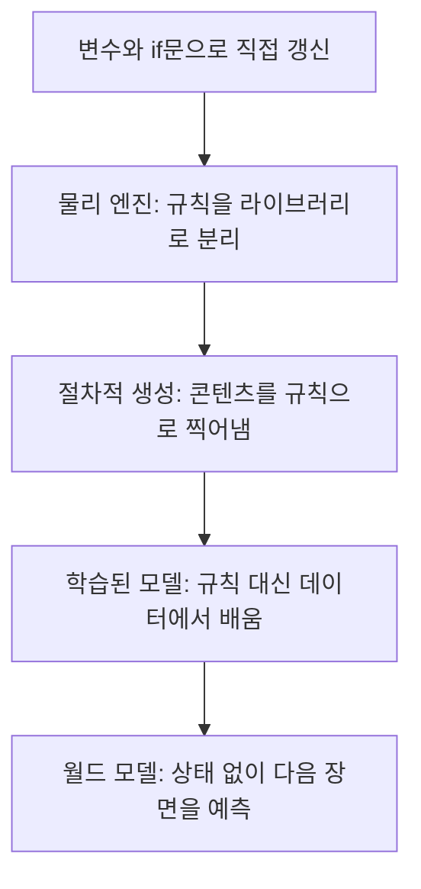

구글이 Genie 4를 내놨고, 댓글 1등은 "화면 밖으로 나갔다 돌아오면 성이 하나 더 생긴다"였다. 이 댓글이 월드 모델이 뭔지 제일 정확하게 찌른다.

> 옛날 시뮬레이션은 세계의 상태를 변수로 직접 들고 있었다. 그래서 화면 밖에 있어도 없어지지 않았다.
> 월드 모델은 상태를 따로 저장하지 않고 "다음 프레임이 어때 보일지"를 예측한다. 기억이 곧 화면이라서 화면 밖은 기억이 흐려진다.
> Genie 4가 어디까지 왔는지는 새 영상보다 "안 보이는 것을 얼마나 기억하냐"로 재야 한다.

## 세계가 변수 몇 개였던 시절

컴퓨터가 처음 "세계"를 흉내 내던 시절에는 세계가 곧 메모리였다. 공이 어디 있는지, 속도가 얼마인지, 점수가 몇 점인지를 전부 변수로 들고 있었다. 60년대 초의 Spacewar!든 70년대 초의 Pong이든 구조는 똑같다. 상태를 들고 있고, 규칙으로 상태를 조금씩 바꾸고, 바뀐 상태를 화면에 그린다.

여기서 핵심은 "그리는 것"과 "존재하는 것"이 다르다는 점이다. 공이 화면 밖으로 나가도 `y` 변수는 그대로 있고, 중력은 계속 적용된다. 카메라를 돌려서 돌아오면 공은 당연히 그 자리에 있거나 그 시간만큼 떨어져 있다. 이걸 객체 영속성이라고 부르는데, 이 시절에는 공짜였다. 상태가 변수에 있으니 잊어버릴 방법이 없었다.

그럼 좋은 시절 아니었냐고 묻는 사람이 있을 거다. 영속성은 공짜였지만 나머지 전부가 공짜가 아니었다. 세계에 있는 모든 것을 사람이 변수와 규칙으로 적어 줘야 했다. 바람에 풀이 흔들리는 걸 보고 싶으면 풀이 흔들리는 규칙을 짜야 한다. 사람이 걷는 걸 보고 싶으면 걷는 규칙을 짜야 한다. 세계가 풍부해질수록 규칙은 폭발한다.

## 그때 방식으로 직접 만들어 보기

공 하나가 떨어지고 튕기는 세계를 그때 방식으로 만들면 이렇다. Python 3.10 기준이고 표준 라이브러리만 쓴다.

```python
# Python 3.10+, 표준 라이브러리만
GRAVITY = -9.8
DT = 1 / 60  # 한 프레임이 흐르는 시간(초)

world = {"ball": {"y": 10.0, "vy": 0.0}, "bounces": 0}

def step(w, dt):
    b = w["ball"]
    b["vy"] += GRAVITY * dt      # 속도 갱신
    b["y"] += b["vy"] * dt       # 위치 갱신
    if b["y"] < 0:               # 바닥 충돌
        b["y"] = 0.0
        b["vy"] = -b["vy"] * 0.8  # 에너지 20% 손실
        w["bounces"] += 1

for frame in range(60 * 5):
    step(world, DT)             # 그리지 않아도 세계는 흐른다
    if frame % 60 == 0:
        b = world["ball"]
        print(f"t={frame*DT:.1f}s y={b['y']:.2f} bounces={world['bounces']}")
```

돌려 보면 1초 간격으로 공 높이와 튕긴 횟수가 찍힌다. `print`를 빼도 세계는 똑같이 흘러간다. 이게 "화면과 상태가 분리돼 있다"는 뜻이다.

여기서 아픈 지점은 이렇다.

- 공 하나에 규칙이 네 줄이다. 천, 물, 사람 같은 건 규칙을 어떻게 적어야 할지부터 막막하다.
- 반발계수 0.8 같은 숫자를 전부 사람이 정한다. 실제 세계에 맞는지는 눈으로 보고 고쳐야 한다.
- 이 세계는 규칙에 적은 것만 한다. 규칙에 없는 일은 절대 일어나지 않아서 심심하다.

## 규칙을 모아 두고, 손으로 채우고, 결국 배우게 한 흐름

불편은 순서대로 쌓였다. 아래 흐름도는 그 순서를 압축한 것이다. 개념도(실제 수치 아님)이고, 위에서 아래로 읽으면 된다.



**1단계, 규칙을 매번 짜기 싫다.** 공마다 중력 코드를 복붙하는 건 지옥이다. 그래서 충돌, 마찰, 관절 같은 걸 한곳에 모아 둔 물리 엔진이 나왔다. 2000년대에 이런 물리 라이브러리가 흔해졌다. 새로 생긴 문제는 엔진이 풀어 주는 건 "강체와 관절" 정도라는 것이다. 천, 유체, 군중은 여전히 사람이 따로 짜야 했다.

**2단계, 세계를 사람이 다 만들기 힘들다.** 맵을 하나하나 그리면 인건비가 끝이 없다. 그래서 규칙으로 맵을 찍어내는 절차적 생성이 나왔다. 80년대 로그라이크부터 이미 이런 접근이 있었다. 대신 새로 생긴 문제는 "다양하지만 비슷비슷하다"는 것이다. 규칙이 만들 수 있는 범위를 못 벗어난다.

**3단계, 규칙 자체를 데이터에서 뽑자.** 손으로 쓰는 규칙에는 한계가 있으니 사람이 움직이는 영상, 물이 흐르는 영상을 잔뜩 보여 주고 "다음에 어떻게 되는지" 맞히게 했다. 2018년 전후에 나온 World Models 같은 연구가 이 흐름을 대중에게 알렸다. 새로 생긴 문제는 상태가 사라진다는 점이다. 변수 `y` 대신 수백 수천 개 숫자로 된 압축된 잠재 표현이 들어간다. 그 안을 열어도 "여기 성이 하나 있음" 같은 칸은 없다.

**4단계, 영상 생성 모델과 합친다.** 다음 프레임을 맞히는 능력을 이미지·영상 생성 쪽 모델과 합치면 사람이 키보드로 조종하는 영상이 나온다. Genie 시리즈가 이 줄기고, 앞선 버전들은 2024년 즈음부터 공개됐다. 새로 생긴 문제가 맨 위 댓글이 말한 그것이다. 상태가 없으니 한 번 화면에서 사라진 건 모델이 기억하는 만큼만 돌아온다.

세대별로 표로 놓으면 이렇다.

| 시대 | 방식 | 장점 | 한계 |
| --- | --- | --- | --- |
| 초기 | 변수 + if문 | 영속성이 공짜, 결과가 예측 가능 | 규칙을 전부 사람이 짬 |
| 2000년대 | 물리 엔진 | 충돌·관절을 재사용 | 천·유체·사람은 따로 |
| 80년대부터 | 절차적 생성 | 콘텐츠 대량 생산 | 규칙 범위 안에서만 다양 |
| 2020년대 | 학습된 월드 모델 | 규칙 없이 풍부한 장면 | 상태가 없어서 일관성이 흔들림 |

표 읽는 법은 간단하다. 아래로 갈수록 사람이 짜는 규칙이 줄고, 대신 세계가 "맞는지" 확인하는 능력도 같이 줄어든다.

## 그럼 지금은 어디까지 왔나

Genie 4는 이 줄기의 최신 단계다. 텍스트로 날씨를 바꾸고, 카메라를 움직이고, 새 인물을 넣으면 세계가 알아서 이어진다. 공식 설명대로면 Gemini 계열이 장면을 감시하면서 일관성을 유지하게 돕는다. 소리까지 같이 생성한다는 점도 이번 발표의 큰 줄거리다.

여기서 독자가 궁금해할 질문이 있다. 그럼 월드 모델 안에 변수 `y` 같은 걸 다시 넣으면 되지 않냐는 거다. 맞는 방향이고 연구자들도 그쪽을 본다. 문제는 "무엇을 명시적 상태로 둘지"를 정해야 한다는 점이다. 성, 사람, 오토바이, 헬멧까지 다 목록에 올리면 옛날 방식의 규칙 폭발로 되돌아간다. 아무것도 안 올리면 지금의 문제가 남는다. 실제로는 그 중간 어딘가에서 줄타기를 하는 중이다.

아래는 두 방식이 어디에 상태를 두는지를 그린 개념도(실제 수치 아님)다. 왼쪽은 상태가 따로 있고, 오른쪽은 화면이 곧 기억이다.

<svg viewBox="0 0 640 220" xmlns="http://www.w3.org/2000/svg" role="img" aria-label="상태 분리 방식과 월드 모델 비교">
<rect x="20" y="30" width="270" height="150" rx="10" fill="none" stroke="#6b4f3a" stroke-width="2"/>
<text x="155" y="22" text-anchor="middle" font-size="15" fill="#7a6a58">옛날 방식</text>
<rect x="45" y="55" width="100" height="45" rx="6" fill="#d9b98c"/>
<text x="95" y="83" text-anchor="middle" font-size="13" fill="#6b4f3a">상태 변수</text>
<rect x="165" y="55" width="100" height="45" rx="6" fill="#c9a37a"/>
<text x="215" y="83" text-anchor="middle" font-size="13" fill="#6b4f3a">화면</text>
<line x1="145" y1="77" x2="165" y2="77" stroke="#a8683a" stroke-width="2"/>
<text x="155" y="140" text-anchor="middle" font-size="13" fill="#7a6a58">화면 밖에서도 상태는 유지</text>
<rect x="350" y="30" width="270" height="150" rx="10" fill="none" stroke="#6b4f3a" stroke-width="2"/>
<text x="485" y="22" text-anchor="middle" font-size="15" fill="#7a6a58">월드 모델</text>
<rect x="375" y="55" width="100" height="45" rx="6" fill="#c9a37a"/>
<text x="425" y="83" text-anchor="middle" font-size="13" fill="#6b4f3a">직전 프레임들</text>
<rect x="495" y="55" width="100" height="45" rx="6" fill="#d9b98c"/>
<text x="545" y="83" text-anchor="middle" font-size="13" fill="#6b4f3a">다음 프레임</text>
<line x1="475" y1="77" x2="495" y2="77" stroke="#a8683a" stroke-width="2"/>
<text x="485" y="140" text-anchor="middle" font-size="13" fill="#7a6a58">화면에서 사라지면 기억이 흐려짐</text>
</svg>

지금 선택지를 정리하면 대략 이렇다.

- 정확한 일관성이 필요한 게임, 시뮬레이터, 공학 계산에는 아직 명시적 상태를 쓰는 엔진이 낫다. 헬멧 있던 사람이 헬멧을 벗고 돌아오면 안 되기 때문이다.
- 장면의 풍부함과 즉흥성이 중요한 프로토타입, 로봇 학습용 환경 후보, 연출 시안에는 월드 모델이 맞는다. Genie 4가 말하는 용도가 이쪽이다.
- 오픈 웨이트로 직접 돌려 보고 싶으면 댓글에서 언급된 Tencent HY-World 2.0 같은 쪽을 볼 수 있다. 다만 나는 성능을 확인하지 못했으니 비교는 직접 해야 한다.

색소폰 소리가 클라리넷으로 나왔다는 댓글도 같은 맥락이다. 그럴듯한 소리를 예측하는 것과 지정한 악기를 정확히 지키는 건 다른 문제다. 지금 Genie 4는 앞쪽을 꽤 잘하고 뒤쪽은 아직 약하다.

변수에 적어 둔 세계는 잊지 않지만 좁고, 예측으로 만든 세계는 넓지만 잘 잊는다. 이 둘이 한곳에서 만나는 날이 오면 그때 가서 진짜 시뮬레이션이라고 불러도 늦지 않다.

---

*원문: [Genie 4](https://deepmind.google/blog/genie-4-a-new-generation-of-world-simulation/) (via hn)*
