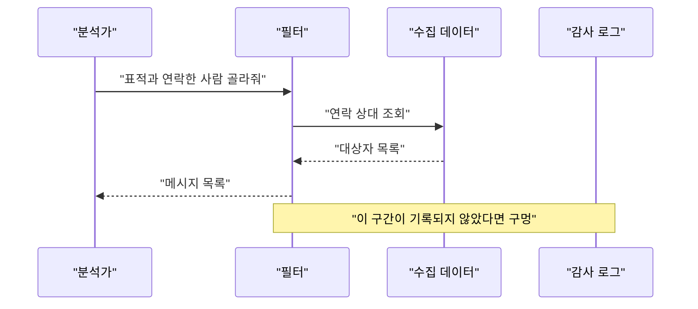

비밀 법원이 정보기관의 검색 필터를 두고 "그거 검색 맞다"고 했는데, 정작 그 판결문이 몇 달째 비공개라서 상원의원들이 난리다. 정치 얘기는 남들이 하게 두고, 우리는 "필터"와 "검색"이 왜 기술적으로 같은 물건인지 보자.

> - 데이터가 한곳에 쌓여 있으면 "누가, 왜, 뭘 봤는지"는 시스템이 강제하지 않는 이상 아무도 모른다.
> - 접근 통제는 파일 권한에서 DB 권한, 역할 기반, 사유와 감사 기록 순으로 진화했고 단계마다 새 구멍이 생겼다.
> - 기사에서 문제 된 "참여자 필터"는 결국 WHERE 절이고, WHERE 절이 기록되지 않으면 통제도 없다.

## 서랍 하나에 다 때려 넣던 시절

접근 통제가 없던 시대를 상상해 보자. 데이터는 파일 하나나 테이블 하나에 쌓인다. 읽을 수 있는 사람은 그 파일을 열 수 있는 사람이다. 규칙은 서류와 사람의 양심에 있었다.

"이 데이터는 외국 표적 용도로만 봐라" 같은 규칙은 코드 어디에도 없었다. 매뉴얼에 적혀 있고 교육 시간에 들었을 뿐이다. 시스템 입장에서는 표적을 찾는 검색과 옆집 사람을 찾는 검색이 똑같은 함수 호출이다.

그럼 왜 그냥 로그를 남기면 되는 일이 아니었냐는 의문이 든다. 로그는 공짜가 아니다. 모든 검색마다 한 줄씩 쓰고, 저장하고, 나중에 읽어 줄 사람이 있어야 한다. 그래서 초기 시스템은 "일단 돌아가게" 만들고 기록은 뒤로 미뤘다. 이 미룸이 몇십 년 뒤 감사 보고서의 단골 문장이 된다.

## 그때 방식으로 직접 만들어 보기

기사에 나온 "참여자 필터"를 초간단 버전으로 흉내 내 보자. 표적과 연락한 사람을 먼저 뽑고, 그 사람들의 메시지를 꺼낸다. 표준 라이브러리만 쓴 Python 3.11 코드다.

```python
import json

# msgs.jsonl 한 줄 예시: {"from": "a@x.com", "to": "b@y.com", "body": "..."}

def read_all(path):
    with open(path, encoding="utf-8") as f:
        for line in f:
            yield json.loads(line)

def contacts_of(path, target):
    out = set()
    for m in read_all(path):
        if m["from"] == target:
            out.add(m["to"])
        elif m["to"] == target:
            out.add(m["from"])
    return out

def messages_of(path, people):
    return [m for m in read_all(path)
            if m["from"] in people or m["to"] in people]

people = contacts_of("msgs.jsonl", "target@foreign.example")
for m in messages_of("msgs.jsonl", people):
    print(m["from"], "->", m["to"], m["body"][:40])
```

코드는 짧고 잘 돈다. 그래서 더 위험하다. 여기서 아픈 지점을 보자.

- 누가 이 코드를 돌렸는지, 왜 돌렸는지 어디에도 남지 않는다. 출력만 있고 흔적은 없다.
- `contacts_of`는 그냥 "준비 단계"처럼 보인다. 하지만 이 함수가 돌려준 사람들 중에 표적이 아닌 일반인이 섞여 있고, 그 사람들의 메시지를 읽는 게 `messages_of`다. 필터라는 이름이 붙었을 뿐 실체는 사람을 골라서 읽는 검색이다.
- 건수를 세려면 이 함수들을 감싸서 세는 코드를 따로 짜야 한다. 안 짜면 "몇 건 검색했냐"는 질문에 답이 없다.

기사 속 "아무도 세지 않은 검색"이 정확히 이 구조다. 바깥에서는 필터가 검색의 일부인지 아닌지 논쟁하지만, 코드로 보면 필터가 결과를 정하는 자리다. 그러니 검색 규칙은 필터에도 똑같이 걸려야 한다. 법원이 내렸다고 알려진 판단도 이 방향이다.

## 그래서 어떻게 진화했나

큰 흐름은 "누가 열 수 있나"에서 "무엇을, 왜, 기록과 함께"로 넘어간 것이다.


위 그림은 단계가 오른쪽으로 갈수록 통제 단위가 잘게 쪼개진다는 개념도다. 화살표 하나가 불편 하나를 해결한 지점이다.

**1단계: 파일 권한**

- 불편: 여러 사람이 한 컴퓨터를 같이 쓰기 시작했다. 남의 파일을 마음대로 열고 지우면 곤란하다.
- 해법: 유닉스 계열의 소유자, 그룹, 기타 세 칸짜리 읽기, 쓰기, 실행 권한. 아주 단순하고 지금도 쓴다.
- 새 문제: 단위가 파일 통째다. "이 파일의 이 부분만 보여 줘"를 말할 방법이 없다. 메시지 100만 건이 든 파일이면 전부 보거나 하나도 못 보거나다.

**2단계: DB 권한과 뷰**

- 불편: 데이터가 파일에서 데이터베이스 테이블로 옮겨 갔다. 한 테이블 안에서도 사람마다 볼 범위가 다르다.
- 해법: 테이블과 컬럼 단위 GRANT, 그리고 뷰다. 뷰는 원본 테이블 위에 "허용된 모양"만 비추는 창문이라고 보면 된다.
- 새 문제: 권한은 "할 수 있다"만 말한다. 왜 하는지는 모른다. 허용된 창문 안에서 아무 사람이나 마음대로 조회해도 시스템은 막지 못한다.

```sql
-- 표준 SQL 흉내, DB마다 문법은 조금씩 다름
CREATE VIEW foreign_only AS
  SELECT sender, receiver, body FROM messages WHERE is_us_person = false;
GRANT SELECT ON foreign_only TO analyst_role;
```

**3단계: 역할 기반 접근 통제**

- 불편: 사람이 늘고 이동이 잦아지니 사람마다 권한을 따로 주는 게 지옥이 됐다.
- 해법: 90년대 초중반에 정리된 RBAC. 사람에게 직접 권한을 주지 않고 "분석가", "감사관" 같은 역할에 주고, 사람을 역할에 붙인다. 부서를 옮기면 역할만 바꾸면 된다.
- 새 문제: 역할이 늘어나 수백 개가 되고, 나중엔 아무도 각 역할이 뭘 하는지 모른다. 더 큰 문제는 역할이 사유를 모른다는 것이다. 분석가 역할이면 모든 검색이 허용되고, 이 검색이 정당한지는 사람이 알아서 해야 한다.

**4단계: 사유 요구와 감사 로그**

- 불편: 허용된 사람이 허용된 범위 안에서 선을 넘는 경우를 막지 못했다.
- 해법: 조회 전에 사유를 입력하게 하고, 승인이 필요한 조회는 승인을 받게 하고, 모든 조회를 로그로 남긴다. 이제 "누가, 언제, 어떤 조건으로, 왜"가 한 줄이다.
- 새 문제: 로그는 로그를 남기는 코드가 있는 곳에서만 쌓인다. 우회 경로가 하나라도 있으면 그 경로는 어둠이다.

```python
def audited(fn):
    def wrap(user, reason, *args, **kw):
        if not reason:
            raise PermissionError("reason required")
        log.info("user=%s fn=%s args=%s reason=%s", user, fn.__name__, args, reason)
        return fn(user, reason, *args, **kw)
    return wrap
```

그럼 처음부터 모든 걸 그렇게 만들지 왜 안 했냐고 물을 수 있다. 사유 입력은 사용자를 귀찮게 하고, 로그는 저장 비용이 들고, 승인 절차는 속도를 늦춘다. 급할 때 이 셋은 가장 먼저 잘리는 기능이다. 통제 장치가 늘 사후에 붙는 이유다.

| 시대 | 방식 | 장점 | 한계 |
|---|---|---|---|
| 초기 | 파일 권한 | 단순하고 빠르다 | 파일 통째 단위 |
| DB 시대 | GRANT와 뷰 | 컬럼, 행 단위 가능 | 사유와 기록이 없다 |
| 조직 확대 | RBAC | 사람 이동에 강하다 | 역할 폭증, 목적 모름 |
| 지금 | 사유, 승인, 감사 로그 | 사후 추적 가능 | 기록 경로가 빠지면 무용 |

표는 위에서 아래로 갈수록 "누가"에서 "왜"로 질문이 바뀐다는 걸 읽으면 된다.

## 지금은 어떤가

기사가 보여 주는 건 4단계의 허점이다. 기사 내용대로면 FBI의 참여자 필터는 2025년 2월에 법무부가 법원에 "검색이 있었는데 아무도 세지 않았다"고 알린 도구다. 상당 기간 기록 대상에서 빠져 있었다는 얘기다. 정부 프라이버시 감시 기구도 이런 검색은 추적이 불가능하다고 했다고 한다.


<svg viewBox="0 0 640 230" xmlns="http://www.w3.org/2000/svg">
  <text x="20" y="24" font-size="14" fill="#7a6a58">개념도(실제 수치 아님)</text>
  <rect x="20" y="40" width="270" height="160" rx="8" fill="none" stroke="#c9a37a" stroke-width="2"/>
  <text x="36" y="66" font-size="14" fill="#6b4f3a">필터를 검색으로 안 볼 때</text>
  <rect x="40" y="82" width="230" height="36" rx="6" fill="#d9b98c"/>
  <text x="56" y="105" font-size="13" fill="#6b4f3a">필터 실행 (기록 없음)</text>
  <rect x="40" y="132" width="230" height="36" rx="6" fill="#a8683a"/>
  <text x="56" y="155" font-size="13" fill="#ffffff">본 검색 (기록 있음)</text>
  <rect x="350" y="40" width="270" height="160" rx="8" fill="none" stroke="#c9a37a" stroke-width="2"/>
  <text x="366" y="66" font-size="14" fill="#6b4f3a">필터도 검색으로 볼 때</text>
  <rect x="370" y="82" width="230" height="36" rx="6" fill="#a8683a"/>
  <text x="386" y="105" font-size="13" fill="#ffffff">필터 실행 (기록 있음)</text>
  <rect x="370" y="132" width="230" height="36" rx="6" fill="#a8683a"/>
  <text x="386" y="155" font-size="13" fill="#ffffff">본 검색 (기록 있음)</text>
</svg>


왼쪽은 기록이 본 검색에서만 쌓이는 구조고, 오른쪽은 결과를 좁히는 모든 단계에서 쌓이는 구조다. 왼쪽에서는 사람을 고르는 가장 중요한 단계가 어둠에 남는다.

시스템 설계자 눈으로 보면 법원 판단이 이상한 게 아니다. 사람을 골라내는 단계가 결과를 정한다. 그 단계를 통제 밖에 두면 통제는 문 앞만 지키고 뒷문을 열어 둔 셈이다. 법원이 필터를 재설계하라고 했다고 보도된 것도 이 이유로 읽힌다.

순서는 이렇다.



호출 순서 그림이다. 로그로 향하는 화살표가 필터 구간에 하나도 없다는 점을 보면 된다.

지금 선택지는 대략 세 가지다. 첫째, 조회 API 하나로 모든 경로를 몰아서 거기서만 로그를 남기는 방식. 둘째, DB 자체의 감사 기능을 켜서 어떤 도구로 들어오든 쿼리를 기록하는 방식. 셋째, 사유와 승인을 코드로 강제하는 정책 엔진을 앞에 두는 방식이다.

첫째는 만들기 쉽지만 우회 경로가 생기면 끝이다. 둘째는 우회가 어렵지만 노이즈가 많다. 셋째가 가장 튼튼하고 가장 귀찮다. 실무에서는 보통 둘째에 셋째를 일부 얹는다.

아직 남은 한계도 있다. 이 모든 장치는 기록이 존재한다는 전제 위에서만 의미가 있다. 기사에는 FBI의 내부 감사 부서가 폐쇄되고 보고된 준수율 수치가 문서마다 다르다는 대목도 있다. 기록이 있어도 읽는 사람이 없고, 읽은 결과가 공개되지 않으면 통제는 제 기능을 못 한다. 판결문이 비공개면 그 통제가 어디까지 가능한지조차 바깥에서는 확인할 수 없다.

권한 설계에서 제일 흔한 사고는 막아야 할 문이 아니라 세지 않은 문에서 난다.

---

*원문: [US Government is hiding a secret court ruling about how it spies on Americans](https://www.wired.com/story/the-us-government-is-hiding-a-secret-court-ruling-about-how-it-spies-on-americans/) (via hn)*
