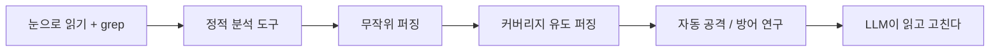

Gemini 4 Carbon이 취약점 찾기 벤치마크에서 1등이라고 한다. 근데 "취약점을 찾는다"가 원래 무슨 일이었는지 모르면 이 숫자가 뭘 자랑하는 건지도 모른다.

> - 취약점 찾기는 원래 사람이 코드를 눈으로 읽고 grep을 돌리는 노가다였다. 정적 분석과 퍼징이 이걸 기계로 옮겼다.
> - 두 도구 모두 "수상한 곳"까지만 알려줬다. 진짜 뚫리는지 확인하고 고치는 건 계속 사람 몫이었다.
> - Carbon의 주장은 찾기, 악용 검증, 패치를 한 모델이 잇는다는 것이다. 다만 지금은 소수 방어자에게만 풀렸고 수치도 구글이 직접 낸 것이다.

## 눈알로 읽고 grep으로 버티던 시절

C로 짠 코드는 메모리를 프로그래머가 직접 만진다. 배열 크기를 넘겨 쓰거나, 길이를 확인하지 않고 복사하면 그대로 보안 구멍이 된다. 컴파일러는 이걸 막아주지 않는다. 문법만 맞으면 통과시킨다.

그래서 처음 방법은 단순했다. 사람이 코드를 읽는다. 읽다 지치면 `gets`, `strcpy` 같은 위험한 함수 이름을 grep으로 찾는다. 80년대 후반에 인터넷을 휩쓴 모리스 웜도 이런 종류의 입력 길이 문제를 파고들었다. 이 글에서는 이런 구멍이 오래전부터 있었다는 것만 알면 된다.

"그럼 위험한 함수를 전부 금지하면 되지 않나?"라는 의문이 나올 수 있다. 함수 이름만 보고는 위험 여부를 모른다. `strcpy`라도 복사할 길이가 항상 안전하게 보장돼 있으면 괜찮다. 반대로 이름이 멀쩡한 함수도 길이 계산이 틀렸으면 터진다.

grep은 글자만 보고 코드가 어떻게 흘러가는지는 모른다. 그래서 안전한 곳을 잔뜩 의심하고, 진짜 위험한 곳은 놓친다. 코드가 수백만 줄로 커지면 사람이 읽는 방식은 아예 성립하지 않는다.

## 그 방식으로 직접 만들어 보기

사람이 읽는 게 한계라면 컴퓨터가 입력을 마구 던져서 죽는지 보면 된다. 이게 퍼징이다. 표준 라이브러리만으로 Python 3.11에서 돌아가는 최소 버전은 이렇다.

```python
import random

def parse(data: bytes):
    # 첫 바이트 = 본문 길이, 이어서 본문, 마지막 1바이트 = 체크섬
    if len(data) < 2:
        raise ValueError("too short")
    n = data[0]
    body = data[1:1 + n]
    check = data[1 + n]          # 버그: 길이가 모자란 입력을 확인하지 않음
    if check != sum(body) % 256:
        raise ValueError("bad checksum")
    return body

random.seed(1)
for i in range(100_000):
    size = random.randrange(0, 8)
    data = bytes(random.randrange(256) for _ in range(size))
    try:
        parse(data)
    except ValueError:
        pass                      # 예상한 거절은 정상
    except Exception as e:        # 예상 못한 죽음만 버그
        print(i, data, type(e).__name__)
        break
```

parse가 예상한 방식으로 거절하면 ValueError를 낸다. 퍼저는 그 외의 예외, 즉 설계자가 생각 못 한 죽음만 버그로 본다. 시드를 고정했으니 같은 입력이 재현된다. 재현이 되어야 고칠 수 있다.

여기서 아픈 지점이 있다.

- Python이라 IndexError로 끝나지만, C였다면 범위 밖 메모리를 읽거나 썼을 것이다. 퍼저는 "죽었다"만 알려주고 "그게 위험한 죽음인가"는 판단하지 못한다.
- 체크섬이 4바이트짜리 CRC였다면 랜덤 입력이 그 검문소를 넘을 확률은 거의 0이다. 검문소 뒤에 있는 코드는 영원히 테스트되지 않는다.
- 크래시가 나와도 원인 줄을 짚어주지 않는다. 입력 바이트 몇 개와 스택 정보를 받아서 사람이 역추적해야 한다.

## 불편이 쌓일 때마다 도구가 하나씩 생겼다

먼저 전체 흐름을 본다. 각 단계는 앞 단계의 불편에서 나왔다.



읽는 법: 화살표는 앞 방식의 불편이 다음 방식을 낳은 순서다. 연도가 아니라 순서만 본다.

첫째는 정적 분석이다. 70년대 Unix의 lint 같은 도구가 시작이었다. 사람이 하던 "의심스러운 패턴 찾기"를 규칙으로 옮겼다. 이후 변수가 어디서 어디로 흘러가는지 따라가는 데이터 흐름 분석까지 갔다.

문제는 경고 홍수였다. 도구는 "혹시 모르니" 모든 가능성을 경고한다. 개발자는 수백 개 경고 중 진짜가 한두 개라는 걸 몇 번 겪으면 목록을 닫아버린다. 이걸 오탐 문제라고 부른다.

그래서 80년대 후반에 반대 발상이 나왔다. 코드를 읽지 말고 실제로 돌려서 죽는지 보자는 것이다. 유닉스 유틸리티에 무작위 입력을 던졌더니 상당수가 죽었다는 연구가 퍼징의 시작으로 자주 거론된다. 위 샘플이 그 방식의 축소판이다.

그런데 순수 무작위는 얕은 곳만 건드린다. 이를 해결한 게 커버리지 유도 퍼징이다. 입력이 코드의 새 분기를 열었는지 계측하고, 새 길을 연 입력만 남겨서 조금씩 바꿔 다시 던진다. 2010년대에 AFL 같은 도구로 대중화됐고, 이후 대형 오픈소스를 상시 퍼징하는 인프라도 생겼다.

새로 생긴 문제는 이런 것이다. 크래시가 수천 개 나오는데 어느 게 진짜 보안 문제고 어느 게 그냥 버그인지 사람이 분류해야 한다. 찾는 속도가 고치는 속도를 앞질러 버렸다.

그 뒤에는 기호 실행처럼 조건식을 풀어서 입력을 만드는 연구가 있었다. 2016년 DARPA가 기계끼리 서로 공격하고 방어하는 대회까지 열었다. 방향은 맞았지만 실제 대형 코드베이스에서 일상적으로 쓰이기에는 규모와 비용이 버거웠다.

세대별로 정리하면 이렇다.

| 시대 | 방식 | 장점 | 한계 |
|---|---|---|---|
| 초기 | 눈으로 리뷰, grep | 맥락을 이해함 | 느리고 사람마다 다름 |
| 70년대~ | lint, 정적 분석 | 코드를 안 돌려도 됨 | 오탐 많음, 실행 맥락 모름 |
| 80년대 후반~ | 무작위 퍼징 | 진짜로 죽는 입력을 줌 | 깊은 경로 도달 어려움 |
| 2010년대~ | 커버리지 유도 퍼징 | 깊은 곳까지 자동 탐색 | 크래시 분류와 악용 판단은 수작업 |
| 최근 | LLM 기반 | 코드를 읽고 패치까지 작성 | 환각, 범위 이탈, 인젝션 |

읽는 법: 아래로 갈수록 자동화 범위가 넓어진다. 대신 "찾기"와 "고치기" 사이의 사람 손은 아주 늦게야 줄었다.

## 그래서 지금, Carbon이 건드리는 자리

도구가 전부 모자란 건 아니었다. 빠진 건 이어붙이기였다. 방어자가 하는 일은 크게 세 단계다. 찾고, 진짜 뚫리는지 검증하고, 원인을 고친다. 그동안 단계마다 도구가 달랐고 사이는 사람이 이었다.


<svg viewBox="0 0 680 230" xmlns="http://www.w3.org/2000/svg" font-family="sans-serif" font-size="14">
<rect x="20" y="30" width="190" height="60" rx="8" fill="none" stroke="#a8683a" stroke-width="2"/>
<text x="115" y="66" text-anchor="middle" fill="#7a6a58">찾기</text>
<rect x="245" y="30" width="190" height="60" rx="8" fill="none" stroke="#a8683a" stroke-width="2"/>
<text x="340" y="66" text-anchor="middle" fill="#7a6a58">악용 검증</text>
<rect x="470" y="30" width="190" height="60" rx="8" fill="none" stroke="#a8683a" stroke-width="2"/>
<text x="565" y="66" text-anchor="middle" fill="#7a6a58">원인 패치</text>
<path d="M212 60 L243 60 M437 60 L468 60" stroke="#6b4f3a" stroke-width="2"/>
<rect x="20" y="120" width="190" height="44" rx="8" fill="#d9b98c" fill-opacity="0.35" stroke="#c9a37a"/>
<text x="115" y="147" text-anchor="middle" fill="#7a6a58">정적 분석, 퍼저</text>
<rect x="245" y="120" width="190" height="44" rx="8" fill="#d9b98c" fill-opacity="0.35" stroke="#c9a37a"/>
<text x="340" y="147" text-anchor="middle" fill="#7a6a58">사람이 직접 재현</text>
<rect x="470" y="120" width="190" height="44" rx="8" fill="#d9b98c" fill-opacity="0.35" stroke="#c9a37a"/>
<text x="565" y="147" text-anchor="middle" fill="#7a6a58">사람이 직접 수정</text>
<text x="340" y="205" text-anchor="middle" fill="#7a6a58">개념도(실제 수치 아님): 위가 해야 할 일, 아래가 그동안 맡던 주체</text>
</svg>


읽는 법: 위 칸이 방어 과정이고 아래 칸이 지금까지 채우던 주체다. 도구는 왼쪽 칸에만 있었고 나머지는 사람이 이었다.

Carbon의 발표는 이 세 칸을 한 모델이 맡는다는 주장이다. 벤치마크도 칸마다 하나씩 대응한다. 찾기는 SEC-bench Pro 88.2%, 악용 검증은 ExploitGym 54.8%, 패치는 CWE-bench 71.0%다. 구글이 밝힌 대로 가드레일 없이 평가한 값이다.

여기서 걸러서 읽어야 한다. 모두 구글이 낸 수치이고 모델도 아직 일반 공개가 아니다. 소수 사이버 방어자에게 먼저 풀고 Fairwind Program으로 신뢰 파트너를 늘려간다고 한다. 해커뉴스 댓글에도 "공개 안 한 모델의 벤치마크는 의미 없다"는 반응이 있었는데, 이 부분은 일리가 있다.

"그럼 이제 퍼저는 필요 없나?" 이 의문은 바로 답할 수 있다. 필요하다. 퍼저는 실제로 코드를 돌려 죽는 입력을 만들어낸다. 모델의 "여기 위험하다"는 주장과 달리 재현 가능한 증거다. 둘의 역할은 겹치지 않고 서로 검증해 준다.

반대 질문도 있다. 모델이 악용까지 쓸 줄 알면 공격자에게도 같은 도구가 되는 것 아닌가. 이게 구글이 방어자에게 먼저 푸는 이유일 것이다. 다만 그 판단이 맞았는지는 외부에서 검증된 적이 없다.

선택지를 비교하면 이렇다. 정적 분석은 싸고 빠르지만 오탐이 많다. 퍼징은 증거가 확실하지만 입력을 만들 하네스와 시간이 필요하다. LLM은 읽고 고치는 데까지 가지만 틀린 말을 자신 있게 할 수 있고, 가격은 입력 100만 토큰당 2달러, 출력 10달러로 도입가라고 한다. 도입 기간이 끝나면 4달러와 20달러다.

결국 새로 생기는 병목은 모델이 낸 패치를 누가 믿고 머지하느냐다. 찾는 속도는 이미 사람보다 빠르다. 신뢰를 쌓는 속도는 아직 사람 속도다.

---

*원문: [Gemini 4 Carbon](https://blog.google/innovation-and-ai/models-and-research/gemini-models/introducing-gemini-4-carbon/) (via hn)*
