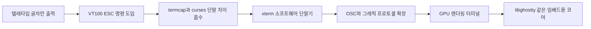

Ghostty 1.4 릴리스 노트에 보안 취약점이 아홉 개 적혀 있는데, 대부분 "그냥 글자를 화면에 뿌렸을 뿐인데" 터진다. 터미널이 글자 출력기가 아니라 명령 해석기라서 그렇다.

> - 터미널 화면에 보이는 글자 속에는 "커서 옮겨라", "화면 지워라", "클립보드 바꿔라" 같은 명령이 섞여 있다.
> - 이 방식은 종이에 찍던 텔레타입 시절의 "글자만 흘려보내는 선" 위에 명령을 얹어서 생겼고, 그래서 지금도 데이터와 명령이 한 줄기로 섞여 있다.
> - Ghostty가 그림, 압축, SIMD까지 붙이는 건 이 구조 위에 기능을 쌓는 일이라, 기능이 늘수록 공격 면도 같이 늘어난다.

## 화면이 없던 시대

처음에는 화면이 없었다. 컴퓨터 앞에는 텔레타입이라는 기계식 타자기가 있었고, 프로그램이 글자를 내보내면 종이에 찍혔다.

이 시절 프로그램이 할 수 있는 일은 "다음 글자 하나 출력"이 전부였다. 한 번 찍은 글자는 지울 수 없었다. 종이에 잉크가 묻었으니까.

화면이 달린 단말기가 나오자 사정이 달라졌다. 화면은 지우고 다시 쓸 수 있다. 그러면 "커서를 3행 5열로 옮겨서 거기 덮어써라" 같은 요청이 필요해진다.

여기서 의문이 하나 생긴다. 그냥 별도 통신선을 하나 더 뽑아서 "명령 전용 채널"을 만들면 되지 않나. 당시 단말기는 케이블이 시리얼 선 하나였다. 선을 더 뽑을 수도 없었고, 이미 깔린 선과 장비를 다 갈아엎을 수도 없었다.

그래서 택한 방법이 "글자 중간에 명령을 끼워 넣기"다. 보통 글자가 아닌 특수 바이트(ESC, 27번)가 오면 "여기서부터는 명령이다"라고 약속했다. 이 약속이 지금까지 이어지는 이스케이프 시퀀스다. 70년대 후반에 나온 DEC의 VT100이 이 방식을 대중화했고, 이후 대부분의 단말기가 이 계열을 흉내 냈다.

아래 그림이 그 구조다. 프로그램은 화면을 직접 건드리지 않고 바이트만 흘려보내고, 단말기가 그 바이트를 읽으면서 "글자냐 명령이냐"를 판단한다.

개념도(실제 수치 아님). 왼쪽에서 오른쪽으로 바이트가 흘러가고, 마지막 단계에서만 화면이 바뀐다.

<svg viewBox="0 0 640 170" xmlns="http://www.w3.org/2000/svg">
<rect x="10" y="50" width="130" height="70" rx="8" fill="none" stroke="#6b4f3a" stroke-width="2"/>
<text x="75" y="90" font-size="14" text-anchor="middle" fill="#7a6a58">프로그램</text>
<rect x="190" y="50" width="130" height="70" rx="8" fill="none" stroke="#c9a37a" stroke-width="2"/>
<text x="255" y="82" font-size="14" text-anchor="middle" fill="#7a6a58">바이트 흐름</text>
<text x="255" y="102" font-size="12" text-anchor="middle" fill="#7a6a58">글자 + ESC 명령</text>
<rect x="370" y="50" width="130" height="70" rx="8" fill="none" stroke="#a8683a" stroke-width="2"/>
<text x="435" y="82" font-size="14" text-anchor="middle" fill="#7a6a58">단말기 해석기</text>
<text x="435" y="102" font-size="12" text-anchor="middle" fill="#7a6a58">ESC 보면 명령 모드</text>
<rect x="550" y="50" width="80" height="70" rx="8" fill="none" stroke="#d9b98c" stroke-width="2"/>
<text x="590" y="90" font-size="14" text-anchor="middle" fill="#7a6a58">화면</text>
<path d="M140 85 H190 M320 85 H370 M500 85 H550" stroke="#a8683a" stroke-width="2" fill="none"/>
<path d="M182 79 L190 85 L182 91 M362 79 L370 85 L362 91 M542 79 L550 85 L542 91" stroke="#a8683a" stroke-width="2" fill="none"/>
<text x="320" y="150" font-size="12" text-anchor="middle" fill="#7a6a58">개념도(실제 수치 아님)</text>
</svg>

## 그 방식으로 직접 만들어 보기

말로만 하면 감이 안 오니까, 이스케이프 시퀀스를 해석하는 미니 단말기를 짜 본다. 화면은 20x4 글자판이고, 지원하는 명령은 "커서 이동"과 "화면 지우기" 두 개뿐이다.

```python
# Python 3.9+, 표준 라이브러리만 사용
import re
W, H = 20, 4
grid = [[" "] * W for _ in range(H)]
row = col = 0
CSI = re.compile(r"\x1b\[([0-9;]*)([A-Za-z])")

def feed(data):
    global row, col
    i = 0
    while i < len(data):
        m = CSI.match(data, i)
        if m:
            nums = [int(a) if a else 1 for a in m.group(1).split(";")] if m.group(1) else []
            if m.group(2) == "H":
                row = (nums[0] if nums else 1) - 1
                col = (nums[1] if len(nums) > 1 else 1) - 1
            elif m.group(2) == "J":
                for r in grid:
                    r[:] = [" "] * W
            i = m.end()
            continue
        ch = data[i]
        i += 1
        if ch == "\n":
            row, col = row + 1, 0
        elif row < H and col < W:
            grid[row][col] = ch
            col += 1

def dump():
    print("\n".join("|" + "".join(r) + "|" for r in grid))

feed("hello\n\x1b[3;5Hworld")
dump()
feed("\x1b[2J\x1b[1;1Hdone")
dump()
```

돌려 보면 첫 출력에는 hello와 world가 각각 1행과 3행에 보이고, 두 번째 출력에는 done만 남는다. 프로그램이 한 일은 문자열을 넘긴 것뿐인데 화면이 지워지고 다시 그려졌다. 이게 터미널이 "해석기"라는 말의 실체다.

여기서 아픈 지점이 있다.

- 바이트가 ESC 중간에서 끊겨 들어오면(`\x1b[3` 까지만 오고 다음 덩어리에 `;5H`) 이 파서는 그걸 그냥 글자로 찍어 버린다. 진짜 단말기는 상태를 기억하고 이어 받아야 한다.
- 모르는 명령이 오면 그냥 글자로 화면에 나온다. 반대로 진짜 터미널이 아무거나 다 실행해 주면, 출력 내용이 곧 명령이 되는 위험이 생긴다.
- 색, 굵기, 한글 같은 폭 넓은 글자, 스크롤 영역까지 넣으면 이 정규식 한 줄로는 감당이 안 된다. 상태 기계로 짜야 한다.

## 그래서 어떻게 진화했나

첫 단계는 "단말기마다 명령이 달라서 프로그램 짜기 괴롭다"였다. 메이커마다 커서 이동 코드가 달랐으니, 에디터 하나를 만들려면 단말기 수만큼 분기를 짜야 했다. 해법은 termcap, 이후 terminfo 같은 "단말기 사양 데이터베이스"와 curses 라이브러리였다. 프로그램은 "커서 이동"만 말하고 라이브러리가 단말기별 코드로 바꿔 줬다. 새로 생긴 문제는 데이터베이스가 낡거나 틀리면 화면이 깨진다는 점이었다.

둘째 단계는 "물리 단말기를 사야 한다"였다. 비싸고 자리를 차지하고 고장 난다. 해법은 소프트웨어가 단말기를 흉내 내는 것이었고, 80년대에 나온 xterm이 대표적이다. 그림 창 안에서 VT100 계열 명령을 해석하는 프로그램이다. 새로 생긴 문제는 "흉내의 정확도"다. 어디까지 따라 하느냐가 제각각이라 호환성 문제가 계속 따라붙었다.

셋째 단계는 "글자만으로는 부족하다"였다. 이미지, 하이퍼링크, 클립보드 연동, 진짜 색상이 필요해졌다. 해법은 기존 형식을 건드리지 않는 확장이었다. 새 명령은 OSC나 APC 같은 시퀀스로 추가했다(하이퍼링크는 OSC 8, 클립보드는 OSC 52, 그림은 Sixel이나 Kitty 그래픽 프로토콜). 새로 생긴 문제는 명령이 늘수록 해석기가 만져야 하는 영역이 커진다는 것이다. 파일을 읽고, 메모리를 할당하고, 링크를 열게 된다.

넷째 단계는 "너무 느리고 무겁다"였다. 수만 줄이 빠르게 흘러가면 CPU로 글자를 그리는 방식은 버티지 못한다. 해법은 GPU 렌더링이었고, 2010년대에 Alacritty, Kitty 같은 터미널이 이를 밀었다. 새로 생긴 문제는 렌더링은 빨라졌어도 상태 관리가 복잡해졌다는 점이다. 숨겨진 탭의 GPU 메모리, 오래된 스크롤백 같은 것들이다.

개념도(실제 수치 아님). 각 상자는 "불편을 풀려고 나온 해법"이고, 화살표 방향이 시간 순서다.



세대별로 표로 묶으면 이렇다.

| 시대 | 방식 | 장점 | 한계 |
|---|---|---|---|
| 텔레타입 | 글자를 종이에 출력 | 단순함 | 지울 수 없고 느림 |
| 물리 단말기 | ESC 명령으로 화면 제어 | 전체 화면 앱 가능 | 기종마다 명령이 다름 |
| xterm 계열 | 소프트웨어로 단말기 흉내 | 어디서나 실행 | 에뮬레이션 호환성 문제 |
| GPU 터미널 | GPU로 빠르게 그림 | 대량 출력도 부드러움 | 기능과 공격 면이 같이 증가 |
| 코어 라이브러리화 | 에뮬레이션만 따로 분리 | 에디터나 IDE에서 재사용 | 아직 생태계 초기 |

## 지금은 어떤가

Ghostty 1.4는 앞에서 말한 네 번째와 다섯 번째 단계를 한꺼번에 밀어붙인 릴리스다. Kitty 그래픽 프로토콜 명세를 100% 구현했고, 큰 이미지 데이터를 SIMD로 한꺼번에 파싱해서 파싱 속도가 약 16배 빨라졌다고 한다. 보이지 않는 스크롤백은 압축해서 실제 메모리를 70~90% 줄였고, 그 여유로 기본 스크롤백 한도를 10MB에서 50MB로 올렸다.

댓글에서 "Konsole도 충분히 빠른데 Ghostty나 Kitty가 왜 필요하냐"는 의문이 나왔다. 단순 속도만 보면 맞는 말이다. 차이는 프로토콜 쪽에서 난다. 터미널에서 이미지를 띄우거나 애니메이션을 돌리는 프로그램은 터미널이 그 프로토콜을 지원해야만 제대로 동작하고, 지원 범위가 제각각인 게 지금의 현실이다.

더 눈여겨볼 건 보안 항목이다. 아홉 개 중 상당수가 앞에서 본 구조적 약점 그대로다.

- 붙여넣기 보호가 캐리지 리턴을 줄 끝으로 안 봐서, 확인 없이 명령이 실행될 수 있었다.
- 조작된 Kitty 그래픽 명령이 크래시나 거대한 메모리 할당을 일으켰고, 일부 경우엔 허용 범위 밖 파일을 읽거나 지울 수 있었다.
- 쉘 통합에서 디렉토리 이름에 심어 둔 시퀀스가 OSC 52로 클립보드를 바꿀 수 있었다. 복제한 저장소로 `cd` 하는 것만으로도 가능한 구조다.

공통점은 "신뢰하지 않는 출력이 곧 명령이 된다"는 점이다. 데이터와 명령을 한 줄에 섞은 70년대 설계가 기능이 늘어난 지금도 그대로 발목을 잡는다. 기능을 더 얹을수록 파서가 만지는 자원이 늘고, 그래서 입력 검증이 점점 중요해진다.

선택지는 대략 이렇게 갈린다.

| 선택 | 맞는 사람 | 감수할 것 |
|---|---|---|
| Ghostty 1.4 | 그래픽, 압축, 최신 프로토콜 지원이 필요한 사람 | 새 기능이 많은 만큼 보안 패치를 자주 따라가야 함 |
| 기존 터미널 유지 | 텍스트 위주로 쓰고 안정이 우선인 사람 | 최신 그래픽 프로토콜은 포기 |
| libghostty 임베드 | 에디터나 IDE에 터미널을 넣는 개발자 | 아직 초기 생태계라 직접 부딪칠 부분이 있음 |

릴리스 노트가 길어지는 건 터미널이 하는 일이 그만큼 늘었다는 뜻이고, 하는 일이 늘면 취약점 목록도 같이 길어진다. 이 구조를 바꾸지 않는 한 그 비례는 계속 간다.

---

*원문: [Ghostty 1.4](https://ghostty.org/docs/install/release-notes/1-4-0) (via hn)*
