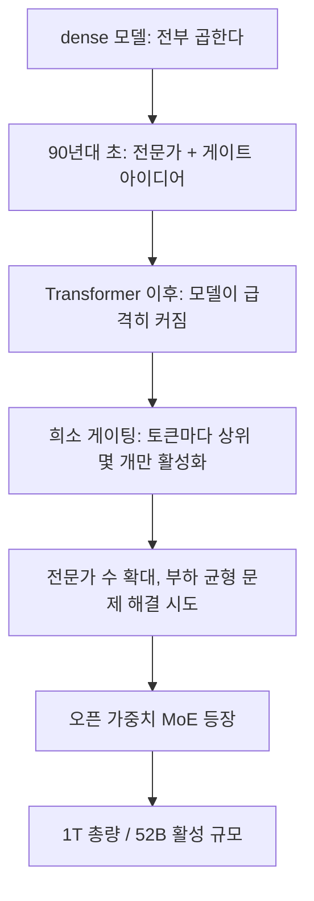

Mistral이 Large 4 가중치를 풀었다. 이름이 Mistral-Large-4-1T-A52B인데, 1조짜리 모델이 토큰 하나 처리할 때 520억만 쓴다는 뜻으로 읽힌다.

> - 예전 신경망은 토큰 하나를 처리할 때 파라미터를 전부 곱했다. 모델이 두 배 커지면 계산도 두 배였다.
> - MoE는 모델을 전문가 여러 개로 쪼개고, 토큰마다 일부만 깨운다. 저장은 1조 개 몫을 하고 계산은 520억 개 몫만 한다.
> - 계산은 싸지지만 메모리는 안 싸진다. 안 쓰는 전문가도 전부 올려놓고 있어야 해서, 셀프 호스팅 청구서는 여전히 크다.

## 전부 다 곱하던 시절

먼저 용어부터 잡자. 신경망 한 층은 결국 큰 행렬 곱셈이다. 입력 벡터에 가중치 행렬을 곱해서 다음 벡터를 만든다. 가중치가 많을수록 똑똑해지는 경향이 있었고, 그래서 사람들은 행렬을 키웠다.

문제는 이 방식이 dense라는 점이다. dense 모델은 입력이 뭐든 가중치를 전부 쓴다. "안녕"이라는 토큰이든 "이 스택트레이스에서 데드락 원인이 뭐냐"는 질문이든 똑같이 전부 곱한다. 쉬운 입력이라고 일부만 쓰는 선택지가 구조상 없다.

비유하자면 회사에 직원이 1000명인데 점심 메뉴를 정할 때도 1000명 전원이 회의실에 들어오는 꼴이다. 정확도는 나올지 몰라도 회의 비용이 말이 안 된다. 직원을 늘릴수록 회의가 길어지니, 모델을 키울수록 학습비와 추론비가 같이 올라갔다.

그럼 그냥 작은 모델 여러 개를 따로 돌리면 되지 않냐는 의문이 나온다. 실제로 앙상블이라는 방법이 있다. 모델을 여러 개 돌려서 답을 평균 내는 건데, 이건 계산을 줄이는 게 아니라 늘리는 방식이다. 모델이 열 개면 비용도 열 배다.

그래서 필요한 건 "큰 용량은 갖되 매번 전부 쓰지는 않는 구조"였다. 용량과 계산량을 분리하고 싶다는 얘기다. dense 구조에서는 이 둘이 한 몸이라 분리가 불가능했다.

## 그때 방식으로 직접 만들어 보기

dense 층이 얼마나 낭비인지 눈으로 보자. 아래는 Python 3 표준 라이브러리만 쓴 장난감이다. 작은 네트워크 16개 몫의 가중치를 전부 곱하고 곱셈 횟수를 센다.

```python
# Python 3.x, 표준 라이브러리만
import random
random.seed(0)
D, N = 8, 16  # 벡터 크기, 가중치 덩어리(전문가) 개수

def mat(r, c):
    return [[random.uniform(-1, 1) for _ in range(c)] for _ in range(r)]

experts = [mat(D, D) for _ in range(N)]
mults = 0

def matvec(m, x):
    global mults
    mults += len(m) * len(x)
    return [sum(w * v for w, v in zip(row, x)) for row in m]

def dense_layer(x):
    outs = [matvec(e, x) for e in experts]  # 16개 전부 계산
    return [sum(col) / N for col in zip(*outs)]

x = [random.uniform(-1, 1) for _ in range(D)]
dense_layer(x)
print("곱셈 횟수:", mults)  # 16 * 8 * 8 = 1024
```

입력이 뭐든 곱셈은 1024번이다. 덩어리를 32개로 늘리면 2048번이 된다. 용량과 비용이 정비례한다.

여기서 아픈 지점은 이렇다.

- 쉬운 입력과 어려운 입력이 같은 비용을 낸다. 입력을 보고 계산량을 조절할 방법이 없다.
- 모델을 키우는 순간 학습비와 추론비가 같이 오른다. 용량을 얻으려면 계산도 무조건 사야 한다.
- 덩어리마다 잘하는 게 달라도 평균으로 뭉개진다. 코드에 강한 덩어리와 번역에 강한 덩어리가 있어도 구분 없이 섞인다.

세 번째가 은근히 중요하다. 이 코드는 16개 결과를 단순 평균 낸다. 어떤 입력에 어떤 덩어리가 맞는지 고르는 장치가 없으니, 덩어리들이 각자 전문성을 키울 이유도 없다.

## 그래서 쪼개기 시작했다

아이디어 자체는 새롭지 않다. 90년대 초에 이미 "전문가 여러 개와 그걸 고르는 게이팅 네트워크"를 합친 구조가 논문으로 나왔다. 그때는 모델이 작았고, 큰 모델의 계산 비용이 아픈 단계도 아니어서 주류가 되지 못했다.

흐름을 먼저 한 장으로 보자. 위에서 아래로 읽는다. 화살표 하나가 "이전 단계의 불편이 다음 해법을 불렀다"는 뜻이다.



단계별로 "불편 -> 해법 -> 새 문제"를 풀어 보자.

첫 단계는 게이트의 등장이다. 불편은 덩어리를 평균 내면 전문성이 안 생긴다는 점이었다. 해법은 입력을 보고 "이 입력은 3번과 9번 덩어리가 맡아라"라고 점수를 매기는 작은 네트워크를 두는 것이었다. 새로 생긴 문제는, 학습이 불안정하고 게이트가 한쪽으로 쏠리면 의미가 없다는 점이었다.

두 번째 단계는 희소 게이팅이다. 2017년 무렵 구글 연구진이 대형 신경망에서 상위 몇 개 전문가만 켜는 희소 게이팅 MoE를 보여줬다. 불편은 게이트 점수를 매겨도 결국 전부 계산하면 비용이 그대로라는 점이었다. 해법은 점수 상위 k개만 실제로 계산하고 나머지는 건너뛰는 것이었다.

핵심 코드는 이 정도다. 위 장난감에 이어 붙이면 된다.

```python
import math
router = mat(N, D)  # 게이트: 입력 -> 전문가별 점수

def sparse_layer(x, k=2):
    scores = matvec(router, x)
    top = sorted(range(N), key=lambda i: -scores[i])[:k]
    w = [math.exp(scores[i]) for i in top]
    w = [v / sum(w) for v in w]  # 상위 k개끼리만 softmax
    outs = [matvec(experts[i], x) for i in top]  # k개만 계산
    return [sum(wi * o[j] for wi, o in zip(w, outs)) for j in range(D)]
```

곱셈 횟수를 세면 게이트 128번에 전문가 2개 128번, 합쳐서 256번이다. dense의 1024번에서 4분의 1로 줄었고, 가중치 총량은 그대로다. 용량과 계산량이 처음으로 분리됐다.

그럼 왜 진작 다 이렇게 안 했냐는 의문이 나온다. 새로 생긴 문제가 만만치 않아서다. 게이트가 인기 있는 전문가 몇 개에만 토큰을 몰아주면 나머지는 학습이 안 되고, 몰린 쪽은 병목이 된다. 그래서 부하를 고르게 퍼뜨리는 보조 손실 같은 장치가 필요해졌다. 그리고 전문가가 여러 GPU에 흩어져 있으면 토큰을 주고받는 통신 비용도 생긴다.

세 번째 단계는 실전 규모다. 2021년 무렵 Switch Transformer 같은 연구가 전문가를 크게 늘리는 방향을 밀었고, 2023년 말에는 Mistral 자신이 Mixtral로 오픈 가중치 MoE를 내놨다. 불편은 학습이 까다롭고 서빙 인프라가 없으면 써먹기 힘들다는 점이었다. 해법은 공개 가중치와 추론 엔진 지원이 따라붙은 것이다. 새로 생긴 문제는 "싸다"는 인상과 달리 메모리가 안 줄어든다는 오해였다.

세대별로 정리하면 이렇다.

| 시대 | 방식 | 장점 | 한계 |
|---|---|---|---|
| 초기 신경망 | dense, 전부 곱함 | 구조가 단순함 | 용량과 계산이 정비례 |
| 앙상블 | 모델 여러 개 평균 | 정확도 상승 | 비용도 개수만큼 증가 |
| 초기 전문가 혼합 | 게이트로 가중 평균 | 전문성 분화 | 결국 전부 계산함 |
| 희소 MoE | 상위 k개만 계산 | 용량과 계산 분리 | 부하 쏠림, 통신, 메모리 |
| 지금의 대형 MoE | 총량 1조대, 활성 수백억대 | 큰 용량을 싼 단가로 | 총량만큼 메모리 필요 |

## 지금은 1조 중 520억

이제 오늘 자료로 돌아오자. Hugging Face 저장소 이름이 Mistral-Large-4-1T-A52B다. 총 1조 개, 활성 약 520억 개로 읽히는 표기이고, 이런 표기는 보통 MoE 모델에서 쓴다. 다만 공식 글 요약에는 구조 설명이 없어서 이건 내 해석이다. 확정은 아니다.

다시 말해 토큰 하나당 계산량은 520억 파라미터짜리 dense 모델과 비슷하고, 지식 용량은 1조짜리다. 방금 만든 장난감에서 256 대 1024가 된 것과 같은 원리다. 비율은 훨씬 극단적이다.

개념도로 보면 이렇다. 아래 그림은 개념도(실제 수치 아님)다. 왼쪽은 칸 16개를 전부 쓰는 dense, 오른쪽은 2칸만 깨우는 희소 방식이다. 색이 진한 칸이 이번 토큰에서 실제로 계산되는 칸이다.

<svg viewBox="0 0 680 280" xmlns="http://www.w3.org/2000/svg" style="background:transparent">
<text x="148" y="32" text-anchor="middle" font-size="16" fill="#7a6a58" font-family="sans-serif">dense: 전부 계산</text>
<text x="488" y="32" text-anchor="middle" font-size="16" fill="#7a6a58" font-family="sans-serif">희소 MoE: 2칸만 계산</text>
<g fill="#d9b98c" stroke="#6b4f3a" stroke-width="1">
<rect x="60" y="50" width="36" height="36"/><rect x="104" y="50" width="36" height="36"/><rect x="148" y="50" width="36" height="36"/><rect x="192" y="50" width="36" height="36"/>
<rect x="60" y="94" width="36" height="36"/><rect x="104" y="94" width="36" height="36"/><rect x="148" y="94" width="36" height="36"/><rect x="192" y="94" width="36" height="36"/>
<rect x="60" y="138" width="36" height="36"/><rect x="104" y="138" width="36" height="36"/><rect x="148" y="138" width="36" height="36"/><rect x="192" y="138" width="36" height="36"/>
<rect x="60" y="182" width="36" height="36"/><rect x="104" y="182" width="36" height="36"/><rect x="148" y="182" width="36" height="36"/><rect x="192" y="182" width="36" height="36"/>
</g>
<g fill="none" stroke="#c9a37a" stroke-width="1">
<rect x="400" y="50" width="36" height="36"/><rect x="444" y="50" width="36" height="36"/><rect x="488" y="50" width="36" height="36"/><rect x="532" y="50" width="36" height="36"/>
<rect x="400" y="94" width="36" height="36"/><rect x="488" y="94" width="36" height="36"/><rect x="532" y="94" width="36" height="36"/>
<rect x="400" y="138" width="36" height="36"/><rect x="444" y="138" width="36" height="36"/><rect x="488" y="138" width="36" height="36"/>
<rect x="400" y="182" width="36" height="36"/><rect x="444" y="182" width="36" height="36"/><rect x="488" y="182" width="36" height="36"/><rect x="532" y="182" width="36" height="36"/>
</g>
<g fill="#a8683a" stroke="#6b4f3a" stroke-width="1">
<rect x="444" y="94" width="36" height="36"/><rect x="532" y="138" width="36" height="36"/>
</g>
<text x="148" y="250" text-anchor="middle" font-size="13" fill="#7a6a58" font-family="sans-serif">개념도(실제 수치 아님): 비용 = 칸 전체</text>
<text x="488" y="250" text-anchor="middle" font-size="13" fill="#7a6a58" font-family="sans-serif">개념도(실제 수치 아님): 비용 = 고른 칸 + 게이트</text>
</svg>

여기서 많이들 하는 오해가 있다. "활성 520억이면 520억짜리 장비로 돌리면 되겠네"라는 생각이다. 아니다. 다음 토큰에 어떤 전문가가 뽑힐지는 미리 모르니까, 1조 개 전부를 메모리에 올려놔야 한다. 8비트로 저장해도 대략 1TB급이고, 4비트로 줄여도 수백 GB다.

정리하면 MoE가 아낀 건 연산이지 메모리가 아니다. 토큰당 속도와 단가는 좋아지지만, 자체 서버로 돌리려면 여전히 GPU 여러 장짜리 노드가 필요하다. 그래서 대부분의 팀은 결국 API로 쓴다. 댓글에 나온 가격 인하(입력 100만 토큰당 0.7달러, 출력 2.1달러)가 의미 있는 이유가 이거다. 활성 파라미터가 작으니 가격을 내릴 여지가 있었던 것이다.

선택지를 비교하면 이렇다. API로 쓰면 인프라 걱정이 없고 단가는 제공사가 정한다. 직접 호스팅하면 데이터가 밖으로 안 나가고 튜닝이 자유롭지만 메모리 장비값을 내야 한다. 작은 dense 모델을 쓰면 장비는 가볍지만 용량이 모자랄 수 있다. 공식 글은 데이터 주권과 자체 배포를 앞세우는데, 그게 말이 되려면 일단 그 노드를 살 수 있어야 한다.

"오픈 웨이트"라는 말에 대해서도 댓글이 갈린다. 라이선스에 모델 서비스(MaaS) 사업자는 별도 상용 계약을 맺으라는 조항이 있다고 한다. 가중치는 받을 수 있어도 소스 코드를 오픈소스로 푼 것과는 다르다. Redis나 Elasticsearch, Terraform이 라이선스를 바꿨을 때와 같은 종류의 논쟁이다. 나는 "weight-available"이라는 표현이 더 정확하다고 본다.

벤치마크도 한 가지 짚자. 악성 사이버 요청 거절률 96.6%는 인상적으로 들리지만, 정상 요청을 얼마나 잘 처리하는지가 같이 나와야 의미가 있다. 댓글의 지적처럼 무조건 거절해도 거절률은 올라간다. 공식 글에 "불필요한 거절 없이"라는 문장은 있는데 그 수치는 안 보였다.

그래도 구조 자체는 분명한 진전이다. 용량과 계산을 분리한다는 90년대 아이디어가 30년 걸려서 오픈 가중치로 풀렸다. 다만 공짜 점심은 아니다. 계산은 싸졌고 메모리는 그대로라서, 청구서의 항목이 바뀌었을 뿐이다.

---

*원문: [We're releasing the weights of Mistral Large 4](https://mistral.ai/news/mistral-large-4-oss/) (via hn)*
