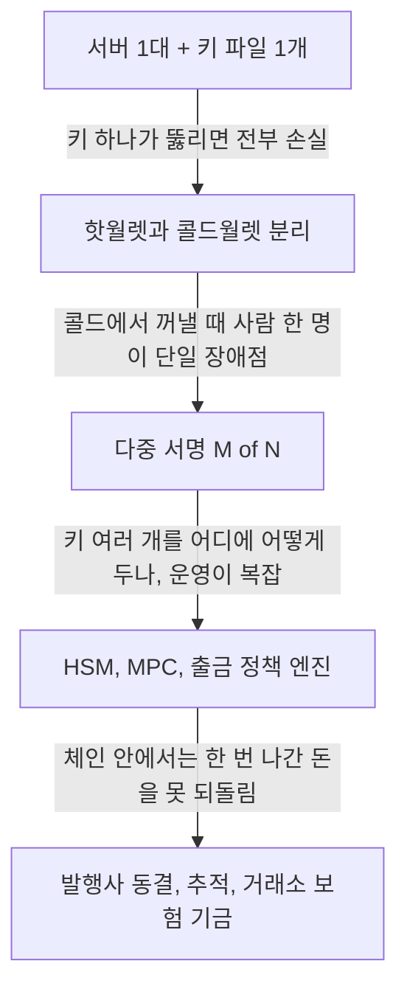

바이낸스에서 56억 달러가 빠져나갔다는 추적 페이지가 HN에 올라왔다. 어떻게 뚫렸는지는 본문을 못 구해서 나도 모르고, 그래서 추측은 안 한다. 대신 "거래소가 내 코인을 들고 있다"는 말이 코드 수준에서 뭘 뜻하는지, 키 보관 방식이 어떻게 바뀌어 왔는지를 푼다.

> 거래소 앱에서 보이는 내 잔고는 블록체인 위의 코인이 아니라 거래소 DB에 적힌 숫자다. 진짜 코인은 거래소가 쥔 키로만 움직인다.
> 키 하나가 모든 출금을 서명하던 구조에서 지갑 분리, 다중 서명, 정책 엔진으로 바뀐 이유는 전부 "키 하나가 뚫리면 끝"이라는 같은 공포다.
> 댓글에 따르면 약 24억 달러는 Circle과 Tether가 이미 동결했다. 체인 밖에서 발행사가 막아주는 안전장치가 마지막 방어선이 된 셈이다.

## 키 보관이라는 개념이 없던 시대

먼저 "코인을 가진다"가 뭔지부터 짚자. 블록체인에는 "이 주소에서 저 주소로 얼마를 보낸다"는 거래가 쌓인다. 그 거래가 유효하려면 주소 주인의 개인키로 서명이 붙어 있어야 한다. 서명을 만들 수 있는 사람이 곧 그 돈의 주인이다.

그러면 거래소는 뭘 하는 곳일까. 사용자 수백만 명의 코인을 거래소 주소 몇 개에 모아 두고, 누가 얼마를 가졌는지는 자기 DB에 따로 적어 둔다. 내가 거래소에서 비트코인을 사면 체인에서는 아무 일도 안 일어나고 DB의 숫자 두 개만 바뀐다. 은행 앱의 잔액과 구조가 같다.

이게 왜 위험한지가 핵심이다. 사용자가 출금을 누르면 거래소는 DB를 깎고, 체인에 보낼 거래를 서명해야 한다. 이 서명 권한이 한 곳에 몰려 있으면 그곳이 뚫리는 순간 장부와 상관없이 돈이 나간다. 장부는 멀쩡한데 체인에서 돈이 사라지는 일이 가능하다는 뜻이다.

그럼 초창기엔 어떻게 했을까. 2009년 비트코인이 나오고 거래소가 생기던 초기엔 "서버 한 대에 지갑 파일 하나, 거기서 서명"이 흔한 구조였다. 보안 모델이라고 할 것도 없었다. 서버를 잘 지키면 된다는 믿음이 전부였다.

## 그때 방식으로 직접 만들어 보기

아래는 그 시절 구조를 흉내 낸 코드다. 실제 체인 서명은 ECDSA 같은 비대칭 서명인데 표준 라이브러리에 없어서, HMAC으로 "키를 가진 쪽만 만들 수 있는 서명"을 대신했다. 구조만 보면 된다.

```python
# Python 3.12, 표준 라이브러리만
import hashlib, hmac, sqlite3

HOT_KEY = b"hot-wallet-secret"   # 서버 설정 파일에 박혀 있다고 치자
db = sqlite3.connect(":memory:")
db.execute("CREATE TABLE ledger (user TEXT PRIMARY KEY, balance INTEGER)")
db.executemany("INSERT INTO ledger VALUES (?, ?)", [("kim", 100), ("lee", 50)])

def sign(tx: str) -> str:
    return hmac.new(HOT_KEY, tx.encode(), hashlib.sha256).hexdigest()

def withdraw(user: str, to_addr: str, amount: int) -> str:
    (bal,) = db.execute("SELECT balance FROM ledger WHERE user=?", (user,)).fetchone()
    if bal < amount:
        raise ValueError("잔고 부족")
    db.execute("UPDATE ledger SET balance = balance - ? WHERE user=?", (amount, user))
    tx = f"{to_addr}:{amount}"
    return sign(tx)   # 검증 없이 바로 서명

print(withdraw("kim", "addr-abc", 30))
print(db.execute("SELECT * FROM ledger").fetchall())
```

여기서 아픈 지점은 이렇다.

- 서명 키가 서버 프로세스 안에 있다. 이 서버에 코드를 실행할 수 있는 사람은 `sign()`을 직접 불러서 아무 주소로 아무 금액이나 서명할 수 있다. DB를 거칠 필요도 없다.
- 장부 검사(`bal < amount`)와 서명이 같은 함수에 붙어 있다. 장부를 속이거나 이 함수를 우회하면 사람의 확인 없이 돈이 나간다.
- 사고가 나도 한도가 없다. 키가 지갑 전체를 움직이니까 피해 상한이 "지갑에 든 전부"다.

## 불편이 쌓여서 나온 순서

이 구조의 불안은 처음부터 다들 알았다. 그래서 한 번에 바뀐 게 아니라, 사고와 불안이 쌓일 때마다 한 겹씩 얹혔다. 흐름부터 보자. 읽는 법은 위에서 아래로 내려가며 각 칸이 앞 칸의 어떤 약점을 막으려고 생겼는지 보면 된다.



**1단계, 핫월렛과 콜드월렛 분리.** 불편은 단순했다. 지갑 전체가 인터넷에 붙은 서버에 있으니, 서버 하나가 뚫리면 전재산이 날아간다. 해법은 평소 출금용 잔액만 인터넷에 연결된 핫월렛에 두고, 대부분은 오프라인 콜드월렛에 두는 것이다. 은행 창구 금고와 지하 대형 금고를 나누는 것과 같다.

새로 생긴 문제도 있다. 핫월렛이 비면 콜드에서 꺼내와야 하는데, 그 순간은 사람이 직접 서명하는 수작업이다. 사람이 느리고, 그 사람 한 명이 또 하나의 약점이 된다. 비밀번호를 쥔 직원이 협박당하거나 실수하면 같은 사고가 난다.

**2단계, 다중 서명.** 불편은 "키 하나를 가진 사람 하나가 단일 장애점"이라는 것이었다. 해법은 서명 N개 중 M개 이상이 모여야 거래가 유효하게 하는 것이다. 2-of-3이면 키 하나를 잃어도, 하나를 도둑맞아도 돈은 안 나간다. 금고 열쇠를 세 명이 나눠 갖고 둘이 와야 열리게 한 것과 같다.

코드로 쓰면 이 정도다.

```python
def approved(tx: str, sigs: dict[str, str], keys: dict[str, bytes], need=2) -> bool:
    ok = sum(
        hmac.compare_digest(sig, hmac.new(keys[n], tx.encode(), hashlib.sha256).hexdigest())
        for n, sig in sigs.items() if n in keys
    )
    return ok >= need
```

그런데 왜 다중 서명만으로 끝나지 않았을까. 키 셋이 모두 같은 회사 같은 네트워크 같은 관리자 권한 아래 있으면, 공격자는 한 번 들어와서 셋 다 가져가면 된다. 숫자만 늘렸지 서로 독립이 아니었던 것이다. 키를 나누는 것과 위험을 나누는 것은 다른 얘기다.

**3단계, 하드웨어 보관과 정책 엔진.** 불편은 키 파일이 어디엔가 평문으로 존재하는 한 복사된다는 점이었다. 해법은 키가 장비 밖으로 나가지 않고 장비 안에서 서명만 해주는 HSM, 그리고 키를 조각내서 조각끼리 계산만 하게 하는 MPC 같은 방식이다. 거기에 "하루 한도", "허용된 주소 목록", "큰 금액은 대기 시간" 같은 규칙을 서명 앞단에 얹는다.

새 문제는 운영이다. 정책이 많아질수록 예외 처리도 늘고, 예외를 승인하는 사람과 시스템이 다시 공격 표면이 된다. 그리고 규칙을 지키는 코드가 틀리면 규칙이 있다는 사실 자체가 안심만 시켜 준다.

**4단계, 체인 밖의 안전망.** 마지막 불편은 블록체인의 성질에서 나온다. 한 번 확정된 거래는 되돌릴 수 없다. 그래서 사고가 나면 "나간 뒤에 어떻게든 막는" 방법이 필요해진다.

그중 눈에 띄는 게 스테이블코인 발행사다. USDT나 USDC는 발행사가 특정 주소를 막을 수 있는 구조로 알려져 있다. 이번에도 댓글 기준으로 약 9.7억 USDT와 8.2억 USDC 같은 큰 덩어리가 동결됐다고 한다. 체인은 되돌리지 못해도 발행사는 "이 주소의 토큰은 이제 못 움직인다"고 할 수 있는 것이다.

이 흐름을 한눈에 비교하면 다음과 같다.

| 시대 | 방식 | 장점 | 한계 |
|---|---|---|---|
| 초창기 | 서버 한 대에 키 한 개 | 만들기 쉽고 빠르다 | 하나 뚫리면 전부 나간다 |
| 지갑 분리 | 핫과 콜드로 나눔 | 피해 상한이 핫 잔액으로 줄어든다 | 콜드 출금이 수작업이고 사람이 약점이다 |
| 다중 서명 | M of N 서명 | 키 하나 손실로는 안 나간다 | 키가 같은 환경에 있으면 의미가 줄어든다 |
| 현재 | HSM, MPC, 정책 엔진 | 키 유출과 오남용을 계층으로 막는다 | 운영이 복잡하고 예외가 약점이 된다 |
| 체인 밖 | 발행사 동결, 보험 기금 | 나간 뒤에도 일부를 막을 수 있다 | 발행사 협조에 의존하고 BTC 같은 자산에는 안 통한다 |

표는 위에서 아래로 갈수록 "막는 시점"이 앞에서 뒤로 넓어진다고 읽으면 된다. 처음엔 서명 직전을 막았고, 지금은 나간 뒤까지 막으려 한다.

## 지금은 어떤가

구조를 하나의 그림으로 줄이면 이렇다. 개념도(실제 수치 아님)고, 왼쪽은 예전 방식, 오른쪽은 지금 방식이다. 오른쪽은 요청이 서명에 닿기까지 문이 여러 개라는 걸 보면 된다.

<svg viewBox="0 0 680 260" xmlns="http://www.w3.org/2000/svg" role="img" aria-label="예전 키 보관 방식과 지금 방식 비교">
<rect x="0" y="0" width="680" height="260" fill="transparent"/>
<text x="110" y="28" font-size="15" fill="#6b4f3a" font-weight="bold">예전</text>
<rect x="30" y="50" width="160" height="44" rx="6" fill="none" stroke="#c9a37a" stroke-width="2"/>
<text x="62" y="77" font-size="13" fill="#7a6a58">출금 요청</text>
<line x1="110" y1="94" x2="110" y2="130" stroke="#a8683a" stroke-width="2"/>
<rect x="30" y="130" width="160" height="44" rx="6" fill="#d9b98c" stroke="#a8683a" stroke-width="2"/>
<text x="52" y="157" font-size="13" fill="#6b4f3a">키 1개로 즉시 서명</text>
<line x1="110" y1="174" x2="110" y2="206" stroke="#a8683a" stroke-width="2"/>
<text x="58" y="228" font-size="13" fill="#7a6a58">체인으로 전송</text>
<text x="465" y="28" font-size="15" fill="#6b4f3a" font-weight="bold">지금</text>
<rect x="260" y="50" width="100" height="40" rx="6" fill="none" stroke="#c9a37a" stroke-width="2"/>
<text x="278" y="75" font-size="12" fill="#7a6a58">출금 요청</text>
<rect x="385" y="50" width="120" height="40" rx="6" fill="none" stroke="#c9a37a" stroke-width="2"/>
<text x="403" y="75" font-size="12" fill="#7a6a58">정책 검사</text>
<rect x="530" y="50" width="120" height="40" rx="6" fill="none" stroke="#c9a37a" stroke-width="2"/>
<text x="548" y="75" font-size="12" fill="#7a6a58">한도 및 대기</text>
<line x1="360" y1="70" x2="385" y2="70" stroke="#a8683a" stroke-width="2"/>
<line x1="505" y1="70" x2="530" y2="70" stroke="#a8683a" stroke-width="2"/>
<line x1="590" y1="90" x2="590" y2="130" stroke="#a8683a" stroke-width="2"/>
<rect x="385" y="130" width="265" height="44" rx="6" fill="#d9b98c" stroke="#a8683a" stroke-width="2"/>
<text x="405" y="157" font-size="13" fill="#6b4f3a">M of N 서명 (HSM 또는 MPC)</text>
<line x1="517" y1="174" x2="517" y2="206" stroke="#a8683a" stroke-width="2"/>
<text x="430" y="228" font-size="13" fill="#7a6a58">체인으로 전송, 이후 발행사 동결 가능</text>
</svg>

여기서 오해하기 쉬운 게 있다. 문이 많다고 안전한 게 아니라, 문 하나가 뚫려도 그 뒤를 또 막는 게 핵심이다. 반대로 말하면 문을 다 같은 사람이 같은 방식으로 관리하면 문이 열 개여도 하나와 같다.

이번 건에서 자료로 확인되는 건 많지 않다. 제목은 56억 달러 도난이라고 하고, 댓글은 보험 기금 SAFU가 약 10억 달러 규모의 BTC라서 통째로 덮을 수 없다고 한다. Molly White가 사건을 진짜로 보는 듯하다는 언급도 있었다. 원인, 범인, 실제 피해액은 이 자료로는 모른다.

선택지를 정리하면 이렇다. 직접 보관하면 거래소 리스크는 없지만 키를 잃으면 끝이다. 거래소에 맡기면 편한 대신 장부 숫자를 믿어야 한다. 이번 같은 일이 터지면 그 숫자가 뭘로 뒷받침되는지가 그제야 문제가 된다.

한계도 분명하다. BTC나 ETH처럼 발행사가 없는 자산은 동결 버튼이 없어서, 나간 돈을 막을 사람이 없다. 댓글에서 나온 "세탁해서 현금화할 수 있냐"는 질문의 답은 결국 이 차이에 달려 있다. 동결 가능한 토큰은 잡히고, 아닌 자산은 추적만 된다.

거래소 잔고는 DB 숫자이고 그 숫자를 받쳐 주는 건 키 관리뿐이다. 그 키 관리가 얼마나 잘 되어 있는지는 사고가 나기 전엔 아무도 못 본다.

---

*원문: [Binance-hacker-1029 – $5.6B stolen from Binance](https://arkm.com/explorer/entity/21a94755-f604-45e5-9501-6542e23005e8) (via hn)*
