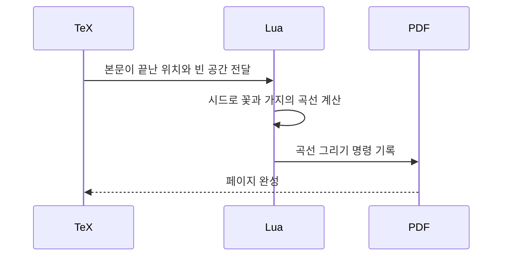

LaTeX로 델프트 블루 꽃 테두리를 이미지 파일 하나 없이 그려내는 프로젝트가 올라왔다. 신기한 건 꽃이 아니다. 페이지가 원래 "그림"이 아니라 "계산하면 그림이 나오는 프로그램"이었다는 점이다.

> 프린터가 글자 코드만 받던 시절에는 폰트도 그림도 프린터 마음이었다.
> PostScript가 페이지를 프로그램으로 바꿨고, PDF는 그 프로그램에서 계산을 걷어내고 결과만 남겼다.
> florilegium은 그 계산을 다시 문서 안으로 끌고 들어온다. 꽃 한 송이는 이미지가 아니라 곡선을 뽑는 함수다.

## 프린터가 멍청한 타자기였던 시절

옛날 프린터는 글자 코드를 받아서 한 칸씩 찍는 기계였다. 한 줄에 80자, 한 페이지에 60줄 남짓, 글꼴은 하나, 폭은 전부 같았다. 레이아웃은 "공백을 몇 개 넣느냐"와 "줄을 몇 번 세느냐"가 전부였다.

굵은 글씨는 어떻게 했을까. 같은 글자를 한 번 더 겹쳐 찍었다. 백스페이스로 돌아가서 덮어 쓰는 방식이다. 지금 보면 웃기지만 당시엔 합리적인 해법이었다.

그다음 세대 프린터는 제조사마다 자기만의 제어 코드를 달고 나왔다. "여기서부터 굵게", "글꼴 바꿔" 같은 명령을 escape 코드로 끼워 넣는 식이다. 문제는 그 코드가 프린터 모델마다 달랐다는 거다. 문서를 만드는 프로그램이 프린터 종류만큼 드라이버를 들고 있어야 했다.

그럼 그냥 그림을 비트맵으로 통째로 보내면 되지 않았나 싶을 거다. 계산해 보면 안 된다. A4를 300dpi로 찍으면 대략 2480 x 3508 픽셀이고, 1비트로만 잡아도 1MB 안팎이다. 직렬선 9600bps로 보내면 한 장에 십몇 분이 걸린다. 게다가 비트맵은 해상도가 고정이라, 600dpi 프린터에 보내면 뭉개지거나 다시 만들어야 했다.

그래서 이 시절의 규칙은 단순했다. 글자는 코드로 보내고, 그림은 포기하거나 프린터 전용 방식으로 보냈다.

## 그때 방식으로 직접 짜 보기

줄 수를 세서 페이지를 나누고, 왼쪽 여백에 ASCII 꽃을 박는 코드다. 라인 프린터 시절 사고방식 그대로다.

```python
# Python 3.x, 표준 라이브러리만
LINES, WIDTH, MARGIN = 20, 40, 8
FLOWER = ["  @  ", " @@@ ", "  |  ", " \\|/ "]

def wrap(text, width):
    out, line = [], ""
    for w in text.split():
        if len(line) + len(w) + 1 > width:
            out.append(line)
            line = w
        else:
            line = (line + " " + w).strip()
    out.append(line)
    return out

def print_pages(text):
    rows = wrap(text, WIDTH)
    for p in range(0, len(rows), LINES):
        for i, row in enumerate(rows[p:p + LINES]):
            deco = FLOWER[i % 4] if i % 8 < 4 else ""
            print(deco.ljust(MARGIN) + row)
        print(f"-- {p // LINES + 1} --\f", end="")

print_pages("꽃을 이미지 없이 그리겠다는 말은 " * 30)
```

여기서 아픈 지점이다.

- 꽃의 크기, 위치, 모양이 전부 문자 격자에 묶여 있다. 줄 높이를 바꾸면 꽃이 깨진다.
- 본문이 얼마나 비는지 알 방법이 없다. 마지막 페이지가 반쯤 비어도 그 자리를 채울 수 없다.
- 이 출력이 어떻게 보일지는 프린터가 정한다. 코드가 아니라 기계 사양을 믿어야 한다.

## 불편이 쌓여서 나온 순서

흐름만 먼저 보자. 화살표 하나가 "불편 하나를 해결하고 새 불편을 낳았다"는 뜻이다.


읽는 법: 왼쪽에서 오른쪽으로 시대 순이다. 마지막 칸이 오늘 소식이고, 사실상 D로 돌아간 모양이다.

첫 번째 단계는 조판이다. 불편은 글자 코드 수준으로는 수식이 많은 논문을 제대로 못 찍는다는 것이었다. 해법으로 Knuth가 70년대 말에 TeX를 만들었다. 단어 사이를 어떻게 벌릴지, 줄을 어디서 끊을지를 문단 전체에서 계산한다. 새 문제는 결과물(DVI)을 실제 프린터까지 가져가는 드라이버와 폰트 설정이었다. 환경마다 모양이 조금씩 달랐다.

두 번째 단계가 PostScript다. 80년대 중반에 프린터 안에 인터프리터를 넣는 접근이 퍼졌다. "이 글자를 여기에 찍어라"가 아니라 "이 곡선을 따라 선을 그리고 안을 채워라"를 보낸다. 곡선은 수식이라 300dpi든 더 높은 해상도든 프린터가 알아서 맞춘다. 해상도 문제가 여기서 풀렸다.

그럼 왜 이게 끝이 아니었을까. 프로그램이니까 실행해야 결과가 나온다. 페이지 50쪽을 보려면 앞쪽 코드가 만든 상태가 필요할 수 있고, 프린터가 느리면 페이지가 느리다. 뷰어가 다른 해석기를 쓰면 미묘하게 달라지기도 한다.

PostScript가 페이지를 어떻게 다루는지 감만 잡자. 꽃잎 하나를 정의하고 다섯 번 돌려서 찍는 코드다.

```postscript
%!PS
/petal { newpath 0 0 moveto 40 30 40 70 0 100 curveto
         -40 70 -40 30 0 0 curveto closepath fill } def
0.25 0.4 0.7 setrgbcolor
300 400 translate
0 72 359 { gsave rotate petal grestore } for
showpage
```

읽는 법: `petal`은 함수고, 마지막 `for`가 72도씩 돌리며 호출한다. 이미지가 아니라 "꽃잎을 그리는 규칙"이 페이지에 들어 있다.

세 번째 단계가 PDF다. 90년대 초에 나온 PDF는 PostScript의 그리기 모델은 가져오고 프로그래밍 기능은 뺐다. 루프도 변수도 없다. 그려진 결과, 즉 좌표와 곡선만 있다. 그래서 어느 쪽을 열어도 같은 모양이고, 임의 페이지로 바로 점프할 수 있다.

대신 잃은 것이 있다. 꽃 다섯 장이 돌아가는 규칙은 사라지고, 곡선 다섯 개가 그냥 펼쳐져 저장된다. 꽃밭이 천 송이면 천 송이가 전부 좌표로 박힌다. "다시 생성하는 방법"은 파일에 남지 않는다.

비교를 한눈에 보자.

| 시대 | 방식 | 장점 | 한계 |
|---|---|---|---|
| 라인 프린터, 도트 매트릭스 | 글자 코드와 제어 코드 | 빠르고 단순함 | 폰트와 그림이 기계에 종속 |
| TeX | 문단 단위 조판 계산 | 수식과 줄바꿈 품질 | 출력 환경 설정이 번거로움 |
| PostScript | 페이지를 프로그램으로 | 해상도 독립, 표현력 | 실행해야 보임, 느림 |
| PDF | 계산 결과만 저장 | 어디서나 같은 모양 | 생성 규칙이 사라짐 |

읽는 법: 위에서 아래로 시대 순이다. 장점과 한계가 서로 맞물려 다음 줄이 나왔다.

## 이번 프로젝트가 들고 온 것

여기서 오늘 자료가 연결된다. florilegium은 LuaLaTeX에서 Lua가 페이지를 쓰는 도중에 곡선을 계산하고, 결과를 바로 PDF에 써 넣는다. 이미지도, 불러온 경로도 없다. 페이지마다 시드가 달라서 정원이 매번 다르다.

핵심은 "본문이 비워 둔 자리를 채운다"는 점이다. 아까 ASCII 꽃은 자리를 몰랐지만, 여기는 조판 엔진이 여백 위치를 알고 있다. 가장 큰 빈 원을 찾아 그 안에 가지를 뻗는 탐욕 루프가 돈다. 이게 글자 코드 시대와 가장 크게 다른 지점이다.

흐름은 이렇다.



읽는 법: 위에서 아래로 시간 순이다. 계산은 Lua에서 일어나고, PDF에는 결과만 남는다.

이 저장소는 같은 로직을 PostScript로도 옮겨 놨다. Ghostscript가 페이지를 해석하면서 꽃잎을 계산한다. 80년대 방식으로 돌아간 셈인데, 이번엔 취미로 하는 거라 느려도 상관없다. README 기준 두 페이지에 2.5초쯤 걸린다.

재미있는 건 같은 시드로도 두 결과가 다르다는 점이다. 난수 생성기는 같은데 PostScript의 실수가 단정밀도라 오차가 쌓인다. 같은 알고리즘이어도 계산하는 쪽이 바뀌면 다른 정원이 나온다는 뜻이다. PDF가 계산 대신 결과를 저장하는 이유가 딱 이거다.

개념도로 두 방식의 차이를 그려 둔다. 개념도(실제 수치 아님)이고, 왼쪽은 결과만 담긴 파일, 오른쪽은 규칙이 담긴 파일이다.

<svg viewBox="0 0 680 240" xmlns="http://www.w3.org/2000/svg">
<rect x="20" y="30" width="290" height="170" rx="8" fill="none" stroke="#6b4f3a" stroke-width="2"/>
<text x="165" y="22" font-size="15" text-anchor="middle" fill="#7a6a58">PDF 방식</text>
<circle cx="90" cy="100" r="14" fill="#c9a37a"/>
<circle cx="130" cy="80" r="14" fill="#c9a37a"/>
<circle cx="170" cy="110" r="14" fill="#c9a37a"/>
<circle cx="210" cy="85" r="14" fill="#c9a37a"/>
<circle cx="250" cy="115" r="14" fill="#c9a37a"/>
<text x="165" y="165" font-size="13" text-anchor="middle" fill="#7a6a58">곡선 좌표가 전부 펼쳐져 저장</text>
<rect x="370" y="30" width="290" height="170" rx="8" fill="none" stroke="#a8683a" stroke-width="2"/>
<text x="515" y="22" font-size="15" text-anchor="middle" fill="#7a6a58">프로그램 방식</text>
<rect x="420" y="70" width="190" height="32" rx="4" fill="#d9b98c"/>
<text x="515" y="91" font-size="13" text-anchor="middle" fill="#6b4f3a">petal 함수 + 시드</text>
<path d="M515 102 L515 130" stroke="#a8683a" stroke-width="2"/>
<text x="515" y="165" font-size="13" text-anchor="middle" fill="#7a6a58">실행하면 곡선이 나온다</text>
</svg>

지금 선택지를 따지면 이렇다.

- 이미지(PNG, SVG)를 가져다 쓴다. 가장 쉽고 안정적이지만 페이지마다 다르게 만들려면 파일을 따로 만들어야 한다.
- TikZ 같은 LaTeX 안의 그리기 패키지를 쓴다. 정석이지만 본문 빈 공간을 읽어서 채우는 일은 직접 짜야 한다.
- 이 프로젝트처럼 Lua로 직접 곡선을 계산한다. 자유도는 최고지만 LuaLaTeX 환경이 필요하고, 엔진이 다르면 결과가 다를 수 있다.

한계도 분명하다. 생성 규칙이 문서 밖(Lua 파일)에 있어서, 결과 PDF만 받은 사람은 같은 정원을 다시 만들 수 없다. 그리고 "예쁘다"는 건 시드를 돌려 눈으로 골라야 한다. 댓글에서 LLM에게 고르게 하자는 얘기가 나오는데, 시드 고르기를 자동화하는 건 그럴듯하다. 다만 그 판단도 결국 어디선가는 사람이 기준을 줘야 한다.

프린터가 하던 계산을 이제 조판 엔진이 하고, 결과물은 여전히 곡선 좌표 덩어리다. 같은 엔진에 같은 시드를 쓰면 같은 꽃이 나온다.

---

*원문: [Florilegium: Procedural Flowers in LaTeX](https://github.com/kevinraymond/florilegium) (via hn)*
