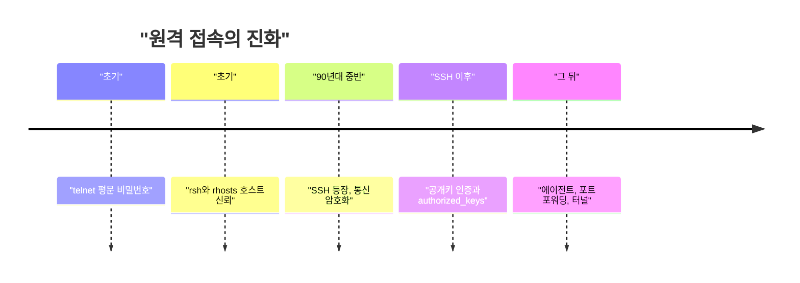
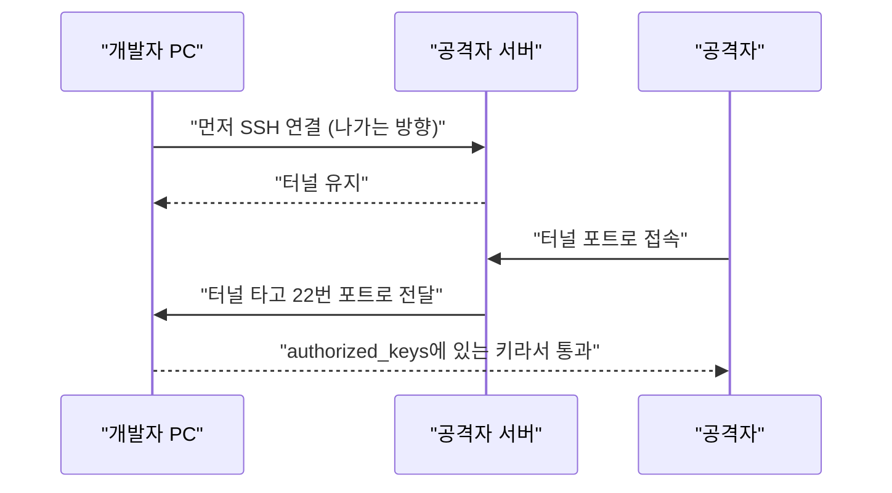

에디터 확장 하나가 뚫렸는데, 공격자가 실제로 한 일은 파일 끝에 텍스트 한 줄 붙이기였다. 그 한 줄이 왜 "집 열쇠 복사본"이랑 같은 값인지 알면 이 사건이 반쯤 이해된다.

> 공격자는 `~/.ssh/authorized_keys`에 자기 공개키 한 줄을 append했다. 이 파일은 "이 키 가진 놈은 비밀번호 없이 들여보낸다"는 명단이다.
> 확장은 설치만 해도 IDE 권한으로 돈다. activate가 호출되기도 전에, 파일이 로드되는 순간 앞에 붙인 코드가 먼저 실행됐다.
> macOS에서는 공격자 코드의 버그 때문에 SSH 활성화가 건너뛰어졌다. 방어가 잘 된 게 아니라 상대가 삐끗한 거다.

사건 요약은 이 정도로 하고, 오늘은 뿌리인 SSH 키 인증 얘기를 한다. 확장 프로그램이 어떻게 뚫렸는지는 다른 글이 많다. 여기서는 "왜 키 한 줄이면 문이 열리는가"를 설명한다.

## 원격 접속이 평문이던 시절

SSH가 없던 시절에도 원격 접속은 있었다. 대표가 telnet이다. 서버에 붙어서 `login:`과 `password:`를 치면 셸이 열렸다.

문제는 그 모든 글자가 네트워크에 평문으로 흘렀다는 거다. 같은 망에 있는 누군가가 패킷만 캡처하면 비밀번호가 그대로 보였다. 지금 감각으로는 미친 설계 같지만, 당시 네트워크는 대학이나 연구소끼리 서로 믿는 좁은 동네였다. 도청하는 놈이 있을 거라는 전제 자체가 약했다.

"그럼 그때 암호화를 안 한 이유가 뭐냐"고 물을 수 있다. 계산 비용도 있었고, 더 큰 이유는 위협 모델이 달랐다는 거다. 인터넷이 전 세계 모르는 사람들과 공유하는 길이 되기 전이라, 내부망은 안전하다는 가정으로 프로토콜을 짰다. 가정이 깨지니까 프로토콜이 통째로 위험해졌다.

신뢰를 쓰는 방식도 있었다. rsh, rlogin 같은 도구는 `.rhosts` 파일에 "이 호스트의 이 사용자는 비밀번호 없이 들여보낸다"고 적어두면 끝이었다. 편했지만 지금 보면 `authorized_keys`의 못생긴 조상이다. 다만 여기엔 키가 없었다. 접속자의 호스트 이름과 계정 이름만 믿었고, 그건 위조가 쉬웠다.

## 그때 방식으로 직접 만들어 보기

원리를 보려고 평문 로그인 서버를 만들어 본다. Python 3 표준 라이브러리만 쓴다. 학습용이니 로컬에서만 돌려라.

```python
# Python 3.x, 표준 라이브러리만 사용 (학습용, 절대 외부에 열지 마라)
import socket, subprocess

USERS = {"kim": "1234"}
srv = socket.socket()
srv.setsockopt(socket.SOL_SOCKET, socket.SO_REUSEADDR, 1)
srv.bind(("127.0.0.1", 2323))
srv.listen()

while True:
    conn, _ = srv.accept()
    f = conn.makefile("rw")
    f.write("login: "); f.flush()
    user = f.readline().strip()
    f.write("password: "); f.flush()
    pw = f.readline().strip()
    if USERS.get(user) != pw:
        f.write("denied\n"); f.flush(); conn.close(); continue
    f.write("ok\n$ "); f.flush()
    for line in f:
        out = subprocess.run(line, shell=True, capture_output=True, text=True)
        f.write(out.stdout + out.stderr + "$ "); f.flush()
    conn.close()
```

다른 터미널에서 `nc 127.0.0.1 2323`으로 붙어서 `kim`, `1234`를 치면 셸처럼 쓸 수 있다. 동작은 하는데 구조가 진짜 telnet이다.

여기서 아픈 지점은 이렇다.

- 비밀번호가 평문으로 오간다. 중간에서 보는 사람은 그냥 읽는다.
- 서버가 비밀번호를 알거나 알 수 있는 형태로 들고 있다. 서버가 털리면 같은 비밀번호를 쓰는 다른 서버도 털린다.
- 자동화가 안 된다. 스크립트가 서버에 접속하려면 비밀번호를 파일에 적어둬야 하는데, 그건 더 위험하다.

## 불편이 쌓여서 SSH가 나왔다

흐름을 한눈에 보면 이렇다. 아래 타임라인은 세대 순서만 보여주는 개념도(실제 수치 아님)고, 위에서 아래로 읽으면 된다.



단계별로 풀어 본다.

첫 번째 불편은 도청이었다. 해법은 통신 전체를 암호화하는 SSH였다. SSH는 90년대 중반 핀란드 대학 네트워크에서 비밀번호 스니핑 사고가 난 걸 계기로 만들어졌다고 알려져 있다. 새로 생긴 문제는 "처음 접속하는 서버가 진짜 그 서버인가"였다. 그래서 서버의 호스트 키를 `known_hosts`에 저장해 두고 다음부터 대조하는 방식이 붙었다.

두 번째 불편은 비밀번호 자체였다. 암호화됐어도 매번 치기 귀찮고, 스크립트가 쓰려면 파일에 적어야 했다. 해법이 공개키 인증이다. 열쇠 구멍은 서버에 두고(공개키), 열쇠는 내가 갖는다(개인키). 서버는 "이 개인키를 가진 사람이 맞는지"만 확인하지, 개인키 자체는 본 적이 없다.

비유하면 이렇다. 서버 문에 자물쇠를 여러 개 달아 놓은 게 `authorized_keys`고, 한 줄이 자물쇠 하나다. 내 열쇠에 맞는 자물쇠가 한 줄이라도 있으면 문이 열린다.

```
ssh-ed25519 AAAAC3Nza...생략... svc-telemetry
```

맨 뒤 `svc-telemetry`는 그냥 주석이다. 서버는 이 글자를 보지 않는다. 누구 키인지 사람이 알아보라고 붙여두는 라벨일 뿐이라, 이름만 믿고 점검하면 안 된다. 이번 사건에서도 공격자 코드가 키가 아니라 이 라벨 문자열로 "이미 넣었나"를 판단했다.

새로 생긴 문제는 그 자물쇠 명단이 일반 사용자 권한으로 쓸 수 있는 평범한 텍스트 파일이라는 점이다. 같은 계정으로 도는 프로그램이면 누구든 한 줄 추가할 수 있다. 서버를 지키던 비밀번호 인증은 사라졌는데, 그 자리를 지키는 건 "내 계정으로 도는 코드를 믿는다"는 가정뿐이다.

세 번째 불편은 방화벽이었다. 집이나 회사 PC는 밖에서 안으로 들어올 수가 없다. 해법이 SSH 포트 포워딩이고, 그중 리버스 터널은 안쪽 컴퓨터가 먼저 밖의 서버로 연결을 걸어 두고, 그 연결로 거꾸로 들어오게 하는 방식이다.

```bash
# 안쪽 PC에서 실행: 밖의 서버에 길을 하나 뚫어 둔다
ssh -N -R 2222:localhost:22 user@relay.example.com
```

새로 생긴 문제는 방화벽이 "들어오는 연결만 막는다"는 가정에 기대고 있었다는 거다. 안쪽에서 나가는 연결은 보통 열려 있다. 그러니 감염된 PC가 먼저 밖으로 전화를 걸어 놓으면 방화벽은 말릴 수가 없다.

호출 순서는 이렇게 생겼다. 위에서 아래로 시간 순서로 읽고, 이번 사건에서 쓰인 구조를 단순화한 개념도다.



여기서 키가 두 종류라는 걸 구분해야 한다. 이번 샘플에서는 `svc-telemetry`가 피해자 PC에 들어오는 용도의 공개키였다. `svc-telemetry-tun`은 피해자 PC가 공격자 서버에 나가는 용도의 개인키였다. 들어오는 열쇠와 나가는 열쇠가 따로 있는 셈이라, 조사할 때 하나만 지우면 반쪽짜리가 된다.

세대별로 표로 정리하면 이렇다.

| 시대 | 방식 | 장점 | 한계 |
|---|---|---|---|
| 초기 | telnet, 평문 비밀번호 | 단순하고 어디서나 됨 | 도청에 무방비 |
| 초기 | rsh와 `.rhosts` | 비밀번호 입력이 없음 | 호스트 이름 위조가 쉬움 |
| 90년대 중반 이후 | SSH 비밀번호 | 통신 암호화 | 비밀번호 유출과 재사용 |
| SSH 이후 | 공개키 인증 | 비밀번호 전송 없음, 자동화 쉬움 | 키 파일 관리와 명단 변조 |
| 현재 | 키 + 인증서 + 접근 통제 | 만료, 중앙 관리 | 설정과 운영 부담 |

## 지금은 어떤가

이번 사건에서 중요한 건 SSH가 아니라 SSH가 아닌 쪽이다. SSH는 설계대로 정확히 동작했다. 뚫린 건 "에디터 확장을 설치하면 그 확장이 내 계정 권한을 통째로 가진다"는 부분이다.

확장의 실행 구조를 먼저 짚자. 자료에 따르면 공격자는 minify된 `extension.js` 맨 앞에 즉시 실행 함수를 붙였다. 그래서 모듈이 로드되는 순간 `activate`보다 먼저 돌았다. 사용자가 확장을 눌러 볼 필요도 없다.

"그럼 확장은 샌드박스에서 돌지 않냐"는 의문이 나올 만하다. 이 사건 설명 기준으로는 Node의 `child_process`, `fs`를 그대로 쓸 수 있었다. 개발자 도구는 편의 때문에 권한을 넓게 열어 두고, 그 신뢰를 마켓플레이스 검증이 메운다는 구조다. 그 검증이 우회되면 안전장치가 없다.

아래 SVG는 방어선이 어디서 비어 있었는지 보여주는 개념도(실제 수치 아님)다. 왼쪽에서 오른쪽으로 읽으면 되고, 점선 칸이 비어 있던 자리다.

<svg viewBox="0 0 640 170" xmlns="http://www.w3.org/2000/svg" role="img">
<rect x="10" y="50" width="130" height="60" rx="8" fill="none" stroke="#6b4f3a" stroke-width="2"/>
<text x="75" y="85" font-size="14" text-anchor="middle" fill="#7a6a58">마켓플레이스</text>
<rect x="170" y="50" width="130" height="60" rx="8" fill="none" stroke="#a8683a" stroke-width="2" stroke-dasharray="6 4"/>
<text x="235" y="78" font-size="14" text-anchor="middle" fill="#7a6a58">게시 권한</text>
<text x="235" y="97" font-size="12" text-anchor="middle" fill="#a8683a">여기서 뚫림</text>
<rect x="330" y="50" width="130" height="60" rx="8" fill="none" stroke="#c9a37a" stroke-width="2"/>
<text x="395" y="85" font-size="14" text-anchor="middle" fill="#7a6a58">내 IDE 권한</text>
<rect x="490" y="50" width="130" height="60" rx="8" fill="none" stroke="#d9b98c" stroke-width="2"/>
<text x="555" y="78" font-size="14" text-anchor="middle" fill="#7a6a58">authorized_keys</text>
<text x="555" y="97" font-size="12" text-anchor="middle" fill="#7a6a58">한 줄 추가</text>
<path d="M140 80 L170 80 M300 80 L330 80 M460 80 L490 80" stroke="#7a6a58" stroke-width="2"/>
<text x="320" y="145" font-size="13" text-anchor="middle" fill="#7a6a58">개념도: 확장 설치부터 SSH 접근까지의 경로</text>
</svg>

알려진 사실부터 정리한다. 확장 버전 2.1.313이 문제였고, 마켓플레이스에서 내려갔다. Anthropic 쪽 설명은 자기네 시스템이나 직원 노트북이 뚫린 게 아니고, 누군가 Cursor 마켓플레이스에 접근해 변조본을 올렸다는 것이다. 공식 채널의 배포본은 영향이 없다고 했다. 이 부분은 댓글과 보도로 나온 얘기라, 사후 조사 결과가 더 나오면 달라질 수 있다.

개발자가 당장 할 일은 단순하다. 확인은 `grep -qs svc-telemetry ~/.ssh/authorized_keys` 한 줄이면 된다. 다만 이건 라벨로 찾는 거라 공격자가 이름을 바꾸면 놓친다. 그러니 `authorized_keys`에 있는 키 지문을 하나씩 훑어서 내가 넣은 게 맞는지 보는 게 정확하다.

더 근본적인 선택지는 이렇다.

- 확장은 최소한만 설치하고, 출처와 게시자를 확인한다. 편하지만 사고가 나면 막을 방법이 없다.
- 개발용 계정과 개인 계정을 분리한다. 번거롭지만 피해 범위가 줄어든다.
- 서버 쪽 SSH는 `AuthorizedKeysFile`을 사용자 홈 밖의 관리되는 경로로 옮기거나, 인증서 기반으로 바꿔 만료를 건다. 운영 부담이 늘지만 홈 디렉토리 한 줄 추가로는 못 들어오게 된다.

macOS에서 공격자가 삐끗한 부분도 교훈이 있다. `systemsetup -getremotelogin`은 일반 사용자로 실행하면 권한 오류 메시지를 stdout에 찍고 종료 코드 0으로 끝난다. 그래서 `Off`를 찾는 검사에 걸리지 않았고, 원격 로그인을 켜는 단계가 통째로 생략됐다. 그렇다고 안심은 못 한다. 이미 원격 로그인을 켜 둔 사람이거나 나중에 켜는 사람한테는 키가 그대로 대기 중이니까.

SSH는 30년 가까이 비밀번호를 지워 왔고, 이제 그 자리에 앉은 건 "내 계정 아래서 도는 코드"다. 명단이 텍스트 파일인 이상, 거기에 쓸 수 있는 놈이 곧 주인이다.

---

*원문: [Backdoor in Claude Code for VS Code extension on the Cursor Marketplace](https://phorion.io/blog/offical-claude-code-vsx-compromise/) (via hn)*
