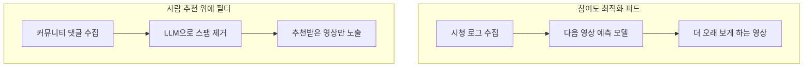

카파시가 유튜브 추천 피드에 질려서 HN 댓글에 달린 영상 링크만 모아 유튜브 클론을 하루 만에 만들었다. 새로운 기술이 아니라 추천이라는 문제를 원점으로 되돌린 물건이다.

> - 추천 시스템의 뿌리는 알고리즘이 아니라 "믿을 만한 사람이 골라 준 목록"이다.
> - 사람이 고르는 방식은 품질은 좋은데 규모가 안 커져서, 클릭과 시청 시간을 세는 기계 추천으로 넘어갔다.
> - 기계 추천이 참여도에 맞춰 최적화되면서 생긴 피로감을 이번엔 LLM 필터가 사람 추천 위에서 풀어 주고 있다.

## 알고리즘이 없던 시절엔 누가 골랐나

웹이 막 퍼지던 90년대 중반에는 볼 만한 사이트를 찾는 방법이 정해져 있었다. 누군가 손으로 만든 링크 목록을 보는 것이다. 포털 초창기의 디렉토리 서비스가 그 형태였고, 개인 홈페이지마다 "추천 링크" 페이지가 하나씩 있었다.

이 방식의 장점은 분명하다. 목록을 만든 사람이 책임을 지니까 품질이 어느 정도 보장된다. 목록 주인의 취향을 알면 "이 사람이 좋다는 건 나도 좋겠네"라고 예측할 수도 있다. 지금 말로 하면 사람 하나가 필터 하나였던 셈이다.

문제는 규모였다. 웹 페이지가 늘어나는 속도를 사람이 손으로 분류하는 속도가 못 따라갔다. 편집자 한 명이 하루에 볼 수 있는 사이트는 뻔한데 새로 생기는 사이트는 그보다 훨씬 많았다.

그러면 왜 편집자를 더 뽑지 않았느냐는 의문이 나온다. 뽑을 수는 있다. 그런데 사람을 늘리면 비용이 선형으로 늘고, 편집자마다 기준이 달라서 목록의 일관성도 깨진다. 결국 "누가 골랐느냐"에 기대던 구조는 규모가 커질수록 버티기 어려웠다.

## 그때 방식으로 직접 만들어 보기

HackerTube가 한 일을 가장 단순하게 줄이면 이렇다. 댓글에서 영상 링크를 뽑고, 몇 명이 추천했는지 센다. 그게 전부다. 아래는 표준 라이브러리만 쓴 파이썬 3.9 이상용 샘플이다.

```python
# Python 3.9+, 표준 라이브러리만 사용
import re
from collections import Counter

YT = re.compile(r"(?:youtube\.com/watch\?v=|youtu\.be/)([\w-]{11})")

comments = [
    "이거 꼭 봐라 https://www.youtube.com/watch?v=aaaaaaaaaaa",
    "same, https://youtu.be/aaaaaaaaaaa 최고",
    "https://youtu.be/bbbbbbbbbbb 도 괜찮음",
    "그냥 잡담입니다",
]

votes = Counter()
for text in comments:
    # 한 댓글이 같은 영상을 두 번 써도 1표만 인정
    for vid in set(YT.findall(text)):
        votes[vid] += 1

for vid, n in votes.most_common():
    print(n, vid)
# 2 aaaaaaaaaaa
# 1 bbbbbbbbbbb
```

읽는 법은 단순하다. 정규식으로 영상 ID를 뽑고, 댓글 하나당 한 표로 쳐서 많이 언급된 순서로 정렬한다.

여기서 아픈 지점이 있다.

- 최신 영상이나 인기 없는 명작은 표가 쌓일 시간이 없어서 밑으로 가라앉는다.
- 같은 사람이 계정을 여러 개 만들어 링크를 뿌리면 순위가 올라간다. 표가 사람 수인지 계정 수인지 코드는 구분하지 못한다.
- 이 목록은 모두에게 똑같다. 내 취향에 맞춘 순서가 아니라 커뮤니티 평균이다.

카파시의 프로젝트는 여기서 스팸과 저질 댓글 걸러내기를 LLM에게 맡겼다. 위 코드에서 두 번째 문제를 사람이 아니라 모델이 푼 셈이다.

## 사람이 고르다 지쳐서 기계가 골랐다

발전 흐름은 불편과 해법이 번갈아 나오는 구조다. 먼저 전체 그림부터 본다.


왼쪽에서 오른쪽으로 읽는다. 앞 단계의 한계가 다음 단계를 만든 순서다.

첫 번째 불편은 사람 손이 모자란 것이었다. 해법은 사람 대신 링크 구조를 세는 것이었다. 90년대 후반에 나온 검색 엔진들은 "다른 페이지가 많이 가리키는 페이지가 믿을 만하다"는 발상으로 순위를 매겼다. 새로 생긴 문제는 순위를 올리려고 링크를 조작하는 사람들이 생겼다는 점이다.

두 번째 불편은 링크 수가 평범한 사용자의 판단과 따로 논다는 것이었다. 해법은 사용자가 직접 투표하는 커뮤니티였다. 2000년대 중반에 Digg, Reddit 같은 곳이 이 모델을 퍼뜨렸고 HN도 같은 계열이다. 새 문제는 위에서 본 것과 같다. 초반 몇 표가 순위를 정하고, 어뷰징도 따라온다.

세 번째 불편은 모두에게 같은 목록이 나온다는 점이었다. 해법이 협업 필터링이다. "나와 비슷한 걸 본 사람들이 다음에 뭘 봤나"를 보고 추천하는 방식이다. 쇼핑몰의 "이 상품을 산 사람이 함께 산 상품"이 대표적이다. 새 문제는 기록이 없는 신규 사용자와 신규 상품에는 추천할 근거가 없다는 점이다.

네 번째 불편은 "봤다"와 "좋았다"가 다르다는 것이었다. 해법은 클릭, 시청 시간, 이탈 시점 같은 행동 데이터를 모델에 통째로 먹이는 것이다. 2010년대 중반부터는 이 일을 딥러닝이 맡았다. 새 문제가 지금 문제다. 모델이 최적화하는 목표가 "좋은 영상"이 아니라 "계속 보게 만드는 영상"이 되어 버렸다.

그러면 왜 처음부터 시청 시간을 목표로 삼았느냐는 의문이 남는다. 측정할 수 있는 숫자가 그것뿐이었기 때문이다. "이 영상이 나를 똑똑하게 만들었나"는 로그에 안 찍힌다. 로그에 찍히는 걸로 최적화하면 로그에 잘 찍히는 쪽으로 세상이 휘어진다.

| 시대 | 방식 | 장점 | 한계 |
|---|---|---|---|
| 90년대 | 사람이 만든 링크 목록 | 품질과 책임이 분명 | 규모가 안 커짐 |
| 90년대 후반 | 링크 구조로 순위 | 자동이고 규모가 큼 | 링크 조작 |
| 2000년대 | 투표 커뮤니티 | 취향이 반영됨 | 초반 쏠림, 어뷰징 |
| 2000년대 이후 | 협업 필터링 | 개인화 가능 | 신규 항목에 약함 |
| 2010년대 이후 | 행동 학습 모델 | 정확도가 높음 | 참여도 최적화로 쏠림 |

읽는 법은 위에서 아래로, 오른쪽 칸이 다음 줄 해법의 이유다. 한계 칸을 보면 다음 줄이 왜 나왔는지 대부분 설명된다.

## 지금은 어떤가

카파시가 한 일은 추천 알고리즘을 새로 만든 게 아니다. 추천의 출처를 "내 행동 로그"에서 "믿을 만한 커뮤니티의 사람 추천"으로 바꾼 것이다. 그리고 예전에 사람이 못 했던 대규모 정리 작업을 LLM에게 시켰다.

글쓴이 말로는 HN 댓글 전체를 내려받아 걸러서 영상을 추천하는 댓글 4만 개를 남겼고, 거기서 영상 6,454개가 나왔다. 2007년부터 2026년까지 150개 주제에 걸친 규모다. 예전 같으면 편집자 수십 명이 달라붙어야 했을 일을 모델 호출로 처리한 셈이다.

개인화는 계정 없이 브라우저 세션에 상태를 저장하는 식으로 해결했다. 서버는 사용자를 모르고, 브라우저가 "내가 뭘 봤나"만 들고 있다. 협업 필터링의 거대한 사용자 DB 없이도 최소한의 맞춤 추천이 되는 구조다.



위쪽은 내가 뭘 봤는지가 입력이고 아래쪽은 남들이 뭘 추천했는지가 입력이다. 입력이 바뀌니까 목표도 바뀐다.

<svg viewBox="0 0 640 220" xmlns="http://www.w3.org/2000/svg" font-family="sans-serif" font-size="14">
<rect x="20" y="20" width="280" height="170" rx="10" fill="none" stroke="#c9a37a" stroke-width="2"/>
<rect x="340" y="20" width="280" height="170" rx="10" fill="none" stroke="#a8683a" stroke-width="2"/>
<text x="160" y="48" text-anchor="middle" fill="#6b4f3a" font-weight="bold">참여도 최적화 피드</text>
<text x="480" y="48" text-anchor="middle" fill="#6b4f3a" font-weight="bold">사람 추천 큐레이션</text>
<rect x="50" y="70" width="220" height="30" rx="6" fill="#d9b98c"/>
<text x="160" y="90" text-anchor="middle" fill="#6b4f3a">입력: 내 시청 행동</text>
<rect x="50" y="110" width="220" height="30" rx="6" fill="#d9b98c"/>
<text x="160" y="130" text-anchor="middle" fill="#6b4f3a">목표: 더 오래 보기</text>
<rect x="370" y="70" width="220" height="30" rx="6" fill="#c9a37a"/>
<text x="480" y="90" text-anchor="middle" fill="#6b4f3a">입력: 남들의 추천 댓글</text>
<rect x="370" y="110" width="220" height="30" rx="6" fill="#c9a37a"/>
<text x="480" y="130" text-anchor="middle" fill="#6b4f3a">목표: 볼 만한 것만 남기기</text>
<text x="160" y="170" text-anchor="middle" fill="#7a6a58">규모는 크고 쏠림도 큼</text>
<text x="480" y="170" text-anchor="middle" fill="#7a6a58">규모는 작고 품질은 높음</text>
</svg>

개념도(실제 수치 아님)다. 왼쪽과 오른쪽은 무엇을 입력으로 받고 무엇을 목표로 삼는지가 다르다.

한계도 분명하다. HN 취향은 HN 사용자 분포에 갇혀 있어서 영상이 영어권 개발자 취향으로 쏠린다. 스팸 필터도 LLM이라 완벽하지 않고, 영상이 삭제되거나 비공개로 바뀌면 목록에 구멍이 난다. 최신 영상은 표가 쌓일 시간이 없으니 신규 콘텐츠에는 여전히 약하다. 사람 추천이라는 출처 자체가 이 한계를 안고 있다.

선택지를 비교하면 이렇다. 규모와 개인화가 필요하면 행동 학습 모델이 맞고, 품질과 신뢰가 먼저면 사람 추천에 필터를 얹는 쪽이 낫다. 둘을 섞는 것도 가능한데, 이때 목표 함수를 누가 정하느냐가 결국 가장 중요한 결정이 된다.

추천은 30년 동안 사람의 판단을 기계로 대체하는 쪽으로만 달려왔는데, 이번엔 기계를 사람의 판단을 걸러 쓰는 도구로 되돌려 놨다. 하루 만에 만들어진 사이트가 그걸 보여 준 게 전부다.

---

*원문: [HackerTube: YouTube built from videos recommended by HN](https://karpathy.bearblog.dev/hacker-tube/) (via hn)*
