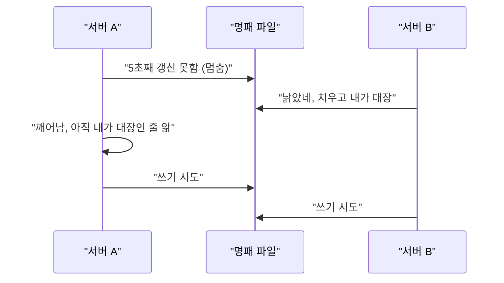
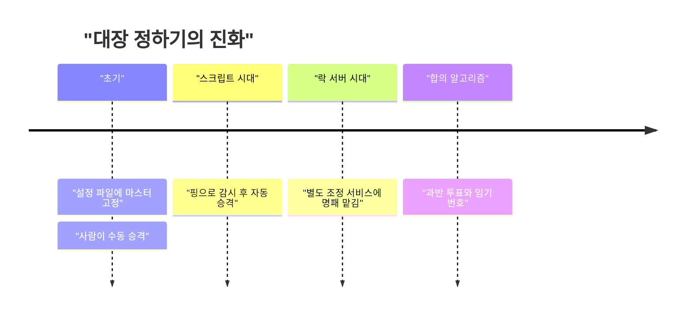
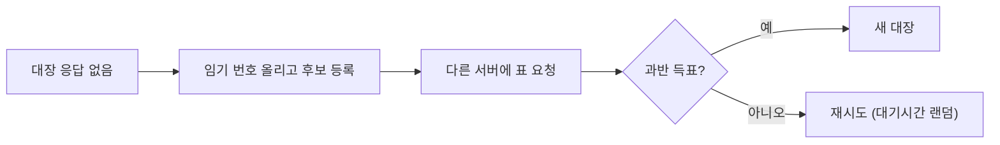

HN 댓글 창에서 제일 많이 나온 걱정이 "대장 없이 정부 구성이 되냐"였다. 서버 쪽은 이걸 수십 년 전부터 싸웠고, 그 싸움 이름이 리더 선출이다.

> 서버 여러 대가 "누가 대장이냐"를 못 정하면 데이터가 갈라지거나 아무도 일을 안 한다.
> 처음엔 대장을 설정 파일에 박아뒀고, 대장이 죽으면 사람이 새벽에 깨서 갈아끼웠다.
> 지금은 과반 투표와 임기 번호로 대장을 자동으로 뽑는데, 이것도 공짜는 아니다.

자료 본문은 수집이 안 돼서 못 읽었다. 그래서 정치 얘기는 안 하고, 댓글에 나온 "리더가 없으면 조직이 굴러가나, 리더가 생기면 그 사람이 망가지면 어쩌나"라는 걱정만 빌려서 서버 얘기로 푼다.

## 대장이 필요한 이유부터

서버 한 대로 서비스하면 대장 따위는 필요 없다. 모든 요청을 그 한 대가 처리하니까 누가 결정하냐는 질문 자체가 없다.

문제는 그 한 대가 죽는 순간이다. 그래서 두 대, 세 대로 늘린다. 그러면 새 질문이 생긴다. 같은 데이터를 두 대가 동시에 고치면 누가 이기냐는 것이다.

비유를 하나 들자. 식당 주문서를 주방장 두 명이 각자 받아서 각자 적는다고 치자. 손님이 "아까 주문 취소요"라고 하면 어느 주방장 장부를 고쳐야 하나. 한쪽만 고치면 장부가 둘로 갈라진다. 그래서 "주문은 한 사람만 받는다"는 규칙이 필요하다. 그 한 사람이 리더다.

그럼 처음부터 리더를 정해놓으면 되지 않냐고 묻게 된다. 실제로 그렇게 했다. 그게 문제의 시작이다.

## 대장을 손으로 박아두던 시절

초창기 이중화는 단순했다. 설정 파일에 "A 서버가 마스터, B 서버가 복제본"이라고 적어놓는 방식이다. 마스터 A가 쓰기를 받고, B는 A를 따라 베끼기만 한다.

평소엔 잘 돌아간다. A가 죽으면 사람이 알림을 받고 B를 마스터로 승격시켰다. 그 과정에서 사람이 "A는 진짜 죽은 거 맞지?"를 눈으로 확인해야 했다. 새벽 3시에 이걸 하는 사람이 당시 현업 개발자였다.

사람을 빼려고 스크립트를 짰다. 스크립트가 A에 핑을 쏴서 응답이 없으면 B를 승격시킨다. 여기서 질문이 나온다. 응답이 없다는 게 죽었다는 뜻이냐는 것이다. 네트워크 선이 잠깐 끊긴 것일 수도 있다. A는 멀쩡히 살아서 쓰기를 받고 있는데 B도 "내가 마스터"라고 하면, 대장이 둘이다. 이걸 스플릿 브레인이라고 부른다.

## 그때 방식으로 직접 만들어 보기

옛날 스크립트 감각을 그대로 재현해 보자. 공유 파일 하나를 "대장 명패"로 쓰고, 대장은 1초마다 파일 시각을 갱신해서 살아있다고 알린다. 명패 시각이 5초 넘게 안 바뀌면 죽은 걸로 보고 치운다.

```python
# Python 3.10+, 표준 라이브러리만 사용. 터미널 두 개에서 이름을 달리해 실행
import os, sys, time

LOCK, TTL = "leader.lock", 5

def try_lead(name):
    try:
        fd = os.open(LOCK, os.O_CREAT | os.O_EXCL | os.O_WRONLY)
        os.write(fd, name.encode()); os.close(fd)
        return True
    except FileExistsError:
        try:
            if time.time() - os.path.getmtime(LOCK) > TTL:
                os.remove(LOCK)  # 죽은 대장의 명패를 치운다
        except FileNotFoundError:
            pass
        return False

name = sys.argv[1]
while True:
    if try_lead(name):
        print(name, "대장 됨")
        while True:
            os.utime(LOCK)  # 나 살아있다
            print(name, "일하는 중"); time.sleep(1)
    time.sleep(1)
```

한 터미널에서 `python leader.py a`, 다른 터미널에서 `python leader.py b`를 돌린다. a를 Ctrl+C로 죽이면 5초쯤 뒤 b가 대장이 된다. 파일을 만드는 `O_EXCL`은 "이미 있으면 실패"를 원자적으로 보장해서, 동시에 만들려 해도 한 명만 성공한다.

여기서 아픈 지점이 있다.

- 죽은 명패를 치우는 동작이 원자적이지 않다. b와 c가 동시에 "5초 지났네" 하고 판단한 뒤, b가 치우고 새로 만든 명패를 c가 또 치워버릴 수 있다.
- 대장이 멈췄다가(GC나 디스크 지연으로) 6초 뒤에 깨어나면, 자기가 아직 대장인 줄 알고 일한다. 그 사이 다른 대장이 이미 뽑혔다.
- 명패 파일이 공유 디스크에 있어서, 그 디스크가 죽으면 대장 선출 자체가 멈춘다. 대장 문제를 파일 서버 한 대한테 떠넘긴 셈이다.

두 번째 항목이 제일 위험하다. 대장이 둘인 게 짧은 시간이라도 둘 다 쓰기를 받으면 데이터가 갈라지고, 나중에 합치기가 어렵다.



위 그림은 호출 순서를 본 것이다. A가 멈춘 사이 B가 대장이 됐는데, A는 그걸 모른 채 일어나서 둘 다 쓰는 장면이 문제의 핵심이다.

## 그래서 어떻게 진화했나

불편이 쌓이면서 해법이 한 단계씩 붙었다. 단계마다 새 문제가 따라온 게 포인트다.



위 타임라인은 순서만 보여주는 개념도다. 연도는 일부러 뺐다.

1단계는 고정 마스터다. 불편은 마스터가 죽으면 사람이 깨야 한다는 것이었다. 해법은 감시 스크립트 자동 승격이었다. 새로 생긴 문제는 앞서 말한 스플릿 브레인이다. 핑 실패가 곧 사망은 아니라서, 자동화가 오히려 대장을 둘로 만들었다.

2단계는 명패를 따로 맡기는 방식이다. 서버끼리 파일을 두고 싸우지 말고, 락 전용 서비스 한 곳에 "대장 명패"를 두자는 발상이다. 2000년대 후반쯤부터 ZooKeeper 같은 조정 서비스가 이 역할을 했다. 이 서비스가 직접 대장을 정해주니까 서버들이 서로 핑을 쏠 필요가 줄었다. 새로 생긴 문제는, 조정 서비스 자체가 죽으면 어쩌냐는 것이다. 이걸 또 여러 대로 늘리면 그 조정 서비스들끼리 대장을 정해야 한다. 닭과 달걀이다.

그럼 처음부터 "여러 대가 서로 투표해서 정하는 방법"을 쓰면 되지 않냐는 생각이 든다. 그게 3단계다.

3단계는 합의 알고리즘이다. Paxos가 이론적 뿌리로 오래 알려졌고, 너무 이해하기 어렵다는 불평이 많아서 2010년대 중반에 Raft가 "이해하기 쉽게" 만들어졌다. 핵심 규칙은 둘이다.

- 대장 후보는 과반의 표를 받아야 한다. 5대라면 3대 이상이다. 네트워크가 둘로 갈라져도 과반을 가진 쪽은 최대 하나라서 대장이 둘이 될 수 없다.
- 대장에게는 임기 번호가 붙는다. 낡은 임기 번호를 들고 온 옛 대장의 요청은 다른 서버들이 거절한다.

식당 비유로 돌아가면, 주방장을 뽑을 때 "직원 과반이 찍어야 하고, 매번 임기 몇 기인지 장부에 적는다"는 규칙이다. 옛 주방장이 졸다 깨서 "내가 주방장이야"라고 해도 "지금은 7기고 넌 6기야"라며 무시한다. 앞에서 본 멈춘 대장 문제가 이 규칙으로 막힌다.



위 흐름도는 선거 한 판의 과정이다. 마지막 "대기시간 랜덤"은 두 후보가 동시에 나와 표가 갈리는 상황을 풀려는 장치다.

새로 생긴 문제도 있다. 과반을 모으려면 서버 절반 이상이 살아서 통신해야 한다. 5대 중 3대가 못 만나면 아무도 대장이 못 되고, 시스템은 쓰기를 멈춘다. 데이터가 갈라지는 것보다 멈추는 쪽을 택한 설계다. 이게 싫다고 해서 "그냥 계속 받자"를 고르면 다시 스플릿 브레인으로 돌아간다.

| 시대 | 방식 | 장점 | 한계 |
|---|---|---|---|
| 초기 | 설정에 마스터 고정, 사람이 승격 | 단순하고 이해하기 쉬움 | 새벽에 사람이 깸, 대응이 느림 |
| 스크립트 | 핑으로 감시하고 자동 승격 | 사람이 빠짐 | 스플릿 브레인 위험 |
| 조정 서비스 | 락 전용 서비스에 명패 위임 | 서버끼리 안 싸움 | 조정 서비스가 새 단일 장애점 |
| 합의 알고리즘 | 과반 투표와 임기 번호 | 자동이면서 대장이 둘이 안 됨 | 과반이 안 모이면 멈춤, 구현이 어려움 |

위 표는 세대별로 방식과 한계를 나란히 본 것이다. 아래로 갈수록 자동화가 늘고, 대신 멈춤이라는 비용을 명시적으로 받아들인다.


<svg viewBox="0 0 640 220" xmlns="http://www.w3.org/2000/svg" font-family="sans-serif" font-size="14">
<text x="150" y="24" fill="#7a6a58" text-anchor="middle">고정 대장</text>
<rect x="105" y="40" width="90" height="36" rx="6" fill="#a8683a"/>
<text x="150" y="63" fill="#ffffff" text-anchor="middle">마스터</text>
<rect x="50" y="130" width="70" height="32" rx="6" fill="#d9b98c"/>
<rect x="180" y="130" width="70" height="32" rx="6" fill="#d9b98c"/>
<line x1="135" y1="76" x2="85" y2="130" stroke="#7a6a58"/>
<line x1="165" y1="76" x2="215" y2="130" stroke="#7a6a58"/>
<text x="150" y="196" fill="#7a6a58" text-anchor="middle">대장 죽으면 사람이 교체</text>
<text x="480" y="24" fill="#7a6a58" text-anchor="middle">투표로 뽑은 대장</text>
<circle cx="420" cy="100" r="26" fill="#d9b98c"/>
<circle cx="480" cy="60" r="26" fill="#a8683a"/>
<circle cx="540" cy="100" r="26" fill="#d9b98c"/>
<circle cx="450" cy="160" r="26" fill="#c9a37a"/>
<circle cx="510" cy="160" r="26" fill="#c9a37a"/>
<line x1="440" y1="85" x2="460" y2="72" stroke="#6b4f3a"/>
<line x1="520" y1="85" x2="500" y2="72" stroke="#6b4f3a"/>
<line x1="450" y1="134" x2="480" y2="86" stroke="#6b4f3a"/>
<line x1="510" y1="134" x2="480" y2="86" stroke="#6b4f3a"/>
<text x="480" y="204" fill="#7a6a58" text-anchor="middle">과반이 찍으면 자동 교체</text>
</svg>


위 그림은 왼쪽의 고정 방식과 오른쪽의 투표 방식을 비교한 개념도(실제 수치 아님)다. 짙은 칸이 대장이고, 오른쪽은 대장이 사라져도 나머지 넷이 서로 표를 모아 다음 대장을 만든다.

## 지금은 어떤가

지금 우리가 쓰는 도구 대부분이 이 흐름 위에 있다. etcd 같은 저장소는 Raft 계열 합의를 쓰고, 쿠버네티스는 이 저장소를 상태 보관소로 삼는다. 컨트롤러가 여러 개 떠 있어도 실제로 일하는 건 임대 형식으로 대장을 정하는 하나뿐이다. 임대는 명패에 유효기간을 붙이고 주기적으로 연장하는 방식이라, 우리가 만든 파일 샘플의 진짜 버전이다.

그럼 직접 안 짜도 되냐는 질문이 남는다. 대부분 직접 짤 필요가 없다. 분산 락이나 대장 선출을 손으로 만들면 앞의 샘플이 겪은 문제를 그대로 다시 만난다. 가능하면 이미 검증된 저장소의 리스나 락 기능을 빌려 쓰는 게 낫다.

선택지를 비교하면 이렇다. 서버가 한 대 규모면 대장 선출 자체가 필요 없다. 두세 대 규모면 DB가 제공하는 복제와 자동 장애조치를 쓰는 게 가장 싸다. 그 이상이거나 직접 조율해야 하면 etcd나 ZooKeeper 같은 조정 서비스에 명패를 맡긴다.

남은 한계도 분명하다. 합의는 과반이 모여야 굴러가고, 대장이 매번 바뀌는 상황이 반복되면 선거만 하다가 일을 못 한다. 임기가 짧으면 불안정하고, 길면 죽은 대장을 오래 기다린다. 이 값을 정하는 건 알고리즘이 아니라 운영하는 사람 몫이다.

댓글에서 걱정하던 "대장이 없다고 했는데 결국 대장이 생긴다"는 서버 쪽에서는 이미 알려진 결말이다. 대장을 없애는 설계는 거의 없고, 대장이 죽어도 다음 대장이 정해지는 절차를 만들 뿐이다.

---

*원문: [Serbia just elected the world's brainiest parliament](https://www.science.org/content/article/serbia-just-elected-world-s-brainiest-parliament) (via hn)*
