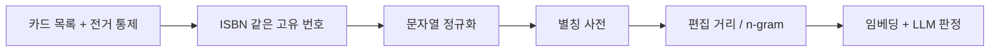

HN 댓글에서 언급된 책을 모아 순위를 매기는 사이트가 나왔다. 이런 건 만드는 것보다 "같은 책"이라고 묶는 게 훨씬 어렵다.

> - 책 언급 집계의 진짜 난이도는 크롤링이 아니라 "이 두 문자열이 같은 대상이냐"를 판정하는 것이다.
> - 도서관은 수십 년 전부터 이 문제를 사람 손으로 풀었고, 개발자는 정규화 -> 편집 거리 -> 임베딩 순으로 자동화해 왔다.
> - 어떤 방식도 100%는 못 한다. 그래서 댓글에 "멧돼지 책이 경영 분류에 있다"는 불만이 달린다.

## 이름 맞추기가 없던 시대

먼저 문제부터 정의한다. 누가 "Designing Data-Intensive Applications"라고 쓰고, 누가 "DDIA"라고 쓰고, 누가 "그 멧돼지 책"이라고 쓴다. 사람은 셋이 같은 책인 줄 안다. 컴퓨터에게는 서로 아무 상관없는 문자열 세 개다.

이 문제는 컴퓨터 이전부터 있었다. 도서관이 대표적이다. 같은 저자가 "Tolstoy", "Tolstoi", "톨스토이"로 적히면 카드 목록에서 책이 세 군데로 흩어진다. 그래서 사서들은 "이 사람의 공식 표기는 이것"이라고 정해 두고 나머지 표기는 "이쪽을 보라"는 안내 카드로 연결했다. 이걸 전거 통제(authority control)라고 부른다.

원리는 단순하다. 대표 이름 하나를 정하고 나머지는 별명으로 연결한다. 이 구조는 지금 쓰는 시스템에도 그대로 남아 있다.

그럼 번호를 붙이면 되지 않냐는 의문이 든다. 실제로 그렇게 했다. 책에는 ISBN이라는 고유 번호가 생겼고, 이 번호는 60년대 말에서 70년대 사이에 표준으로 자리 잡았다. 번호가 있으면 이름이 달라도 같은 책임을 확정할 수 있다.

문제는 사람들이 댓글을 쓸 때 ISBN을 적지 않는다는 점이다. 번호는 책을 등록하는 쪽의 도구다. 말하는 쪽은 여전히 제목, 약칭, 별명으로 말한다. 이름과 번호 사이의 간극은 누군가 메워야 했고, 그게 개발자 몫이 됐다.

## 그때 방식으로 직접 만들어 보기

가장 처음 떠올리는 방식은 댓글 안에 제목이 그대로 들어 있는지 보는 것이다. Python 3.x, 표준 라이브러리만 쓴다.

```python
from collections import Counter
import re

comments = [
    "Read Designing Data-Intensive Applications, great book",
    "designing data intensive applications changed my job",
    "the wild boar book by Kleppmann is the best",
    "Also SICP. Structure and Interpretation of Computer Programs.",
]
titles = [
    "Designing Data-Intensive Applications",
    "Structure and Interpretation of Computer Programs",
]

def norm(s):
    return " ".join(re.sub(r"[^a-z0-9]+", " ", s.lower()).split())

exact, normed = Counter(), Counter()
for c in comments:
    for t in titles:
        if t in c:
            exact[t] += 1
        if norm(t) in norm(c):
            normed[t] += 1
print("exact :", dict(exact))
print("normed:", dict(normed))
```

돌리면 exact는 책마다 1건씩 잡고, normed는 DDIA가 2건으로 늘어난다. 2번 댓글은 소문자와 하이픈 때문에 exact에서 빠졌다가 정규화로 살아난다. 3번 댓글의 "멧돼지 책"은 둘 다 놓친다.

여기서 아픈 지점은 이렇다.

- 정규화는 대소문자와 기호 차이만 잡는다. 약칭(SICP, DDIA)과 별명은 문자열을 아무리 다듬어도 제목과 닮지 않는다.
- 제목이 짧고 흔한 단어이면 오탐이 난다. 제목이 "Rust"인 책이 있다면 Rust 언어 이야기를 하는 댓글이 전부 그 책으로 집계된다.
- 오탈자에 약하다. 댓글에 "Kleppman"이라고 적혀 있으면 "Kleppmann"과 한 글자 차이인데도 일치 판정이 안 난다.

## 그래서 어떻게 진화했나

불편이 쌓일 때마다 한 칸씩 올라간 흐름을 먼저 본다.



왼쪽이 사람 손, 오른쪽으로 갈수록 기계가 더 많이 맡는다. 화살표 하나마다 "앞 단계로는 안 풀리는 사례"가 쌓여서 생긴 단계다.

첫 번째 단계는 정규화다. 불편은 대소문자, 공백, 기호가 다르다는 것이었다. 해법은 비교 전에 전부 같은 모양으로 깎는 것이다. 새로 생긴 문제는 깎을수록 서로 다른 것이 같아진다는 점이다. 기호를 다 지우면 "C++"와 "C"가 구별되지 않는다.

두 번째 단계는 별칭 사전이다. 불편은 약칭과 별명을 문자열로는 못 잡는다는 것이었다. 해법은 사람이 "DDIA = Designing Data-Intensive Applications"를 표로 적어 두는 것이다. 사실상 사서의 안내 카드를 코드로 옮긴 셈이다. 새로 생긴 문제는 책이 늘어나는 속도를 사람이 못 따라간다는 점이다. 새 별명은 사전에 올라오기 전에 먼저 쓰인다.

세 번째 단계는 편집 거리다. 불편은 오탈자였다. 해법은 두 문자열이 몇 글자를 고쳐야 같아지는지를 세는 것이다. 이 개념은 60년대부터 있었고, "Kleppman"과 "Kleppmann"은 한 글자 차이라서 같은 사람으로 묶인다. 새로 생긴 문제는 임계값이다. 너무 느슨하면 다른 책이 묶이고, 너무 빡빡하면 오탈자가 안 잡힌다. 이 값은 데이터마다 다시 맞춰야 한다.

여기서 "그럼 처음부터 편집 거리만 쓰면 되지 않냐"는 질문이 나온다. 안 된다. 편집 거리는 글자 모양이 비슷한 것만 잡는다. 책 제목은 모양이 달라도 같은 책이고, 모양이 비슷해도 다른 책인 경우가 흔하다. 시리즈물 "Volume 1"과 "Volume 2"는 거의 같은 문자열인데 다른 책이다.

네 번째 단계가 임베딩이다. 불편은 글자 모양이 아니라 의미를 비교해야 한다는 것이었다. 해법은 문장을 숫자 벡터로 바꿔서 의미가 가까우면 벡터도 가깝게 만드는 것이다. "멧돼지 책"처럼 제목과 글자가 안 닮은 표현도 문맥(저자, 주제, 같이 언급된 단어)이 있으면 후보로 끌어올 수 있다. 새로 생긴 문제는 판정 근거를 설명할 수 없다는 점이다. 왜 이 댓글이 이 책으로 묶였는지는 모델만 안다.

각 세대를 표로 정리하면 이렇다.

| 시대 | 방식 | 장점 | 한계 |
|---|---|---|---|
| 카드 목록 | 사서가 대표 표기를 정하고 별칭을 연결 | 정확하다 | 사람 손이 필요해서 느리다 |
| 고유 번호 | ISBN으로 책을 확정 | 모호함이 없다 | 말하는 쪽이 번호를 안 쓴다 |
| 문자열 처리 | 정규화, 별칭 사전, 편집 거리 | 싸고 빠르고 설명 가능 | 약칭, 별명, 동음이의에 약하다 |
| 임베딩과 LLM | 의미 기반 후보 생성과 판정 | 별명과 맥락을 잡는다 | 근거 설명이 어렵고 가끔 크게 틀린다 |

읽는 법은 위에서 아래로 갈수록 기계가 사람 일을 가져간다는 것이다. 대신 "틀렸을 때 왜 틀렸는지 알기"는 점점 어려워진다.

## 지금은 어떤가

아래 그림은 지금 이런 사이트가 쓰는 구조를 단순화한 것이다. 개념도이고 실제 수치는 아니다. 왼쪽 문자열들이 가운데 판정기를 거쳐 오른쪽 책 한 권으로 모이는 모양으로 읽으면 된다.

<svg viewBox="0 0 680 250" xmlns="http://www.w3.org/2000/svg" font-family="sans-serif" font-size="14">
<rect x="20" y="30" width="190" height="40" rx="6" fill="none" stroke="#c9a37a" stroke-width="2"/>
<text x="115" y="55" text-anchor="middle" fill="#7a6a58">Designing Data-Intensive...</text>
<rect x="20" y="105" width="190" height="40" rx="6" fill="none" stroke="#c9a37a" stroke-width="2"/>
<text x="115" y="130" text-anchor="middle" fill="#7a6a58">DDIA</text>
<rect x="20" y="180" width="190" height="40" rx="6" fill="none" stroke="#c9a37a" stroke-width="2"/>
<text x="115" y="205" text-anchor="middle" fill="#7a6a58">the wild boar book</text>
<rect x="270" y="75" width="150" height="100" rx="8" fill="none" stroke="#a8683a" stroke-width="2.5"/>
<text x="345" y="115" text-anchor="middle" fill="#a8683a">정규화</text>
<text x="345" y="135" text-anchor="middle" fill="#a8683a">별칭 + 임베딩</text>
<rect x="480" y="95" width="180" height="60" rx="8" fill="none" stroke="#6b4f3a" stroke-width="2.5"/>
<text x="570" y="130" text-anchor="middle" fill="#6b4f3a">책 1권 (대표 ID)</text>
<path d="M210 50 L270 110 M210 125 L270 125 M210 200 L270 145 M420 125 L480 125" stroke="#d9b98c" stroke-width="2" fill="none"/>
<text x="345" y="235" text-anchor="middle" fill="#7a6a58">개념도(실제 수치 아님)</text>
</svg>

이 구조에서 가장 약한 곳은 가운데 상자다. 댓글에 달린 불만 두 개가 정확히 거기를 찌른다. 하나는 멧돼지 책이 "Business & Management"에 들어가 있다는 것이고, 다른 하나는 "Pattern Recognition and Machine Learning"이 "Psychology and Behavior"에 들어가 있다는 것이다. 이름 매칭은 맞았는데 분류에서 틀린 경우다.

분류 오류는 이름 맞추기와 같은 병이다. 모델이 제목 문자열과 몇 개의 단어만 보고 판단하면, "Recognition"이나 "Behavior" 같은 단어에 끌려간다. 책의 내용을 읽은 판단이 아니다. 그래서 사용자 피드백으로 보정하자는 제안이 나온다. 이건 사서의 전거 통제가 돌아온 모양새다. 기계가 후보를 만들고 사람이 확정하는 구조로 간다.

다른 댓글도 같은 맥락이다. 위키에서 자주 언급되는 『The Invention of Morel』과 『Why's (poignant) Guide to Ruby』가 빠졌다는 지적이 있었다. 둘 다 존재하는 책이지만 후자는 인쇄본이 없다. 고유 번호 기반으로 책을 확정하는 시스템이면 ISBN이 없는 책은 처음부터 후보에서 빠진다. 번호가 있으면 정확하고, 번호가 없으면 아예 안 보인다는 건 ISBN 시대부터 있던 한계다.

"가장 적게 추천된 책"을 보고 싶다는 불만은 데이터 문제가 아니라 화면 문제다. 집계는 이미 끝났고 정렬 기준만 하나 더 있으면 된다. 이름 맞추기와는 무관하다.

지금 선택지를 비교하면 이렇다. 규칙 기반(정규화와 별칭 사전)은 싸고 설명이 되지만 별명에 약하다. 임베딩 기반은 별명을 잡지만 틀렸을 때 이유를 모른다. 둘을 섞어서 규칙으로 확실한 건 확정하고, 애매한 것만 모델에 넘기고, 모델 결과는 사람이 가끔 검수하는 구조가 가장 현실적이다. 이건 새로운 발명이 아니라 카드 목록 시절의 분업을 기계 버전으로 다시 짠 것이다.

멧돼지 책이 언젠가 경영서에서 빠져나온다면, 그건 모델이 똑똑해져서가 아니라 누군가 한 번 고쳐 줬기 때문일 것이다.

---

*원문: [Show HN: HackerBooks – HackerTube, but for books mentioned on HN](https://hackerbooks.org) (via hn)*
