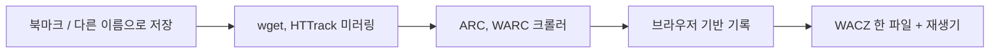

2004년부터 멀쩡히 떠 있던 팬사이트가 어느 날 도박 광고 서버로 바뀌어 있었다는 글이다. 주인이 사이트를 지운 게 아니다. 도메인이 만료됐고, 누가 그 이름을 주워다 다른 걸 올렸을 뿐이다.

> 웹페이지는 디스크에 놓인 파일이 아니라 서버가 요청을 받을 때마다 만들어 주는 응답이다. 그래서 파일 복사로는 백업이 안 된다.
> 그 응답을 헤더까지 통째로 기록하는 포맷이 WARC고, 이걸 한 파일로 묶어 서버 없이 재생하게 만든 게 WACZ다.
> 지금은 확장 프로그램 클릭 몇 번으로 개인도 한다. 안 하면 남이 해주길 기다리는 수밖에 없다.

## 북마크가 백업이라고 믿던 시절

웹 초기에 "저장"이라고 하면 브라우저의 다른 이름으로 저장이나 북마크였다. 북마크는 주소만 적어 둔 쪽지다. 내용은 여전히 남의 서버에 있다.

그 서버 주인이 요금을 안 내거나, 호스팅 업체가 문을 닫거나, 도메인이 만료되면 쪽지는 빈 주소를 가리킨다. 이걸 링크 썩음(link rot)이라고 부른다. 댓글에도 몇 년 전 북마크를 열었더니 404나 도메인 판매 페이지가 뜬다는 얘기가 있다.

"그럼 페이지를 파일로 저장하면 되잖아"라는 의문이 나온다. 정적인 HTML 한 장이면 된다. 그런데 사이트는 HTML 한 장이 아니다. 이미지, CSS, 스크립트, 폰트가 각각 별도 요청으로 따라온다.

게다가 요즘 사이트는 서버가 요청을 받을 때 DB를 뒤져서 즉석에서 HTML을 만든다. 서버 안의 코드와 DB는 내가 가져올 수 없다. 내가 가질 수 있는 건 "그 시점에 서버가 나한테 준 응답"뿐이다.

그래서 웹 백업의 단위는 파일이 아니라 응답이어야 한다. 이 말이 이 글의 전부이고, 나머지는 사람들이 이걸 깨닫기까지 겪은 삽질이다.

## 그때 방식으로 직접 만들어 보기

90년대부터 쓰던 방식을 그대로 만들어 보자. 시작 주소에서 출발해 링크를 따라가며 응답 본문을 파일로 저장하는 미러링이다. Python 3.11, 표준 라이브러리만 쓴다.

```python
# Python 3.11, 표준 라이브러리만
import re, sys, pathlib
from urllib.request import urlopen
from urllib.parse import urljoin, urlparse

start = sys.argv[1]
host = urlparse(start).netloc
out = pathlib.Path("mirror")
seen, queue = set(), [start]

while queue:
    url = queue.pop()
    if url in seen or urlparse(url).netloc != host:
        continue
    seen.add(url)
    try:
        body = urlopen(url, timeout=10).read()
    except Exception as e:
        print("skip", url, e)
        continue
    path = urlparse(url).path.lstrip("/") or "index.html"
    if path.endswith("/"):
        path += "index.html"
    dest = out / host / path
    dest.parent.mkdir(parents=True, exist_ok=True)
    dest.write_bytes(body)
    for link in re.findall(rb'(?:href|src)="([^"#]+)"', body):
        queue.append(urljoin(url, link.decode(errors="ignore")))
```

돌려 보면 정적인 옛날 팬사이트 정도는 그럭저럭 긁힌다. 문제는 그 다음이다.

- 저장한 HTML 안의 `/img/a.png` 같은 절대 경로 링크가 내 디스크가 아니라 파일 시스템 루트를 가리킨다. 열어 보면 이미지가 다 깨진다.
- `page?id=1`과 `page?id=2`는 서로 다른 응답인데 파일 이름 규칙이 없어서 뭉개진다. 본문만 저장하니 "언제, 어떤 헤더로 받았는지"도 사라진다.
- 자바스크립트가 나중에 불러오는 데이터는 정규식이 못 본다. HTML에 글자로 안 적혀 있으니 링크 목록에도 안 잡힌다.

## 그래서 어떻게 진화했나

단계마다 불편, 해법, 새 문제 순서로 보자.



읽는 법: 왼쪽에서 오른쪽으로 갈수록 "파일을 복사한다"에서 "응답을 기록하고 나중에 재생한다"로 넘어간다.

**1단계: 미러링 도구**

- 불편: 위 샘플처럼 직접 짜면 링크가 깨지고, 경로 규칙도 매번 새로 만들어야 한다.
- 해법: wget의 미러 옵션이나 HTTrack 같은 도구가 링크를 상대 경로로 고쳐 쓰고 파일 이름도 알아서 정해 준다. 폴더째 열어도 어느 정도 돌아간다.
- 새 문제: 원본을 고쳐서 저장한다. 내가 본 게 아니라 도구가 가공한 결과물이다. 수집 시각과 응답 헤더는 여전히 없다.

**2단계: 응답을 그대로 이어 붙이는 포맷**

- 불편: 도구가 가공하지 않고 원문 그대로 보관하고 싶다. 파일 수천 개가 폴더에 흩어지는 것도 관리하기 괴롭다.
- 해법: 인터넷 아카이브 쪽에서 크롤러 결과를 큰 파일 하나에 레코드 단위로 이어 붙이는 방식을 썼고, 이게 ARC를 거쳐 WARC가 됐다. 2000년대 후반에 국제 표준(ISO 28500)이 됐다. 레코드마다 요청 주소, 수집 시각, 응답 원문(상태 줄과 헤더 포함)을 그대로 담는다.
- 새 문제: WARC는 보관용 포맷이지 보는 포맷이 아니다. 열려면 재생기가 필요하다. 재생기는 요청이 오면 기록된 응답을 찾아서 돌려주는 가짜 서버 역할을 한다.

WARC 레코드는 대략 이런 모양이다. 실제 포맷을 아주 줄여서 보여 주는 것이다.

```text
WARC/1.1
WARC-Type: response
WARC-Target-URI: http://example.org/
WARC-Date: (수집한 시각)
Content-Type: application/http; msgtype=response

HTTP/1.1 200 OK
Content-Type: text/html

<html>... 서버가 준 그대로 ...</html>
```

HTTP 응답 원문이 통째로 들어가는 게 핵심이다. 내가 고치지 않았으니 나중에 재생할 때 "그때 서버가 준 것"을 그대로 돌려줄 수 있다.

**3단계: 사람이 보는 그대로 기록**

- 불편: 크롤러는 자바스크립트가 만들어 내는 페이지를 못 본다. 요즘 사이트는 HTML이 거의 빈 껍데기이고 화면은 스크립트가 채운다.
- 해법: 진짜 브라우저를 자동으로 조종해서 로딩이 끝날 때까지 기다린 뒤, 그동안 오간 모든 요청과 응답을 기록한다. 이 글이 소개한 Browsertrix가 이 방식의 크롤러다. 브라우저 확장(ArchiveWeb.page)은 같은 일을 내가 직접 클릭하면서 한다.
- 새 문제: 브라우저를 통째로 돌리니 무겁고 느리다. 클릭해야 나오는 데이터는 누군가 클릭해 줘야 기록된다. 그래서 확장 프로그램 안내에도 "인터랙티브 요소는 직접 눌러서 데이터가 로딩되게 하라"는 단계가 들어 있다.

**4단계: 한 파일로 묶고 서버 없이 재생**

- 불편: WARC를 재생하려면 재생 서버를 따로 돌려야 해서, 친구한테 보내 주기가 번거롭다.
- 해법: WARC와 색인을 한 파일(WACZ)로 묶고, 재생 로직을 브라우저 안의 자바스크립트로 옮겼다. 파일 하나와 스크립트 몇 줄이면 블로그 글 안에도 사이트를 통째로 박아 넣을 수 있다. 원문 글이 실제로 그렇게 했다.
- 새 문제: 포맷 자체를 아는 사람이 적다. 파일을 받아도 "이걸 뭘로 여냐"부터 막힌다.

아래 개념도는 두 방식의 차이를 한눈에 보여 준다. 실제 수치가 아니라 구조를 그린 것이다.

<svg viewBox="0 0 680 220" xmlns="http://www.w3.org/2000/svg" font-family="sans-serif" font-size="14">
<text x="20" y="28" fill="#7a6a58" font-weight="bold">개념도(실제 수치 아님): 예전 방식 vs 지금 방식</text>
<text x="20" y="62" fill="#6b4f3a">예전: 파일로 풀어 저장</text>
<rect x="20" y="74" width="120" height="40" rx="6" fill="none" stroke="#c9a37a" stroke-width="2"/>
<text x="38" y="99" fill="#7a6a58">서버 응답</text>
<rect x="200" y="74" width="140" height="40" rx="6" fill="none" stroke="#c9a37a" stroke-width="2"/>
<text x="214" y="99" fill="#7a6a58">링크 고쳐 쓰기</text>
<rect x="400" y="74" width="180" height="40" rx="6" fill="none" stroke="#c9a37a" stroke-width="2"/>
<text x="414" y="99" fill="#7a6a58">흩어진 파일 폴더</text>
<line x1="140" y1="94" x2="200" y2="94" stroke="#a8683a" stroke-width="2"/>
<line x1="340" y1="94" x2="400" y2="94" stroke="#a8683a" stroke-width="2"/>
<text x="20" y="152" fill="#6b4f3a">지금: 응답을 기록하고 재생</text>
<rect x="20" y="164" width="120" height="40" rx="6" fill="none" stroke="#a8683a" stroke-width="2"/>
<text x="38" y="189" fill="#7a6a58">서버 응답</text>
<rect x="200" y="164" width="140" height="40" rx="6" fill="none" stroke="#a8683a" stroke-width="2"/>
<text x="214" y="189" fill="#7a6a58">원문 그대로 기록</text>
<rect x="400" y="164" width="180" height="40" rx="6" fill="none" stroke="#a8683a" stroke-width="2"/>
<text x="414" y="189" fill="#7a6a58">WACZ 한 파일</text>
<line x1="140" y1="184" x2="200" y2="184" stroke="#6b4f3a" stroke-width="2"/>
<line x1="340" y1="184" x2="400" y2="184" stroke="#6b4f3a" stroke-width="2"/>
</svg>

읽는 법: 위쪽 줄은 중간에서 내용을 고쳐 쓰고, 아래쪽 줄은 건드리지 않고 담아서 재생 때 되살린다.

## 지금은 어떤가

오늘 글이 말하는 건 "이제 이 도구들을 개인도 쓴다"는 것이다. 예전에는 인터넷 아카이브 같은 큰 기관의 일이었는데, 확장 프로그램에서 시작 버튼을 누르고 페이지를 돌아다닌 뒤 정지 버튼을 누르면 끝이다.

세대별로 비교하면 이렇다.

| 시대 | 방식 | 장점 | 한계 |
|---|---|---|---|
| 초기 | 북마크, 다른 이름으로 저장 | 쉽다 | 북마크는 내용이 없고, 저장본은 링크가 깨진다 |
| 90년대 후반 이후 | wget, HTTrack 미러링 | 폴더째 받는다 | 원본을 가공하고 메타 정보가 없다 |
| 2000년대 | 크롤러 + ARC/WARC | 응답 원문과 수집 시각이 남는다 | 재생기가 따로 필요하고 JS 사이트에 약하다 |
| 최근 | 브라우저 기반 기록 + WACZ | 보이는 그대로 담고, 파일 하나로 공유한다 | 무겁고, 로그인이나 클릭 후 로딩에는 사람 손이 필요하다 |

지금 고를 수 있는 선택지도 정리해 둔다.

- 페이지 몇 개: ArchiveWeb.page 확장이나 독립 앱. 내가 보는 그대로 담는다.
- 사이트 전체: Browsertrix. 도메인만 주면 링크를 따라 돈다. 무료 체험 후에는 사용량에 따라 돈을 내는 구조이고, 오픈소스라서 직접 띄울 수도 있다.
- 그냥 한 장짜리 HTML이면 충분할 때: 댓글에서 나온 SingleFile. 미디어까지 한 파일에 넣어 준다.
- 보관을 워크플로로 만들고 싶을 때: 댓글에서 추천한 ArchiveBox.

남은 한계도 분명하다. 첫째, 이미 사라진 건 못 되살린다. 댓글에서 포럼 복원에 AI를 써 봤지만 "진짜로 없어진 데이터는 복원 못 한다"고 한 게 그 얘기다. AI는 있는 자료를 이어 붙일 수 있을 뿐이다.

둘째, 인터넷 아카이브가 다 해 주지 않는다. 한 댓글은 아카이브에 사이트의 뼈대만 남고 직접 스캔한 사진은 없었다고 한다. 크롤러가 이미지까지 못 가져간 것이다. 셋째, 로그인 뒤에 있는 글, 영상, 무한 스크롤은 아직도 사람이 손으로 챙겨야 한다.

그리고 법적 문제가 있다. 내 컴퓨터에 보관하는 것과 남에게 공개하는 것은 다른 일이니 사는 곳의 규정을 확인해야 한다.

결국 제일 싼 보험은 좋아하는 사이트가 멀쩡할 때 확장 프로그램 버튼을 한 번 누르는 것이다. 도메인이 만료된 다음에는 그 버튼을 누를 수 없다.

---

*원문: [If you love a website, back it up](https://blog.mistys-internet.website/post/2026/10/29/if-you-love-a-website-back-it-up/) (via hn)*
