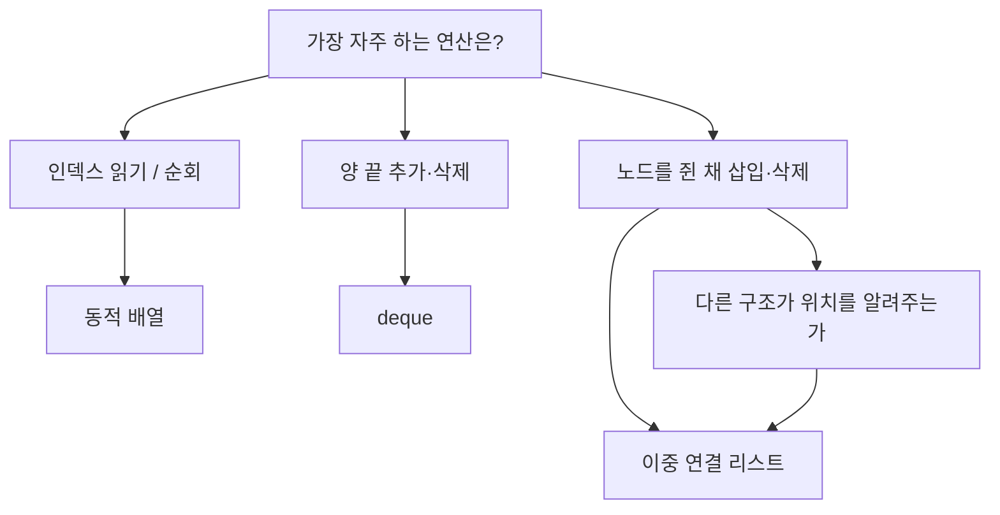

자료구조 시간에 "배열은 삽입이 느리고 연결 리스트는 삽입이 빠르다"를 외웠을 거다. 현업에서 연결 리스트를 직접 쓸 일이 드문 이유는 그 문장에서 빠진 절반에 있다.

> - 배열은 메모리에 연달아 놓여서 i번째 원소를 계산 한 번으로 찾고, 연결 리스트는 앞에서부터 포인터를 따라가야 찾는다.
> - 연결 리스트의 O(1) 삽입은 "삽입할 위치를 이미 쥐고 있을 때"만 성립한다. 그 위치를 찾는 비용은 O(n)이다.
> - 같은 O(n)이어도 연속 메모리를 훑는 쪽이 캐시 덕에 훨씬 빠른 경우가 많아서, 기본값은 배열이고 연결 리스트는 이유가 있을 때만 쓴다.

## 책장과 보물찾기

배열은 번호가 붙은 책장이다. 칸 크기가 모두 같고 1번 칸 위치를 알면, 100번 칸은 "1번 칸 위치 + 99칸"으로 바로 걸어가면 된다. 찾는 데 걸리는 시간이 칸 번호와 상관없다.

연결 리스트는 보물찾기 쪽지다. 첫 쪽지에는 "다음 쪽지는 도서관 2층 창가"라고만 적혀 있다. 100번째 쪽지를 보려면 앞의 99장을 순서대로 열어야 한다. 대신 쪽지는 아무 데나 숨겨도 되고, 중간에 새 쪽지를 끼우려면 앞 쪽지에 적힌 위치만 고치면 된다.

아래 그림은 두 구조를 메모리 위에 그린 것이다. 위쪽 줄은 칸이 붙어 있고, 아래쪽 줄은 칸이 흩어져 화살표로 이어진다.

개념도(실제 수치 아님)


<svg viewBox="0 0 680 230" xmlns="http://www.w3.org/2000/svg" width="680" height="230" style="background:transparent">
<text x="20" y="28" font-size="14" fill="#7a6a58" font-family="sans-serif">배열: 연속된 칸, 시작 주소 + i x 칸 크기</text>
<rect x="20" y="40" width="70" height="44" fill="none" stroke="#6b4f3a" stroke-width="2"/>
<rect x="90" y="40" width="70" height="44" fill="#d9b98c" stroke="#6b4f3a" stroke-width="2"/>
<rect x="160" y="40" width="70" height="44" fill="none" stroke="#6b4f3a" stroke-width="2"/>
<rect x="230" y="40" width="70" height="44" fill="none" stroke="#6b4f3a" stroke-width="2"/>
<rect x="300" y="40" width="70" height="44" fill="none" stroke="#6b4f3a" stroke-width="2"/>
<text x="48" y="68" font-size="13" fill="#7a6a58" font-family="sans-serif">[0]</text>
<text x="118" y="68" font-size="13" fill="#7a6a58" font-family="sans-serif">[1]</text>
<text x="188" y="68" font-size="13" fill="#7a6a58" font-family="sans-serif">[2]</text>
<text x="258" y="68" font-size="13" fill="#7a6a58" font-family="sans-serif">[3]</text>
<text x="328" y="68" font-size="13" fill="#7a6a58" font-family="sans-serif">[4]</text>
<path d="M20 110 L125 98 L125 84" fill="none" stroke="#a8683a" stroke-width="2"/>
<text x="140" y="116" font-size="13" fill="#a8683a" font-family="sans-serif">[1]은 계산 한 번으로 도착</text>
<text x="20" y="160" font-size="14" fill="#7a6a58" font-family="sans-serif">연결 리스트: 흩어진 노드, 값 + 다음 노드 주소</text>
<rect x="20" y="175" width="90" height="40" fill="none" stroke="#6b4f3a" stroke-width="2"/>
<rect x="190" y="190" width="90" height="40" fill="none" stroke="#6b4f3a" stroke-width="2"/>
<rect x="360" y="172" width="90" height="40" fill="none" stroke="#6b4f3a" stroke-width="2"/>
<rect x="540" y="188" width="90" height="40" fill="none" stroke="#6b4f3a" stroke-width="2"/>
<text x="40" y="200" font-size="13" fill="#7a6a58" font-family="sans-serif">A | next</text>
<text x="210" y="215" font-size="13" fill="#7a6a58" font-family="sans-serif">B | next</text>
<text x="380" y="197" font-size="13" fill="#7a6a58" font-family="sans-serif">C | next</text>
<text x="560" y="213" font-size="13" fill="#7a6a58" font-family="sans-serif">D | null</text>
<path d="M110 195 L190 208" fill="none" stroke="#c9a37a" stroke-width="2"/>
<path d="M280 210 L360 192" fill="none" stroke="#c9a37a" stroke-width="2"/>
<path d="M450 192 L540 206" fill="none" stroke="#c9a37a" stroke-width="2"/>
</svg>


읽는 법: 위쪽은 번호만 알면 바로 점프하고, 아래쪽은 화살표를 한 칸씩 따라가야 한다.

## 배열이 하는 일

배열은 같은 크기의 칸을 연속으로 잡는다. i번째 원소의 주소는 시작 주소에 i와 칸 크기를 곱해 더한 값이다. 곱셈과 덧셈 한 번이면 끝나니 읽기와 쓰기는 O(1)이다.

대가는 크기 변경이다. 연속된 빈 공간이 필요해서 칸이 모자라면 더 큰 공간을 새로 잡고 전부 복사한다. 그래서 "크기를 모르면 배열을 못 쓰나?"라는 의문이 나온다.

동적 배열이 이걸 푼다. 꽉 차면 일정 비율로 큰 공간을 새로 잡아 옮기고, 그 뒤 한동안은 복사 없이 끝에 붙인다. 복사가 가끔 일어나니 끝에 붙이는 연산을 평균으로 보면 O(1)이고, 이걸 분할 상환(amortized) 비용이라고 부른다. Python의 list, Java의 ArrayList, C++의 vector가 이 방식이다.

중간 삽입은 정말 느리다. 3번 자리에 끼우려면 뒤의 원소를 전부 한 칸씩 밀어야 하니 O(n)이다. 삭제도 뒤를 당겨야 해서 같다.

## 연결 리스트가 하는 일

노드는 값과 다음 노드의 주소를 함께 들고 있다. 리스트는 첫 노드 주소(head)만 기억한다. 노드는 필요할 때마다 따로 할당하니 크기를 미리 정할 필요가 없고, 늘어날 때 복사도 없다.

노드 B 뒤에 X를 끼운다면 순서는 이렇다. X의 next를 B의 next로 맞추고, B의 next를 X로 바꾼다. 다른 노드는 건드리지 않으니 O(1)이다.

삭제에는 함정이 있다. 단일 연결 리스트에서 B를 지우려면 B의 앞 노드의 next를 고쳐야 하는데, 앞 노드로 돌아갈 길이 없다. 그래서 앞 노드 주소도 같이 들고 가거나, next와 prev를 모두 가진 이중 연결 리스트를 쓴다. 대신 노드마다 포인터가 하나 더 붙는다.

## 그럼 중간 삽입은 연결 리스트가 이기는 거 아니냐

문제는 "중간"이 어디냐는 거다. 연결 리스트의 O(1)은 삽입할 노드를 이미 쥐고 있다는 전제다. "5000번째 뒤에 넣어라"는 요구를 받으면 먼저 5000개를 따라가야 하니 전체로는 O(n)이다. 큰 O 표기로는 배열과 같아진다.

그다음은 상수의 문제다. 배열의 밀기는 연속된 메모리를 통째로 옮기는 작업이라 CPU가 가장 잘하는 일이다. 연결 리스트의 따라가기는 노드마다 주소를 읽고 다음 주소로 점프하는 작업이다. 노드가 메모리 여기저기 흩어져 있으면 캐시 미스가 연달아 나고, 앞 노드를 읽기 전에는 다음 주소를 몰라서 CPU가 미리 읽어 두지도 못한다.

공간도 손해다. 배열은 값만 저장하고, 연결 리스트는 값마다 포인터를 하나나 둘 더 저장한다. 노드를 따로 할당하면 할당기가 붙이는 관리 정보도 생긴다. 값이 작을수록 이 낭비 비율이 커진다.

아래 표는 두 구조를 같은 연산으로 비교한 것이다. 연결 리스트 칸의 "위치를 쥔 경우"가 교과서의 O(1)이다.

| 연산 | 동적 배열 | 단일 연결 리스트 | 이중 연결 리스트 |
|---|---|---|---|
| i번째 읽기 | O(1) | O(n) | O(n) |
| 끝에 추가 | 분할 상환 O(1) | tail을 쥐면 O(1) | tail을 쥐면 O(1) |
| 맨 앞에 추가 | O(n) | O(1) | O(1) |
| 중간 삽입(위치 모름) | 찾기 O(1) + 밀기 O(n) | 찾기 O(n) + 연결 O(1) | 찾기 O(n) + 연결 O(1) |
| 중간 삽입(노드를 쥔 경우) | O(n) | O(1) | O(1) |
| 노드를 쥔 채 삭제 | O(n) | 앞 노드 필요, 없으면 O(n) | O(1) |
| 순회 | 캐시에 유리 | 캐시 미스 많음 | 캐시 미스 많음 |
| 칸당 추가 공간 | 없음 (여유 용량 제외) | 포인터 1개 | 포인터 2개 |

읽는 법: 가로로 같은 연산의 비용을 비교하고, 여섯 번째 행까지는 "위치를 이미 쥐었나"가 승부를 가른다.

## 직접 재 보기

Python 3.10 이상, 표준 라이브러리만 쓴다. 맨 앞 삽입과 가운데 읽기를 리스트와 직접 만든 연결 리스트로 비교한다.

```python
# Python 3.10+
import timeit

class Node:
    __slots__ = ("val", "next")
    def __init__(self, val, nxt=None):
        self.val = val
        self.next = nxt

N = 20_000

def front_insert_list():
    a = []
    for i in range(N):
        a.insert(0, i)
    return a

def front_insert_linked():
    head = None
    for i in range(N):
        head = Node(i, head)
    return head

def linked_get(head, k):
    cur = head
    for _ in range(k):
        cur = cur.next
    return cur.val

arr = list(range(N))
head = front_insert_linked()
mid = N // 2

print("front insert, list  :", timeit.timeit(front_insert_list, number=3))
print("front insert, linked:", timeit.timeit(front_insert_linked, number=3))
print("middle read, list   :", timeit.timeit(lambda: arr[mid], number=1000))
print("middle read, linked :", timeit.timeit(lambda: linked_get(head, mid), number=1000))
```

- 맨 앞 삽입은 연결 리스트가 알고리즘상 유리하다. 다만 Python의 list.insert는 밀기를 C 레벨에서 한 번에 처리해서 N이 작으면 차이가 생각보다 작게 나올 수 있다. N을 키워 가며 직접 확인해라.
- 가운데 읽기는 배열이 인덱스 한 번이고 연결 리스트는 mid번 포인터를 따라간다. 이쪽은 차이가 크게 난다.
- 수치는 머신과 버전마다 다르니 절대값이 아니라 N을 늘렸을 때 어느 쪽이 가파르게 늘어나는지를 봐라.
- 인터프리터 위에서 돌린 결과라서 C나 Rust의 캐시 효과를 그대로 대변하지는 않는다.

## 현업에서 마주치는 곳

배열 쪽은 말할 것도 없이 많다. Python list는 객체 포인터를 담는 동적 배열이고, JavaScript의 Array도 엔진이 대개 연속 저장소로 최적화한다. 로그 한 줄씩 쌓기, 결과 목록, 정렬 대상이 거의 다 배열이다.

연결 리스트는 숨어서 쓰인다. 리눅스 커널의 list_head는 구조체 안에 prev와 next를 박아 넣는 원형 이중 연결 리스트이고, 구조체를 따로 할당해서 연결하지 않아도 된다. 이런 방식을 침투형(intrusive) 리스트라고 부른다.

LRU 캐시도 대표적이다. 해시 테이블로 키에서 노드를 O(1)에 찾고, 이중 연결 리스트에서 그 노드를 맨 앞으로 옮긴다. 노드를 이미 쥐고 있으니 떼어 붙이는 데 O(1)이 정말로 성립하는 자리다.

collections.deque도 눈여겨볼 만하다. 양쪽 끝에서 넣고 빼야 하는 큐를 위한 구조인데, CPython 구현은 고정 크기 블록을 이중 연결 리스트로 이은 형태다. 순수 연결 리스트의 맨 앞 삽입 장점과 배열의 연속성을 절충한 설계다.

Java의 LinkedList는 "중간 삽입이 많으면 이걸 쓰라"는 식으로 소개되곤 한다. 하지만 위치를 찾는 순회 비용과 노드 할당 비용 때문에 실제로는 ArrayList가 앞서는 경우가 흔하다고 알려져 있다. 쓰기 전에 반복자로 위치를 쥔 채 삽입하는 패턴인지부터 확인해라.

## 고르는 기준

질문은 두 개로 줄어든다. 읽기가 인덱스 기반이거나 전체 순회가 주 작업인가, 그리고 이미 위치를 쥔 채 앞뒤 삽입·삭제를 반복하는가. 아래 순서도가 그 판단을 그대로 옮긴 거다.



읽는 법: 맨 위 질문에서 가장 자주 하는 연산 하나를 고르고, 화살표 끝의 구조를 후보로 잡으면 된다.

판단이 애매하면 배열로 시작해라. 병목이 측정으로 확인된 뒤에 바꿔도 늦지 않고, 바꿀 때 근거가 되는 것도 측정값이다.

연결 리스트가 이기는 조건은 "위치를 이미 쥐고 있다"와 "원소가 자주 끼고 빠진다"가 동시에 성립할 때다. 그 조건이 아니면 연속 메모리가 대부분 이긴다.

---

*CS 기초 시리즈: 자료구조*
