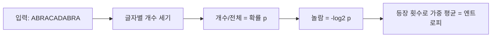

11글자짜리 문자열 하나를 한 글자씩 흘려보내면서, 글자마다 얼마나 놀라는지 재 볼 거다. 그 놀람을 평균 내면 그게 엔트로피다.

> - 엔트로피는 데이터가 얼마나 어지러운지가 아니라, 다음 심볼을 얼마나 예측하기 어려운지의 평균이다.
> - 확률 p인 사건이 터지면 -log2 p 비트만큼 놀라고, 엔트로피는 그 놀람의 기댓값이다.
> - 이 값은 주어진 확률 모델에서 심볼당 평균 비트 수의 하한이라, 압축, 키 설계, 결정 트리에서 계속 나온다.

## 무질서가 아니다

엔트로피를 "무질서도"로 외운 사람이 많다. 열역학에서 건너온 비유라 틀린 말은 아닌데, 정보이론에서는 이 말이 오히려 이해를 막는다.

"그럼 aaaaaaaa는 0이고, 랜덤해 보이는 문자열은 높은 거냐"는 질문이 바로 나온다. 반은 맞고 반은 틀리다. 엔트로피는 문자열 자체의 속성이 아니라, 그 문자열을 만들어 낸 확률 모델의 속성이다.

7f3a9c라는 문자열이 있다고 하자. 16진수 6자리를 균등하게 뽑는 생성기에서 나왔다면 24비트짜리 사건이다. 이 문자열 하나만 영원히 내보내는 생성기에서 나왔다면 0비트다. 문자열만 봐서는 엔트로피를 말할 수 없고, 어떤 분포에서 뽑았는지가 먼저 정해져야 한다. 아래 예제에서는 입력 안의 글자 빈도를 그 분포로 삼는다.

## 스무고개로 잡는 감각

친구가 물건 8개 중 하나를 골랐고, 너는 예/아니오로만 맞혀야 한다. 8개가 똑같이 나올 법하면 질문은 3번이면 된다. 절반씩 가르는 질문을 세 번 하면 8개가 1개로 줄기 때문이고, 이게 log2 8 = 3이다.

이제 물건 하나가 절반의 확률로 고르는 단골이라는 걸 안다고 하자. 첫 질문을 "그거냐?"로 던지면 절반은 한 번에 끝난다. 확률이 치우칠수록 질문 수가 평균적으로 줄어든다.

엔트로피는 확률을 아는 상태에서 가장 영리하게 물었을 때의 평균 질문 수에 해당한다. 비트는 예/아니오 질문 한 번이 가르는 정보량의 단위다.

## 1단계: 개수를 센다

입력은 ABRACADABRA다. 세어 보면 A가 5번, B와 R이 2번씩, C와 D가 1번씩이고 전체는 11글자다. 확률은 개수를 11로 나눈 값이다.



개념도(실제 수치 아님). 왼쪽에서 오른쪽으로 읽으면 입력이 숫자 하나로 줄어드는 순서다.

## 2단계: 확률을 놀람으로 바꾼다

글자 하나가 도착했을 때의 놀람은 -log2 p로 정의한다. 왜 하필 로그냐는 의문이 나올 만하다. 놀람이 가져야 할 성질을 적어 보면 답이 나온다.

확실한 사건(p = 1)은 놀람이 0이어야 한다. 드물수록 놀람이 커야 한다. 서로 독립인 두 사건이 같이 터지면 확률은 곱해지는데 놀람은 더해져야 한다. 이 조건을 만족하는 함수는 사실상 로그뿐이고, 밑을 2로 잡으면 단위가 비트가 된다.

| 글자 | 개수 | 확률 p | 놀람 -log2 p (비트) | p × 놀람 |
|---|---|---|---|---|
| A | 5 | 0.455 | 1.14 | 0.517 |
| B | 2 | 0.182 | 2.46 | 0.447 |
| R | 2 | 0.182 | 2.46 | 0.447 |
| C | 1 | 0.091 | 3.46 | 0.314 |
| D | 1 | 0.091 | 3.46 | 0.314 |

마지막 열이 글자별 기여분이고 합은 약 2.04다. 위에서 아래로 읽으면 자주 나오는 글자일수록 놀람이 작다.

## 3단계: 평균을 낸다

놀람 5개를 그냥 평균 내면 안 되냐고 물을 수 있다. 계산해 보면 (1.14 + 2.46 + 2.46 + 3.46 + 3.46) / 5 ≈ 2.60이 나온다. 이 값은 글자 5종류가 완전히 균등할 때의 최대치 log2 5 ≈ 2.32보다 크다. 이 평균은 글자 종류를 한 표씩 센 것이고, 실제로는 A가 5번 나오기 때문에 틀린 값이다.

그래서 놀람에 등장 확률을 가중치로 곱해 더한다. 이게 엔트로피 H = Σ p × (-log2 p)이고 값은 약 2.04비트/글자다.

<svg viewBox="0 0 680 230" xmlns="http://www.w3.org/2000/svg" style="background:transparent">
<line x1="60" y1="190" x2="560" y2="190" stroke="#d9b98c" stroke-width="2"/>
<rect x="90" y="139" width="60" height="51" fill="#a8683a"/>
<rect x="190" y="79" width="60" height="111" fill="#c9a37a"/>
<rect x="290" y="79" width="60" height="111" fill="#c9a37a"/>
<rect x="390" y="34" width="60" height="156" fill="#6b4f3a"/>
<rect x="490" y="34" width="60" height="156" fill="#6b4f3a"/>
<line x1="60" y1="98" x2="560" y2="98" stroke="#a8683a" stroke-width="2" stroke-dasharray="6 5"/>
<text x="565" y="102" font-size="14" fill="#7a6a58">평균 2.04</text>
<text x="120" y="133" font-size="14" fill="#7a6a58" text-anchor="middle">1.14</text>
<text x="220" y="73" font-size="14" fill="#7a6a58" text-anchor="middle">2.46</text>
<text x="320" y="73" font-size="14" fill="#7a6a58" text-anchor="middle">2.46</text>
<text x="420" y="28" font-size="14" fill="#7a6a58" text-anchor="middle">3.46</text>
<text x="520" y="28" font-size="14" fill="#7a6a58" text-anchor="middle">3.46</text>
<text x="120" y="212" font-size="15" fill="#7a6a58" text-anchor="middle">A (5번)</text>
<text x="220" y="212" font-size="15" fill="#7a6a58" text-anchor="middle">B (2번)</text>
<text x="320" y="212" font-size="15" fill="#7a6a58" text-anchor="middle">R (2번)</text>
<text x="420" y="212" font-size="15" fill="#7a6a58" text-anchor="middle">C (1번)</text>
<text x="520" y="212" font-size="15" fill="#7a6a58" text-anchor="middle">D (1번)</text>
</svg>

ABRACADABRA에서 계산한 글자별 놀람(비트)이고, 막대가 높을수록 드문 글자다. 점선이 가중 평균이며, 자주 나오는 A가 평균을 끌어내린다.

5종류를 고정 길이로 구분하려면 글자당 3비트가 필요해서, 11글자는 33비트다. 엔트로피 기준으로는 11 × 2.04 ≈ 22.4비트다. 이 차이가 편향된 분포에서 줄일 수 있는 여지의 크기다.

## 같은 길을 코드로 따라가기

```python
# Python 3.8+, 표준 라이브러리만 사용
import math
from collections import Counter

def trace(text):
    counts = Counter(text)
    n = len(text)
    total = 0.0
    for i, ch in enumerate(text, 1):
        p = counts[ch] / n
        bits = -math.log2(p)
        total += bits
        print(f"{i:2d} {ch}  p={p:.3f}  놀람={bits:.2f}비트")
    avg = total / n
    print(f"합계 {total:.2f}비트, 평균 {avg:.4f}비트/글자")
    return avg

trace("ABRACADABRA")
```

- 글자가 도착할 때마다 그 글자의 놀람을 누적한다. 같은 글자는 매번 같은 값을 더하므로, 등장 횟수 가중치가 따로 필요 없다.
- 마지막 줄의 평균이 위에서 손으로 구한 약 2.04와 같다. 합계는 약 22.4비트다.
- 빈도는 입력 전체에서 센 값이다. 스트림을 읽으며 빈도를 갱신하는 적응형 모델은 값이 달라진다.

## 하한이라는 말의 뜻

"그럼 글자마다 2.04비트짜리 코드를 주면 되냐"는 의문이 남는다. 코드 길이는 정수 비트여야 하니 글자 하나에 2.04비트를 그대로 줄 수는 없다. 글자별 코드를 쓸 때 가장 잘해도 평균 길이는 H 이상 H + 1 미만이라는 게 알려져 있고, 이 간극을 메우는 방법은 다른 글에서 다룬다. 여기서는 H가 넘을 수 없는 바닥이라는 것만 기억하면 된다.

분포가 치우칠수록 바닥이 내려간다. 동전 하나로 보면 이렇다.

| 앞면 확률 | 엔트로피 (비트) |
|---|---|
| 0.5 | 1.00 |
| 0.9 | 0.47 |
| 0.99 | 0.08 |

위에서 아래로 읽으면 결과가 뻔해질수록 값이 0에 가까워진다. 반반일 때가 최대이고, 거의 확정이면 알려 줄 정보가 거의 없다.

또 하나, 위 계산은 글자를 서로 독립으로 봤다. 실제 ABRACADABRA에서는 B, R, C, D 다음에 올 글자가 항상 정해져 있다. 앞 글자를 알고 보면 불확실성이 훨씬 작아지고, 압축기가 문맥을 보는 이유가 이것이다.

## 현업에서 마주치는 곳

비밀번호나 토큰의 강도를 말할 때 "비트"를 쓰는 게 엔트로피다. 소문자 8자를 균등하게 랜덤으로 뽑으면 8 × log2 26 ≈ 37.6비트다. 사람이 고른 비밀번호는 분포가 심하게 치우쳐 있어서 글자 수보다 훨씬 낮게 계산된다.

결정 트리가 어느 특성으로 먼저 가를지 정할 때 쓰는 정보 이득은 분할 전후의 엔트로피 차이다. 레이블이 섞여 있을수록 엔트로피가 높고, 잘 가르는 특성은 그 값을 많이 떨어뜨린다.

보안 쪽에서는 도메인 이름이나 로그 필드 값의 엔트로피를 계산해서, 사람이 지은 이름과 알고리즘이 뽑아낸 이름을 구분하는 휴리스틱이 있다. 평소 분포에서 벗어난 값이 갑자기 늘면 이상 신호로 본다. 압축 쪽에서는 이미 압축된 파일이나 암호화된 파일이 더 줄지 않는 이유를 엔트로피가 설명한다. 분포가 균등에 가까워서 줄일 여지가 없는 것이다.

엔트로피가 알려 주는 것은 모델이 정해졌을 때의 한계이고, 그 한계를 실제로 맞출 방법은 따로 찾아야 한다.

---

*CS 기초 시리즈: 정보이론 (COSE485)*
