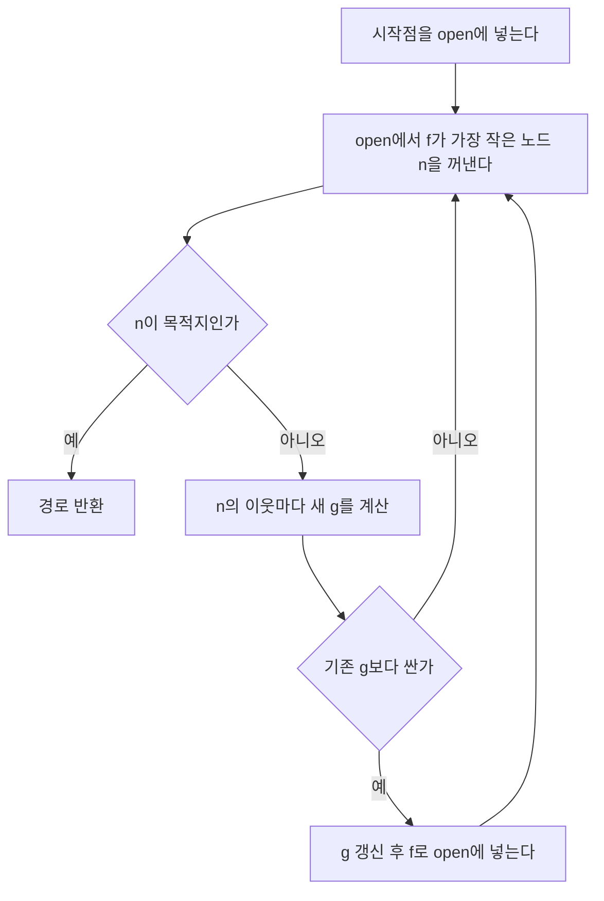

길찾기 코드를 짜다 보면 BFS, 다익스트라, 그리디, A* 중 뭘 쓸지 한 번은 고민하게 된다. 넷은 따로 노는 알고리즘이 아니라 "다음에 열어볼 칸을 뭘로 고르느냐"만 다른 한 가족이다.

> - 탐색 알고리즘의 차이는 우선순위 큐에 넣는 숫자 하나로 갈린다. 지금까지 온 거리 g만 쓰면 다익스트라, 남은 거리 추정 h만 쓰면 그리디, 둘을 더하면 A*다.
> - A*가 최적 경로를 보장하려면 h가 실제 남은 비용을 절대 넘겨 부르지 않아야 한다. 이 조건 하나가 깨지면 빠르지만 틀린 답이 나온다.
> - 휴리스틱이 좋을수록 열어보는 칸이 줄어든다. h를 0으로 두면 A*는 다익스트라와 똑같아진다.

## 그냥 다익스트라 쓰면 안 되나

A*를 처음 보면 드는 의문이 이거다. 다익스트라는 최단 경로를 보장하는데 왜 굳이 다른 걸 쓰나.

보장은 맞다. 문제는 다익스트라가 목적지가 어디 있는지 모른다는 점이다. 시작점에서 같은 거리에 있는 칸을 사방으로 똑같이 퍼지며 열어본다. 목적지가 오른쪽 끝에 있어도 왼쪽 끝 칸을 똑같이 열어본다.

반대로 "그럼 목적지에 가까운 칸부터 열면 되잖아" 하는 생각도 든다. 이게 그리디다. 빠르긴 한데 최단 경로를 보장하지 못한다. 가까워 보이는 길이 막다른 길이거나 멀리 돌아가는 길일 수 있기 때문이다.

A*는 이 둘을 합친다. 온 거리를 계산하니 돌아가는 길에 벌점이 붙고, 남은 거리를 추정하니 엉뚱한 방향으로 퍼지지 않는다.

## 안개 속에서 산을 넘는 비유

안개 낀 산에서 목적지 마을로 가는 길을 찾는다고 해보자. 지도는 없고, 지금까지 걸은 거리와 마을이 대충 어느 방향 몇 킬로 앞인지만 안다.

다익스트라는 걸어온 거리가 짧은 갈림길부터 차례로 확인한다. 성실하지만 마을과 반대 방향도 똑같이 확인한다. 그리디는 마을 방향으로 보이는 길로만 달려간다. 낭떠러지 앞에서야 돌아서고, 그렇게 찾은 길이 최단이라는 보장도 없다.

A*는 "걸어온 거리 + 직선으로 남은 거리"가 가장 작은 갈림길부터 확인한다. 이미 많이 걸었는데 마을과 멀어지는 길은 합이 커져서 뒤로 밀린다. 직선거리는 실제 길보다 짧을 수밖에 없다. 이 성질이 최적성의 핵심이다.

## f = g + h가 하는 일

세 숫자를 구분하면 된다.

- g(n): 시작점에서 n까지 실제로 쓴 비용. 이미 알고 있는 값이다.
- h(n): n에서 목적지까지 남은 비용의 추정치. 추측한 값이다.
- f(n) = g(n) + h(n): n을 지나가는 경로의 예상 총비용. 우선순위 큐는 이 값이 작은 순서로 꺼낸다.

읽는 법: 아래 그림에서 실선은 이미 확정된 g, 점선은 추정인 h다. 둘을 이은 길이가 f다.

개념도(실제 수치 아님)

<svg viewBox="0 0 660 190" width="660" xmlns="http://www.w3.org/2000/svg" style="background:transparent">
<line x1="80" y1="100" x2="330" y2="100" stroke="#6b4f3a" stroke-width="4"/>
<line x1="330" y1="100" x2="580" y2="100" stroke="#a8683a" stroke-width="3" stroke-dasharray="8 6"/>
<circle cx="80" cy="100" r="18" fill="#d9b98c" stroke="#6b4f3a" stroke-width="2"/>
<circle cx="330" cy="100" r="18" fill="#c9a37a" stroke="#6b4f3a" stroke-width="2"/>
<circle cx="580" cy="100" r="18" fill="#d9b98c" stroke="#6b4f3a" stroke-width="2"/>
<text x="80" y="106" font-size="16" text-anchor="middle" fill="#6b4f3a">S</text>
<text x="330" y="106" font-size="16" text-anchor="middle" fill="#6b4f3a">n</text>
<text x="580" y="106" font-size="16" text-anchor="middle" fill="#6b4f3a">G</text>
<text x="205" y="80" font-size="15" text-anchor="middle" fill="#7a6a58">g(n) 실제로 온 거리</text>
<text x="455" y="80" font-size="15" text-anchor="middle" fill="#7a6a58">h(n) 남은 거리 추정</text>
<line x1="80" y1="140" x2="580" y2="140" stroke="#c9a37a" stroke-width="2"/>
<text x="330" y="165" font-size="15" text-anchor="middle" fill="#7a6a58">f(n) = g(n) + h(n) 이 값이 작은 노드부터 꺼낸다</text>
</svg>

읽는 법 보충: n이 S에서 멀어질수록 g가 커지고, G에 가까워질수록 h가 줄어든다. f가 작다는 건 "많이 돌지 않았고 아직 가망이 있다"는 뜻이다.

## 동작을 그대로 옮기면

A*의 루프는 짧다. 열린 목록(open)에서 f가 가장 작은 노드를 꺼내고, 목적지면 끝낸다. 아니면 이웃을 보면서 더 싼 경로를 발견했을 때만 g를 갱신해 다시 넣는다.

읽는 법: 위에서 아래로 흐르고, 마름모 두 개가 분기점이다. 다익스트라 흐름도와 똑같고 큐에 넣는 키만 다르다.



여기서 자주 나오는 의문이 있다. 목적지를 처음 발견한 순간 바로 끝내면 안 되나. 안 된다. 발견은 큐에 넣을 때 하는 것이고, 최단이라는 확정은 큐에서 꺼낼 때 난다. 더 싼 경로가 큐 안에 숨어 있을 수 있기 때문이다. 코드에서도 목적지 검사를 꺼낸 직후에 둔다.

## 같은 미로에 세 가지를 돌려 본다

12x7 격자에 벽을 몇 개 세웠다. S에서 G까지 가는 길은 일부러 한 번 크게 돌아가게 만들었다. 직선으로 가면 막힌다. 모드만 바꿔 세 방식을 돌리고, 찾은 경로 길이와 큐에서 꺼낸 칸 수를 출력한다.

```python
# Python 3.11, 표준 라이브러리만 사용
import heapq

GRID = [
    "S....#......",
    ".###.#.####.",
    ".#...#....#.",
    ".#.#####.##.",
    ".#.......#..",
    ".#######.#.#",
    "........#..G",
]

def find(ch):
    for r, row in enumerate(GRID):
        if ch in row:
            return (r, row.index(ch))

def solve(mode):
    start, goal = find("S"), find("G")
    h = lambda p: abs(p[0] - goal[0]) + abs(p[1] - goal[1])
    key = {"dijkstra": lambda g, p: g,
           "greedy": lambda g, p: h(p),
           "astar": lambda g, p: g + h(p)}[mode]
    best = {start: 0}
    pq = [(key(0, start), 0, start)]
    expanded = 0
    while pq:
        _, g, p = heapq.heappop(pq)
        if g > best[p]:
            continue
        expanded += 1
        if p == goal:
            return g, expanded
        r, c = p
        for nr, nc in ((r + 1, c), (r - 1, c), (r, c + 1), (r, c - 1)):
            if 0 <= nr < len(GRID) and 0 <= nc < len(GRID[0]) and GRID[nr][nc] != "#":
                ng = g + 1
                if ng < best.get((nr, nc), 10**9):
                    best[(nr, nc)] = ng
                    heapq.heappush(pq, (key(ng, (nr, nc)), ng, (nr, nc)))
    return None, expanded

for m in ("dijkstra", "greedy", "astar"):
    print(m, solve(m))
```

- 세 모드는 우선순위 키 한 줄(`key`)만 다르다. 나머지 루프는 완전히 같다.
- `if g > best[p]: continue`는 같은 칸이 더 비싼 값으로 큐에 중복 들어간 경우를 걸러낸다. 힙에서 기존 항목을 수정할 수 없어서 쓰는 관용구다.
- 맨해튼 거리는 상하좌우 4방향 이동에서 실제 남은 비용을 넘지 않는다. 그래서 `astar`의 결과는 `dijkstra`와 같은 최단 길이가 나온다.
- 출력되는 꺼낸 칸 수는 직접 돌려서 확인해라. 이 미로는 G 쪽으로 곧장 가는 길이 막혀 있어서 맨해튼 거리가 A*를 일부러 헷갈리게 만든다. 그래도 최적성은 깨지지 않는다는 점이 이 예제에서 볼 부분이다.

## 네 방식을 한 표로

BFS는 모든 이동 비용이 같을 때의 다익스트라와 같다. 그래서 따로 코드를 만들지 않고 표에서만 비교한다.

읽는 법: 행이 알고리즘이고 열은 현업에서 고를 때 따지는 기준이다. "최적 보장" 열이 먼저 갈리고, 그다음 "열어보는 칸" 열을 본다.

| 방식 | 큐 키 | 최적 경로 보장 | 열어보는 칸 | 필요한 것 |
|---|---|---|---|---|
| BFS | 칸 수 | 비용이 모두 같을 때만 | 시작점 주변 전부 | 없음 |
| 다익스트라 | g | 보장 (음수 간선 없을 때) | 시작점 주변 전부 | 간선 비용 |
| 그리디 | h | 보장 안 됨 | 가장 적은 편 | 휴리스틱 |
| A* | g + h | h가 허용적이면 보장 | 휴리스틱 품질에 따라 | 간선 비용과 휴리스틱 |

그리디가 틀리는 이유는 단순하다. h만 보니까 "이미 비싸게 온 길"을 평가하지 못한다. 목적지에 가까운 칸이 사실은 거대한 벽을 끼고 한참 돌아야 닿는 위치일 수 있다.

## 휴리스틱이 지켜야 하는 조건

A*의 보장은 공짜가 아니다. h에 조건이 붙는다.

- 허용적(admissible): h(n)이 n에서 목적지까지 진짜 최소 비용보다 크지 않다. 과대평가만 하지 않으면 된다.
- 일관적(consistent): 이웃으로 한 칸 이동했을 때 h의 감소량이 그 이동 비용을 넘지 않는다. 삼각부등식이다. 일관적이면 허용적이다.

그럼 h를 크게 부풀리면 더 빨라지지 않나. 빨라진다. 대신 최적성을 잃는다. 과대평가한 h는 진짜로 좋은 경로를 "비싸 보인다"며 뒤로 밀어낸다. 그 사이 목적지에 먼저 닿은 나쁜 경로가 답으로 나온다.

반대로 h = 0이면 항상 허용적이라 A*는 다익스트라가 된다. 정확한 값에 가까울수록 쓸데없는 칸을 덜 열어본다. 한쪽 끝은 다익스트라고 다른 쪽 끝은 정답을 아는 상태다. 휴리스틱 설계는 이 사이 어디를 고르는 일이다.

이동 규칙에 맞는 거리 함수를 골라야 한다. 4방향이면 맨해튼, 대각선 이동이 되는 8방향이면 대각선 이동 비용을 반영한 거리(옥타일 거리나 체비쇼프 거리)를 쓴다. 4방향 칸에 직선 유클리드 거리를 써도 허용적이긴 하다. 다만 실제보다 너무 낮게 잡아서 열어보는 칸이 늘어난다.

## 현업에서 만나는 자리

게임 NPC 길찾기가 가장 흔하다. 맵을 격자나 내비게이션 메시로 쪼개고 A*를 돌린다. 프레임 안에 끝내야 하니 최적성을 조금 양보하는 경우가 많다. 허용적 h에 가중치 w(1보다 큼)를 곱하는 가중치 A*가 대표적이다. 결과 경로 비용이 최적의 w배 이내라는 한계가 알려져 있고, 대신 열어보는 칸이 크게 줄 수 있다.

로보틱스의 경로 계획, 퍼즐 풀이(8퍼즐 같은 상태 공간 탐색)도 같은 구조다. 상태가 칸이 아니라 "퍼즐 배치"일 뿐이다. 이때 h는 "제자리에 없는 조각 수"나 "각 조각의 맨해튼 거리 합" 같은 걸 쓴다.

지도 앱의 도로망 길찾기는 조금 다르다. 도로 그래프가 워낙 커서 순수 A*만으로 부족해, 보통 전처리를 해 두는 기법을 얹는다. 그래도 "우선순위 큐로 유망한 노드부터 연다"는 뼈대는 같다.

## A*가 못 푸는 구간

A*의 병목은 시간보다 메모리다. open과 g 테이블에 지금까지 만난 노드를 전부 들고 있어야 한다. 상태 공간이 크면 메모리가 먼저 터진다. 그럴 때는 깊이 우선으로 f 한계를 늘려 가며 반복하는 IDA*를 쓴다. 메모리는 줄고 같은 노드를 여러 번 다시 방문하는 비용을 낸다.

간선 비용이 음수이면 다익스트라처럼 A*도 그대로 쓸 수 없다. 환경이 계속 바뀌어서 경로를 매번 새로 짜야 하는 경우도 따로 변형 알고리즘이 있다.

고르는 기준은 이렇다. 목적지를 모르고 모든 곳까지 최단 거리가 필요하면 다익스트라. 목적지가 하나고 거리 감각을 줄 수 있으면 A*. 답이 좀 틀려도 되니 빨리만 나오면 되면 가중치 A*나 그리디. 메모리가 문제면 IDA*.

결국 A*는 다익스트라에 "목적지가 이쪽이다"라는 힌트 한 줄을 더한 것이고, 그 힌트가 거짓말만 하지 않으면 답은 틀리지 않는다.

---

*CS 기초 시리즈: 인공지능*
