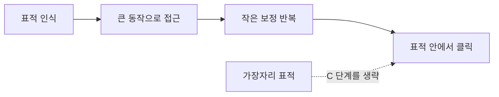

버튼 크기를 키우는 것과 버튼을 가까이 옮기는 것 중 뭐가 더 효과적인지, 감으로 말하는 사람은 많은데 계산해 본 사람은 드물다. 오늘은 공식 하나로 그걸 직접 계산해 본다.

> - 포인팅 시간은 거리 자체가 아니라 거리와 크기의 비율에 로그를 씌운 값에 비례한다.
> - 거리를 두 배로 늘리는 것과 크기를 절반으로 줄이는 것은 거의 같은 비용이다.
> - 화면 가장자리는 커서가 멈춰 주는 벽이라서, 크기가 사실상 무한대인 표적이 된다.

## 먼저 드는 의문

"버튼이 멀면 오래 걸리는 건 당연하지, 그걸 왜 법칙이라고 부르냐"는 생각이 들 수 있다. 맞다. 방향만 보면 당연하다. 법칙이 말해 주는 건 얼마나 오래 걸리는지다. 그리고 그 증가가 직선이 아니라 로그 모양이라는 점이 설계에 쓸모가 있다.

비유부터 하자. 멀리 있는 양동이에 공을 던져 넣는 상황을 생각해 봐. 양동이가 두 배 멀어지면 던지는 힘만 키우면 되는 게 아니라 조준도 더 정밀해야 한다. 반대로 양동이 입구가 넓으면 조준이 대충이어도 들어간다. 마우스 이동도 같다. 처음에는 큰 동작으로 표적 근처까지 가고, 마지막에는 작은 보정을 반복해서 표적 안에 들어간다. 시간 대부분은 이 마지막 보정에서 쓰인다.

## 공식이 말하는 것

Paul Fitts가 1954년에 낸 원래 형태는 이동 시간 MT = a + b * log2(2D / W)다. D는 표적까지의 거리, W는 이동 방향으로 잰 표적 폭이다. 지금 HCI 쪽에서는 MacKenzie가 1992년에 제안한 MT = a + b * log2(D / W + 1) 형태를 많이 쓴다. 이쪽은 D가 0일 때 로그 안이 1이 되어 시간이 음수로 떨어지지 않는다.

log2 부분을 난이도 지수(ID)라고 부르고 단위는 비트다. a와 b는 장치와 사람에 따라 달라지는 상수라서 공식만 봐서는 알 수 없다. 마우스, 트랙패드, 손가락마다 직접 재서 회귀로 구해야 한다.

아래 그림은 D와 W가 무엇인지 보여 주는 개념도다. 왼쪽 커서에서 오른쪽 표적까지 화살표가 D이고 표적의 가로 길이가 W다. 읽는 법은 간단하다. 화살표가 길수록, 표적 상자가 좁을수록 어렵다.

개념도(실제 수치 아님)

<svg viewBox="0 0 680 200" xmlns="http://www.w3.org/2000/svg" style="background:transparent">
<line x1="60" y1="90" x2="60" y2="130" stroke="#7a6a58" stroke-width="2"/>
<circle cx="60" cy="110" r="6" fill="#6b4f3a"/>
<text x="60" y="155" font-size="14" fill="#7a6a58" text-anchor="middle">커서 시작점</text>
<rect x="470" y="70" width="90" height="80" fill="#d9b98c" stroke="#a8683a" stroke-width="2"/>
<text x="515" y="115" font-size="14" fill="#6b4f3a" text-anchor="middle">표적</text>
<line x1="70" y1="110" x2="462" y2="110" stroke="#a8683a" stroke-width="2"/>
<polygon points="468,110 456,104 456,116" fill="#a8683a"/>
<text x="265" y="100" font-size="15" fill="#7a6a58" text-anchor="middle">거리 D</text>
<line x1="470" y1="55" x2="560" y2="55" stroke="#c9a37a" stroke-width="2"/>
<text x="515" y="45" font-size="15" fill="#7a6a58" text-anchor="middle">폭 W</text>
</svg>

그림에서 W는 이동 방향으로 잰 폭이라는 점을 기억해 둬. 세로로 아주 긴 버튼이라도, 위에서 내려오는 커서에게는 높이가 W다.

## 숫자 몇 개로 감 잡기

D/W의 비율만 바꿔 가며 ID를 계산해 봤다. 단위가 픽셀이든 센티미터든 비율이 같으면 ID도 같다. 표의 값은 MacKenzie 식에 대입해서 소수 셋째 자리에서 반올림한 계산 결과다.

| 거리 D | 폭 W | D/W | ID (비트) |
|---|---|---|---|
| 400 | 80 | 5 | 2.585 |
| 400 | 40 | 10 | 3.459 |
| 400 | 20 | 20 | 4.392 |
| 400 | 10 | 40 | 5.358 |
| 800 | 40 | 20 | 4.392 |

읽는 법은 이렇다. 위에서 아래로 갈수록 표적이 반씩 작아지는데, ID는 매번 대략 1비트씩만 늘어난다. 그리고 마지막 두 줄을 비교해 봐. 거리를 두 배로 늘린 줄(800, 40)과 폭을 절반으로 줄인 줄(400, 20)은 ID가 같다.

여기서 직관과 다른 점이 나온다. 표적을 네 배 작게 만들어도 시간은 네 배가 되지 않는다. 2비트 늘어나는 것이고, 시간으로 환산하면 b의 두 배만큼 늘어난다. 반대로 말하면 버튼을 키우는 것은 한 번 키울 때마다 b만큼 시간을 줄여 주지만, 이미 충분히 큰 버튼은 더 키워 봐야 얻는 게 점점 줄어든다. 로그는 그래서 중요하다. 이득이 감소하는 지점이 공식 안에 들어 있다.

처리량도 같은 틀에서 나온다. ID를 이동 시간으로 나눈 값(비트/초)을 처리량이라고 하고, 입력 장치를 비교하는 표준 평가에서 이 값을 쓴다. ISO 9241-9가 그런 평가 방법을 정리한 문서다.

## 코드로 직접 재 보기

Python 3.11 표준 라이브러리만 쓴다. 실제 사용자 데이터는 없으니 a=0.1, b=0.15인 가상의 사용자를 가정하고 잡음을 섞은 합성 시행을 만든다. 그다음 회귀로 a, b를 다시 복원한다. 이 숫자들은 실험값이 아니라 가정이다.

```python
import math
import random
import statistics

def fitts_id(d: float, w: float) -> float:
    return math.log2(d / w + 1)

def predict(d: float, w: float, a: float = 0.1, b: float = 0.15) -> float:
    return a + b * fitts_id(d, w)

# 같은 화면 위의 서로 다른 버튼들 (px, 가정)
buttons = [
    ("큰 버튼, 가까움", 200, 80),
    ("작은 버튼, 가까움", 200, 20),
    ("큰 버튼, 멀음", 800, 80),
    ("작은 버튼, 멀음", 800, 20),
]
for name, d, w in buttons:
    print(f"{name:<14} ID={fitts_id(d, w):.2f}  MT={predict(d, w):.3f}s")

# 합성 시행: 진짜 a=0.1, b=0.15에 잡음을 섞어 회귀로 복원
rng = random.Random(1)
ids, times = [], []
for _ in range(200):
    d = rng.uniform(50, 900)
    w = rng.uniform(10, 120)
    ids.append(fitts_id(d, w))
    times.append(predict(d, w) + rng.gauss(0, 0.03))

fit = statistics.linear_regression(ids, times)
print(f"b={fit.slope:.3f}, a={fit.intercept:.3f}")
```

- fitts_id가 공식의 전부다. 나머지는 이 함수를 둘러싼 입출력이다.
- statistics.linear_regression은 Python 3.10부터 있고 slope와 intercept를 돌려준다.
- 실제 실험이라면 합성 부분을 로그로 남긴 포인팅 시행으로 바꾸면 그대로 a, b를 구할 수 있다.
- 잡음이 크면 복원된 값이 흔들린다. 시행 수를 늘리면 줄어드는 것이 정상이다.

## 왜 화면 모서리는 공짜일까

여기서 질문이 하나 더 나온다. "그럼 아무 데나 작은 버튼을 놓고 크게 만들면 되지 않나." 방법이 하나 있다. 화면 가장자리에 놓는 것이다.

커서는 화면 밖으로 나가지 못하고 가장자리에서 멈춘다. 그러니 가장자리에 붙은 버튼은 사용자가 마우스를 끝까지 밀어붙이면 정확히 맞출 필요가 없다. 이동 방향으로 보면 W가 사실상 무한대다. 화면 모서리는 두 방향 모두 막혀 있으니 더 유리하다. macOS의 메뉴 막대가 화면 맨 위에 붙어 있는 이유가 이것이다. 윈도우 안에 메뉴가 떠 있으면 위아래 모두 정확히 맞춰야 하지만, 화면 맨 위에 붙어 있으면 위쪽은 신경 쓰지 않아도 된다.

한 가지 조건이 있다. 버튼이 가장자리에서 1픽셀이라도 떨어져 있으면 이 이점이 사라진다. 그 사이 틈으로 커서가 빠지기 때문이다. 창 모서리 버튼에 여백을 주는 디자인이 접근성 측면에서 비판받는 이유다.

아래 흐름도는 포인팅 한 번이 어떤 단계로 이루어지는지 보여 주는 개념도다.

개념도(실제 수치 아님)



읽는 법은 왼쪽에서 오른쪽이다. 시간의 대부분은 보정 반복 단계에서 쓰이고, 점선은 가장자리에 붙은 표적이 이 단계를 건너뛴다는 뜻이다.

## 모델이 맞추지 못하는 것

법칙이 만능은 아니다. 몇 가지는 직접 알아 둬야 한다.

첫째, 피츠의 법칙은 한 번의 직선 이동만 다룬다. 터널처럼 좁은 경로를 따라 커서를 움직여야 하는 계층형 메뉴는 별도의 모델이 필요하고, 그게 Accot과 Zhai가 1997년에 제안한 조향 법칙(steering law)이다. 하위 메뉴로 대각선 이동하다가 옆 항목에 걸려 메뉴가 닫히는 현상이 여기에 해당한다.

둘째, 이동 시간 전에 선택 시간이 있다. 항목이 n개일 때 어떤 걸 고를지 정하는 데 드는 시간은 힉-하이먼 법칙(RT = a + b * log2(n + 1))으로 모델링한다. 이것도 로그다. 메뉴 항목이 두 배 늘어도 반응 시간은 일정량만 늘어난다. 단, 목록이 정렬되어 있거나 사용자가 위치를 외웠다는 전제가 있을 때 이 모델이 잘 맞는다.

셋째, 손가락과 터치 화면에서는 가림 문제가 있다. 손가락이 표적을 가려서 마지막 보정이 눈으로 안 된다. 그래서 터치 UI는 실제 표시 크기보다 터치 인식 영역을 크게 잡는 식으로 W를 늘려 준다.

넷째, 이 법칙은 숙련도와 전혀 별개의 문제다. 이미 위치를 외운 사용자는 눈으로 찾는 시간이 없어서 모델 바깥의 시간이 줄어든다. 단축키가 빠른 이유가 이동 시간이 아니라 이 탐색 시간을 없애기 때문이다.

## 현업에서 마주치는 곳

대시보드나 관리자 페이지에서 삭제 버튼과 저장 버튼이 붙어 있는 화면을 본 적이 있을 거다. D가 거의 0이고 W도 작으니, 오조작이 일어날 만한 ID 조건이 갖춰진 셈이다. 위험한 동작은 일부러 멀리 떨어뜨려 D를 키우는 방식으로 설계한다. 이건 피츠의 법칙을 거꾸로 쓴 사례다.

반대로 자주 쓰는 동작은 크고 가깝게 둔다. 모달 대화상자의 기본 버튼을 크게 만들거나, 폼의 제출 버튼을 마지막 입력 필드 바로 아래에 두는 것이 그렇다. 컨텍스트 메뉴가 커서 위치에서 바로 열리는 것도 D를 0에 가깝게 만드는 방법이다. 파이 메뉴(원형 메뉴)는 모든 항목이 중심에서 같은 거리에 있어서 D를 같게 만드는 시도다.

프론트엔드에서는 클릭 영역을 CSS padding으로 늘리는 것이 W를 키우는 가장 싼 방법이다. 아이콘이 16px이어도 클릭 가능한 영역은 훨씬 크게 줄 수 있다. 시각적 크기와 입력 영역 크기는 따로 설계해도 된다.

UI를 평가할 때 "느낌상 불편하다"에서 멈추지 말고 D와 W를 재서 ID를 비교해 봐. 공식이 정확한 시간을 알려 주진 못해도, 두 설계안 중 어느 쪽이 더 어렵냐는 순서는 거의 틀리지 않는다.

---

*CS 기초 시리즈: 인간컴퓨터상호작용 (COSE432)*
