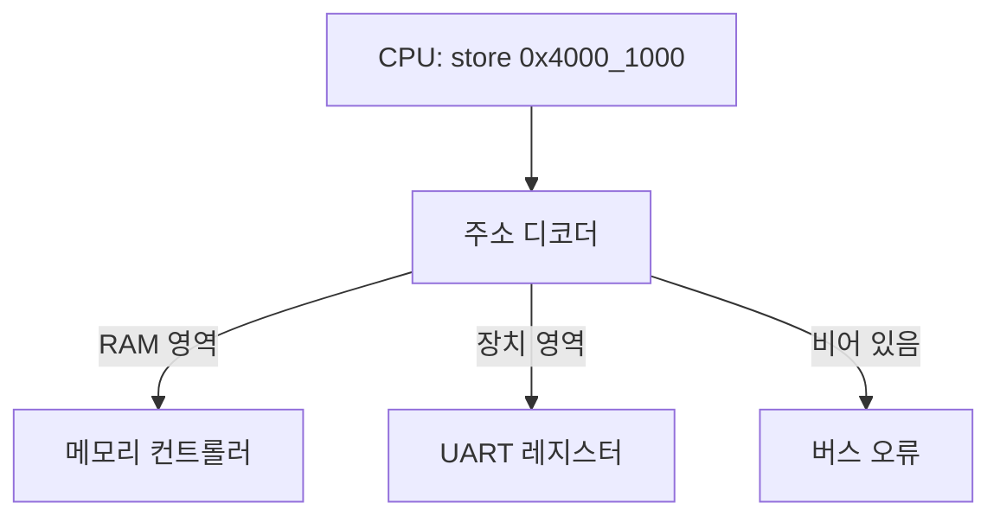

CPU 입장에서 키보드 컨트롤러나 UART는 그냥 특정 주소에 있는 칸이다. 그 칸에 store 하면 메모리가 아니라 장치가 반응한다.

> - 메모리 맵 I/O는 장치 레지스터를 주소 공간에 끼워 넣어서, 일반 load/store 명령으로 장치를 다루는 방식이다.
> - 포트 I/O는 별도 주소 공간과 전용 명령(x86의 in/out)을 쓴다. 명령어가 늘어나는 대신 RAM 주소와 섞이지 않는다.
> - MMIO 레지스터는 값을 저장하는 칸이 아니라 읽고 쓰는 행위 자체가 동작이라서, 캐시와 컴파일러 최적화를 꺼야 한다.

## 같은 주소, 다른 대상

식당 주문 창구를 떠올려 보자. 창구 번호 1~100번 중 1~90번은 창고(RAM)이고 91~100번은 주방 직원(장치)이다. 손님(CPU)은 번호만 말하면 되고, 번호표를 보고 안쪽에서 누가 받을지 갈린다.

이게 메모리 맵 I/O(MMIO)다. CPU는 주소를 버스에 내보낼 뿐이고, 주소 디코더가 그 주소를 RAM 컨트롤러로 보낼지 장치 레지스터로 보낼지 정한다. CPU 코어는 이 둘을 구분하지 않는다.

개념도(실제 수치 아님). 위에서 아래로, 주소가 어디로 라우팅되는지 읽으면 된다.



아래 그림은 같은 내용을 주소 공간 모양으로 본 것이다. 칸 하나가 주소 범위 하나이고, 색이 진한 칸이 장치다.

개념도(실제 수치 아님). 왼쪽 아래가 낮은 주소, 위로 갈수록 높은 주소다.

<svg viewBox="0 0 680 260" xmlns="http://www.w3.org/2000/svg" style="background:transparent">
<rect x="40" y="20" width="260" height="40" fill="none" stroke="#7a6a58" stroke-width="1.5"/>
<text x="170" y="45" text-anchor="middle" font-size="14" fill="#7a6a58">부트 ROM / 플래시</text>
<rect x="40" y="60" width="260" height="40" fill="#d9b98c" stroke="#7a6a58" stroke-width="1.5"/>
<text x="170" y="85" text-anchor="middle" font-size="14" fill="#6b4f3a">UART 레지스터</text>
<rect x="40" y="100" width="260" height="40" fill="#c9a37a" stroke="#7a6a58" stroke-width="1.5"/>
<text x="170" y="125" text-anchor="middle" font-size="14" fill="#6b4f3a">GPIO / 타이머 레지스터</text>
<rect x="40" y="140" width="260" height="40" fill="#a8683a" stroke="#7a6a58" stroke-width="1.5"/>
<text x="170" y="165" text-anchor="middle" font-size="14" fill="#ffffff">PCIe 장치 BAR</text>
<rect x="40" y="180" width="260" height="60" fill="none" stroke="#7a6a58" stroke-width="1.5"/>
<text x="170" y="215" text-anchor="middle" font-size="14" fill="#7a6a58">DRAM</text>
<text x="340" y="45" font-size="13" fill="#7a6a58">같은 주소 공간, 같은 load/store</text>
<text x="340" y="125" font-size="13" fill="#7a6a58">진한 칸: 읽고 쓰는 것이 곧 동작</text>
<text x="340" y="215" font-size="13" fill="#7a6a58">연한 칸: 저장한 값이 그대로 남는 곳</text>
<line x1="305" y1="120" x2="335" y2="120" stroke="#6b4f3a" stroke-width="1.5"/>
</svg>

그림에서 장치 칸은 DRAM 칸 사이에 끼어 있다. 주소만 보고는 어느 쪽이 어느 쪽인지 알 수 없고, 메모리 맵 문서나 디바이스 트리를 봐야 안다.

## 두 방식을 같은 장치에 붙여 보면

CPU가 장치를 다루는 방법은 크게 둘이다. x86이 오래 써 온 포트 I/O는 주소 공간을 하나 더 만든다. in, out이라는 전용 명령이 있고, 포트 번호는 16비트라서 65536개 안에서 놀아야 한다.

MMIO는 그런 전용 명령이 없다. ARM이나 RISC-V 같은 아키텍처는 처음부터 별도 I/O 공간이 없고 전부 MMIO다. x86도 요즘 PCIe 장치는 대부분 MMIO로 다룬다.

같은 문제, 같은 시리얼 장치에 한 글자를 보내는 작업에 둘을 적용해서 비교해 보자. 아래 표는 행이 비교 기준이고 열이 방식이다.

| 기준 | 포트 I/O | 메모리 맵 I/O |
|---|---|---|
| 주소 공간 | RAM과 분리된 I/O 공간 | RAM과 같은 공간 |
| 접근 명령 | 전용 명령(in/out) | 일반 load/store |
| C에서 쓰는 법 | 인라인 어셈블리나 커널 래퍼 | 포인터 역참조 |
| 크기 제한 | 포트 번호 범위 | 주소 공간만큼 |
| 대량 데이터 | 명령 단위로 불편 | 구조체로 덮어 씌우기 쉬움 |
| 캐시 | 영향 없음 | 캐시 비활성 설정 필요 |
| 보호 | 명령 자체를 막을 수 있음 | 페이지 권한으로 막음 |
| 지금 주로 쓰는 곳 | 오래된 PC 레거시 장치 | 거의 모든 SoC와 PCIe |

표를 읽으면 포트 I/O의 장점은 RAM 주소와 안 섞인다는 점뿐이다. 반면 MMIO는 언어 지원이 공짜라서 구조체 하나로 레지스터 맵 전체를 표현할 수 있다.

## 그럼 그냥 포인터로 읽으면 안 돼?

여기서 가장 흔한 의문이 나온다. 장치 주소가 그냥 주소면, 평범한 포인터로 읽고 쓰면 끝 아니냐는 거다. 그렇게 쓰면 세 군데에서 깨진다.

첫째는 컴파일러다. 상태 레지스터를 폴링하는 루프를 보자. 컴파일러는 `while (!(*status & 1));`에서 status가 루프 안에서 바뀌지 않으니, 한 번만 읽고 무한 루프로 바꿔도 된다고 판단한다. 그래서 `volatile`이 필요하다. 이건 읽고 쓰기를 생략하거나 합치지 말라는 약속이다.

둘째는 캐시다. RAM은 한 번 읽은 값이 캐시에 남아도 문제가 없다. 하지만 장치 레지스터를 캐시가 쥐고 있으면 CPU는 장치가 바꾼 값을 영영 못 본다. 그래서 MMIO 영역은 페이지 테이블에서 캐시 불가 혹은 장치 메모리 속성으로 매핑한다.

셋째는 순서다. `volatile`은 컴파일러에게만 하는 약속이고 CPU가 명령 순서를 바꾸는 건 막지 못한다. 데이터 레지스터에 쓰고 나서 시작 레지스터에 쓰는 순서가 뒤집히면 장치는 쓰레기 값으로 출발한다. 리눅스 커널의 readl, writel이 단순 포인터 접근이 아니라 배리어를 품은 함수인 이유가 이거다.

한 가지 더 있다. 레지스터는 읽는 행위에 부작용이 있는 경우가 많다. UART 수신 데이터 레지스터를 한 번 읽으면 FIFO에서 값이 하나 빠진다. 디버거로 그 주소를 들여다보기만 해도 데이터가 사라질 수 있다.

## 직접 돌려 보는 레지스터 폴링

실제 장치 주소는 유저 프로그램에서 못 건드리니 가짜 장치를 만들어서 구조를 흉내 낸다. 장치 쪽 스레드가 상태 비트를 세우고, 드라이버 쪽 코드는 레지스터만 보고 일한다.

C11, gcc 또는 clang, POSIX 스레드 기준이다. `cc -O2 -pthread mmio.c`로 빌드한다.

```c
#include <stdint.h>
#include <stdio.h>
#include <pthread.h>
#include <unistd.h>

#define TX_READY 1u

typedef struct {
    volatile uint32_t status;
    volatile uint32_t data;
} uart_regs;

static uart_regs fake = { .status = TX_READY };

static void *device(void *arg) {
    (void)arg;
    for (;;) {
        if (!(fake.status & TX_READY)) {
            usleep(1000);
            putchar((int)fake.data);
            fflush(stdout);
            fake.status |= TX_READY;
        }
    }
    return NULL;
}

static void uart_putc(uart_regs *r, char c) {
    while (!(r->status & TX_READY)) { }
    r->data = (uint32_t)c;
    r->status &= ~TX_READY;
}

int main(void) {
    pthread_t t;
    pthread_create(&t, NULL, device, NULL);
    for (const char *s = "hello mmio\n"; *s; s++)
        uart_putc(&fake, *s);
    while (!(fake.status & TX_READY)) { }
    return 0;
}
```

- 구조체 필드 순서가 곧 레지스터 오프셋이다. 실제 드라이버는 이 구조체를 ioremap으로 얻은 주소에 덮어 씌운다.
- 필드의 `volatile`을 빼고 `-O2`로 빌드하면 폴링 루프가 최적화돼 멈출 수 있다.
- 드라이버가 상태를 비우는 쪽, 장치가 세우는 쪽으로 나눠서 두 스레드가 같은 비트를 동시에 쓰지 않게 했다. 실제 장치도 이런 식으로 소유권을 나눈다.
- 이 예제는 x86 같은 강한 순서 보장 환경을 가정한 데모다. 약한 순서의 CPU에서 진짜 장치를 다루려면 배리어가 따로 필요하다.

## 현업에서 마주치는 곳

임베디드나 BSP 쪽에서는 거의 매일이다. 보드 문서의 레지스터 맵 표가 곧 MMIO 주소표이고, ARM 리눅스에서는 디바이스 트리의 `reg` 속성이 장치의 기준 주소와 크기를 알려 준다. 드라이버는 이 주소를 ioremap으로 매핑한 다음 readl, writel로 읽고 쓴다.

서버나 데스크톱에서는 PCIe 장치의 BAR(Base Address Register)가 MMIO 영역이다. 부팅 때 펌웨어나 OS가 BAR에 주소를 배정하고, GPU나 NIC 드라이버는 그 영역에 레지스터를 읽고 쓴다. 리눅스에서는 `/proc/iomem`에서 이 배치를 볼 수 있고, 포트 I/O 쪽은 `/proc/ioports`에서 본다.

프레임버퍼 같은 영역은 조금 다르다. 읽기는 거의 없고 쓰기만 대량으로 하니 캐시를 아예 끄기보다 쓰기를 모아서 내보내는 속성(write-combining)을 쓰기도 한다. 레지스터와 같은 장치 안에 있어도 영역마다 매핑 속성이 다르다는 얘기다.

드라이버 버그 중에는 쓰기가 사실은 아직 장치에 안 도착했는데 다음 줄이 실행되는 경우도 있다. 쓰기 직후 같은 장치의 레지스터를 한 번 읽어서 앞선 쓰기가 끝나게 만드는 관용구가 그래서 존재한다. 버스를 거치는 쓰기는 CPU가 보낸 순간 끝난 게 아닐 수 있다.

## 고르는 기준

새로 설계하는 쪽이면 선택지는 거의 없다. 주소 공간이 충분한 아키텍처에서는 MMIO가 기본값이다. 전용 명령이 없어서 컴파일러와 OS의 메모리 보호 장치를 그대로 쓸 수 있기 때문이다.

포트 I/O를 만나는 경우는 정해져 있다. x86의 오래된 레거시 장치를 다루거나, 그런 장치를 에뮬레이션하는 가상화 코드를 읽을 때다. 이때는 이 방식이 왜 따로 있었는지보다 어느 쪽 공간의 주소인지를 먼저 확인하면 된다.

고르는 것보다 중요한 건 속성이다. 어느 방식이든 레지스터는 값을 저장하는 칸이 아니라 동작을 일으키는 칸이다. 캐시, 컴파일러, CPU 순서 셋 중 하나라도 놓치면 코드는 맞는데 장치가 반응하지 않는 상황이 생긴다.

---

*CS 기초 시리즈: 컴퓨터시스템설계*
