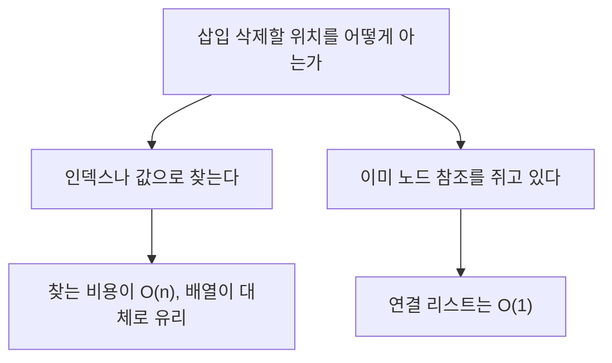

면접에서 이 주제가 나오면 선배는 정의보다 이유를 듣고 싶어 한다. 질문 세 개를 순서대로 받아 답하면서 쌓는다.

> - 배열은 주소를 계산으로 바로 찍고, 연결 리스트는 포인터를 따라 걸어간다. "i번째 원소"의 값이 서로 다른 이유다.
> - 연결 리스트의 O(1) 삽입은 위치를 이미 쥐고 있을 때만 성립한다. 위치를 찾는 비용은 따로 낸다.
> - 연결 리스트가 현업에서 남은 자리는 노드 참조를 쥐고 있다가 중간에서 바로 빼는 곳이다. LRU 캐시와 커널의 리스트가 그 예다.

## 메모리에 어떻게 놓이나

선배: 배열과 연결 리스트가 메모리에서 어떻게 다른지 말해 봐.

직관부터 잡는다. 배열은 극장의 연속 좌석이다. 7번 좌석이 어디냐고 물으면 입구에서 좌석 폭 곱하기 7만큼 가면 되니, 앞 좌석을 하나씩 셀 필요가 없다.

연결 리스트는 보물찾기다. 쪽지마다 "다음 쪽지는 저기"만 적혀 있어서, 다섯 번째 쪽지를 보려면 앞의 쪽지를 차례로 열어야 한다.

정확한 동작은 이렇다. 배열은 같은 크기의 원소를 연속된 메모리에 붙여 놓는다. i번째 원소의 주소는 시작 주소 + i × 원소 크기라서 곱셈과 덧셈 한 번으로 끝나고, 이걸 임의 접근이라 부르며 O(1)이다.

연결 리스트는 노드마다 값과 다음 노드의 주소를 같이 들고 있다. 노드는 메모리 어디에나 있을 수 있고, k번째 노드에 가려면 head에서 k번 따라가야 하니 O(k)다.

작은 예제로 확인한다. 4바이트 int 배열 [10, 20, 30, 40]이 주소 1000에서 시작하면 인덱스 2의 주소는 1000 + 2×4 = 1008이다. 연결 리스트에 같은 값을 넣으면 노드가 1000, 3480, 912, 2200처럼 아무 데나 놓이고, 30을 보려면 10과 20을 거쳐서 도착해야 한다.

아래 그림은 위쪽이 배열, 아래쪽이 연결 리스트다. 위는 칸이 붙어 있어 계산으로 점프하고, 아래는 화살표를 따라가야 한다는 것만 읽으면 된다. 개념도(실제 수치 아님).

<svg viewBox="0 0 680 240" width="680" xmlns="http://www.w3.org/2000/svg" font-family="sans-serif" font-size="13">
<defs><marker id="ah" markerWidth="8" markerHeight="8" refX="7" refY="4" orient="auto"><path d="M0,0 L8,4 L0,8 z" fill="#6b4f3a"/></marker></defs>
<text x="20" y="26" fill="#7a6a58">배열: 칸이 연속으로 붙어 있다</text>
<rect x="40" y="40" width="70" height="40" fill="#d9b98c" stroke="#6b4f3a"/>
<rect x="110" y="40" width="70" height="40" fill="#d9b98c" stroke="#6b4f3a"/>
<rect x="180" y="40" width="70" height="40" fill="#d9b98c" stroke="#6b4f3a"/>
<rect x="250" y="40" width="70" height="40" fill="#d9b98c" stroke="#6b4f3a"/>
<rect x="320" y="40" width="70" height="40" fill="#d9b98c" stroke="#6b4f3a"/>
<rect x="390" y="40" width="70" height="40" fill="#d9b98c" stroke="#6b4f3a"/>
<text x="75" y="65" fill="#6b4f3a" text-anchor="middle">[0]</text>
<text x="145" y="65" fill="#6b4f3a" text-anchor="middle">[1]</text>
<text x="215" y="65" fill="#6b4f3a" text-anchor="middle">[2]</text>
<text x="285" y="65" fill="#6b4f3a" text-anchor="middle">[3]</text>
<text x="355" y="65" fill="#6b4f3a" text-anchor="middle">[4]</text>
<text x="425" y="65" fill="#6b4f3a" text-anchor="middle">[5]</text>
<text x="480" y="65" fill="#7a6a58">주소 = 시작 + i × 칸 크기</text>
<text x="20" y="130" fill="#7a6a58">연결 리스트: 노드가 흩어져 있고 화살표로 이어진다</text>
<rect x="40" y="150" width="100" height="44" fill="#c9a37a" stroke="#6b4f3a"/>
<rect x="210" y="180" width="100" height="44" fill="#c9a37a" stroke="#6b4f3a"/>
<rect x="380" y="146" width="100" height="44" fill="#c9a37a" stroke="#6b4f3a"/>
<rect x="540" y="186" width="100" height="44" fill="#c9a37a" stroke="#6b4f3a"/>
<text x="90" y="177" fill="#6b4f3a" text-anchor="middle">10 | next</text>
<text x="260" y="207" fill="#6b4f3a" text-anchor="middle">20 | next</text>
<text x="430" y="173" fill="#6b4f3a" text-anchor="middle">30 | next</text>
<text x="590" y="213" fill="#6b4f3a" text-anchor="middle">40 | null</text>
<line x1="140" y1="172" x2="208" y2="202" stroke="#a8683a" stroke-width="2" marker-end="url(#ah)"/>
<line x1="310" y1="202" x2="378" y2="168" stroke="#a8683a" stroke-width="2" marker-end="url(#ah)"/>
<line x1="480" y1="168" x2="538" y2="208" stroke="#a8683a" stroke-width="2" marker-end="url(#ah)"/>
</svg>

위 그림에서 연결 리스트의 각 상자가 놓인 높이는 제각각이다. 메모리 어디에 놓일지 모른다는 뜻이다.

선배: 연결 리스트는 크기를 미리 정할 필요가 없으니 메모리도 아끼는 거 아냐?

그렇지 않다. 노드마다 다음 노드를 가리키는 포인터가 추가로 붙는다. 64비트 환경에서 포인터는 8바이트라서 4바이트 int를 담으면 포인터가 값보다 크다.

이중 연결 리스트면 포인터가 두 개다. 노드를 하나씩 할당할 때마다 할당기가 붙이는 관리 비용도 따로 든다. 배열의 약점인 크기 변경은 다음 질문에서 다룬다.

## 중간 삽입은 정말 싸냐

선배: 연결 리스트는 중간 삽입이 O(1)이고 배열은 O(n)이잖아. 그럼 연결 리스트가 낫지 않아?

그 O(1)에는 조건이 붙어 있다. 삽입할 자리 앞 노드를 이미 안다는 조건이다. 포인터 두 개를 고쳐 쓰는 건 상수 시간이지만, 앞 노드를 찾으려면 head부터 걸어야 한다.

인덱스나 값으로 위치를 찾는 순간 전체 비용은 O(n)이 된다. 배열의 중간 삽입과 같은 차수다.

같은 O(n)이어도 상수가 다르다. 배열의 삽입은 뒤쪽 원소를 한 칸씩 미는 일인데, 연속된 메모리 블록을 통째로 복사하는 동작이라 CPU가 가장 잘하는 일이다. CPU는 메모리를 캐시 라인이라는 덩어리 단위로 읽어 오고, 배열은 이웃 원소가 같은 덩어리에 같이 올라온다.

연결 리스트는 노드가 흩어져 있어서 포인터를 따라갈 때마다 새 덩어리를 읽어야 할 가능성이 크다. 점근 표기는 이 차이를 지워 버린다. 그래서 "O(n) 대 O(n)"인데 실제로는 배열이 이기는 일이 흔하다.

선배: 배열은 꽉 차면 어떻게 하냐. 끝에 추가하는 것도 느리지 않아?

Python list, Java ArrayList, C++ std::vector 같은 동적 배열은 꽉 차면 더 큰 배열을 새로 잡고 옮긴다. 용량을 일정 비율로 늘리기 때문에 비싼 복사는 드문드문 일어난다. 늘리는 비율은 구현마다 다르지만 비율로 늘린다는 점은 같다.

두 배씩 늘린다고 가정하고 계산한다. 용량 1에서 시작해 8개를 넣으면 용량이 1, 2, 4, 8로 커지고, 그때 복사한 원소는 1 + 2 + 4 = 7개다. 원소 하나당 한 번 안쪽이라, 끝 추가의 평균 비용은 상수다. 이걸 분할 상환 O(1)이라 부른다.

아래 표는 연산별 비용을 나란히 놓은 것이다. 가로로 읽고, 마지막 두 행의 차이를 본다.

| 연산 | 동적 배열 | 이중 연결 리스트 |
|---|---|---|
| i번째 읽기 | O(1) | O(i) |
| 끝에 추가 | 분할 상환 O(1) | O(1), 꼬리 참조를 쥔 경우 |
| 맨 앞에 추가 | O(n) | O(1) |
| 값으로 찾기 | O(n) | O(n) |
| 중간 삽입, 위치를 찾아야 함 | O(n) | O(n) |
| 중간 삽입·삭제, 노드를 이미 쥠 | O(n) | O(1) |

마지막 행에서만 연결 리스트가 차수로 이긴다. 현업에서 연결 리스트를 쓰는 이유가 거의 다 이 한 줄에 있다.

## 그럼 연결 리스트는 어디에 쓰냐

선배: 그럼 연결 리스트는 어디서 쓰는데?

노드를 이미 쥐고 있는 자리에서 쓴다. 그런 자리는 보통 다른 자료구조가 노드 참조를 대신 찾아 준다. 아래 흐름도는 연결 리스트를 고르는 판단 하나를 그린 것이다. 위에서 아래로 읽는다. 개념도(실제 수치 아님).



대표 사례는 LRU 캐시다. 캐시가 꽉 차면 가장 오래 안 쓴 항목을 버리고, 항목을 읽을 때마다 그 항목을 "가장 최근" 자리로 옮겨야 한다. 해시 맵이 키로 노드를 O(1)에 찾아 주고, 이중 연결 리스트가 그 노드를 O(1)에 빼서 맨 앞에 붙인다. 배열로 순서를 관리하면 옮길 때마다 O(n)이다.

표준 라이브러리만 쓴 Python 3.12 구현이다.

```python
# Python 3.12
class Node:
    __slots__ = ("key", "val", "prev", "next")
    def __init__(self, key=None, val=None):
        self.key, self.val = key, val
        self.prev = self.next = None

class LRU:
    def __init__(self, cap):
        self.cap, self.map = cap, {}
        self.head, self.tail = Node(), Node()
        self.head.next, self.tail.prev = self.tail, self.head
    def _unlink(self, n):
        n.prev.next, n.next.prev = n.next, n.prev
    def _push_front(self, n):
        n.prev, n.next = self.head, self.head.next
        self.head.next.prev = n
        self.head.next = n
    def get(self, key):
        n = self.map.get(key)
        if n is None:
            return None
        self._unlink(n); self._push_front(n)
        return n.val
    def put(self, key, val):
        n = self.map.get(key)
        if n:
            n.val = val
            self._unlink(n)
        else:
            if len(self.map) >= self.cap:
                old = self.tail.prev
                self._unlink(old)
                del self.map[old.key]
            n = self.map[key] = Node(key, val)
        self._push_front(n)
c = LRU(2)
c.put("a", 1); c.put("b", 2); c.get("a"); c.put("c", 3)
print(c.get("b"), c.get("a"), c.get("c"))  # None 1 3
```

- head와 tail에 값 없는 센티넬 노드를 두면 빈 리스트나 양 끝을 따로 처리하는 분기가 사라진다.
- `_unlink`는 대상 노드의 앞뒤 포인터만 고친다. 리스트를 순회하는 코드는 어디에도 없다.
- `map`이 키에서 노드로 가는 지름길을 준다. 위치를 찾는 비용을 해시 맵이 대신 낸다.
- 용량 2에서 a, b를 넣고 a를 읽은 뒤 c를 넣으면 가장 오래 안 쓴 b가 밀려나서 `None 1 3`이 찍힌다.

선배: 그냥 OrderedDict 쓰면 되는 거 아냐?

실무에서는 그렇다. `OrderedDict.move_to_end`가 같은 일을 해 준다. 직접 짜 보는 건 그 한 줄 밑에서 어떤 비용이 오가는지 알기 위해서다.

두 번째 사례는 리눅스 커널의 `list_head`다. 구조체 안에 prev와 next를 가진 `list_head`를 멤버로 박아 넣는 방식이라, 객체 자체가 노드가 된다. 별도 노드 할당이 없고, 멤버를 여러 개 두면 한 객체를 여러 리스트에 동시에 걸 수도 있다. 객체 포인터만 쥐고 있으면 리스트에서 O(1)에 빠진다.

세 번째는 메모리 할당기다. 반납된 블록을 free list로 이어 두는 구현이 흔하다. 비어 있는 블록의 빈 공간에 다음 포인터를 적어 두면 추가 메모리도 들지 않는다. 해시 테이블의 체이닝도 같은 연결 리스트인데, 충돌 해결은 해시 테이블 글에서 따로 다룬다.

하이브리드도 있다. Python의 `collections.deque`는 작은 배열 블록들을 연결 리스트로 이은 구조다. 양 끝 삽입과 삭제는 O(1)이고, 블록 안에서는 배열의 지역성도 챙긴다.

선배: 그러면 기본값은 뭘로 잡아?

언어가 주는 기본 컨테이너는 배열이다. Java에 `LinkedList`가 있지만 대부분 `ArrayList`를 쓰고, C++도 `std::list`보다 `std::vector`가 먼저다. 노드를 쥘 일이 보이지 않으면 배열로 시작하고, 병목이 측정으로 확인되면 그때 바꾼다.

배열이냐 연결 리스트냐는 대개 인덱스를 쥐고 있는지 노드를 쥐고 있는지로 갈린다. 둘 다 아니면 배열로 쓰고 재 보면 된다.

---

*CS 기초 시리즈: 자료구조*
