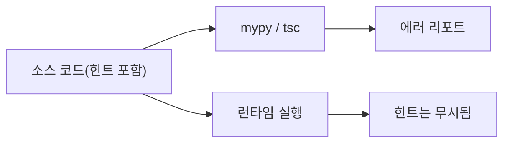

타입 얘기만 나오면 같은 말이 반복된다. 동적 언어는 타입이 없고, 타입 힌트를 달면 검사가 되고, 정적 타입이면 타입 버그는 끝이라는 말이다. 셋 다 반쯤만 맞아서 더 위험하다. 파이썬 3.12.13, mypy 2.4.1, Node 22, TypeScript 7.0.2로 직접 돌려 봤다.

> 타입은 변수가 아니라 값이 들고 있고, 동적 언어에도 타입은 있다. 달라지는 건 검사하는 시점이다.
> 타입 힌트는 실행 중에 아무 일도 하지 않는다. 검사는 mypy나 tsc 같은 별도 도구가 소스를 읽고 한다.
> 정적 검사는 코드 안쪽만 보장한다. JSON 파싱, 캐스트, 공변 배열처럼 경계에서는 통과하고도 런타임에 터진다.

## 정적과 동적은 무엇이 다른가

먼저 축을 정리한다. 정적/동적은 타입 검사를 실행 전에 하느냐 실행 중에 하느냐의 차이다. 타입이 있느냐 없느냐의 차이가 아니다.

비유하자면 공항 보안검색과 기내 승무원 점검이다. 정적은 탑승 전에 가방을 전부 열어 보고, 동적은 비행 중에 문제가 생겼을 때 대처한다. 동적 쪽도 검사는 한다. 다만 비행기가 이미 떠 있을 뿐이다.

아래 그림은 검사가 일어나는 시점만 보여 주는 개념도다. 실제 수치는 아니다. 왼쪽에서 오른쪽이 시간 순서고, 점선 위치가 검사 시점이다.

개념도(실제 수치 아님)

<svg viewBox="0 0 680 190" xmlns="http://www.w3.org/2000/svg" style="background:transparent">
<defs><marker id="a" markerWidth="8" markerHeight="8" refX="7" refY="4" orient="auto"><path d="M0,0 L8,4 L0,8 z" fill="#6b4f3a"/></marker></defs>
<rect x="20" y="30" width="150" height="50" rx="8" fill="none" stroke="#c9a37a" stroke-width="2"/>
<text x="95" y="60" font-size="15" text-anchor="middle" fill="#7a6a58">소스 코드</text>
<rect x="260" y="30" width="150" height="50" rx="8" fill="none" stroke="#c9a37a" stroke-width="2"/>
<text x="335" y="60" font-size="15" text-anchor="middle" fill="#7a6a58">실행 시작</text>
<rect x="500" y="30" width="160" height="50" rx="8" fill="none" stroke="#c9a37a" stroke-width="2"/>
<text x="580" y="60" font-size="15" text-anchor="middle" fill="#7a6a58">연산 실행 중</text>
<line x1="170" y1="55" x2="258" y2="55" stroke="#6b4f3a" stroke-width="2" marker-end="url(#a)"/>
<line x1="410" y1="55" x2="498" y2="55" stroke="#6b4f3a" stroke-width="2" marker-end="url(#a)"/>
<line x1="215" y1="20" x2="215" y2="160" stroke="#a8683a" stroke-width="2" stroke-dasharray="6 5"/>
<text x="215" y="178" font-size="14" text-anchor="middle" fill="#a8683a">정적 검사: 여기서</text>
<line x1="580" y1="90" x2="580" y2="160" stroke="#d9b98c" stroke-width="2" stroke-dasharray="6 5"/>
<text x="580" y="178" font-size="14" text-anchor="middle" fill="#7a6a58">동적 검사: 연산할 때마다</text>
</svg>

## 오해 1. 동적 언어에는 타입이 없다

파이썬에서 변수에 정수를 넣었다가 문자열로 바꿨다. 그다음 `"1" + 1`을 실행했다.

직접 돌려보니 이렇게 나왔다.

```text
3.12.13
<class 'str'>
TypeError: can only concatenate str (not "int") to str
2 [1, 1, 1]
```

변수 `x`는 타입이 없다. 하지만 값 `"now a string"`은 `str`이라는 걸 알고 있다. 그래서 `"1" + 1`이 거부된다. 이름(변수)에 타입이 붙어 있는지, 값에 붙어 있는지가 정적/동적을 가르는 직관적인 기준이다. 동적 언어는 값에 붙는다.

여기서 흔히 섞이는 게 강한 타입/약한 타입이다. 같은 연산을 자바스크립트에서 돌려 봤다.

```text
11 12 [object Object] 1,21 1 NaN
```

`"1" + 1`은 `"11"`이고, `"3" * "4"`는 `12`, `[] + {}`는 `[object Object]`, `null + 1`은 `1`, `undefined + 1`은 `NaN`이다. 에러가 하나도 없다. 파이썬과 자바스크립트는 둘 다 동적이지만 타입이 안 맞을 때 거부하느냐 알아서 바꿔 주느냐가 다르다. 이건 동적/정적과 별개의 축이다.

그럼 `True + 1`이 파이썬에서 `2`인 건 뭐냐는 의문이 든다. `bool`이 `int`의 서브클래스라서 언어가 정한 규칙대로 도는 것이다. 암묵 변환이라기보다 타입 관계의 문제다.

| 구분 | 검사 시점 | 안 맞을 때 | 대표 예 |
|---|---|---|---|
| 정적 + 강함 | 컴파일 전 | 컴파일 에러 | Rust, Java |
| 동적 + 강함 | 연산 시 | 예외 | Python |
| 동적 + 약함 | 연산 시 | 조용히 변환 | JavaScript |

표는 두 축을 따로 읽는다. 가로로 보면 시점이고, 행마다 안 맞을 때 얼마나 엄격한지가 다르다.

## 오해 2. 타입 힌트를 달면 검사된다

파이썬 힌트로 `list[int]`를 받는 함수를 만들고 문자열 리스트를 넘겼다.

```python
def total(prices: list[int]) -> int:
    return sum(prices)

try:
    print(total(["a", "b"]))
except TypeError as e:
    print("runtime:", e)
print(total([1.5, 2.5]))   # float도 그냥 돈다
```

직접 돌려보니 이렇게 나왔다.

```text
runtime: unsupported operand type(s) for +: 'int' and 'str'
4.0
```

- 첫 번째 에러는 힌트 때문이 아니다. `sum`이 `0 + "a"`를 하다가 터진 것이다. 힌트가 막은 게 아니다.
- 두 번째는 반환 힌트가 `int`인데 `4.0`이 그대로 나온다. 런타임은 힌트를 읽지도 않는다.

같은 파일을 mypy에 넣으면 이렇게 나온다.

```text
m2.py:6: error: List item 0 has incompatible type "str"; expected "int"  [list-item]
m2.py:6: error: List item 1 has incompatible type "str"; expected "int"  [list-item]
m2.py:9: error: List item 0 has incompatible type "float"; expected "int"  [list-item]
m2.py:9: error: List item 1 has incompatible type "float"; expected "int"  [list-item]
Found 4 errors in 1 file (checked 1 source file)
```

실행은 되는 코드에서 에러가 네 개 나왔다. 그러니까 파이썬은 동적 언어에 선택적 정적 검사기를 얹어 쓰는 구조다. 힌트는 주석에 가깝고, 검사는 CI에서 mypy를 돌려야 생긴다. 안 돌리면 힌트는 장식이다.

내 판단은 이렇다. 파이썬 프로젝트에 힌트를 달 거면 CI에 타입 체커를 반드시 넣겠다. 안 넣을 거면 달지 않는 게 낫다. 검사 안 되는 힌트는 틀린 문서가 되고, 틀린 문서는 문서가 없는 것보다 나쁘다.



그림은 같은 소스가 두 갈래로 간다는 뜻이다. 위쪽 갈래만 힌트를 읽고, 아래쪽 실행 갈래는 힌트를 버린다.

## 오해 3. 정적 타입이면 타입 버그는 끝이다

이게 제일 중요하다. 파이썬에서 `Any`를 통해 JSON을 받았다.

```python
import json
from typing import Any

def load() -> Any:
    return json.loads('{"ids": [1, 2, "3"]}')

def first_sum(ids: list[int]) -> int:
    return sum(ids)

data = load()
try:
    print(first_sum(data["ids"]))
except TypeError as e:
    print("runtime:", e)
```

mypy 결과는 이 부분에서 에러가 0개였다. 실행하면 이렇게 나온다.

```text
runtime: unsupported operand type(s) for +: 'int' and 'str'
```

`Any`는 검사기에게 "여기부터는 묻지 마"라는 뜻이다. 그래서 `data["ids"]`가 `list[int]`로 흘러 들어가도 통과한다. 파이썬만의 문제가 아니라 TypeScript도 똑같다. 이쪽이 더 놀라웠다.

```ts
interface User { id: number; name: string }
const raw = '{"id": "42", "name": "kim"}';
const u = JSON.parse(raw) as User;      // 검사 없는 주장
console.log(typeof u.id, u.id + 1);
const arr: number[] = [1, 2, 3];
const objs: (number | string)[] = arr;  // 배열 공변을 허용
objs.push("x");
console.log(arr, arr.map(n => n.toFixed(1)).length);
```

`tsc --strict`로 컴파일하면 종료 코드가 0이었다. 에러도 경고도 없다. 그리고 컴파일된 JS를 실행하니 이렇게 나왔다.

```text
string 421
TypeError: n.toFixed is not a function
```

- `as User`는 검사가 아니라 "내가 책임진다"는 선언이다. `id`가 `"42"`인데 타입은 `number`라고 믿고 있으니 `u.id + 1`이 `"421"`이 된다.
- `number[]`를 `(number | string)[]`에 넣는 건 TS가 허용한다. 그다음 `push("x")`가 원본 배열에 문자열을 넣었고, `toFixed`에서 터졌다.

같은 모양을 파이썬 mypy에 시켜 보면 반응이 다르다. `list[int]`를 `list[object]`에 대입하는 줄에서 이렇게 막는다.

```text
m3.py:17: error: Incompatible types in assignment (expression has type "list[int]", variable has type "list[object]")  [assignment]
m3.py:17: note: "list" is invariant -- see https://mypy.readthedocs.io/en/stable/common_issues.html#variance
```

mypy는 막고 TS는 안 막는다. 의도적인 차이다. TS는 건전성보다 기존 JS 코드를 편하게 타입 붙이는 쪽을 택했다고 알려져 있다. 같은 "정적 타입"이어도 검사기마다 엄격도가 다르다. 정적이라는 말 하나로 보장 수준을 알 수는 없다.

"그럼 Rust나 Java는 안전하냐"는 의문이 따라온다. 완전히 같지는 않다. 컴파일러가 증명하는 범위가 더 넓고 캐스트 지점이 명시적이어서 구멍 위치가 보이기는 한다. 그래도 외부에서 들어오는 바이트를 타입으로 바꾸는 경계는 어느 언어든 검사 코드를 짜야 한다. 이 부분은 직접 돌려 보지 않았으니 단정은 하지 않는다.

## 어떤 걸 고르겠나

내 선택은 이렇다. 팀이 둘 이상이고 코드가 몇 달 이상 살 거면 정적 타입 쪽을 고른다. 이유는 오류 방지보다 리팩터링 때문이다. 함수 시그니처를 바꿨을 때 호출부를 도구가 다 찾아 준다.

반대로 고르는 경우도 있다. 하루 이틀 쓰고 버릴 스크립트, 데이터 탐색 노트북, 입력 모양이 계속 바뀌는 프로토타입은 동적이 낫다. 타입 선언에 드는 시간이 얻는 것보다 크다.

그리고 어느 쪽이든 경계에는 런타임 검증을 둔다. 외부 JSON을 받는 지점에서는 `as`나 `Any`로 넘기지 않고 값을 하나씩 확인하거나 검증 라이브러리를 쓴다. 정적 검사는 그 안쪽 코드를 믿을 수 있게 해 줄 뿐이다. 위에서 돌린 TS 예제가 그걸 보여 준다. 컴파일은 통과했고 문자열 `"42"`는 `number` 자리에 앉아 있었다.

타입은 값이 들고 다니고, 검사기는 소스만 읽는다. 둘 사이 이음새가 경계이고, 장애는 대부분 거기서 난다.

---

*CS 기초 시리즈: 프로그래밍언어*
