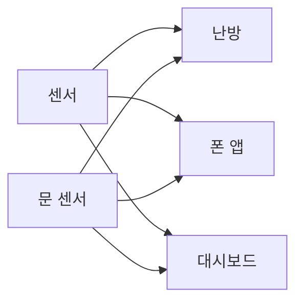
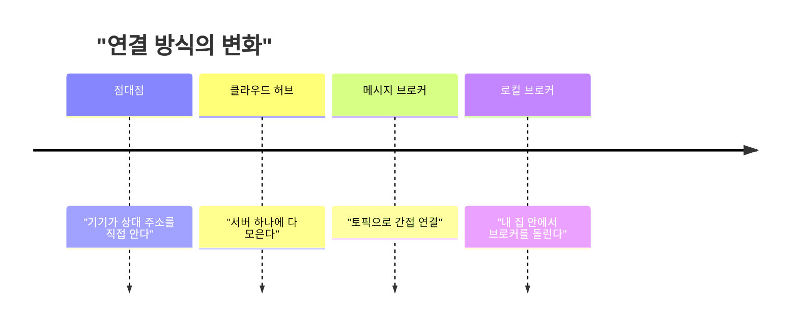

스마트홈을 로컬로 돌린다는 글이 떴는데, 사람들이 로컬 얘기만 하고 정작 그 로컬을 떠받치는 MQTT는 대충 안다고 착각하더라. 그래서 브로커를 30줄짜리로 직접 만들어서 오해 세 개를 돌려봤다.

> 구독자가 없을 때 발행한 메시지는 그냥 사라진다. 브로커는 기본적으로 우체통이 아니라 확성기다.
> 토픽은 폴더가 아니라 슬래시로 나눈 문자열이고, 와일드카드는 레벨 단위로만 동작한다.
> 발행자는 누가 받았는지 모른다. 이게 결합도를 끊어 주는 대신 "전달됐나?"라는 질문을 포기하게 만든다.

## 이 기술이 없던 시대

원래 기기끼리 통신은 점대점이었다. 온도 센서가 있으면 센서가 난방 컨트롤러 주소를 알고 직접 연결해서 값을 보냈다. 기기가 둘이면 선이 한 개다. 다섯이면 최대 열 개고, 열이면 마흔다섯 개다.

그래서 사람들이 한 일은 두 가지다. 하나는 기기마다 자기 클라우드 서버를 두고 거기에 다 올리는 것이다. 편하지만 그 서버가 죽으면 집이 멍청해진다. 다른 하나는 기기마다 폴링하는 것이다. "지금 몇 도냐" 하고 몇 초마다 물어보는 방식이다. 전력도 먹고 트래픽도 먹는다.

오늘 HN에 올라온 글의 필자는 Nest 연동이 구글이 API를 바꾸면서 깨졌다고 한다. 점대점에 클라우드까지 끼면 이렇게 된다. 상대 주소와 규격을 내가 통제하지 못한다.



위 그림은 점대점 방식이다. 읽는 법은 간단하다. 센서와 받는 쪽이 늘 때마다 화살표가 곱으로 늘어난다.

## 그때 방식으로 직접 만들어 보기

먼저 흔한 오해 세 개를 적는다. 하나씩 코드로 확인할 거다.

- 오해 1: 브로커가 메시지를 받아 두니까 나중에 켠 기기도 받는다.
- 오해 2: `#`는 "전부"니까 어디에 붙여도 다 잡힌다.
- 오해 3: 발행에 성공하면 누군가는 받은 거다.

MQTT 서버(mosquitto)는 이 머신에 없어서 못 돌렸다. 대신 표준 라이브러리만으로 의미만 흉내 낸 토이 브로커를 만들었다. 네트워크도 QoS도 없는 순수 토픽 매칭과 retain 로직이다. 환경은 Python 3.9.6이다.

```python
# Python 3.9, stdlib only
def match(flt, topic):
    f, t = flt.split("/"), topic.split("/")
    for i, p in enumerate(f):
        if p == "#": return True
        if i >= len(t) or (p != "+" and p != t[i]): return False
    return len(f) == len(t)

class Broker:
    def __init__(self): self.subs, self.retained = [], {}
    def subscribe(self, flt, cb):
        self.subs.append((flt, cb))
        for t, m in self.retained.items():
            if match(flt, t): cb(t, m)
    def publish(self, topic, msg, retain=False):
        if retain: self.retained[topic] = msg
        n = 0
        for flt, cb in self.subs:
            if match(flt, topic): cb(topic, msg); n += 1
        return n
```

이걸 돌리는 쪽은 이렇다.

```python
b = Broker()
print("구독자 0명일 때 전달 수:", b.publish("home/garage/door", "open"))
b.subscribe("home/garage/door", lambda t, m: print("  늦게 온 폰이 받음:", t, m))
b.publish("home/garage/door", "closed", retain=True)
b.subscribe("home/garage/#", lambda t, m: print("  새 구독자(retain):", t, m))
for flt, t in [("home/+/temp","home/kitchen/temp"),("home/+/temp","home/kitchen/oven/temp"),
               ("home/#","home"),("home/#","homely/x"),("#","$SYS/uptime")]:
    print(flt, t, match(flt, t))
```

직접 돌려보니 출력은 이랬다.

```text
구독자 0명일 때 전달 수: 0
  늦게 온 폰이 받음: home/garage/door closed
  새 구독자(retain): home/garage/door closed
home/+/temp home/kitchen/temp True
home/+/temp home/kitchen/oven/temp False
home/# home True
home/# homely/x False
# $SYS/uptime True
```

여기서 아픈 지점은 이렇다.

- 첫 줄이 오해 1의 답이다. 구독자가 없을 때 낸 `open`은 전달 수 0으로 끝났고 어디에도 안 남았다. 뒤의 구독자는 `open`을 못 봤다.
- 폰이 받은 `closed`는 `retain=True`로 냈기 때문에 받은 거다. 브로커가 "마지막 값 하나"만 따로 들고 있다가 새 구독자에게 준다. 이력이 아니라 최신 상태 한 칸이다.
- 마지막 줄은 내 토이가 틀린 부분이다. 실제 MQTT 스펙은 `#` 단독 구독이 `$`로 시작하는 토픽(`$SYS` 등)을 잡지 않게 되어 있다고 알고 있다. 내 코드는 그걸 구현하지 않아서 True가 나왔다. 토이와 진짜가 갈라지는 지점이다.

## 그래서 어떻게 진화했나

오해 2부터 풀자. `home/#`가 `home`도 잡고 `homely/x`는 안 잡았다. 토픽이 문자열 접두어가 아니라 슬래시로 쪼갠 레벨로 비교되기 때문이다. `+`는 정확히 한 레벨만 대신한다. 그래서 `home/+/temp`가 `home/kitchen/oven/temp`를 못 잡는다. 폴더처럼 보여도 폴더가 아니다.

그럼 왜 이런 구조로 갔을까. 단계로 보면 이렇다.



위 그림은 발전 순서다. 읽는 법은 위에서 아래로, 상대를 아는 정도가 점점 줄어든다.

1단계, 점대점이다. 불편은 기기가 늘수록 연결이 폭발하는 것이다. 해법은 중앙 서버였다. 새로 생긴 문제는 그 서버가 남의 소유라는 점이다.

2단계, 벤더 클라우드다. 불편은 서버가 죽거나 API가 바뀌면 집이 멈추는 것이다. 필자의 삼성 냉장고가 자기 화면에 TLS 인증서 오류를 띄운 게 이 단계의 증상이다. 해법은 가운데 브로커를 두고 기기들은 토픽만 알게 하는 것이다.

3단계, pub/sub이다. 불편은 상대를 몰라도 되게 만들었더니 이번엔 "받았는지"를 알 수 없다는 것이다. 이게 오해 3이다. 위 실행에서 발행 함수가 돌려준 0은 내가 일부러 세어서 본 값이다. 진짜 MQTT 발행자는 이런 숫자를 받지 않는다. QoS 1이나 2를 써도 확인 대상은 브로커가 받았느냐지, 구독자가 처리했느냐가 아니다. 이걸 모르고 "발행 성공 = 불이 켜짐"이라고 믿으면 로직이 깨진다.

이게 왜 위험한지는 구체적이다. 문 센서가 `open`을 내보냈는데 대시보드가 재시작 중이었다면 그 이벤트는 증발한다. 그래서 상태는 retain으로, 이벤트는 구독 쪽 재동기화로 나눠 설계해야 한다.

마지막 칸의 대비를 표로 정리하면 이렇다.

| 시대 | 방식 | 장점 | 한계 |
|---|---|---|---|
| 점대점 | 기기가 서로 주소를 안다 | 단순하다 | 연결이 곱으로 는다 |
| 벤더 클라우드 | 앱과 서버를 거친다 | 설치가 쉽다 | 서버나 API가 바뀌면 죽는다 |
| 브로커 pub/sub | 토픽으로 간접 연결 | 기기 추가가 싸다 | 전달 확인과 순서를 직접 챙겨야 한다 |
| 로컬 브로커 | 내 장비에서 브로커를 돌린다 | 인터넷이 끊겨도 동작한다 | 운영과 백업이 내 몫이다 |

표는 세대별 비교다. 읽는 법은 위에서 아래로 갈수록 통제권이 나한테 오고, 책임도 같이 온다.

## 지금은 어떤가

오늘의 글 필자는 Tasmota를 올린 ESP 보드, MQTT 브로커, Node-RED를 라즈베리파이에서 돌린다. 규칙 1번은 "인터넷을 뽑아도 집이 돌아가야 한다"이다. 규칙 중에 "기기끼리는 점대점이 아니라 MQTT pub/sub으로 말하게 한다"도 있다. 방향에 동의한다.

아래 그림은 구조 차이를 개념도로 그린 거다. 개념도(실제 수치 아님)이고, 읽는 법은 왼쪽은 인터넷이 끊기면 전부 끊기고 오른쪽은 안쪽 박스만 남아도 돈다는 뜻이다.

<svg viewBox="0 0 640 220" xmlns="http://www.w3.org/2000/svg">
<rect x="20" y="20" width="280" height="180" fill="none" stroke="#c9a37a" stroke-width="2"/>
<text x="160" y="45" text-anchor="middle" font-size="14" fill="#7a6a58">클라우드 의존</text>
<rect x="110" y="60" width="100" height="36" fill="#d9b98c"/>
<text x="160" y="83" text-anchor="middle" font-size="13" fill="#6b4f3a">벤더 서버</text>
<rect x="40" y="140" width="80" height="36" fill="none" stroke="#a8683a"/>
<text x="80" y="163" text-anchor="middle" font-size="13" fill="#7a6a58">센서</text>
<rect x="200" y="140" width="80" height="36" fill="none" stroke="#a8683a"/>
<text x="240" y="163" text-anchor="middle" font-size="13" fill="#7a6a58">조명</text>
<line x1="80" y1="140" x2="140" y2="96" stroke="#a8683a" stroke-width="2"/>
<line x1="240" y1="140" x2="180" y2="96" stroke="#a8683a" stroke-width="2"/>
<rect x="340" y="20" width="280" height="180" fill="none" stroke="#c9a37a" stroke-width="2"/>
<text x="480" y="45" text-anchor="middle" font-size="14" fill="#7a6a58">로컬 브로커</text>
<rect x="430" y="60" width="100" height="36" fill="#a8683a"/>
<text x="480" y="83" text-anchor="middle" font-size="13" fill="#ffffff">MQTT 브로커</text>
<rect x="360" y="140" width="80" height="36" fill="none" stroke="#6b4f3a"/>
<text x="400" y="163" text-anchor="middle" font-size="13" fill="#7a6a58">센서</text>
<rect x="520" y="140" width="80" height="36" fill="none" stroke="#6b4f3a"/>
<text x="560" y="163" text-anchor="middle" font-size="13" fill="#7a6a58">조명</text>
<line x1="400" y1="140" x2="460" y2="96" stroke="#6b4f3a" stroke-width="2"/>
<line x1="560" y1="140" x2="500" y2="96" stroke="#6b4f3a" stroke-width="2"/>
</svg>

내 판단은 이렇다. 새로 시작하면 로컬 브로커를 먼저 고른다. 설치도 쉽고 인터넷이 끊겨도 돌아가기 때문이다. 다만 단서가 있다. 브로커를 하나 두는 순간 그게 새 단일 장애점이 된다. 필자가 파이 한 대에 다 올린 걸 보면 그 위험은 감수한 거다. 나라면 브로커 설정 파일과 retain 상태를 백업하는 것부터 한다.

반대로 고르는 경우도 있다. 기기가 서너 개고 한 방 안에서 끝나는 용도라면 브로커를 세우는 건 과하다. 그럴 땐 제조사 앱을 쓰되 규칙 1번을 지켜서, 벽 스위치 같은 물리적 수단은 남겨 둔다.

댓글에서 Home Assistant의 "IoT Class" 분류를 언급하던데, 구매 전에 Local Push 쪽인지 확인하는 기준으로 쓰기 좋다. 실제로 쓰는 사람이 있다는 건 이 기준이 현실에서 먹힌다는 뜻이다. 한 가지 더. 토이를 돌려서 알게 된 건, 편한 건 "받아 둔다"가 아니라 "받을 사람이 없어도 발행자는 신경 안 쓴다"는 점이고, 그 대가로 전달 확인은 내가 설계해야 한다는 거다.

---

*원문: [Smart home devices should work without the internet](https://docodethatmatters.com/home-automation-overnight-success/) (via hn)*
