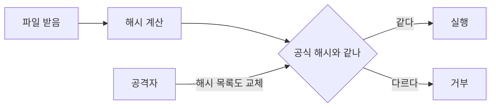
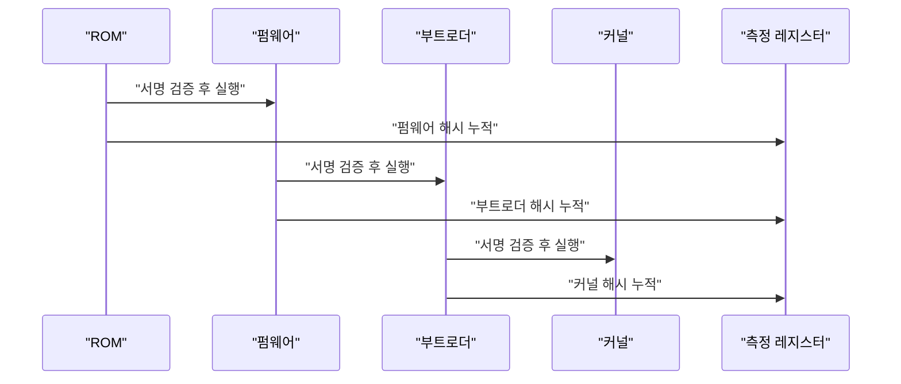

CEO 하나 날아간 걸로 시끄러운 와중에, 댓글 맨 아래에 제일 중요한 얘기가 숨어 있었다. GPU 펌웨어가 "서명 안 된 모델은 추론 못 돌리게" 막는 세계가 오면 어쩌냐는 걱정이다. 이걸 이해하려면 "이 파일을 실행해도 되는지 누가 정하냐"의 뿌리를 알아야 한다.

> - 파일이 안 바뀌었다는 증명은 해시로 되지만, 해시를 누가 줬는지는 해시가 증명 못 한다.
> - 서명은 "누가 줬는지"를 붙이고, 측정 부팅은 "무슨 순서로 올라왔는지"를 붙인다.
> - 모델 가중치에 이걸 하드웨어 레벨로 강제하는 순간, 소프트웨어 취향 문제가 아니라 누가 문지기냐의 문제가 된다.

원문은 사실 CEO 사퇴와 수출 통제 얘기다. 그건 내가 확인할 수 있는 영역이 아니라서 건드리지 않는다. 댓글에서 가져온 건 "실행 통제를 하드웨어가 강제하면 어떻게 되냐"는 질문 하나뿐이고, 그건 내가 직접 돌려볼 수 있다. 선배가 후배한테 던지는 질문 세 개로 간다.

## 질문 1. 파일이 멀쩡한지 어떻게 아냐

처음엔 다들 그냥 믿었다. 플로피로 받은 프로그램이든 FTP로 받은 tarball이든, 깨졌으면 실행이 안 되겠거니 하고 돌렸다. 깨진 건 그나마 다행이다. 조용히 바뀐 건 아무도 모른다.

그래서 나온 게 체크섬이다. 처음엔 CRC 같은 가벼운 걸 썼는데, 이건 전송 중 비트가 튀는 사고를 잡으려는 거지 누가 일부러 바꾸는 걸 막으려는 게 아니다. 악의적인 사람은 체크섬이 맞게 내용을 맞춰 바꿀 수 있다. 그래서 암호학적 해시가 등장한다. 내용을 조금만 바꿔도 결과가 완전히 달라지고, 결과가 같은 다른 내용을 일부러 만들기가 사실상 불가능하다는 성질이 핵심이다.

"그럼 해시면 끝 아니냐"는 의문이 나온다. 직접 확인해 보자. 1MB짜리 랜덤 파일을 가중치 파일인 척 만들고, 딱 1비트만 뒤집어서 SHA-256을 비교했다.

직접 돌려보니 이랬다.

```text
원본     d580735441defdd6cfe18f4dbc7eea7d
1비트 변조 e750348db8f0806fbe91eaef6114ae51
해시 256비트 중 달라진 비트: 124
변조본 통과? True
```

1비트 바꿨는데 해시는 256비트 중 124비트가 달라졌다. 절반 근처다. 이게 "눈사태 효과"다. 해시를 비교하면 1비트 변조도 놓치지 않는다.

그런데 마지막 줄을 봐라. `변조본 통과? True`. 내가 일부러 짠 시나리오다. 파일만 바꾼 게 아니라 "공식 해시 목록"까지 같이 바꿨다. 그러면 로더는 변조본을 정품으로 믿는다. 해시는 "내용이 이 값과 같다"만 말해 주고, 이 값을 누가 줬는지는 모른다. 여기서 예상 못 한 건 없었고, 오히려 너무 당연해서 허무했다. 허무한 게 포인트다. 해시만으로는 신뢰가 안 생긴다.



위에서 아래로가 아니라 왼쪽에서 오른쪽으로 읽는다. 공격자 화살표가 "공식 해시"를 바꿔 버리면 비교 단계가 의미를 잃는다.

## 질문 2. 그럼 해시를 누가 줬는지는 어떻게 증명하냐

여기서 나온 게 디지털 서명이다. 개발자가 비밀키로 해시에 서명하고, 사용자는 공개키로 검증한다. 공개키는 누구나 알아도 되고 비밀키는 개발자만 갖고 있다. 변조범은 파일을 바꿀 수 있어도 그 변조본에 맞는 서명을 만들 수 없다.

비유하면 이렇다. 해시는 "택배 상자의 무게를 적어 둔 송장"이고, 서명은 "발송인이 직접 도장을 찍은 송장"이다. 무게가 같아도 도장이 없으면 누가 보냈는지는 모른다.

이번엔 openssl로 RSA 2048 키를 만들어 같은 1MB 파일에 서명하고, 한 바이트를 바꿔서 검증했다. 표준 라이브러리만으로는 서명을 못 짜서 여기선 시스템에 있는 openssl(LibreSSL 3.3.6)을 썼다.

직접 돌려보니 이랬다.

```text
원본:
Verified OK
변조:
Verification Failure
256
```

마지막 256은 서명 파일 크기(바이트)다. 파일이 1MB든 1GB든 서명은 256바이트다. 서명은 파일 전체가 아니라 해시에 하는 거라서 그렇다. 이걸 보고 "서명이 이렇게 작았나" 싶었는데, 설계상 당연한 결과였다.

"그럼 개발자 키가 털리면?" 이 질문이 다음 단계를 부른다. 서명 체계의 약점은 알고리즘이 아니라 키 관리다. 키가 유출되면 공격자가 정품 도장을 찍을 수 있다. 그래서 인증서 폐기, 키 분리 보관, 하드웨어 보안 모듈 같은 게 붙었다. 이 얘기는 이전에 쓴 인증서 취소 글에서 다뤘으니 여기선 넘어간다.

| 시대 | 방식 | 장점 | 한계 |
|---|---|---|---|
| 초기 | 그냥 실행 | 단순 | 변조를 알 방법이 없음 |
| 체크섬 | CRC 등 | 전송 오류 감지 | 의도적 변조에 무력 |
| 암호 해시 | SHA 계열 | 변조 탐지 | 해시를 준 사람은 모름 |
| 서명 | 비밀키 서명 + 공개키 검증 | 출처와 무결성 증명 | 키 관리가 곧 약점 |

표는 위에서 아래로 시간 순서다. 오른쪽 열이 다음 행의 등장 이유다.

## 질문 3. 파일이 정품이어도 올라오는 순서가 이상하면?

서명은 파일 하나를 검증한다. 그런데 컴퓨터가 켜질 때는 펌웨어, 부트로더, 커널, 드라이버가 차례로 올라온다. 맨 앞 단계가 오염되면 뒤의 모든 검증이 거짓말에 속는다. 검사원이 범인이면 검사가 의미 없다.

그래서 나온 게 신뢰 사슬이다. 맨 앞 코드는 바꿀 수 없는 ROM에 박아 두고, 그게 다음 단계를 검증하고, 다음 단계가 그다음을 검증한다. 여기에 측정 부팅이 붙는다. 각 단계의 해시를 레지스터에 "누적"해서 기록한다. 새 값 = 해시(이전 값 + 이번 단계 해시) 방식이다.

"그냥 목록으로 적어 두면 안 되냐"는 의문이 나온다. 목록은 나중에 지우거나 고칠 수 있다. 누적 방식은 한 번 쌓이면 되돌릴 수 없다. 이게 정말 그런지 토이로 확인했다. 레지스터 초기값은 0이고, 네 단계를 차례로 extend 한다.

직접 돌려보니 이랬다.

```text
정상       de7ca199f300de9dbbb2ba29
순서 바꿈  ea275f92c52bc46c9e9ec694
한 단계 변조 823601176bd0787de36c1318
단계 하나 생략 0748b1c8ca7fabd3533749e2
덮어쓰기 시도 3e66fc351412aba2b788bd7a
```

네 가지 변조 전부 값이 다르다. 파일 내용뿐 아니라 순서와 누락도 결과에 반영된다. 마지막 "덮어쓰기 시도"가 가장 재밌다. 변조된 커널을 올린 다음, 정상 커널과 드라이버를 이어서 올려 정상인 척 돌아가 보려 했다. 값은 정상과 다르다. 지나간 과거는 지울 수 없다. 이게 목록과 누적의 차이다.



위에서 아래로 시간이 흐른다. 실행 화살표는 앞 단계가 뒤 단계에게 건네는 것이고, 레지스터로 가는 화살표는 기록이다.

아래 그림은 두 방식을 한 장에 놓은 것이다. 개념도(실제 수치 아님)다. 왼쪽은 해시 하나만 믿는 구조, 오른쪽은 서명과 누적 측정이 쌓인 구조다. 읽는 법은 위에서 아래로 신뢰의 근거를 따라가면 된다.

<svg viewBox="0 0 640 260" xmlns="http://www.w3.org/2000/svg">
<rect x="20" y="20" width="270" height="220" fill="none" stroke="#c9a37a" stroke-width="2"/>
<text x="155" y="48" text-anchor="middle" font-size="15" fill="#7a6a58">"해시만 믿는 방식"</text>
<rect x="50" y="70" width="210" height="40" fill="#d9b98c"/>
<text x="155" y="95" text-anchor="middle" font-size="13" fill="#6b4f3a">"파일"</text>
<rect x="50" y="130" width="210" height="40" fill="#d9b98c"/>
<text x="155" y="155" text-anchor="middle" font-size="13" fill="#6b4f3a">"해시 목록 (누가 줬는지 모름)"</text>
<text x="155" y="205" text-anchor="middle" font-size="12" fill="#a8683a">"목록이 바뀌면 끝"</text>
<rect x="330" y="20" width="290" height="220" fill="none" stroke="#a8683a" stroke-width="2"/>
<text x="475" y="48" text-anchor="middle" font-size="15" fill="#7a6a58">"서명 + 측정 부팅"</text>
<rect x="360" y="70" width="230" height="30" fill="#a8683a"/>
<text x="475" y="90" text-anchor="middle" font-size="13" fill="#ffffff">"ROM (고정)"</text>
<rect x="360" y="110" width="230" height="30" fill="#c9a37a"/>
<text x="475" y="130" text-anchor="middle" font-size="13" fill="#6b4f3a">"서명 검증 단계들"</text>
<rect x="360" y="150" width="230" height="30" fill="#d9b98c"/>
<text x="475" y="170" text-anchor="middle" font-size="13" fill="#6b4f3a">"누적 기록 (지울 수 없음)"</text>
<text x="475" y="212" text-anchor="middle" font-size="12" fill="#a8683a">"뿌리는 바꿀 수 없는 코드"</text>
</svg>

## 지금은 이렇다, 그리고 내 생각

이제 댓글의 걱정으로 돌아간다. 이 사슬을 CPU 부팅에서 GPU 펌웨어까지 늘리고, 거기에 "서명된 모델만 추론"을 얹으면 기술적으로는 가능하다. 위에서 직접 돌린 해시, 서명, 누적 측정이 전부 재료다. 새 발명이 필요 없다는 게 오히려 무섭다. 다만 댓글이 말하는 "그런 계획이 실제로 진행 중인지"는 나도 확인 못 했다. 원문에서 내가 검증할 수 있는 건 여기까지다.

내 판단은 이렇다. 부팅 무결성은 켜라. 서버 펌웨어가 남의 손에 오염되는 걸 막는 건 이득이 압도적이다. 반대로 "어떤 모델을 돌려도 되는지"를 하드웨어 서명으로 강제하는 건 반대다. 이유는 기술이 아니라 구조다. 서명 체계는 키를 쥔 쪽이 문지기가 된다. 보안 부팅이 쓸모 있는 이유는 내 기계를 내가 검증할 수 있어서인데, 모델 서명은 내 기계에서 남이 허가를 내주는 구조가 된다.

예외는 있다. 규제 산업이나 내가 직접 서명 키를 관리하는 폐쇄 환경이라면, 허용된 모델만 돌리는 정책은 꽤 좋은 보안 장치다. 같은 기술인데 키를 누가 쥐느냐로 보호막이 되기도 하고 족쇄가 되기도 한다.

선택지를 비교하면 이렇다. 해시만 쓰면 싸고 간단하지만 출처를 보장 못 한다. 서명을 쓰면 출처는 잡히지만 키 관리가 숙제다. 측정 부팅까지 쓰면 가장 강하지만 설정이 번거롭고 장비가 받쳐 줘야 한다. 나라면 내 서비스엔 서명까지, 내 서버 부팅엔 측정까지 쓰고, 모델 파일에는 내가 키를 쥔 서명만 쓴다.

사람이 CEO로 바뀌든 말든 해시는 똑같이 계산된다. 달라지는 건 그 해시에 도장을 찍을 손이 누구냐다.

---

*원문: [Jensen Huang resigns](https://apnews.com/article/nvidia-megaspeed-china-singapore-huang-5403f152a601cf82ce939f1d24fffa0f) (via hn)*
