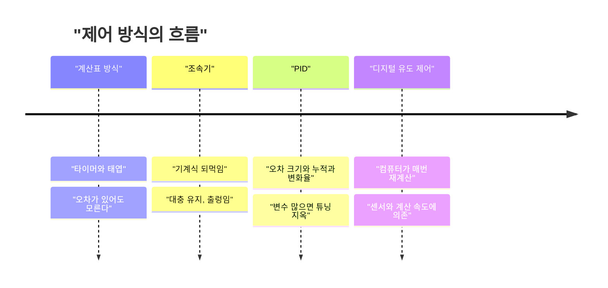

로켓 상단을 공중에서 잡았다는 소식에 다들 열광하는데, 나는 "그걸 어떻게 안 놓치고 맞추냐"가 더 궁금했다. 답은 거의 항상 같다. 계산을 잘해서가 아니라, 계산을 계속 다시 해서다.

> 미리 계산해 둔 추력표대로만 태우는 방식은 오차 1%에도 무너진다. 직접 돌려보니 한쪽은 허공에서 멈추고 한쪽은 17m/s로 땅에 꽂혔다.
> 지금 재서 지금 고치는 방식(피드백)은 오차 10%에도 착지 속도가 3m/s 근처였다.
> 그런데 피드백도 만능이 아니다. 센서와 추력 한계가 받쳐 줘야 하고, 그게 요즘 착륙 알고리즘이 점점 무거워지는 이유다.

## 계산표만 믿던 시절

피드백이 없던 시대의 기본 사고방식은 "정확히 계산해서 정확히 실행한다"였다. 이걸 개방 루프(open loop)라고 부른다. 타이머로 돌리는 세탁기, 태엽 장치, 정해진 시간만 불을 때는 가마 같은 것들이다.

쉬운 말로 하면 눈 감고 운전하는 거다. 출발 전에 "직진 10초, 우회전, 5초 직진"을 완벽히 계산했다면 이론상 도착한다. 문제는 바람, 타이어 공기압, 도로 경사처럼 계산에 안 들어간 것들이 실제로는 항상 있다는 점이다.

"그럼 계산을 더 정밀하게 하면 되잖아"라는 의문이 나올 거다. 일부는 맞다. 그런데 오차를 0으로 만드는 건 불가능하다. 엔진 추력은 온도에 따라 달라지고, 연료는 타면서 줄고, 대기 밀도는 고도마다 다르다. 정밀도를 올릴수록 비용이 폭증하는데 오차는 어차피 남는다.

그래서 진짜 질문은 "오차를 없애라"가 아니라 "오차가 있어도 망하지 않게 하려면?"이다. 이 질문이 제어 이론의 출발점이다.

## 직접 태워 보기: 1000m에서 떨어뜨리고 계산표대로 점화

착륙을 1차원으로 단순화해서 만들어 봤다. 고도 1000m, 하강 속도 100m/s에서 시작한다. 개방 루프는 "이 고도에서 점화해서 2g 추력으로 태우면 정확히 0/0으로 멈춘다"를 미리 계산해 두고 그대로 실행한다. 피드백 쪽은 매 순간 속도와 고도를 재서 필요한 감속도를 다시 계산하고, 센서 잡음 3%를 일부러 섞었다. Python 3, 표준 라이브러리만 쓴다.

```python
# Python 3, 표준 라이브러리만 사용
import random
g, dt = 9.8, 0.001
H0, V0 = 1000.0, -100.0          # 고도 1000m, 낙하 속도 100m/s
def open_loop(err):               # 미리 계산한 대로만 태운다
    a_net = 2*g - g               # 계획: 추력 가속 2g
    hb = (V0**2 + 2*g*H0) / (2*(a_net + g))   # 점화 고도
    h, v = H0, V0
    while h > 0:
        v += (-g + (2*g*(1+err) if h <= hb else 0)) * dt
        h += v * dt
        if v >= 0: break          # 땅에 닿기 전에 떠버림
    return h, v
def feedback(err):                # 매 순간 재서 다시 계산
    h, v = H0, V0
    while h > 0:
        want = v*v / (2*max(h, 0.5)) + g
        a = min(want, 3*g) if v < -2 or h > 20 else 0.9*g
        a *= (1+err) * (1 + random.gauss(0, 0.03))   # 오차 + 센서 잡음 3%
        v += (a - g) * dt
        h += v * dt
        if v >= 0: break
    return h, v
random.seed(1)
for e in (0, .01, .05, -.01, -.05):
    print(f"open err={e:+.0%} h={open_loop(e)[0]:6.1f}m v={open_loop(e)[1]:7.2f}")
for e in (0, .05, -.05, -.10):
    h, v = feedback(e); print(f"fb   err={e:+.0%} h={h:6.1f}m v={v:7.2f}")
```

직접 돌려보니 이렇게 나왔다. err는 엔진 추력이 계획보다 몇 % 세거나 약했는지다.

```text
open err=+0% h=  -0.0m v=  -0.60
open err=+1% h=  14.8m v=   0.00
open err=+5% h=  68.6m v=   0.01
open err=-1% h=  -0.0m v= -17.21
open err=-5% h=  -0.0m v= -38.48
fb   err=+0% h=  -0.0m v=  -2.00
fb   err=+5% h=  -0.0m v=  -2.00
fb   err=-5% h=  -0.0m v= -2.21
fb   err=-10% h=  -0.0m v= -3.17
```

여기서 아픈 지점이 있다.

- 추력이 1%만 약해도 17m/s로 땅에 닿는다. 사람이 높은 데서 뛰어내리는 속도다. 1% 오차가 이 정도 결과로 증폭될 줄은 나도 몰랐다.
- 오차가 반대로 +1%면 고도 14.8m에서 속도가 0이 돼 허공에 뜬다. 땅에 안 닿았으니 "성공"이 아니다. 실제 로켓이면 연료만 태우고 착륙을 못 한 거다.
- 오차 0%인데도 -0.60m/s가 나왔다. 시뮬레이션 시간 간격(dt)이 0.001초라서 생긴 계산 오차다. 계산이 완벽해도 이산화 때문에 완벽하지 않다는 걸 보여 주는 작은 증거다.

## 피드백은 어디서 왔나

개방 루프는 왜 이렇게 약할까. 오차가 생겨도 시스템이 그걸 모르기 때문이다. 계산표는 "지금 몇 m인가"를 묻지 않는다. 그래서 오차가 쌓이면 쌓인 채로 끝까지 간다. 아래 그림은 두 방식의 구조 차이다. 위쪽 화살표가 한 방향이면 개방, 아래로 되돌아오는 선이 있으면 피드백이다.

<svg viewBox="0 0 680 260" xmlns="http://www.w3.org/2000/svg">
<text x="20" y="28" font-size="14" fill="#7a6a58" font-family="sans-serif">개념도(실제 수치 아님): 개방 루프</text>
<rect x="20" y="40" width="120" height="44" rx="6" fill="none" stroke="#c9a37a" stroke-width="2"/>
<text x="42" y="67" font-size="13" fill="#7a6a58" font-family="sans-serif">계산표</text>
<rect x="260" y="40" width="120" height="44" rx="6" fill="none" stroke="#c9a37a" stroke-width="2"/>
<text x="292" y="67" font-size="13" fill="#7a6a58" font-family="sans-serif">엔진</text>
<rect x="500" y="40" width="120" height="44" rx="6" fill="none" stroke="#c9a37a" stroke-width="2"/>
<text x="535" y="67" font-size="13" fill="#7a6a58" font-family="sans-serif">결과</text>
<line x1="140" y1="62" x2="260" y2="62" stroke="#6b4f3a" stroke-width="2"/>
<line x1="380" y1="62" x2="500" y2="62" stroke="#6b4f3a" stroke-width="2"/>
<text x="20" y="140" font-size="14" fill="#7a6a58" font-family="sans-serif">개념도(실제 수치 아님): 피드백 루프</text>
<rect x="20" y="152" width="120" height="44" rx="6" fill="none" stroke="#a8683a" stroke-width="2"/>
<text x="42" y="179" font-size="13" fill="#7a6a58" font-family="sans-serif">목표와 차이</text>
<rect x="260" y="152" width="120" height="44" rx="6" fill="none" stroke="#a8683a" stroke-width="2"/>
<text x="292" y="179" font-size="13" fill="#7a6a58" font-family="sans-serif">엔진</text>
<rect x="500" y="152" width="120" height="44" rx="6" fill="none" stroke="#a8683a" stroke-width="2"/>
<text x="535" y="179" font-size="13" fill="#7a6a58" font-family="sans-serif">결과</text>
<line x1="140" y1="174" x2="260" y2="174" stroke="#6b4f3a" stroke-width="2"/>
<line x1="380" y1="174" x2="500" y2="174" stroke="#6b4f3a" stroke-width="2"/>
<polyline points="560,196 560,235 80,235 80,196" fill="none" stroke="#d9b98c" stroke-width="2"/>
<text x="250" y="226" font-size="13" fill="#7a6a58" font-family="sans-serif">재서 되돌린다</text>
</svg>

피드백 루프가 처음 널리 쓰인 대표 사례로 보통 증기기관의 원심 조속기를 든다. 기관이 빨리 돌면 추가 벌어지면서 증기 밸브를 닫고, 느려지면 열린다. 사람이 밸브를 잡고 있지 않아도 속도가 대충 유지되는 구조다.

그런데 "대충 유지"가 문제였다. 단순 비례 방식은 목표보다 조금 모자란 채로 안정하거나, 반대로 계속 출렁였다. 에어컨 설정 온도를 맞추려다 뜨거웠다 추웠다를 반복하는 것과 같다.

그래서 다음 단계가 나왔다. 오차의 크기만 보지 말고(P), 오차가 쌓인 양도 보고(I), 오차가 변하는 속도도 보자(D)는 것이다. 이게 PID다. 20세기 중반쯤엔 공장 자동화의 기본 부품이 됐다.

PID에도 새 문제가 있었다. 변수가 하나일 때는 잘 맞지만 로켓처럼 위치, 속도, 자세, 연료가 서로 엉킨 시스템에선 튜닝이 지옥이다. 한 값을 만지면 다른 값이 출렁이니까. 그래서 상태 전체를 한 번에 다루는 현대 제어와 컴퓨터 기반 유도 계산이 들어왔다.



읽는 법은 위에서 아래로 시대 순서다. 각 칸의 둘째 줄이 그 방식의 한계다. 세대별로 표로 놓으면 이렇다.

| 시대 | 방식 | 장점 | 한계 |
|---|---|---|---|
| 초기 | 개방 루프 | 단순하고 싸다 | 오차를 모른다 |
| 산업 초기 | 기계식 조속기 | 사람 손이 안 든다 | 출렁이거나 목표에 못 미친다 |
| 20세기 중반 | PID | 이해하기 쉽다 | 변수가 엉키면 튜닝이 어렵다 |
| 컴퓨터 시대 | 매 주기 재계산하는 유도 | 복잡한 시스템도 다룬다 | 센서와 연산 성능이 병목 |

## 지금: 잡았다는 건 재계산을 멈추지 않았다는 뜻

오늘의 자료는 스타십 상단을 공중에서 잡았다는 소식이다. 댓글에서 사람들이 "재사용"에 집중하는 건 이해가 간다. 나는 이 장면을 "계산표로는 절대 못 하는 일을 피드백이 했다"로 읽는다. 잡는 팔 앞에서 오차 몇 m는 계획이 아니라 순간순간의 재계산으로 줄이는 거다.

내 시뮬레이션에서 피드백은 추력 오차 -10%에도 3.17m/s에서 끝났다. 개방 루프가 -1%에서 17m/s였던 것과 비교하면 차이가 크다. 다만 내 피드백 코드에도 한계가 있다. 마지막 구간에서 일부러 천천히 내려오게 짠 탓에 오차 0%에서도 정확히 -2.00m/s로 끝난다. 이건 알고리즘의 성능이 아니라 내가 정한 설계값이다. 연료 소모와 엔진 최소 추력도 안 넣었다. 실제 로켓은 한번 켜면 추력을 마음대로 낮출 수 없는 경우가 많아서 이 시뮬레이션보다 훨씬 까다롭다.

그래서 선택지는 이렇게 본다. 나라면 센서가 믿을 만하고 시스템이 단순하면 PID를 쓰겠다. 튜닝이 쉽고, 문제가 생겼을 때 어디를 봐야 하는지 보이기 때문이다. 상태가 엉켜 있고 제약(추력 한계, 연료)이 빡빡하면 매 주기 최적화를 푸는 방식으로 간다. 반대로 센서가 아예 없거나 환경이 완전히 고정된 경우엔 개방 루프도 고른다. 가습기 타이머에 PID를 얹을 이유는 없다.

피드백이 없던 시대의 교훈은 하나다. 계산이 완벽하길 기대하지 말고, 틀렸을 때 알아채는 구조부터 넣어라. 로켓이든 서버 오토스케일링이든 똑같다.

---

*원문: [SpaceX catches the Starship to end Flight 15](https://www.spacex.com/launches/starship-flight-15) (via hn)*
