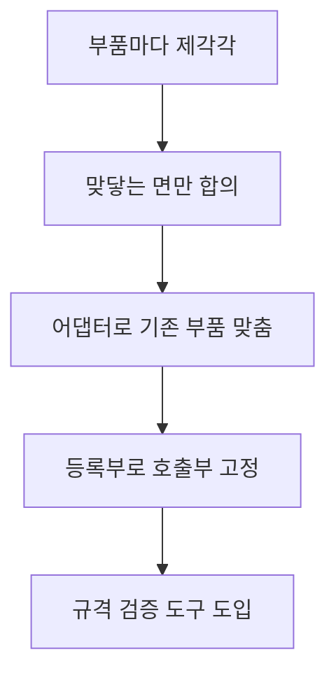

도요타, 닛산, 혼다가 강철 품질 기준이랑 플라스틱 규격, 배선 색깔을 통일한다고 한다. 소비자는 모르는 부품부터 맞추겠다는 얘기다. 이걸 보고 떠올린 건 자동차가 아니라 `if kind == "smtp"` 같은 코드다.

> - 규격이 없으면 부품이 하나 늘 때마다 호출하는 쪽 코드가 같이 바뀐다.
> - 표준화는 부품을 똑같이 만드는 게 아니라, 맞닿는 면만 똑같이 만드는 거다.
> - 아무도 안 보는 부분부터 맞추는 건 이유가 있다. 거긴 차별화할 게 없고 비용만 먹는다.

## 규격이 없던 시대

자동차든 소프트웨어든 초기엔 부품마다 제각각이었다. 만드는 쪽은 자기 편한 대로 만들었고, 쓰는 쪽이 그 사정에 맞췄다. 배선 색깔이 회사마다 다르면 정비사는 차종마다 매뉴얼을 새로 외워야 한다. 수리 시간이 늘고, 공급업체는 회사마다 라인을 따로 돌려야 한다.

소프트웨어도 똑같았다. 메일은 `send_mail`, 슬랙은 `post`, 문자는 `push`. 이름도 다르고 인자 순서도 다르고 제약도 다르다. 이걸 쓰는 코드는 부품 종류를 일일이 구분해서 호출하는 수밖에 없었다.

"그냥 if문 쓰면 되지, 그게 뭐가 문제냐"는 의문이 나올 거다. 처음엔 문제가 아니다. 부품이 셋일 때는 오히려 가장 읽기 쉽다. 문제는 부품이 늘 때 생긴다.

구조를 그림으로 보면 이렇다. 아래는 개념도(실제 수치 아님)고, 왼쪽은 부품마다 호출 코드가 따로 있는 상태, 오른쪽은 가운데 규격 하나를 거치는 상태다.

<svg viewBox="0 0 660 220" xmlns="http://www.w3.org/2000/svg">
<rect x="20" y="20" width="120" height="36" fill="none" stroke="#6b4f3a"/>
<text x="80" y="43" font-size="13" text-anchor="middle" fill="#7a6a58">호출 코드</text>
<rect x="200" y="20" width="90" height="30" fill="none" stroke="#c9a37a"/>
<text x="245" y="40" font-size="12" text-anchor="middle" fill="#7a6a58">send_mail</text>
<rect x="200" y="80" width="90" height="30" fill="none" stroke="#c9a37a"/>
<text x="245" y="100" font-size="12" text-anchor="middle" fill="#7a6a58">post</text>
<rect x="200" y="140" width="90" height="30" fill="none" stroke="#c9a37a"/>
<text x="245" y="160" font-size="12" text-anchor="middle" fill="#7a6a58">push</text>
<line x1="140" y1="38" x2="200" y2="35" stroke="#a8683a"/>
<line x1="140" y1="38" x2="200" y2="95" stroke="#a8683a"/>
<line x1="140" y1="38" x2="200" y2="155" stroke="#a8683a"/>
<text x="170" y="205" font-size="12" text-anchor="middle" fill="#7a6a58">선이 부품 수만큼 늘어난다</text>
<rect x="380" y="20" width="120" height="36" fill="none" stroke="#6b4f3a"/>
<text x="440" y="43" font-size="13" text-anchor="middle" fill="#7a6a58">호출 코드</text>
<rect x="380" y="90" width="120" height="30" fill="none" stroke="#a8683a"/>
<text x="440" y="110" font-size="12" text-anchor="middle" fill="#7a6a58">send 규격</text>
<line x1="440" y1="56" x2="440" y2="90" stroke="#a8683a"/>
<rect x="540" y="60" width="90" height="26" fill="none" stroke="#d9b98c"/>
<rect x="540" y="100" width="90" height="26" fill="none" stroke="#d9b98c"/>
<rect x="540" y="140" width="90" height="26" fill="none" stroke="#d9b98c"/>
<line x1="500" y1="105" x2="540" y2="73" stroke="#c9a37a"/>
<line x1="500" y1="105" x2="540" y2="113" stroke="#c9a37a"/>
<line x1="500" y1="105" x2="540" y2="153" stroke="#c9a37a"/>
<text x="460" y="205" font-size="12" text-anchor="middle" fill="#7a6a58">호출 쪽 선은 하나로 고정</text>
</svg>

## 그때 방식으로 직접 만들어 보기

알림 보내는 코드를 규격 없이 만들어 봤다. 외부 라이브러리 없이 표준 라이브러리만 썼고, Python 3.9.6에서 돌렸다. 부품 셋은 서로 메서드 이름도 인자도 다르다.

```python
# Python 3.9, 표준 라이브러리만
class Smtp:
    def send_mail(self, to, body): return f"SMTP -> {to}: {body}"
class Slack:
    def post(self, channel, msg): return f"SLACK #{channel}: {msg}"
class Sms:
    def push(self, number, text, max_len=10): return f"SMS {number}: {text[:max_len]}"

def notify(kind, target, text):
    if kind == "smtp":  return Smtp().send_mail(target, text)
    elif kind == "slack": return Slack().post(target, text)
    elif kind == "sms": return Sms().push(target, text)
    raise ValueError(kind)
```

직접 돌려보니 결과는 이랬다. 문자(SMS)에서 글이 잘린 게 눈에 띈다.

```text
SMTP -> a@b.c: 배포 완료 롤백 없음
SLACK #dev: 배포 완료 롤백 없음
SMS 010: 배포 완료 롤백 없
ValueError: ValueError('kakao')
```

"롤백 없음"이 "롤백 없"으로 나왔다. 문자 쪽 `max_len=10`이 조용히 잘라 버린 거다. 에러도 경고도 없다. 부품마다 숨은 제약이 다른데 호출하는 쪽은 그걸 알 방법이 없다.

여기서 아픈 지점:

- 부품이 하나 늘면 `notify`의 분기도 하나 는다. 카카오를 붙이려 했더니 `ValueError('kakao')`가 바로 터졌고, 고치려면 호출 코드를 열어야 한다.
- 제약이 부품 안에 숨어 있다. 글자 수 제한 같은 건 호출 쪽이 알 길이 없어서, 위처럼 조용히 데이터가 깨진다.
- 이런 분기가 알림만 있을까. 로그 저장, 결제, 파일 업로드마다 같은 if문이 생기고, 부품을 하나 바꿀 때마다 전부 찾아다녀야 한다.

## 그래서 어떻게 진화했나

첫 단계는 "이름이라도 맞추자"였다. 불편은 부품마다 메서드 이름이 달라서 매번 분기한다는 것이었다. 해법은 맞닿는 면, 즉 `send(target, text)` 하나만 합의하는 것이다. 새로 생긴 문제는, 이미 있는 부품이 이 모양이 아니라는 점이다. 남이 만든 부품은 못 고친다.

두 번째 단계가 어댑터다. 불편은 기존 부품을 못 고친다는 것이었고, 해법은 규격에 맞는 얇은 껍데기를 하나 씌우는 것이다. 새로 생긴 문제는 껍데기가 늘어나고, 그 안에 숨은 제약(글자 수 같은)은 여전히 남는다는 점이다. 자동차로 치면 규격이 다른 커넥터에 변환 잭을 끼우는 거다.

```python
REG = {"smtp": SmtpA, "slack": SlackA, "sms": SmsA}
def notify(kind, target, text):
    return REG[kind]().send(target, text)
```

세 번째 단계는 등록부(registry)다. 불편은 새 부품마다 `if`를 고쳐야 한다는 것이었고, 해법은 이름과 부품을 딕셔너리에 모아 두는 것이다. 새로 생긴 문제는 규격을 안 지킨 부품이 들어와도 등록 때는 모른다는 점이다. 실제로 확인해 봤다. `send` 대신 `post`만 있는 클래스를 넣고 호출하니 이렇게 나왔다.

```text
SMTP -> a@b.c: 배포 완료 롤백 없음
SLACK #dev: 배포 완료 롤백 없음
SMS 010: 배포 완료 롤백 없
KAKAO x: hi
KeyError: KeyError('fax')
AttributeError: 'Bad' object has no attribute 'send'
```

카카오는 `notify()`를 한 줄도 안 고치고 `REG["kakao"] = KakaoA` 한 줄로 붙었다. 이게 규격의 이득이다. 반면 규격을 어긴 부품은 등록할 땐 조용히 받아 주고, 실제로 호출될 때 터진다. 공장에서 규격 검사를 안 하고 조립 라인에서 터지는 꼴이다.

이 진화를 시간순으로 줄이면 이렇다. 위에서 아래로 읽으면 되고, 각 단계가 앞 단계의 불편 하나를 푼다.



여기서 한 가지 의문이 나온다. "그럼 아예 모든 부품을 똑같이 만들면 안 되나?" 안 되는 이유가 있다. 문자는 글자 수 제한이 있고, 메일은 제목이 있고, 슬랙은 채널이 있다. 전부 똑같이 만들면 각 부품의 장점이 사라진다. 그래서 표준화는 "맞닿는 면만" 맞추는 거다. 안쪽은 마음대로 해도 된다.

세대별로 정리하면 이렇다.

| 시대 | 방식 | 장점 | 한계 |
|---|---|---|---|
| 규격 없음 | 부품마다 호출 분기 | 처음엔 단순 | 부품 수만큼 분기가 늘어남 |
| 이름 합의 | 공통 메서드 하나 | 호출부가 짧아짐 | 기존 부품은 못 맞춤 |
| 어댑터 | 껍데기로 변환 | 남의 부품도 사용 | 껍데기가 늘고 숨은 제약 남음 |
| 등록부 | 이름과 부품을 맵으로 | 부품 추가에 호출부 불변 | 규격 위반은 호출 때 발견 |

## 지금은 어떤가

오늘 기사의 세 일본 회사가 고른 건 강철 품질 기준, 플라스틱 규격, 배선 색깔이다. 소비자 눈에 안 띄고 브랜드 정체성과 상관없는데 비용은 큰 곳이다. 위 코드로 치면 `send(target, text)` 한 줄을 합의하는 일이고, 안쪽 구현은 건드리지 않는다. 이 선택은 맞다고 본다. 차별화하는 부분까지 표준화하면 그건 합병이지 표준화가 아니다.

다만 한계도 분명하다. 댓글에 따르면 BYD 같은 회사는 부품 상당수를 자체 생산한다는데, 이건 내가 확인한 수치가 아니라서 크기는 모르겠다. 확실한 건 구조의 차이다. 규격으로 여러 업체를 묶는 방식은 협상 비용이 들고, 한 회사가 다 갖고 있으면 그 비용이 없다. 코드로 치면 `REG`에 남의 부품을 끼우는 방식과 전부 한 클래스에 넣는 방식의 차이다.

내 선택은 이렇다. 외부 부품이 둘 이상 들어올 가능성이 있으면 처음부터 규격 한 줄과 등록부를 쓰겠다. 위에서 직접 보니 부품 셋이면 if문이 더 읽기 쉬웠지만, 카카오 하나 붙이는 순간 호출부를 열어야 했다. 반대로 부품이 둘로 고정이고 앞으로 안 늘 거면 if문으로 간다. 추상화는 공짜가 아니고 껍데기만큼 읽을 코드가 늘기 때문이다. 그리고 등록부를 쓰면 등록 시점에 규격을 검사하는 코드를 같이 넣어라. `AttributeError`를 호출 때 맞는 건 사고다.

규격을 맞추는 건 지루하고 아무도 박수 쳐 주지 않는다. 그런데 비용은 늘 그 지루한 곳에서 새고 있다.

---

*원문: [Toyota, Nissan, and Honda to standardize parts to lower costs](https://www.caranddriver.com/news/a74490092/toyota-nissan-honda-standardize-parts-lower-costs/) (via hn)*
