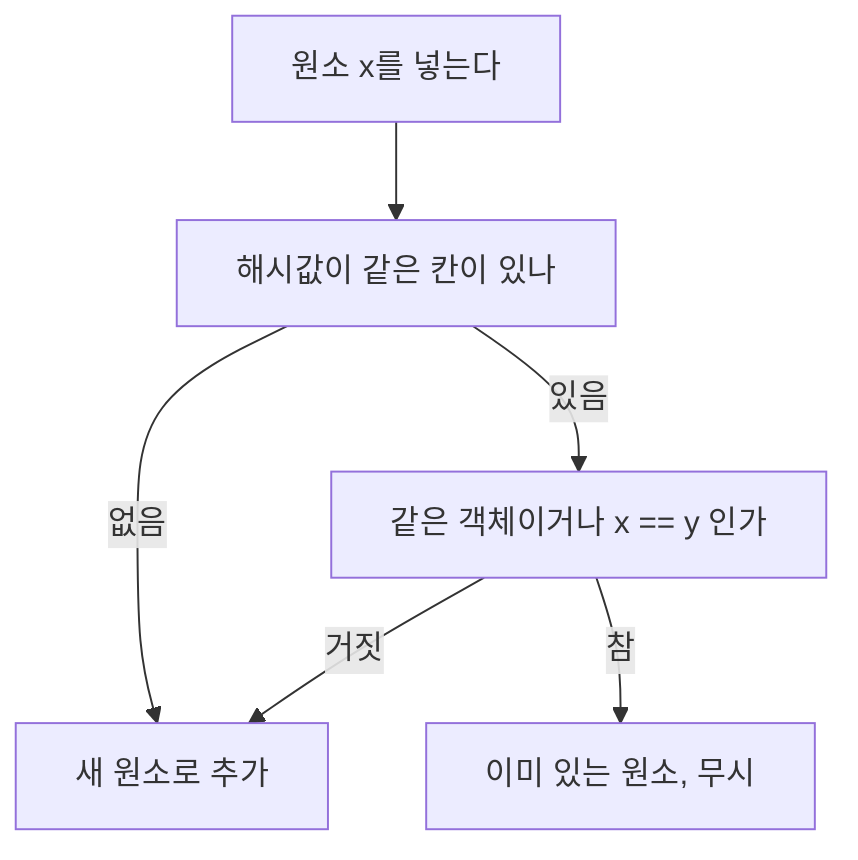

set에 1과 1.0과 True를 넣으면 몇 개가 남는지, 그리고 NaN을 두 번 넣으면 왜 두 개가 남는지 직접 돌려봤다. 집합과 함수는 너무 기초라 다 안다고 넘기는데, 코드에서 터지는 버그는 대부분 이 기초의 정의를 정확히 안 읽어서 나온다.

> - 집합은 "같다"의 정의가 먼저 있어야 성립하고, 그 정의가 깨지는 순간 set도 깨진다.
> - 함수는 계산 절차가 아니라 입력과 출력 쌍의 집합이다. 정의역의 모든 원소가 정확히 하나의 출력을 가져야 한다.
> - 정의역이 공역보다 크면 충돌은 확률이 아니라 필연이고, 역함수는 전단사에서만 존재한다.

모든 실행은 Python 3.9.6, 표준 라이브러리만 썼다.

## 오해 1. 집합은 순서 없는 리스트인데 중복만 빼 준다

리스트에서 중복만 제거한 물건이라고 생각하면 절반만 맞다. 집합은 "원소가 무엇인가"가 아니라 "두 원소가 같은가"를 판정할 수 있어야 만들어진다. 같음의 기준이 흔들리면 집합이 하는 일도 달라진다.

비유하면 출석부다. 이름이 같으면 같은 사람으로 칠지, 학번이 같아야 같은 사람으로 칠지 정해야 출석부를 만들 수 있다. 기준이 없으면 "중복 제거"라는 말 자체가 의미가 없다.

직접 돌려보니 이랬다.

```python
s = {1, 1.0, True}
print(s, len(s))

nan = float("nan")
t = {nan, float("nan")}
print(len(t), nan in {nan}, float("nan") in {nan})

try:
    {[1, 2]}
except TypeError as e:
    print(e)

print(frozenset({1, 2}) in {frozenset({2, 1})})
```

```text
{1} 1
2 True False
unhashable type: 'list'
True
```

- 1, 1.0, True는 파이썬에서 `==`가 참이고 해시도 같아서 하나로 합쳐졌다. 수학적으로는 같은 수라 말이 되지만, 타입이 다르다고 기대했다면 데이터가 조용히 사라진다.
- NaN은 자기 자신과도 `==`가 거짓이다. 같은 객체를 다시 넣으면 `in`이 참인데(객체 동일성을 먼저 확인하기 때문이다), 새로 만든 NaN은 거짓이다. 이게 제일 의외였다. 같음이 반사적이지 않으면 집합의 전제가 무너진다.
- 리스트는 값이 바뀔 수 있어서 해시가 불가능하다. 바뀌는 순간 "같음"이 바뀌기 때문이다. 그래서 집합 안의 집합은 `frozenset`으로 넣는다.

그럼 순서는 어떤가. 같은 코드를 프로세스를 세 번 새로 띄워서 문자열 집합을 찍어 봤다.

```text
['kiwi', 'plum', 'apple', 'pear']
['plum', 'kiwi', 'pear', 'apple']
['pear', 'kiwi', 'apple', 'plum']
```

문자열은 실행마다 순서가 달랐다. 반면 `{3,1,2,100,5}` 같은 작은 정수는 `[1, 2, 3, 100, 5]`로 거의 정렬된 것처럼 나왔다. 해시가 정수 값 자체여서 그렇다. 이걸 보고 "집합은 정렬된다"고 믿고 테스트를 짜면, 문자열로 바꾸는 날 테스트가 깨진다. 나라면 집합 출력은 무조건 `sorted()`를 거친 뒤에만 비교한다.

아래는 같음 판정에서 집합이 어디로 갈라지는지 그린 것이다. 개념도(실제 수치 아님)이고, 위에서 아래로 읽으면 된다.



NaN은 D에서 거짓이 나오고, 객체가 같을 때만 앞 조건으로 구제된다. 이 흐름을 알고 나면 그 결과가 설명된다.

## 오해 2. 함수는 입력을 받아 계산하는 코드다

코드로 짠 함수만 봐서 생기는 오해다. 수학의 함수는 계산 방법을 말하지 않는다. 집합 A의 원소마다 집합 B의 원소를 딱 하나씩 짝지은 규칙, 즉 쌍의 집합이다.

비유로는 사물함 배정표다. 학생마다 사물함이 정확히 하나여야 한다. 사물함이 두 개인 학생이 있어도, 사물함이 없는 학생이 있어도 그 표는 배정표가 될 수 없다. 두 학생이 한 사물함을 쓰는 건 괜찮다.

쌍의 집합이 함수인지 직접 검사해 봤다.

```python
def is_function(pairs, domain):
    return all(len({y for x, y in pairs if x == d}) == 1 for d in domain)

D = {1, 2, 3}
print(is_function({(1,'a'), (2,'b'), (3,'a')}, D))
print(is_function({(1,'a'), (1,'b'), (2,'b'), (3,'a')}, D))
print(is_function({(1,'a'), (2,'b')}, D))
```

```text
True
False
False
```

- 첫째는 1과 3이 같은 'a'로 가도 함수다. 출력이 겹치는 건 규칙 위반이 아니다.
- 둘째는 입력 1에 출력이 둘이라 함수가 아니다. 현업에서 "같은 키인데 값이 두 개"인 테이블이 이 모양이다.
- 셋째는 3에 대한 출력이 없어서 함수가 아니다. 정의역을 어디까지로 보느냐가 함수의 일부라는 뜻이다.

이걸 현업 감각으로 옮기면 이렇다. 같은 입력에 다른 출력이 나오는 코드(시간, 난수, 외부 상태에 의존하는 코드)는 수학 함수가 아니다. 그래서 캐싱, 재시도, 테스트 재현이 "함수처럼 다룰 수 있는가"의 문제로 바뀐다. 그리고 `dict`는 사실상 함수 그 자체다. 키가 정의역이고, 키 하나에 값 하나만 허용한다.

나는 설계 리뷰에서 "이 API가 멱등한가"를 물을 때, 속으로 "입력에서 출력으로 가는 진짜 함수인가"를 먼저 본다. 멱등성이 필요한 곳에는 함수처럼 만들고, 상태가 본질인 곳(카운터 증가 같은 것)에는 억지로 함수 꼴을 만들지 않는다. 둘을 섞어 놓은 코드가 제일 디버깅하기 힘들었다.

## 오해 3. 해시 충돌은 운이 나쁠 때 생기고, 함수는 되돌릴 수 있다

여기서 단사, 전사, 전단사가 나온다. 단사는 서로 다른 입력이 서로 다른 출력으로 가는 것, 전사는 공역의 모든 원소가 어딘가의 출력으로 쓰이는 것이다. 둘이 동시에 성립하면 전단사다.

비유로는 극장 좌석이다. 단사는 한 좌석에 한 명만 앉는 것이고, 전사는 빈 좌석이 없는 것이다. 관객이 좌석보다 많으면 단사는 불가능하다. 이게 비둘기집 원리다.

A에서 B로 가는 모든 함수를 전부 나열해서 몇 개가 단사이고 전사인지 세 봤다.

```python
import itertools

def classify(A, B):
    inj = sur = bij = tot = 0
    for ys in itertools.product(B, repeat=len(A)):
        tot += 1
        i = len(set(ys)) == len(A)
        s = set(ys) == set(B)
        inj += i; sur += s; bij += i and s
    return tot, inj, sur, bij

for a, b in [(3, 3), (3, 5), (5, 3), (4, 4)]:
    print(a, b, classify(range(a), range(b)))
```

```text
3 3 (27, 6, 6, 6)
3 5 (125, 60, 0, 0)
5 3 (243, 0, 150, 0)
4 4 (256, 24, 24, 24)
```

각 줄은 (정의역 크기, 공역 크기, 전체 함수 수, 단사 수, 전사 수, 전단사 수)에서 앞의 두 숫자를 뺀 순서로 읽는다.

- 3에서 3으로 가는 함수는 27개이고, 단사인 6개가 곧 전사이며 전단사다. 크기가 같으면 단사와 전사가 서로를 끌고 온다. 예상했지만 숫자로 보니 깔끔하다.
- 3에서 5로 가면 단사는 60개 있어도 전사는 0개다. 공역이 더 크면 다 채울 수 없다.
- 5에서 3으로 가면 전사는 150개 있어도 단사는 0개다. 정의역이 크면 반드시 겹친다. 이게 충돌이 필연이라는 말이다.

그러면 "충돌은 확률의 문제"라는 믿음은 어떻게 되나. 16비트로 줄인 해시를 `user0`, `user1`, ... 에 걸어서 처음 충돌이 나는 지점을 찾아 봤다.

```text
first collision at 136 user87 user136
```

공역이 65536개인데 136번째에서 충돌했다. 공역 크기의 제곱근인 256 근처에서 난다는 생일 문제의 감각과 맞는다. 운이 나쁜 게 아니라 이 정도가 정상이다. 해시 테이블이 체이닝이나 개방 주소법 같은 충돌 처리를 반드시 갖는 이유가 이것이고, 충돌이 없다고 가정하는 코드는 언젠가 반드시 틀린다.

그럼 역함수는 어떤가. 전단사가 아니면 역함수는 정의되지 않는다.

```python
m = {'a': 1, 'b': 1, 'c': 2}
inv = {v: k for k, v in m.items()}
print(inv)
```

```text
{1: 'b', 2: 'c'}
```

'a'가 아무 경고 없이 사라졌다. 딕셔너리 뒤집기 코드는 값이 유일하다는 가정이 있어야 맞는데, 그 가정은 코드 어디에도 적혀 있지 않다. 나는 값이 유일한지 모를 때 뒤집은 결과를 `dict[value] -> list[key]`로 만든다. 유일함이 스키마로 보장될 때만 한 줄짜리 뒤집기를 쓴다.

아래 SVG는 세 종류의 대응을 화살표로 그린 개념도(실제 수치 아님)이다. 왼쪽 점이 입력, 오른쪽 점이 출력이고, 가운데 배치가 단사에서 전단사로 갈수록 빈틈이 줄어든다.

<svg viewBox="0 0 680 190" xmlns="http://www.w3.org/2000/svg" style="background:transparent">
<g font-family="sans-serif" font-size="13" fill="#7a6a58" text-anchor="middle">
<text x="113" y="20">단사만</text>
<text x="340" y="20">전사만</text>
<text x="567" y="20">전단사</text>
</g>
<g fill="#6b4f3a">
<circle cx="50" cy="55" r="6"/><circle cx="50" cy="105" r="6"/><circle cx="50" cy="155" r="6"/>
<circle cx="277" cy="55" r="6"/><circle cx="277" cy="105" r="6"/><circle cx="277" cy="155" r="6"/>
<circle cx="504" cy="55" r="6"/><circle cx="504" cy="105" r="6"/><circle cx="504" cy="155" r="6"/>
</g>
<g fill="#c9a37a">
<circle cx="176" cy="45" r="6"/><circle cx="176" cy="85" r="6"/><circle cx="176" cy="125" r="6"/><circle cx="176" cy="165" r="6"/>
<circle cx="403" cy="75" r="6"/><circle cx="403" cy="135" r="6"/>
<circle cx="630" cy="55" r="6"/><circle cx="630" cy="105" r="6"/><circle cx="630" cy="155" r="6"/>
</g>
<g stroke="#a8683a" stroke-width="2" fill="none">
<line x1="56" y1="55" x2="170" y2="45"/><line x1="56" y1="105" x2="170" y2="85"/><line x1="56" y1="155" x2="170" y2="165"/>
<line x1="283" y1="55" x2="397" y2="75"/><line x1="283" y1="105" x2="397" y2="75"/><line x1="283" y1="155" x2="397" y2="135"/>
<line x1="510" y1="55" x2="624" y2="55"/><line x1="510" y1="105" x2="624" y2="155"/><line x1="510" y1="155" x2="624" y2="105"/>
</g>
<g font-family="sans-serif" font-size="12" fill="#7a6a58" text-anchor="middle">
<text x="176" y="185">빈 칸이 생김</text>
<text x="403" y="185">겹치는 화살표</text>
<text x="630" y="185">1대1, 빈틈 없음</text>
</g>
</svg>

마지막으로 위 내용을 한 표로 모았다. 행은 성질이고 열은 그 성질이 보장하는 것이다.

| 성질 | 보장하는 것 | 코드에서 보이는 모습 |
|---|---|---|
| 함수 | 입력마다 출력 하나 | dict, 순수 함수 |
| 단사 | 출력이 겹치지 않음 | 충돌 없는 ID 발급 |
| 전사 | 공역이 빈틈없이 쓰임 | 모든 버킷이 채워짐 |
| 전단사 | 되돌릴 수 있음 | 인코딩과 디코딩 쌍 |

## 현업에서 마주치는 곳

세 오해는 결국 한 군데로 모인다. 데이터를 키로 묶고, 변환하고, 되돌릴 수 있다고 믿는 모든 코드다. 중복 제거, 조인 키 설계, 해시 샤딩, 직렬화와 역직렬화가 다 여기에 걸린다.

내 판단을 적어 두면 이렇다. 집합이나 딕셔너리의 키로는 값이 바뀌지 않는 타입만 쓰고, 부동소수점은 키로 쓰지 않는다. 변환 함수에는 "단사인가, 전사인가"를 주석이 아니라 테스트로 남긴다. 해시는 충돌이 난다는 전제로 쓰고, 되돌려야 하는 변환에는 해시를 쓰지 않는다.

반대로 고르는 경우도 있다. 키가 수억 개 이상으로 커져서 전체를 들고 있을 수 없을 때는 충돌을 허용하는 쪽(블룸 필터 같은 근사 구조)을 일부러 고른다. 그때는 단사가 아니라는 사실을 설계에 적어 놓고 쓴다.

1과 1.0과 True가 하나로 합쳐지는 건 파이썬의 버그가 아니고 정의대로 동작한 결과다. 정의를 안 읽은 쪽이 놀랄 뿐이다.

---

*CS 기초 시리즈: 전산수학*
