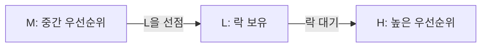

CPU 이용률이 97%인데 마감을 지키는 스케줄러가 있고, 같은 태스크로 마감을 깨먹는 스케줄러도 있다. 직접 돌려서 확인했다.

> - RTOS의 "실시간"은 빠르다는 뜻이 아니라, 마감 안에 끝난다는 걸 사전에 말할 수 있다는 뜻이다.
> - 같은 태스크 둘을 RM으로 돌리면 마감을 놓치고 EDF로 돌리면 맞춘다. 고정 우선순위는 이용률이 높아지면 한계가 있다.
> - 스케줄러보다 현장에서 더 자주 터지는 건 우선순위 역전이다. 락 하나 때문에 높은 우선순위가 5가 아니라 11에 끝났다.

## 빠른 것과 늦지 않는 것

택배 기사 비유가 쓸 만하다. 일반 OS는 하루 총 배송량을 최대화하는 기사고, RTOS는 "오전 11시 지정 배송"을 반드시 지키는 기사다. 평균 처리량이 낮아도 지정 시간을 안 어기면 그게 실시간이다.

그래서 실시간 시스템의 정확성은 값과 시간 두 축으로 판정한다. 에어백 제어가 정확한 판단을 3초 뒤에 내렸다면 그건 틀린 답이다. 마감을 어기면 시스템이 망가지는 쪽이 hard, 품질만 떨어지는 쪽이 soft다. 오디오 버퍼 언더런은 소리가 튀는 정도라 soft에 가깝고, 모터 제어 루프가 늦으면 하드웨어가 상한다.

## 주기 태스크 둘로 시작한다

모델은 단순하다. 태스크마다 주기 p마다 작업이 하나씩 도착하고, 실행에 c만큼 걸리고, 다음 주기가 오기 전까지가 마감이다. 이용률 U는 c/p를 다 더한 값이다.

태스크 A는 주기 5에 실행 2, 태스크 B는 주기 7에 실행 4로 잡았다. U = 2/5 + 4/7 = 0.9714다. 1을 넘지 않으니 CPU 용량으로는 가능한 조합이다.

"그럼 U가 1 이하면 어떤 스케줄러로 돌려도 되는 거 아니냐"는 의문이 먼저 든다. 안 된다. 용량이 된다는 건 필요조건이고, 순서를 어떻게 정하느냐에 따라 마감이 깨진다. 아래 세 방식을 같은 조건에 넣어 보면 보인다.

- RM(Rate Monotonic): 주기가 짧은 태스크에 높은 우선순위를 고정으로 준다.
- EDF(Earliest Deadline First): 매 순간 마감이 가장 가까운 작업을 먼저 돌린다.
- 라운드로빈: 준비된 작업을 돌아가며 한 칸씩 준다. 일반 OS 감각에 가까운 방식이다.

```python
# Python 3.9.6, 표준 라이브러리만 사용. 시간은 1칸 단위로 쪼갠 이산 시뮬레이션
def run(tasks, policy, horizon):
    jobs, misses, trace, rr = [], [], [], 0
    for t in range(horizon):
        for n, (c, p) in tasks.items():
            if t % p == 0:
                jobs.append({"n": n, "left": c, "dl": t + p, "rel": t})
        for j in jobs:
            if j["left"] > 0 and t >= j["dl"] and not j.get("miss"):
                j["miss"] = True; misses.append((j["n"], j["dl"]))
        ready = [j for j in jobs if j["left"] > 0]
        if not ready:
            trace.append("."); continue
        if policy == "rm":
            j = min(ready, key=lambda j: (tasks[j["n"]][1], j["rel"]))
        elif policy == "edf":
            j = min(ready, key=lambda j: (j["dl"], j["rel"]))
        else:
            rr += 1; j = ready[rr % len(ready)]
        j["left"] -= 1
        trace.append(j["n"])
    return "".join(trace), misses

tasks = {"A": (2, 5), "B": (4, 7)}   # (실행시간, 주기)
```

- 정책 차이는 `min(...)`의 key 한 줄뿐이다. 스케줄러의 본질이 "ready 큐에서 누굴 뽑느냐"라는 걸 보여 준다.
- 마감 판정은 "마감 시각에 아직 남은 일이 있는가"로 했다.
- 라운드로빈은 진짜 타임슬라이스 구현이 아니라 카운터로 돌려 뽑는 단순화 버전이다.

직접 돌려보니 두 주기의 최소공배수인 35칸 동안 이렇게 나왔다. 글자는 그 칸에 실행된 태스크고 점은 idle이다.

```text
U = 0.9714 hyperperiod = 35
rm  AABBBAABBBAABBBAABBBAABBBAABBBAABB.  misses=[('B', 7)]
edf AABBBBAABBBBAABAABBBAABBBBAABBBBAA.  misses=[]
rr  BABABBAABBABABBBABABAABBBBAABBABAB.  misses=[]
```

RM은 첫 B 작업이 시각 7에 마감인데 3칸만 실행하고 A에게 선점당했다. 그 한 칸 때문에 마감이 깨졌다. EDF는 B의 마감이 A의 두 번째 작업(마감 10)보다 가까워서 B를 먼저 끝냈고, 그 뒤에 A를 돌렸다.

시각으로 보면 이렇다. 위가 RM, 아래가 EDF이고 점선이 B의 첫 마감이다. 점선 왼쪽에서 B가 4칸을 채웠는지 보면 된다. 아래 그림은 위 출력 앞 14칸을 그린 것이다.

<svg viewBox="0 0 660 150" xmlns="http://www.w3.org/2000/svg" style="background:transparent" font-family="sans-serif" font-size="13">
<text x="8" y="67" fill="#7a6a58">RM</text>
<rect x="60" y="45" width="36" height="32" rx="3" fill="#c9a37a"/>
<text x="78" y="66" text-anchor="middle" fill="#fff">A</text>
<rect x="98" y="45" width="36" height="32" rx="3" fill="#c9a37a"/>
<text x="116" y="66" text-anchor="middle" fill="#fff">A</text>
<rect x="136" y="45" width="36" height="32" rx="3" fill="#a8683a"/>
<text x="154" y="66" text-anchor="middle" fill="#fff">B</text>
<rect x="174" y="45" width="36" height="32" rx="3" fill="#a8683a"/>
<text x="192" y="66" text-anchor="middle" fill="#fff">B</text>
<rect x="212" y="45" width="36" height="32" rx="3" fill="#a8683a"/>
<text x="230" y="66" text-anchor="middle" fill="#fff">B</text>
<rect x="250" y="45" width="36" height="32" rx="3" fill="#c9a37a"/>
<text x="268" y="66" text-anchor="middle" fill="#fff">A</text>
<rect x="288" y="45" width="36" height="32" rx="3" fill="#c9a37a"/>
<text x="306" y="66" text-anchor="middle" fill="#fff">A</text>
<rect x="326" y="45" width="36" height="32" rx="3" fill="#a8683a"/>
<text x="344" y="66" text-anchor="middle" fill="#fff">B</text>
<rect x="364" y="45" width="36" height="32" rx="3" fill="#a8683a"/>
<text x="382" y="66" text-anchor="middle" fill="#fff">B</text>
<rect x="402" y="45" width="36" height="32" rx="3" fill="#a8683a"/>
<text x="420" y="66" text-anchor="middle" fill="#fff">B</text>
<rect x="440" y="45" width="36" height="32" rx="3" fill="#c9a37a"/>
<text x="458" y="66" text-anchor="middle" fill="#fff">A</text>
<rect x="478" y="45" width="36" height="32" rx="3" fill="#c9a37a"/>
<text x="496" y="66" text-anchor="middle" fill="#fff">A</text>
<rect x="516" y="45" width="36" height="32" rx="3" fill="#a8683a"/>
<text x="534" y="66" text-anchor="middle" fill="#fff">B</text>
<rect x="554" y="45" width="36" height="32" rx="3" fill="#a8683a"/>
<text x="572" y="66" text-anchor="middle" fill="#fff">B</text>
<text x="8" y="117" fill="#7a6a58">EDF</text>
<rect x="60" y="95" width="36" height="32" rx="3" fill="#c9a37a"/>
<text x="78" y="116" text-anchor="middle" fill="#fff">A</text>
<rect x="98" y="95" width="36" height="32" rx="3" fill="#c9a37a"/>
<text x="116" y="116" text-anchor="middle" fill="#fff">A</text>
<rect x="136" y="95" width="36" height="32" rx="3" fill="#a8683a"/>
<text x="154" y="116" text-anchor="middle" fill="#fff">B</text>
<rect x="174" y="95" width="36" height="32" rx="3" fill="#a8683a"/>
<text x="192" y="116" text-anchor="middle" fill="#fff">B</text>
<rect x="212" y="95" width="36" height="32" rx="3" fill="#a8683a"/>
<text x="230" y="116" text-anchor="middle" fill="#fff">B</text>
<rect x="250" y="95" width="36" height="32" rx="3" fill="#a8683a"/>
<text x="268" y="116" text-anchor="middle" fill="#fff">B</text>
<rect x="288" y="95" width="36" height="32" rx="3" fill="#c9a37a"/>
<text x="306" y="116" text-anchor="middle" fill="#fff">A</text>
<rect x="326" y="95" width="36" height="32" rx="3" fill="#c9a37a"/>
<text x="344" y="116" text-anchor="middle" fill="#fff">A</text>
<rect x="364" y="95" width="36" height="32" rx="3" fill="#a8683a"/>
<text x="382" y="116" text-anchor="middle" fill="#fff">B</text>
<rect x="402" y="95" width="36" height="32" rx="3" fill="#a8683a"/>
<text x="420" y="116" text-anchor="middle" fill="#fff">B</text>
<rect x="440" y="95" width="36" height="32" rx="3" fill="#a8683a"/>
<text x="458" y="116" text-anchor="middle" fill="#fff">B</text>
<rect x="478" y="95" width="36" height="32" rx="3" fill="#a8683a"/>
<text x="496" y="116" text-anchor="middle" fill="#fff">B</text>
<rect x="516" y="95" width="36" height="32" rx="3" fill="#c9a37a"/>
<text x="534" y="116" text-anchor="middle" fill="#fff">A</text>
<rect x="554" y="95" width="36" height="32" rx="3" fill="#c9a37a"/>
<text x="572" y="116" text-anchor="middle" fill="#fff">A</text>
<text x="60" y="30" fill="#7a6a58" font-size="11">0</text>
<text x="250" y="30" fill="#7a6a58" font-size="11">5</text>
<text x="440" y="30" fill="#7a6a58" font-size="11">10</text>
<line x1="326" y1="36" x2="326" y2="135" stroke="#6b4f3a" stroke-width="2" stroke-dasharray="4 3"/>
<text x="330" y="146" fill="#6b4f3a" font-size="11">B 마감 t=7</text>
</svg>

## 예상과 달랐던 것: 라운드로빈이 안 틀렸다

라운드로빈은 마감 개념이 없는 방식이니 당연히 깨질 줄 알았다. 그런데 이 조합에서는 miss가 0이었다. 그래서 다른 조합 두 개를 더 돌렸다. 이용률이 0.833인 세 태스크와 0.875인 세 태스크였는데, 여기서도 RM, EDF, 라운드로빈 모두 miss가 없었다.

내 결론은 이렇다. 라운드로빈이 안전하다는 증거가 아니고 내가 고른 조합이 너그러웠던 것이다. 마감이 아니라 순번으로 뽑으니 맞으면 운이다. 다만 이 시뮬레이션만으로 "라운드로빈은 반드시 깨진다"고 쓸 수는 없고, 마감을 보장하는 근거가 없다는 것만 말할 수 있다. 라운드로빈을 마감 보장 수단으로 쓰는 건 고르지 않겠다.

## 판단 기준

| 방식 | 우선순위 | 이번 실험 | 맞는 상황 |
|---|---|---|---|
| RM | 주기 기준 고정 | U 0.97에서 B 마감 놓침 | 태스크 구성이 고정이고 우선순위를 손으로 읽고 싶을 때 |
| EDF | 마감 기준 동적 | 같은 조합에서 miss 0 | 이용률이 높고 마감이 서로 다를 때 |
| 라운드로빈 | 순번 | miss 0이지만 보장 근거 없음 | 마감이 느슨한 같은 급 작업끼리 |

표에서 RM 행의 "고정"이 핵심이다. 고정이면 디버깅이 쉽다. 로그에서 누가 누구를 밀어냈는지 우선순위 숫자만 보면 된다.

현업 기준 내 선택은 이렇다. 대부분은 RM 계열의 고정 우선순위 선점형을 고른다. 상용 RTOS 대부분이 이 방식을 기본으로 제공하고, 이용률을 70~80% 안쪽에 두고 짜면 이번 실험 같은 상황을 피할 수 있다. 반대로 이용률을 90% 넘게 써야 하고 EDF를 지원하는 커널을 쓰고 있다면 EDF를 고른다. 단 EDF는 과부하가 되면 어느 태스크가 먼저 무너질지 예측하기 어렵다는 약점이 있어서, 이용률 여유를 확인하는 습관은 똑같이 필요하다.

## 스케줄러보다 락이 먼저 터진다

실제로는 스케줄링 정책보다 우선순위 역전을 먼저 마주친다. 구조는 이렇다. 낮은 우선순위 L이 락을 쥐고 있는데 높은 우선순위 H가 그 락을 기다린다. 이때 중간 우선순위 M이 들어오면 L은 M에게 밀려 락을 풀지 못하고, H는 M이 끝날 때까지 기다린다.



화살표는 "누가 누구를 막는가"다. H는 L이 막고, L은 M이 막는 연쇄를 읽으면 된다.

이것도 작은 시뮬레이션으로 돌렸다. L은 t=0에 락을 잡고 4칸 일하고, H는 t=1에 도착해 락 안에서 1칸이 필요하고, M은 t=2에 도착해 락 없이 6칸을 쓴다. 직접 돌려보니 상속이 없을 때와 있을 때 H가 끝나는 시각이 이랬다.

```text
plain   LLMMMMMMLLH... 11
inherit LLLLHMMMMMM... 5
```

1칸짜리 H가 plain에서는 11에 끝났고, 우선순위 상속을 켜면 5에 끝났다. 상속은 H가 기다리는 동안 L의 우선순위를 H 수준으로 올려서 M이 끼어들지 못하게 하는 방식이다. 실제 RTOS의 뮤텍스는 대부분 이 옵션을 제공한다. 세마포어는 소유자 개념이 없어 상속이 안 되는 구현이 많다는 걸 알아 둬야 한다. 그래서 상호 배제 용도라면 뮤텍스를 고르고, 이벤트 신호 용도에서만 세마포어를 쓴다.

이 실험은 이산 시간 장난감 모델이다. 문맥 전환 비용, 인터럽트, 틱 주기 같은 현실 요소가 전혀 없으니 숫자 자체는 의미가 없고 순서와 구조만 믿어야 한다.

EDF가 RM보다 더 많이 쓸 수 있다는 건 실험 하나로 확인했다. 그래도 설계 문서에 먼저 적어야 하는 건 스케줄러 이름보다 각 태스크의 최악 실행 시간과 공유 락 목록이다.

---

*CS 기초 시리즈: 임베디드시스템*
